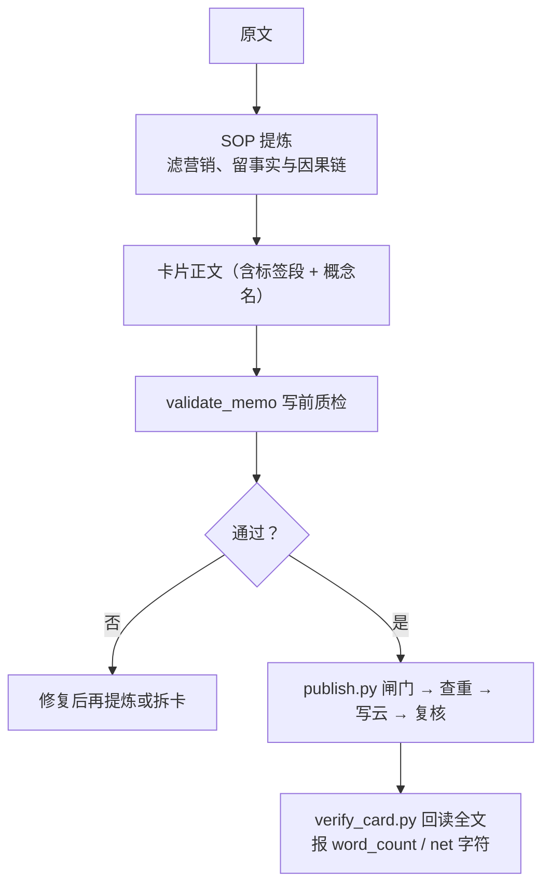
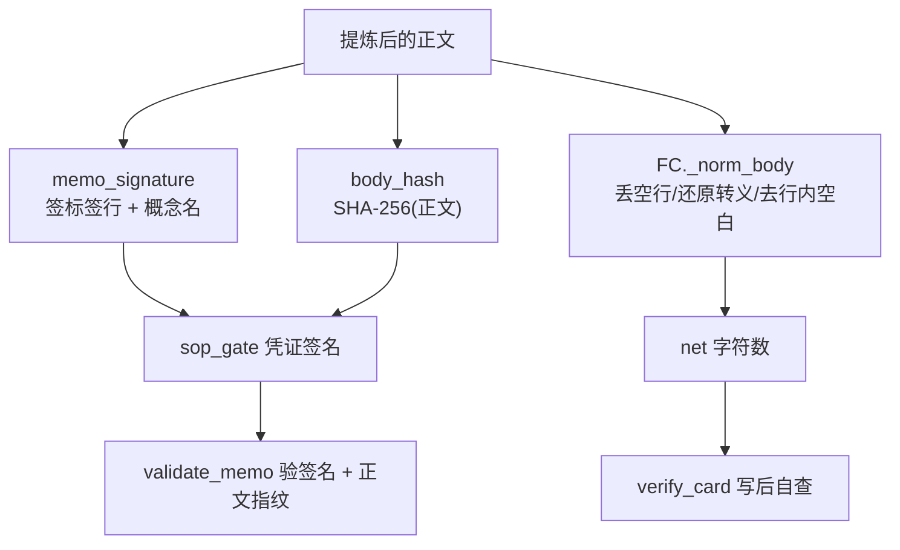
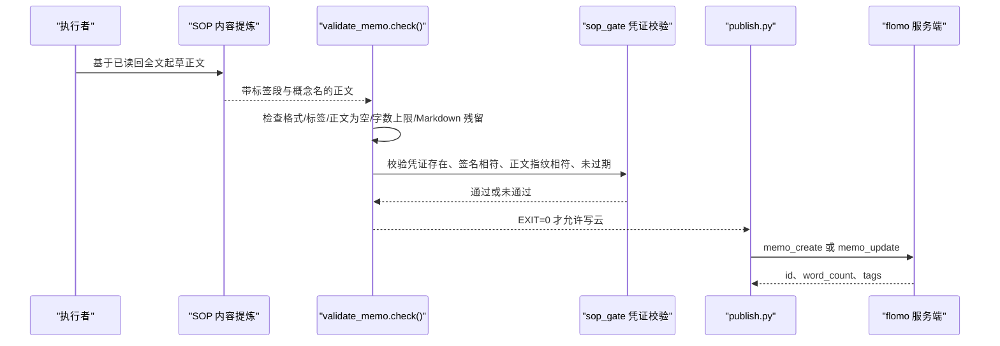

# 3.3 内容提炼

<cite>
**本文引用的文件**   
- [SKILL.md](file://SKILL.md)
- [README.md](file://README.md)
- [scripts/memo_util.py](file://scripts/memo_util.py)
- [scripts/validate_memo.py](file://scripts/validate_memo.py)
- [scripts/publish.py](file://scripts/publish.py)
- [scripts/verify_card.py](file://scripts/verify_card.py)
</cite>

## 目录
1. [引言](#引言)
2. [项目结构定位](#项目结构定位)
3. [核心业务规则](#核心业务规则)
4. [与指纹、净字符数口径的关系](#与指纹净字符数口径的关系)
5. [从提炼到 validate_memo 与 publish 的数据流](#从提炼到-validate_memo-与-publish-的数据流)
6. [长文→单卡、短文→多卡的取舍原则](#长文单卡短文多卡的取舍原则)
7. [字数不足或过长的调整建议](#字数不足或过长的调整建议)
8. [常见陷阱与排查清单](#常见陷阱与排查清单)
9. [结论](#结论)

## 引言
“内容提炼”是 SOP 流程中的第三步：在抓取并验证原文后，把文章转成一张或多张卡片正文。它不是简单缩写，而是按 SKILL 的规则做三层过滤：
- 过滤营销话术、事件叙述、主观评价；
- 保留事实、数据、机制定义、因果链；
- 把“材料本身不是概念”的文章，转换成以某个可独立成立的概念为主体的卡片。

提炼后的文本会进入写前质检 `validate_memo`，再由 `publish.py` 走闸门、查重、建卡/更新、回读复核的一条链。

**章节来源**
- [SKILL.md:60-70](file://SKILL.md#L60-L70)
- [SKILL.md:232-235](file://SKILL.md#L232-L235)
- [SKILL.md:359-360](file://SKILL.md#L359-L360)
- [README.md:62](file://README.md#L62)

## 项目结构定位
“内容提炼”本身是技能执行动作，但它的输出必须满足脚本层的硬限：
- `memo_util.py` 提供卡片签名、正文指纹、标签键、截断占位符等唯一实现；
- `validate_memo.py` 做格式、标签、来源、载体、字数上限等写前检查；
- `publish.py` 串联闸门、质检、云端写入和机器项复核；
- `verify_card.py` 写后回读全文，复用写前校验器，并报告实测字数与净字符数。

**图表来源**
- [SKILL.md:359-360](file://SKILL.md#L359-L360)
- [scripts/validate_memo.py:38-42](file://scripts/validate_memo.py#L38-L42)
- [scripts/publish.py:1-60](file://scripts/publish.py#L1-L60)
- [scripts/verify_card.py:1-40](file://scripts/verify_card.py#L1-L40)

**章节来源**
- [README.md:100-112](file://README.md#L100-L112)

## 核心业务规则
### 一、过滤什么
提炼阶段应主动剔除以下内容：
1. **营销话术**：如“快 X 倍”“行业首个”“全面领先”等横向对比与夸大表述；
2. **事件叙述外壳**：时间线、动机、发布会经过、记者导语；
3. **执行者推算值**：原文没有的数字，不得由执行者换算后当事实写入要点；
4. **评论性分析**：原文没有的归因、启示、方法论，除非原文确为方法论文章且该部分属于事实性说明；
5. **图片载体信息**：H19 要求只提炼图片内容，不记录截图、链接等载体。

这些规则来自 SKILL 对内容边界的约束，尤其是 H13 关于“原文没有的要点一律不写”。

**章节来源**
- [SKILL.md:232-235](file://SKILL.md#L232-L235)
- [SKILL.md:297](file://SKILL.md#L297)
- [SKILL.md:359-360](file://SKILL.md#L359-L360)

### 二、保留什么
提炼后的正文应聚焦：
- 概念的定义、参数、机制；
- 可核查的事实、数据、单位、阈值、覆盖范围；
- 明确的因果关系；
- 若原文是事件报道，则把事件中的关键参数写进要点，但事件时间线和动机不写；
- 若原文是方法论，则提炼方法论本身，而不是“新闻摘要 + 一点启示”。

**章节来源**
- [SKILL.md:232-235](file://SKILL.md#L232-L235)
- [SKILL.md:359-360](file://SKILL.md#L359-L360)

### 三、从“材料不是概念”中提取概念
如果输入是一篇新闻报道、财报、通告或综述，不能直接退回“这不是概念”，而应按 H6c 提取一个能跨切片独立成立的主体，例如：
- 一项技术；
- 一套机制；
- 一种商业模式；
- 一个分类框架；
- 一个工具、模型、定理、协议、架构范式。

概念名仍须遵守 H6b：名词短语、标识对象本身、不含谓语、不含时间/版本/地域等切片限定。

**章节来源**
- [SKILL.md:120-170](file://SKILL.md#L120-L170)

## 与指纹、净字符数口径的关系
“内容提炼”不只是人读层面的写作纪律，还直接影响以下系统级指标：

| 指标 | 计算口径 | 作用 | 提炼阶段的关联 |
|---|---|---|---|
| 卡片签名 | `memo_signature` 取正文前两个非空行：首行标签段 + 第二行概念名 | 幂等查重、闸门凭证依据 | 概念名必须稳定；营销话术不会改变签名，但错误概念名会让签名漂移 |
| 正文指纹 | `body_hash` 对完整正文字符串做 SHA-256 | 防“先跑闸门、后改正文” | 提炼后若再改动正文，指纹变化，闸门凭证失效 |
| 净字符数 | `verify_card.py` 用 `FC._norm_body`：丢空行、还原存储转义、去行内水平空白后取长度 | 写后自查第④项“实测字数”的重要辅助口径 | 提炼时删掉冗余段落会显著影响净字符数 |
| 云端 word_count | 云接口返回字段 | 终端显示与 SKILL 要求的“字数只认实测” | 提炼目标应使 word_count 不超过 `MAX_MEMO_CHARS=20000` |

**图表来源**
- [scripts/memo_util.py:18-55](file://scripts/memo_util.py#L18-L55)
- [scripts/validate_memo.py:962-968](file://scripts/validate_memo.py#L962-L968)
- [scripts/verify_card.py:166-254](file://scripts/verify_card.py#L166-L254)

**章节来源**
- [scripts/memo_util.py:18-55](file://scripts/memo_util.py#L18-L55)
- [scripts/verify_card.py:166-254](file://scripts/verify_card.py#L166-L254)
- [SKILL.md:67-68](file://SKILL.md#L67-L68)

## 从提炼到 validate_memo 与 publish 的数据流
### 写前链路

**图表来源**
- [scripts/validate_memo.py:290-300](file://scripts/validate_memo.py#L290-L300)
- [scripts/validate_memo.py:908-968](file://scripts/validate_memo.py#L908-L968)
- [scripts/publish.py:1-60](file://scripts/publish.py#L1-L60)

### 写后链路
`publish.py` 成功写云后，`verify_card.py` 回读全文并报告：
- 是否被截断；
- 首行是否为完整标签段；
- 第二行是否为概念名；
- 形态检查是否通过；
- 是否存在抽取占位符或检索截断占位符；
- `word_count`、`chars`、`net`、行数；
- 可选地与本地草稿逐字比对。

**章节来源**
- [scripts/verify_card.py:1-40](file://scripts/verify_card.py#L1-L40)
- [scripts/verify_card.py:156-254](file://scripts/verify_card.py#L156-L254)
- [scripts/publish.py:774-791](file://scripts/publish.py#L774-L791)

## 长文→单卡、短文→多卡的取舍原则
### 总原则
- 一张卡只装一个事件、概念、主题或企业；
- 多个各自能独立成立的概念，逐一分卡；
- 同一概念在不同时点的多件事，合并进该概念的同一张卡；
- 不做“新闻摘要 + 一点启示”的汇编卡。

### 长文 → 多卡
适用场景：
- 一篇长文包含多个概念，每个概念都能回答“这是什么/谁”，且不依赖其他概念才能成立；
- 一篇文章同时讲不同产品、不同公司、不同制度、不同技术路径；
- 多个条目型回包，每条都可独立建卡。

处理步骤：
1. 先列概念清单；
2. 对每个概念判断是否符合 H6b；
3. 对每个概念分别写一张卡；
4. 同一概念的多条素材按 H8/H9 合并。

### 短文 → 单卡
适用场景：
- 短消息只围绕一个概念给出少量参数或一次事件；
- 短文不足以支撑多张卡，但仍有可独立成立的对象；
- 短文只有行情数字、人事变动、单方观点，且经 H6c 四类试提后确实提不出概念，则可窄口径退出，但须在收尾中说明原因。

### 示例（抽象描述）
- 一篇长文同时介绍“某模型 v2.1 的参数变化”和“另一模型的定价策略”：拆成两张卡，一张记模型参数，一张记定价模式；
- 一条短通知只说明“某 API 新增某个字段及必填规则”：一张卡即可；
- 一篇报道只说“某公司股价上涨 5%”，且无法提取出可独立成立的技术、机制、商业模式或分类框架：按 H6c 窄口径退出，并在报告中写明理由。

**章节来源**
- [SKILL.md:172-193](file://SKILL.md#L172-L193)
- [SKILL.md:194-260](file://SKILL.md#L194-L260)

## 字数不足或过长的调整建议
### 超过 20000 字
`validate_memo` 的硬限 `MAX_MEMO_CHARS=20000` 是含标签段的字符数上限。超限通常意味着：
- 该拆卡；
- 多个事件混入一张卡；
- 保留了过多事件叙述、背景铺垫或营销话术。

调整建议：
1. 按 H7 拆分多事件；
2. 删除事件时间线、动机、媒体套话；
3. 把重复解释合并到已有卡，新卡只写本次新增事实；
4. 检查是否误把多篇概念揉进一张汇总卡；
5. 若正文过长，优先拆卡而非强行压缩。

**章节来源**
- [scripts/validate_memo.py:38-42](file://scripts/validate_memo.py#L38-L42)
- [scripts/validate_memo.py:290-300](file://scripts/validate_memo.py#L290-L300)
- [SKILL.md:194-200](file://SKILL.md#L194-L200)

### 字数明显偏少
字数偏少不一定是错误，但需要区分两种情况：
1. **原文就短**：可能只够一张小卡，或根本不构成概念；
2. **正文被截断**：检索回包的 `content_truncated=true` 时，字数与结构都不可信，必须先 `memo_batch_get` 重取全文。

调整建议：
- 若原文被截断，不要凭截断内容估算字数，也不要据此决定能否写卡；
- 若原文很短但仍包含一个可独立成立的概念，按 H6c 提取概念后写卡；
- 若经 H6c 四类试提仍无概念，可在收尾中声明“已收到但未写卡 + 理由”；
- 若只是营销话术导致“看起来短但实际没信息量”，应删除话术后重新评估。

**章节来源**
- [SKILL.md:67-68](file://SKILL.md#L67-L68)
- [SKILL.md:219-235](file://SKILL.md#L219-L235)
- [scripts/verify_card.py:125-166](file://scripts/verify_card.py#L125-L166)

## 常见陷阱与排查清单
| 问题 | 表现 | 排查位置 | 处理建议 |
|---|---|---|---|
| 提炼后正文又改 | 闸门凭证正文指纹不符 | `validate_memo` 正文指纹检查 | 重新跑 `sop_gate`，再生成新凭证 |
| 概念名不稳定 | 签名变化、查重失败 | `memo_signature`、`slice_qualifiers` | 去掉时间、版本、地域、谓语等切片 |
| 正文中段缺失 | 出现 `[此处省略 N 字]` | `find_truncation`、`verify_card` | 用 `memo_batch_get` 重取全文，不凭检索快照写卡 |
| 净字符数异常 | `chars`、`net`、`word_count` 不一致 | `verify_card.py` 字数对账 | 使用 `FC._norm_body` 口径理解差异，不要手工凑数字 |
| Markdown 残留 | 加粗、斜体、代码块、HTML 标签报错 | `validate_memo` 格式检查 | 改为纯文本，靠结构与句式表达强调 |
| 长文未拆卡 | 超 20000 字 | `validate_memo` 字数上限 | 按 H7 拆卡，而不是继续压缩 |
| 短文误判为不值得写 | 只报“内容单薄” | H6c 窄口径退出 | 先按四类概念试提，仍无概念才退出并报告理由 |

**章节来源**
- [scripts/memo_util.py:18-55](file://scripts/memo_util.py#L18-L55)
- [scripts/memo_util.py:201-347](file://scripts/memo_util.py#L201-L347)
- [scripts/validate_memo.py:270-340](file://scripts/validate_memo.py#L270-L340)
- [scripts/validate_memo.py:962-968](file://scripts/validate_memo.py#L962-L968)
- [scripts/verify_card.py:125-254](file://scripts/verify_card.py#L125-L254)

## 结论
“内容提炼”在 SOP 中承担的是**语义净化**角色：把外部文章的叙事外壳、营销包装和无关载体剥掉，只留下可独立成立的概念及其事实层。它不仅是写作技巧，更是后续所有机械检查的前置条件——概念名不稳，签名就不稳；正文再改，指纹就对不上；内容膨胀，就会突破 20000 字上限；内容被截断，字数和结构就全不可信。

因此，提炼阶段应坚持三条底线：
1. 先读回全文，不凭截断内容决策；
2. 先列概念清单，再决定长文拆卡或短文单卡；
3. 只保留事实、数据与因果链，不替原文补分析、不加营销倍数。

提炼完成后，让 `validate_memo` 和 `publish.py` 承担格式、字数、闸门凭证与写云安全，`verify_card.py` 承担写后回读与字数口径核对，形成人读与机判互补的闭环。