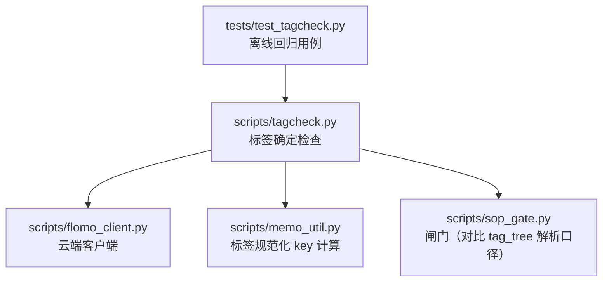
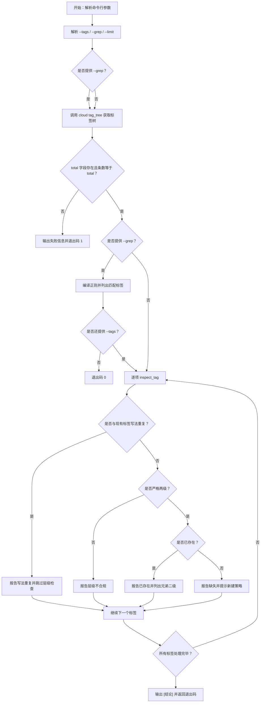
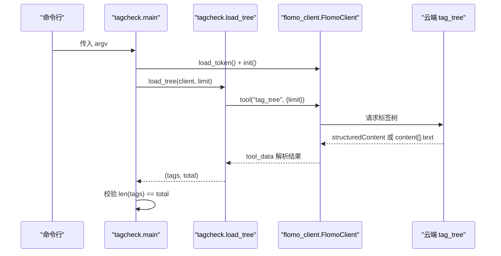
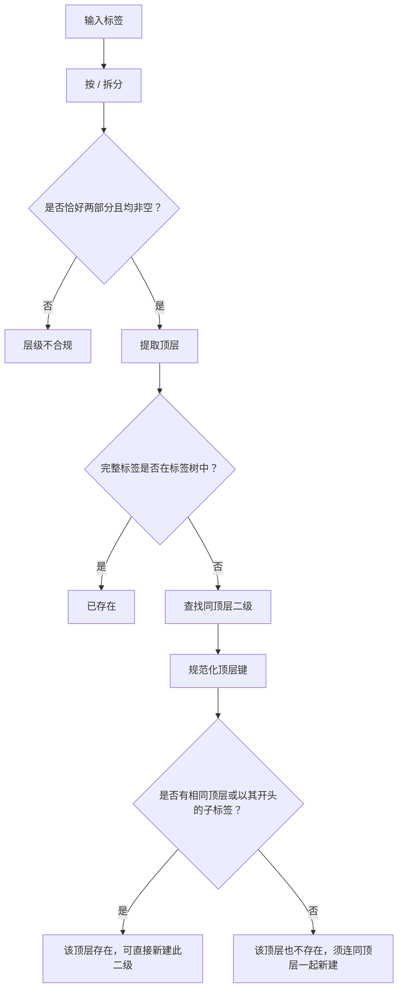
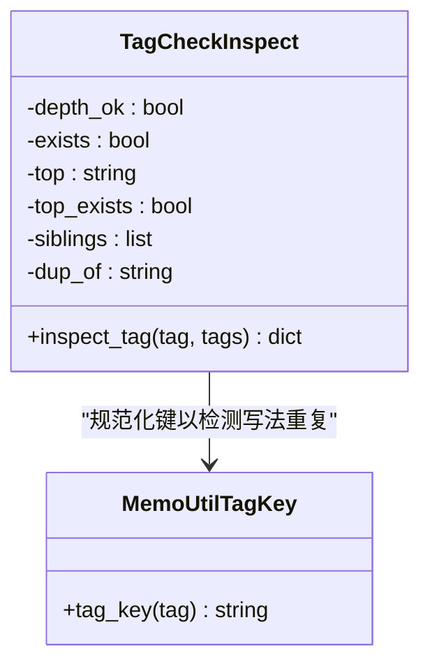
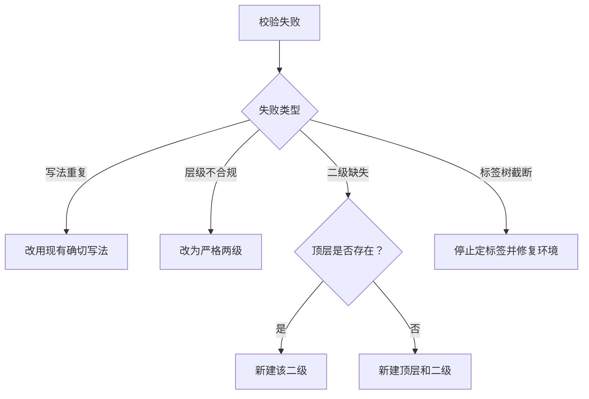

# 3.4 标签确定（tagcheck）

<cite>
**本文引用的文件**   
- [scripts/tagcheck.py](file://scripts/tagcheck.py)
- [tests/test_tagcheck.py](file://tests/test_tagcheck.py)
- [scripts/memo_util.py](file://scripts/memo_util.py)
- [scripts/flomo_client.py](file://scripts/flomo_client.py)
- [scripts/sop_gate.py](file://scripts/sop_gate.py)
</cite>

## 目录
1. [引言](#引言)
2. [项目结构中的位置](#项目结构中的位置)
3. [核心职责与输出约定](#核心职责与输出约定)
4. [命令行参数](#命令行参数)
5. [执行流程总览](#执行流程总览)
6. [标签树现采与缓存语义](#标签树现采与缓存语义)
7. [两级校验、兄弟二级与存在性判断](#两级校验兄弟二级与存在性判断)
8. [写法重复与 memo_util 一致性](#写法重复与-memo_util-一致性)
9. [失败模式与安全回退](#失败模式与安全回退)
10. [退出码与可观测输出](#退出码与可观测输出)
11. [常见使用场景与命令示例](#常见使用场景与命令示例)
12. [故障排查](#故障排查)
13. [结论](#结论)

## 引言
`tagcheck.py` 是标签确定流程中的“第 4 步”：在真正写入笔记首行标签之前，先向云端调用 `tag_tree` 工具拉取当前标签树，再对拟使用的标签做严格校验。它要解决的核心问题是：

- 防止漏掉已有二级标签，导致同顶层下出现近义簇。
- 强制标签遵循“严格两级”规则。
- 把“只差空白、全半角斜杠或大小写”的写法视为同一标签，避免云端按字面创建分裂簇。
- 提供只读检查能力：不新建、不修改任何标签。

该脚本依赖云端接口，因此每次运行都会发起一次 `tag_tree` 请求；它本身没有本地持久化缓存文件。

**章节来源**
- [scripts/tagcheck.py:1-45](file://scripts/tagcheck.py#L1-L45)

## 项目结构中的位置
`tagcheck.py` 位于 `scripts/` 目录，与其他数据处理脚本并列。它由以下模块协作完成工作：

**图表来源**
- [scripts/tagcheck.py:1-45](file://scripts/tagcheck.py#L1-L45)
- [tests/test_tagcheck.py:1-30](file://tests/test_tagcheck.py#L1-L30)

**章节来源**
- [scripts/tagcheck.py:1-45](file://scripts/tagcheck.py#L1-L45)
- [tests/test_tagcheck.py:1-30](file://tests/test_tagcheck.py#L1-L30)

## 核心职责与输出约定
`tagcheck.py` 的职责可以概括为“三查一列”：

| 校验项 | 含义 | 不通过时的行为 |
|---|---|---|
| 层级校验 | 标签必须恰好为“顶层/二级”，不能是单层、三级或多级 | 标记为不可直接使用，并提示“须严格两级” |
| 存在性校验 | 若目标标签已存在于标签树中，则允许复用 | 不存在时给出“可直接新建二级”或“须连同顶层一起新建”的提示 |
| 写法重复校验 | 忽略空白、全半角斜杠、大小写后与现有标签相同 | 直接报错，要求改回现有写法，不再建议新建 |
| 兄弟二级列出 | 列出同顶层下的其他二级标签，帮助判断应复用还是新建更精准二级 | 最多显示固定数量，超出部分以省略形式提示 |

输出不是结构化数据，而是面向人读的逐行日志，包括：

- `[标签树] …`：本次读取到的标签总数与 limit。
- `[匹配] …`：仅在使用 `--grep` 时出现，列出正则匹配的现有标签。
- `✓` 行：标签已存在且合规。
- `✗` 行：标签缺失、层级不合规或写法重复。
- `   同顶层二级：…`：兄弟二级提示。
- `[结论] …`：最终汇总与退出码依据。

**章节来源**
- [scripts/tagcheck.py:1-45](file://scripts/tagcheck.py#L1-L45)
- [scripts/tagcheck.py:140-201](file://scripts/tagcheck.py#L140-L201)

## 命令行参数
脚本通过统一选项解析器处理参数，错误参数会由入口包装成一行提示，而不是打印 Python traceback。

| 参数 | 类型 | 默认值 | 说明 |
|---|---|---:|---|
| `--tags` | 字符串 | 空 | 需要校验的一个或多个标签；多个标签用英文逗号分隔；支持中文逗号、顿号；可带或不带前导 `#` |
| `--grep` | 正则表达式 | 无 | 只列出匹配的现有标签，不做“是否可用”判定；空字符串会被拒绝 |
| `--limit` | 正整数 | `2000` | 限制 `tag_tree` 返回条数；过小会导致截断检测误报 |

关键行为约束：

- `--tags` 内部会把中文逗号、顿号都转为英文逗号，再拆分去重。
- 每个标签会去掉前导 `#` 和两端空白。
- `--grep` 为空时会主动报错，因为“命中全部标签”不构成有效证据。
- `--limit` 必须是大于等于 1 的整数；非法值会触发用法错误。
- 未同时提供 `--tags` 或 `--grep` 时会报错。

**章节来源**
- [scripts/tagcheck.py:28-45](file://scripts/tagcheck.py#L28-L45)
- [scripts/tagcheck.py:140-173](file://scripts/tagcheck.py#L140-L173)
- [tests/test_tagcheck.py:201-247](file://tests/test_tagcheck.py#L201-L247)

## 执行流程总览
下图展示了从命令行到云端标签树、再到逐项校验的主要控制流：

**图表来源**
- [scripts/tagcheck.py:28-45](file://scripts/tagcheck.py#L28-L45)
- [scripts/tagcheck.py:60-138](file://scripts/tagcheck.py#L60-L138)
- [scripts/tagcheck.py:140-201](file://scripts/tagcheck.py#L140-L201)

**章节来源**
- [scripts/tagcheck.py:60-138](file://scripts/tagcheck.py#L60-L138)
- [scripts/tagcheck.py:140-201](file://scripts/tagcheck.py#L140-L201)

## 标签树现采与缓存语义
### 现采机制
`load_tree` 通过 `FlomoClient.tool("tag_tree", {"limit": limit})` 获取云端标签树，并使用 `flomo_client.tool_data` 解析回包。它会读取 `structuredContent.tags` 与 `structuredContent.total`，同时也兼容云端可能只返回 `content[].text` 中包含 JSON 的情况。

### 截断保护
脚本要求返回数组长度等于 `total`；不相等即认为标签树被截断，立即抛出运行时错误，主流程捕获后输出失败信息并返回退出码 1。

### 缓存语义
`tagcheck.py` **自身不提供本地缓存**。每次运行都会重新调用 `tag_tree`。这意味着：

- 它反映的是调用时刻的云端标签树状态。
- 不适合用于高频批量调用场景中的“长期缓存”。
- 如果希望减少网络开销，应在上层实现缓存；但需注意云端标签树变化后的失效策略。
- 测试中使用 `FakeClient` 模拟云端响应，因此离线测试不需要真实网络。

**图表来源**
- [scripts/tagcheck.py:46-79](file://scripts/tagcheck.py#L46-L79)
- [scripts/tagcheck.py:140-162](file://scripts/tagcheck.py#L140-L162)
- [tests/test_tagcheck.py:32-62](file://tests/test_tagcheck.py#L32-L62)

**章节来源**
- [scripts/tagcheck.py:46-79](file://scripts/tagcheck.py#L46-L79)
- [scripts/tagcheck.py:140-162](file://scripts/tagcheck.py#L140-L162)
- [tests/test_tagcheck.py:32-62](file://tests/test_tagcheck.py#L32-L62)
- [tests/test_tagcheck.py:108-162](file://tests/test_tagcheck.py#L108-L162)

## 两级校验、兄弟二级与存在性判断
### 层级校验
标签必须满足“严格两级”：

- 正好包含一个 `/`。
- 顶层和二级都不能为空。
- 不符合时被视为“层级不合规”，退出码 2。

### 存在性判断
存在性判断分为两层：

1. 完整标签是否存在于标签树中。
2. 若不存在，判断“顶层是否存在”：只要标签树中存在与顶层键相同的条目，或其子路径以该顶层键开头，就认为顶层存在。

顶层存在性比较使用 `memo_util.tag_key` 进行规范化，避免因大小写差异而误判顶层不存在。

### 兄弟二级
对于某个顶层，脚本会从标签树中筛选出：

- 不等于目标标签；
- 以“顶层/”开头；
- 恰好只有一个 `/`（即也是叶子形态）。

这些就是“同顶层二级”。它们用于帮助判断：

- 是否应该复用已有二级。
- 是否需要新建更精准的二级。
- 是否真的需要新建顶层。

**图表来源**
- [scripts/tagcheck.py:81-138](file://scripts/tagcheck.py#L81-L138)
- [scripts/tagcheck.py:174-201](file://scripts/tagcheck.py#L174-L201)

**章节来源**
- [scripts/tagcheck.py:81-138](file://scripts/tagcheck.py#L81-L138)
- [scripts/tagcheck.py:174-201](file://scripts/tagcheck.py#L174-L201)
- [tests/test_tagcheck.py:64-106](file://tests/test_tagcheck.py#L64-L106)

## 写法重复与 memo_util 一致性
### 什么是写法重复
“写法重复”指两个标签在以下方面不同，但在业务意义上属于同一个键：

- 空白字符位置不同。
- 斜杠是全角还是半角。
- 字母大小写不同。

这类差异不会让云端把它们当成同一个簇；云端会按字面写入，从而产生“分裂簇”。

### 与 memo_util 的一致性
`tagcheck.py` 显式导入 `memo_util.tag_key`，并在 `inspect_tag` 中用它计算规范化键。这是为了与“第 ⑧ 步写前闸门”保持一致：如果这里放行了写法重复的标签，后续闸门仍会拦截，用户就会反复回到第 4 步修正。

测试中覆盖了三种典型写法重复：

| 名称 | 示例标签 | 期望行为 |
|---|---|---|
| 斜杠两侧空格 | `AI / Agent` | 报写法重复，指出应改回现有写法 |
| 全角斜杠 | `AI／Agent` | 报写法重复，不报层级不合规 |
| 大小写差异 | `ai/agent` | 报写法重复 |

**图表来源**
- [scripts/tagcheck.py:81-138](file://scripts/tagcheck.py#L81-L138)
- [scripts/memo_util.py](file://scripts/memo_util.py)

**章节来源**
- [scripts/tagcheck.py:81-138](file://scripts/tagcheck.py#L81-L138)
- [tests/test_tagcheck.py:164-188](file://tests/test_tagcheck.py#L164-L188)

## 失败模式与安全回退
### 失败分类
`tagcheck.py` 的失败可以分为三类：

| 类别 | 触发条件 | 退出码 | 是否安全 |
|---|---|---:|---|
| 标签树不可信 | 云端返回缺少 `total`，或返回条数小于 `total` | 1 | 不安全：不应基于此结果写标签 |
| 标签校验失败 | 标签缺失、层级不合规、写法重复 | 2 | 安全：阻止直接写入 |
| 参数错误 | `--tags`、`--grep`、`--limit` 使用不当 | 2 | 安全：阻止执行 |

### 安全回退策略
当校验失败时，不应直接把原始标签写入笔记首行。推荐回退顺序如下：

1. **写法重复**：改为标签树中已有的确切写法。
2. **层级不合规**：改为严格的“顶层/二级”形式。
3. **二级不存在但顶层存在**：确认是否已有更合适的二级；若无，则新建该二级。
4. **顶层也不存在**：先确认顶层是否正确，再决定顶层与二级是否都要新建。
5. **标签树截断或云端失败**：不要继续定标签；修复 limit、权限或云端问题后重试。

[本图为概念流程图，不对应具体代码片段]

**章节来源**
- [scripts/tagcheck.py:140-201](file://scripts/tagcheck.py#L140-L201)
- [tests/test_tagcheck.py:108-162](file://tests/test_tagcheck.py#L108-L162)

## 退出码与可观测输出
| 退出码 | 含义 | 典型原因 |
|---:|---|---|
| 0 | 成功 | 所有 `--tags` 均已存在且严格两级，无写法重复；或仅使用 `--grep` 且无需 `--tags` |
| 1 | 标签树不可信 | 云端返回缺少 `total`，或返回条数与 `total` 不一致 |
| 2 | 标签不可直接使用或参数错误 | 标签缺失、层级不合规、写法重复、`--grep` 为空、`--limit` 非法、参数写错 |

可观测输出要点：

- 标签树加载成功后会打印 `[标签树] N 个（limit=…，条数与 total 相符）`。
- `--grep` 模式会打印 `[匹配] 正则「…」命中 N 个`，并列出最多 60 个匹配标签。
- 每个待检标签会输出 `✓` 或 `✗` 行。
- 兄弟二级最多显示 12 个，多余部分以省略提示显示。
- 最后会输出 `[结论] …` 行，作为人类快速判断依据。

**章节来源**
- [scripts/tagcheck.py:28-45](file://scripts/tagcheck.py#L28-L45)
- [scripts/tagcheck.py:140-201](file://scripts/tagcheck.py#L140-L201)
- [tests/test_tagcheck.py:64-106](file://tests/test_tagcheck.py#L64-L106)
- [tests/test_tagcheck.py:189-247](file://tests/test_tagcheck.py#L189-L247)

## 常见使用场景与命令示例
以下示例描述命令意图，不展示具体输出内容。实际命令应与仓库中测试用例的行为一致。

### 新增顶级标签
适用情况：你准备引入一个新的顶层分类，例如“知识管理”，并为其添加第一个二级标签。

步骤：

1. 先用 `--grep` 搜索，确认标签树中没有相近的顶层。
2. 再用 `--tags` 指定完整的“顶层/二级”标签。
3. 看到“该顶层也不存在，须连同顶层一起新建”时，说明顶层和二级都需要新建。
4. 确认后，由下游流程创建顶层与二级标签。

示例命令：

- `python scripts/tagcheck.py --grep "知识管理"`
- `python scripts/tagcheck.py --tags "知识管理/卡片"`

### 添加二级标签
适用情况：顶层已存在，你想增加一个新二级标签。

步骤：

1. 使用 `--tags` 指定“顶层/新二级”。
2. 如果输出“该顶层存在，可直接新建此二级”，说明可以直接新建。
3. 如果输出“该顶层也存在，可直接新建此二级”之外的信息，请根据兄弟二级列表判断是否应复用已有二级。

示例命令：

- `python scripts/tagcheck.py --tags "AI/评测"`
- `python scripts/tagcheck.py --grep "AI" --tags "AI/评测"`

### 修正错误标签
适用情况：标签存在，但写法不规范，比如多了空格、用了全角斜杠或大小写不一致。

步骤：

1. 运行 `tagcheck.py`。
2. 看到“与现有『…』只差空白/全半角/大小写”时，直接复制现有写法。
3. 不要按“层级不合规”的提示改成任意格式；应先处理写法重复。

示例命令：

- `python scripts/tagcheck.py --tags "AI / Agent"`
- `python scripts/tagcheck.py --tags "AI／Agent"`
- `python scripts/tagcheck.py --tags "ai/agent"`

### 仅搜索现有标签
适用情况：不确定标签名，只想看看云端有哪些相关标签。

示例命令：

- `python scripts/tagcheck.py --grep "多语言|本地化"`

注意：`--grep` 找不到匹配项不代表“没有这个簇”，只能说明当前正则没命中；仍需按 H18 规则判断是否新建。

**章节来源**
- [scripts/tagcheck.py:1-45](file://scripts/tagcheck.py#L1-L45)
- [scripts/tagcheck.py:140-201](file://scripts/tagcheck.py#L140-L201)
- [tests/test_tagcheck.py:64-106](file://tests/test_tagcheck.py#L64-L106)
- [tests/test_tagcheck.py:164-200](file://tests/test_tagcheck.py#L164-L200)

## 故障排查
### 退出码 1：标签树被截断或调用失败
现象：

- 标准错误中出现“标签树被截断”或“回包缺 total 字段”。
- 标准输出可能没有正常的逐标签检查结果。

可能原因：

- `--limit` 太小，导致 `len(tags) != total`。
- 云端返回了不完整数据。
- 云端返回了 `isError` 或其他异常结构，导致解析失败。

处理建议：

- 增大 `--limit` 并重试。
- 检查云端 token、权限和网络。
- 不要把这次结果当作“标签树为空”。

**章节来源**
- [scripts/tagcheck.py:46-79](file://scripts/tagcheck.py#L46-L79)
- [scripts/tagcheck.py:140-162](file://scripts/tagcheck.py#L140-L162)
- [tests/test_tagcheck.py:108-162](file://tests/test_tagcheck.py#L108-L162)

### 退出码 2：标签不可直接使用
现象：

- 输出包含 `✗` 行。
- 最后 `[结论]` 行提示有若干标签不可直接用。

可能原因：

- 标签缺失。
- 层级不是严格两级。
- 写法与现有标签重复。
- 命令行参数错误。

处理建议：

- 按每行提示修改标签。
- 写法重复优先处理，再处理层级。
- 参数错误时查看一行错误提示，不要只看退出码。

**章节来源**
- [scripts/tagcheck.py:174-201](file://scripts/tagcheck.py#L174-L201)
- [tests/test_tagcheck.py:201-247](file://tests/test_tagcheck.py#L201-L247)

### 为什么 `--grep` 找不到也要谨慎新建
`--grep` 只是匹配工具，不是存在性证明。找不到匹配项可能有多种原因：

- 正则写错了。
- 标签名确实不同。
- 大小写或写法差异导致未命中。

因此脚本在无匹配时会明确提示：不要根据“搜不到”就直接建一个近义簇。

**章节来源**
- [scripts/tagcheck.py:1-45](file://scripts/tagcheck.py#L1-L45)
- [tests/test_tagcheck.py:148-162](file://tests/test_tagcheck.py#L148-L162)

## 结论
`tagcheck.py` 是标签确定流程中的关键只读检查环节。它通过现采云端标签树，强制执行“严格两级”“兄弟二级可见”“写法重复拦截”和“存在性提示”四重保障，避免人工肉眼扫描标签树时遗漏已有二级，也避免把同一标签的不同写法写成多个簇。

使用时应记住三条原则：

1. 始终先运行 `tagcheck.py`，再决定是否新建标签。
2. 遇到写法重复，直接改用标签树中的现有写法。
3. 遇到标签树截断或云端失败，不要继续定标签，先恢复可信任的标签树。

**章节来源**
- [scripts/tagcheck.py:1-45](file://scripts/tagcheck.py#L1-L45)
- [scripts/tagcheck.py:140-201](file://scripts/tagcheck.py#L140-L201)
- [tests/test_tagcheck.py:1-30](file://tests/test_tagcheck.py#L1-L30)