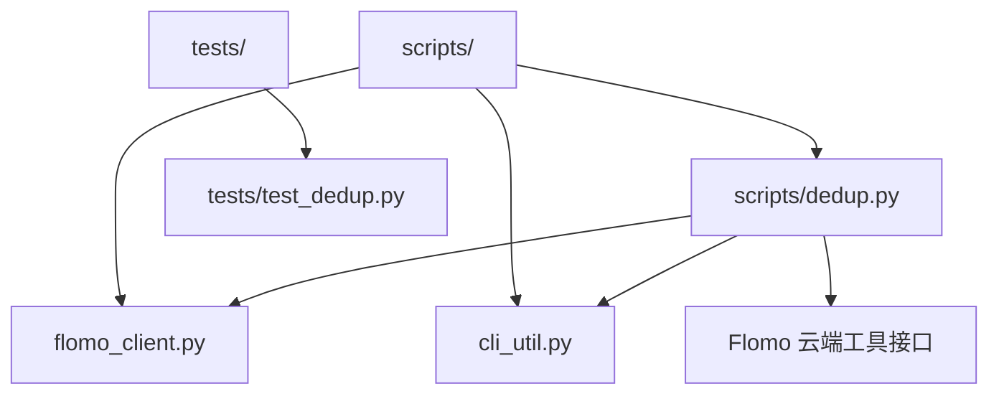
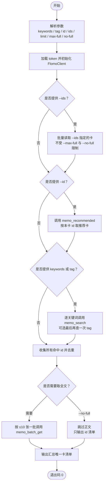
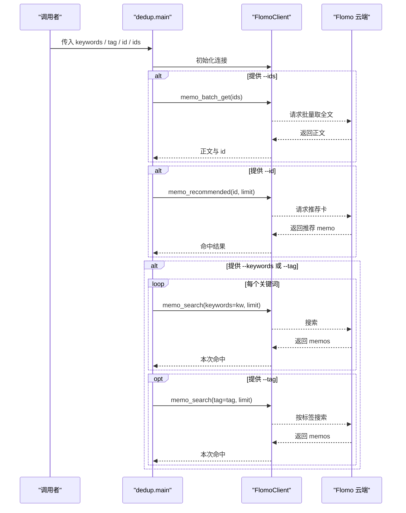
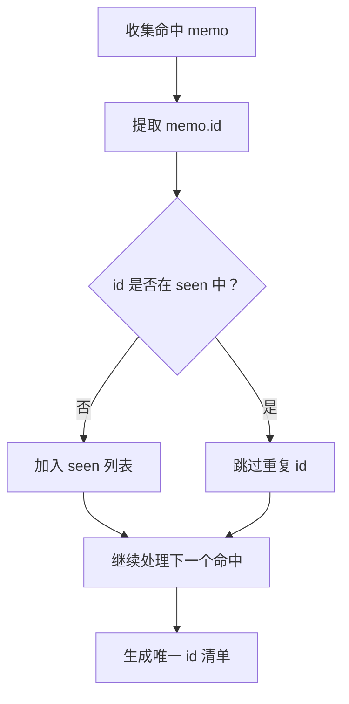
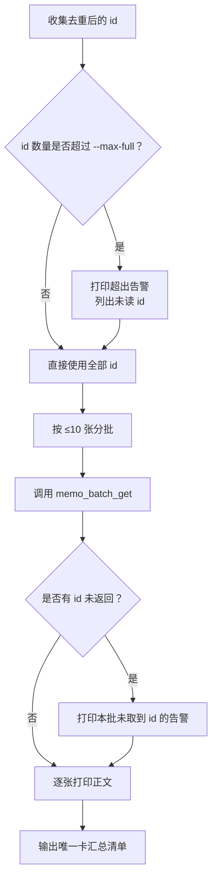
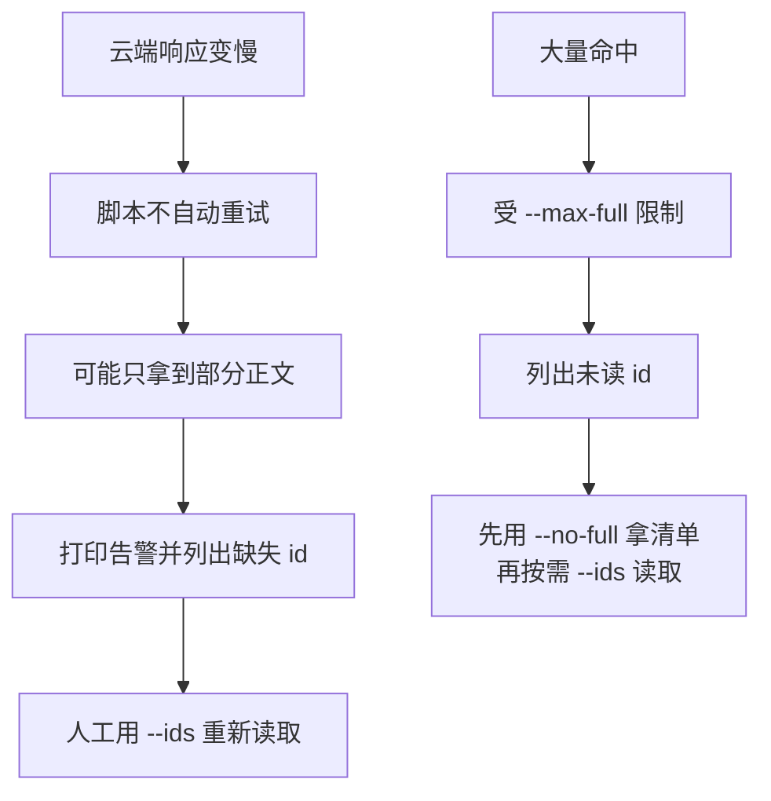
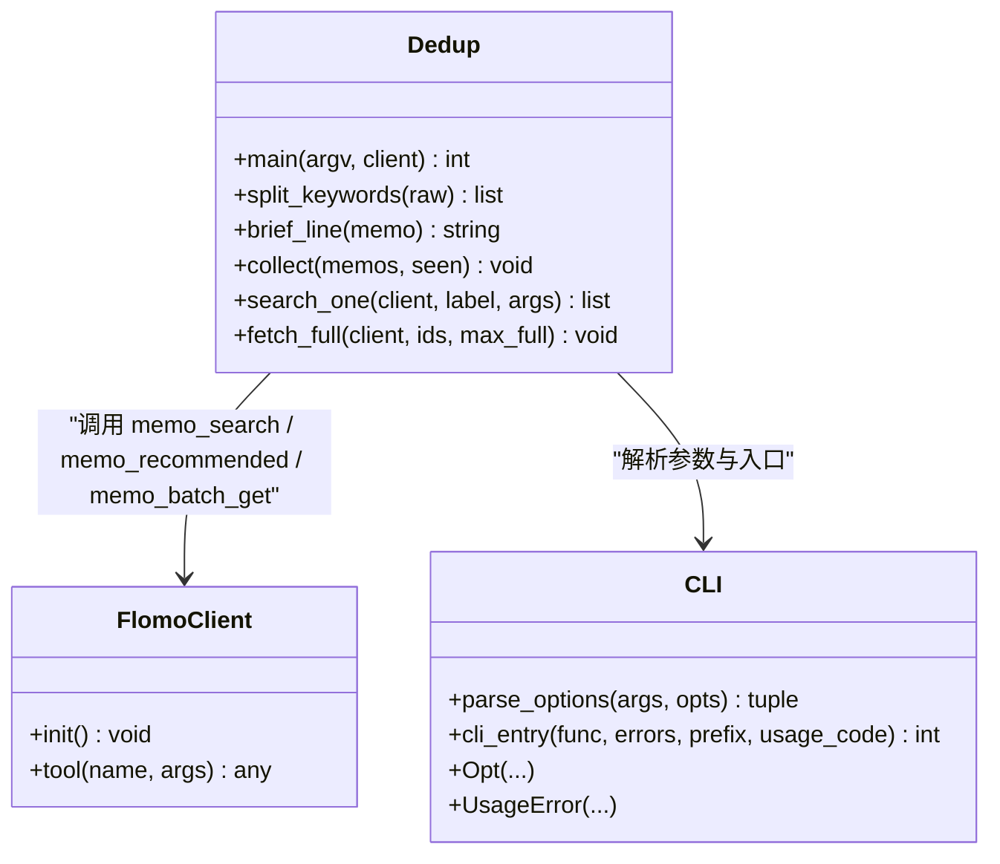

# 3.5 查重（dedup）

<cite>
**本文引用的文件**   
- [scripts/dedup.py](file://scripts/dedup.py)
- [tests/test_dedup.py](file://tests/test_dedup.py)
</cite>

## 目录
1. [简介](#简介)
2. [项目结构中的位置](#项目结构中的位置)
3. [核心机制总览](#核心机制总览)
4. [输入清单与参数](#输入清单与参数)
5. [关键词提取规则](#关键词提取规则)
6. [两路查重流程](#两路查重流程)
7. [同主标签比对策略](#同主标签比对策略)
8. [重复判定阈值与去重逻辑](#重复判定阈值与去重逻辑)
9. [分批取全文与输出报告](#分批取全文与输出报告)
10. [三类场景命令示例](#三类场景命令示例)
11. [高延迟、分页失败与批量性能处理](#高延迟分页失败与批量性能处理)
12. [依赖关系与架构](#依赖关系与架构)
13. [故障排查](#故障排查)
14. [结论](#结论)

## 简介
`scripts/dedup.py` 是 Flomo 工作流中“查重与近邻复查”的自动化执行器，对应文档流程的第 5 步和第 8 步。它的核心目标是避免人工抄写 memo id 导致指向错误卡片，并通过程序化方式完成：

- 对每个关键词单独调用一次 `memo_search`；
- 可选地对指定标签再调用一次检索；
- 对所有命中卡按 id 去重；
- 自动分批调用 `memo_batch_get` 取正文；
- 汇总唯一 id 清单，供后续复盘或人工判断是否属于同一事件。

脚本明确不替代业务判断：命中卡是否与当前卡片描述同一事件，仍由调用方根据 H8 读取正文后决定。

## 项目结构中的位置
该脚本位于仓库根目录下的 `scripts/` 中，并配套有离线回归测试 `tests/test_dedup.py`。测试使用假客户端验证关键机械口径：每关键词单独调用、id 去重、batch 不超过 10、失败不等于无命中等。



**图示来源**
- [scripts/dedup.py:1-40](file://scripts/dedup.py#L1-L40)
- [tests/test_dedup.py:1-40](file://tests/test_dedup.py#L1-L40)

**章节来源**
- [scripts/dedup.py:1-40](file://scripts/dedup.py#L1-L40)
- [tests/test_dedup.py:1-20](file://tests/test_dedup.py#L1-L20)

## 核心机制总览
脚本实现的是“两路查重 + id 去重 + 分批取全文”的组合流程：

| 路径 | 触发条件 | 调用的工具 | 主要目的 |
|---|---|---|---|
| 关键词路 | 提供 `--keywords` 或 `--tag` | `memo_search` | 按关键词或标签查找候选卡 |
| 复盘路 | 提供 `--id` | `memo_recommended` | 以本卡 id 定向推荐可能相关卡 |
| 点名读 | 提供 `--ids` | `memo_batch_get` | 直接读取指定 id 的正文 |
| 去重后取正文 | 存在未显式点名的命中 id | `memo_batch_get` | 按 ≤10 张一批取全文 |

流程图如下：



**图示来源**
- [scripts/dedup.py:41-80](file://scripts/dedup.py#L41-L80)
- [scripts/dedup.py:81-140](file://scripts/dedup.py#L81-L140)
- [scripts/dedup.py:141-220](file://scripts/dedup.py#L141-L220)

## 输入清单与参数
脚本通过命令行参数接收输入，而不是读取外部清单文件。主要参数如下：

| 参数 | 类型 | 默认值 | 含义 |
|---|---|---:|---|
| `--keywords` | 字符串 | 空 | 多个关键词用半角逗号、全角逗号、顿号、分号或换行分隔 |
| `--tag` | 字符串 | 空 | 按标签查询，作为关键词路的补充检索 |
| `--id` | 字符串 | 空 | 复盘模式：以本卡 id 调用 `memo_recommended` |
| `--ids` | 字符串 | 空 | 点名读取这些 id 的全文，支持逗号分隔 |
| `--limit` | 整数 | 10 | 每次 `memo_search` 返回的最大结果数 |
| `--max-full` | 整数 | 8 | 自动分批取全文时的卡片数量上限 |
| `--no-full` | 标志 | 否 | 不取正文，只输出命中 id 清单 |

注意事项：

- `--keywords`、`--tag`、`--id`、`--ids` 至少提供一个，否则报 `UsageError`。
- `--id` 与 `--keywords`/`--tag` 可同时提供，脚本会同时跑两路，不再静默吞掉关键词路。
- `--ids` 点名的卡始终取全文，即使传入 `--no-full` 或把 `--max-full` 设为很小。
- `--limit` 控制每次搜索返回的数量，但不等于最终去重后的总量。
- `--max-full` 控制自动取全文的上限，超出部分不会静默丢弃，而是列出未读 id。

**章节来源**
- [scripts/dedup.py:41-80](file://scripts/dedup.py#L41-L80)
- [scripts/dedup.py:141-180](file://scripts/dedup.py#L141-L180)

## 关键词提取规则
`split_keywords` 负责把原始关键词字符串拆成独立关键词列表。规则如下：

1. 先统一替换：全角逗号、顿号、分号、半角分号都转为半角逗号。
2. 按半角逗号分割。
3. 去除首尾空白。
4. 忽略空项。
5. 保持顺序去重：同一个关键词第一次出现保留，后续重复项丢弃。

这意味着：

- `"智能体,agent,工具契约"` 会被拆为三个关键词。
- `"甲、乙；丙"` 也会被识别为三个关键词。
- `"甲, 甲"` 只会保留一个 `"甲"`。
- 换行也可以作为分隔符，因为换行会在后续替换和分割过程中被当作普通文本参与拆分。

复杂度分析：

- 时间复杂度：`O(n)`，其中 `n` 是原始字符串长度。字符串替换、分割、遍历都是线性操作。
- 空间复杂度：`O(k)`，其中 `k` 是唯一关键词数量。`out` 列表存储去重后的结果。

**章节来源**
- [scripts/dedup.py:41-60](file://scripts/dedup.py#L41-L60)

## 两路查重流程
### 关键词路
当提供 `--keywords` 时，脚本会对每个关键词分别调用一次 `memo_search`。如果还提供了 `--tag`，则在所有关键词之后再追加一次按标签的检索。

关键行为：

- 每次调用都会打印一行带序号的结果摘要，例如“关键词 1/3：甲”。
- 每次搜索结果单独打印，不会被合并成一张大表。
- 每次返回的 memo id 会被收集到 `seen` 列表中，并按首次出现顺序保留。
- 如果某次检索没有命中，会打印“（无命中）”，但不会中断整体流程。

### 复盘路
当提供 `--id` 时，脚本调用 `memo_recommended`，参数为该 memo id 和 `--limit`。这用于复盘场景，比如从已推荐卡集中检查是否存在重复。

注意：

- `memo_recommended` 不是关键词检索，它依赖服务端基于 id 的推荐逻辑。
- 推荐结果也会计入去重集合。

### 两路并行语义
虽然代码里是顺序执行，但从语义上看，关键词路和复盘路各自独立：

1. 如果同时提供 `--id` 和 `--keywords`，两路都会执行。
2. 所有命中的 id 最终进入同一个 `seen` 集合。
3. id 去重发生在关键词路、复盘路、以及显式 `--ids` 之间。



**图示来源**
- [scripts/dedup.py:81-140](file://scripts/dedup.py#L81-L140)
- [scripts/dedup.py:141-220](file://scripts/dedup.py#L141-L220)

**章节来源**
- [scripts/dedup.py:81-140](file://scripts/dedup.py#L81-L140)
- [scripts/dedup.py:141-200](file://scripts/dedup.py#L141-L200)

## 同主标签比对策略
脚本**没有实现**基于标签名称的自定义比对算法。所谓“同主标签比对”，在当前实现中表现为：

- 如果提供 `--tag`，脚本会把该标签作为一个独立的关键词路查询。
- 如果某个关键词恰好匹配了某个 memo 的标签字段，那么 `memo_search` 也可能返回该 memo。
- 最终去重只按 id，不按标签名称做二次过滤。

因此，不要期望脚本能回答“两个不同标签下是否属于同一主标签”这类语义问题。标签只是检索入口之一。

实际比对逻辑集中在 id 层：

- 所有命中卡的 id 加入 `seen`。
- `collect` 函数保证 id 不重复。
- 最终汇总输出的是唯一 id 数量与 id 列表。

如果需要按主标签做更复杂的去重或分组，应在脚本之外进行，或由调用方在拿到 id 清单后自行处理。

**章节来源**
- [scripts/dedup.py:61-80](file://scripts/dedup.py#L61-L80)
- [scripts/dedup.py:141-180](file://scripts/dedup.py#L141-L180)

## 重复判定阈值与去重逻辑
### id 去重
脚本使用 `seen` 列表保存所有命中的 id，并在添加前检查是否已存在。这意味着：

- 重复 id 不会重复计数。
- 跨关键词的重复 id 只取一次正文。
- 复盘路与关键词路共享同一个 id 集合。

测试用例验证了这一点：相同 id 出现在多个关键词结果中时，`memo_batch_get` 的总调用次数只包含该 id 一次。

### 是否实现相似度阈值？
脚本**没有实现**关键词相似度阈值、编辑距离阈值、语义向量阈值或内容重合率阈值。重复判定完全依赖 id 相等性。

关键词本身只是搜索条件，不会在本地计算“关键词 A 与关键词 B 有多相似”。

### 为什么没有相似度阈值？
脚本设计上是“检索器 + 取全文器”，而不是“相似度打分器”。真正的重复判断要求调用方根据 H8 读取正文后决定。这也是脚本文档反复强调的重点：命中卡是否同一事件，仍由调用方判断。



**图示来源**
- [scripts/dedup.py:61-80](file://scripts/dedup.py#L61-L80)
- [scripts/dedup.py:141-220](file://scripts/dedup.py#L141-L220)

**章节来源**
- [scripts/dedup.py:61-80](file://scripts/dedup.py#L61-L80)
- [tests/test_dedup.py:120-160](file://tests/test_dedup.py#L120-L160)

## 分批取全文与输出报告
### 分批逻辑
常量 `BATCH_LIMIT = 10` 表示服务端 `memo_batch_get` 的单次上限。脚本把所有待取全文的 id 按最多 10 张一批切分，依次调用。

关键点：

- 每批调用后会检查返回的 id 集合。
- 如果某批中有 id 缺失，会打印告警，且**不重试**。
- 未匹配的 id 需要人工核对。
- 正文输出以 `===== id | 字数 | 标签` 开头，然后打印完整 content。

### 全文上限
`--max-full` 默认值为 8。如果去重后的 id 数量超过该值：

- 只取前 `max_full` 张的正文。
- 超出部分会打印 `[告警] 超出 --max-full=8`。
- 未读的 id 会逐个列出。
- 提示可通过 `--ids ID1,ID2` 点名读取。
- 汇总仍然报告全部唯一 id 数量，不会把未读当成不存在。

### 输出报告结构
脚本的输出大致分为四段：

1. **每次检索结果**：每个关键词或标签单独一段，显示命中条数与简要信息。
2. **全文段落**：标题包含 id、字数、标签，正文紧随其后。
3. **跳过全文提示**：当使用 `--no-full` 时，说明哪些 id 只列清单未取正文。
4. **汇总清单**：输出唯一 id 总数与 id 列表。



**图示来源**
- [scripts/dedup.py:81-120](file://scripts/dedup.py#L81-L120)
- [scripts/dedup.py:201-220](file://scripts/dedup.py#L201-L220)

**章节来源**
- [scripts/dedup.py:81-120](file://scripts/dedup.py#L81-L120)
- [scripts/dedup.py:201-220](file://scripts/dedup.py#L201-L220)
- [tests/test_dedup.py:80-120](file://tests/test_dedup.py#L80-L120)

## 三类场景命令示例
以下命令示例基于脚本参数语义整理。实际执行时需确保 Flomo token 已配置。

### 场景一：无重复
适用于关键词检索后，未发现任何相关卡。

```bash
python scripts/dedup.py --keywords "智能体,agent,工具契约" --tag "AI/Agent" --limit 10
```

预期行为：

- 对 `智能体`、`agent`、`工具契约` 各调用一次 `memo_search`。
- 若还提供 `--tag "AI/Agent"`，再调用一次标签检索。
- 若所有结果都为空，会输出“无命中”。
- 最终汇总唯一卡数量为 0。
- 退出码为 0。

### 场景二：命中现有 id
适用于关键词或标签检索到了已有 memo id，需要取正文确认是否重复。

```bash
python scripts/dedup.py --keywords "智能体,agent" --limit 10
```

预期行为：

- 对两个关键词分别检索。
- 将所有命中 id 去重。
- 默认取前 8 张正文；若超过 8 张，会列出未读 id。
- 输出唯一 id 汇总清单。
- 退出码为 0。

### 场景三：命中关键词但未匹配
这里“未匹配”应理解为：脚本完成了检索，但没有找到可判定的正文，或者调用方读完正文后认为不构成重复。

两种常见子情况：

#### 3a：检索无命中
```bash
python scripts/dedup.py --keywords "不存在的关键词"
```

预期行为：

- 打印“（无命中）”。
- 汇总唯一卡为 0。
- 退出码为 0。

#### 3b：有命中但跳过正文
```bash
python scripts/dedup.py --keywords "可疑关键词" --no-full
```

预期行为：

- 执行关键词检索。
- 不调用 `memo_batch_get`。
- 输出“跳过全文”及未取正文的 id 数量。
- 仍输出唯一 id 清单。
- 退出码为 0。

注意：如果正文没取到，调用方不应据此判定“无重复”。脚本也明确区分“无命中”和“未完成查重”。

**章节来源**
- [scripts/dedup.py:1-40](file://scripts/dedup.py#L1-L40)
- [scripts/dedup.py:81-120](file://scripts/dedup.py#L81-L120)
- [scripts/dedup.py:141-220](file://scripts/dedup.py#L141-L220)
- [tests/test_dedup.py:160-200](file://tests/test_dedup.py#L160-L200)

## 高延迟、分页失败与批量性能处理
### 高延迟
脚本本身没有实现：

- 请求超时控制；
- 重试机制；
- 并发请求；
- 退避策略；

因此，在高延迟网络下，单次 `memo_search`、`memo_recommended` 或 `memo_batch_get` 都可能很慢。建议：

- 在网络稳定环境中运行；
- 增加系统级超时保护；
- 不要在 CI 或强时限任务中直接依赖该脚本而不加外层超时；
- 如果云端响应慢，优先减少 `--limit`，避免一次性拉回过多候选。

### 分页失败
脚本没有实现分页。`memo_search` 的 `limit` 参数控制单次返回数量，但脚本不会自动翻页获取下一页。

如果云端返回不完整：

- 当前实现不会重试失败批次；
- 如果某批 `memo_batch_get` 缺少某些 id，只打印告警；
- 调用方应人工核对缺失 id；
- 可使用 `--ids ID1,ID2` 重新点名读取。

### 批量取全文的性能问题
默认 `--max-full=8`，单批最多 10 张。对于大量命中：

- 脚本按固定批次顺序调用，不并发；
- 超过上限的 id 不会自动取全文，而是显式告警；
- 这是刻意设计的性能与安全折中：避免因一次拉取过多正文拖慢流程，也避免静默丢失数据。

优化建议：

- 先用 `--no-full` 快速得到 id 清单；
- 评估真正需要读正文的 id；
- 再用 `--ids` 精确点名；
- 如需批量处理，可在上层封装重试、限速与日志。



**图示来源**
- [scripts/dedup.py:81-120](file://scripts/dedup.py#L81-L120)
- [scripts/dedup.py:201-220](file://scripts/dedup.py#L201-L220)

**章节来源**
- [scripts/dedup.py:81-120](file://scripts/dedup.py#L81-L120)
- [scripts/dedup.py:201-220](file://scripts/dedup.py#L201-L220)

## 依赖关系与架构
### 模块依赖
`dedup.py` 依赖：

- `flomo_client.FlomoClient`：封装 Flomo 工具调用。
- `flomo_client._result_memos`：从云端返回结构中抽取 memos。
- `flomo_client.load_token`：加载认证凭据。
- `cli_util.Opt`、`cli_util.parse_options`、`cli_util.UsageError`、`cli_util.cli_entry`：命令行解析与入口封装。



**图示来源**
- [scripts/dedup.py:41-120](file://scripts/dedup.py#L41-L120)
- [scripts/dedup.py:141-220](file://scripts/dedup.py#L141-L220)

### 测试驱动的行为约束
`tests/test_dedup.py` 定义了假客户端，记录每次工具调用，并断言：

- 每关键词单独调用一次；
- 关键词参数逐次传入；
- 标签路单独调用；
- 12 张卡分两批取全文；
- 默认上限 8 张；
- 超限显式告警；
- `--ids` 不受 `--no-full` 影响；
- `--id` 与 `--keywords` 两路都跑；
- 跨关键词同 id 只取一次正文；
- `--no-full` 不调 batch_get；
- 云端失败退出码非 0；
- 复盘模式参数正确。

这说明脚本的关键契约由测试覆盖，而不仅仅是文档约定。

**章节来源**
- [scripts/dedup.py:1-40](file://scripts/dedup.py#L1-L40)
- [tests/test_dedup.py:1-80](file://tests/test_dedup.py#L1-L80)
- [tests/test_dedup.py:80-260](file://tests/test_dedup.py#L80-L260)

## 故障排查
### 常见问题与对策

| 现象 | 可能原因 | 处理方式 |
|---|---|---|
| 报错“至少给 --keywords / --tag / --id / --ids 之一” | 没有提供任何检索或点名参数 | 补充 `--keywords`、`--tag`、`--id` 或 `--ids` |
| 退出码为 1，提示“查重未能进行” | token 缺失或初始化失败 | 检查 Flomo token 配置 |
| 退出码为 1，提示“查重调用未完成” | 云端调用出错 | 不要把失败当成无命中；先恢复网络或重试 |
| 某批正文缺失 | 服务端未返回部分 id | 人工核对缺失 id，并用 `--ids` 重新读取 |
| 正文只取了部分 | 超过 `--max-full` | 先用 `--no-full` 拿清单，再用 `--ids` 点名读 |
| 想跳过正文只看命中 | 传入了 `--no-full` | 确认确实不需要正文，仅用于预检或清单汇总 |
| 复盘发现关键词路没跑 | 旧版本行为或误以为 `--id` 会吞掉关键词路 | 当前实现两路都跑；如仍异常，检查参数组合 |

### 退出码语义
- `0`：成功。包括无命中。
- `1`：任一云端调用失败。脚本明确禁止把失败等同于无命中。

这与“无命中”不同：无命中是检索结果为空；失败是查重流程没有跑完。

**章节来源**
- [scripts/dedup.py:1-40](file://scripts/dedup.py#L1-L40)
- [scripts/dedup.py:141-220](file://scripts/dedup.py#L141-L220)
- [tests/test_dedup.py:160-200](file://tests/test_dedup.py#L160-L200)

## 结论
`scripts/dedup.py` 的核心价值是把原本靠人工拼命令、手抄 id 的查重流程，改为程序化、可测试、可复现的两路检索：

- 关键词逐次现查，保证每次调用结果独立可见；
- 复盘路通过 `memo_recommended` 定位与本卡相关的推荐卡；
- id 去重避免重复取正文；
- 分批取全文满足服务端单次上限；
- 汇总输出唯一 id 清单，供后续人工判断。

它不负责语义相似度打分，也不承担完整的重复判定责任。真正判断“是否为同一事件”的责任仍在调用方。对于高延迟、分页失败和批量性能问题，脚本采取保守策略：不重试、不并发、显式告警、可点名读取。这种设计更适合在人工复核闭环中使用，而不是作为黑盒自动决策器。