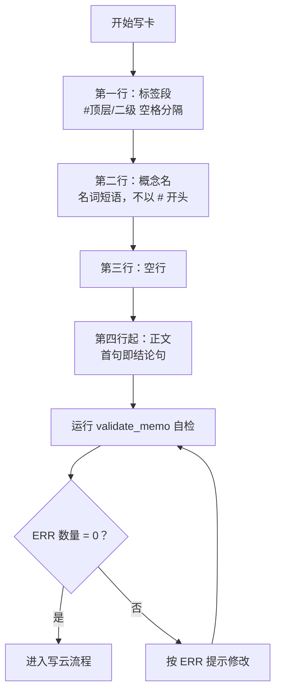
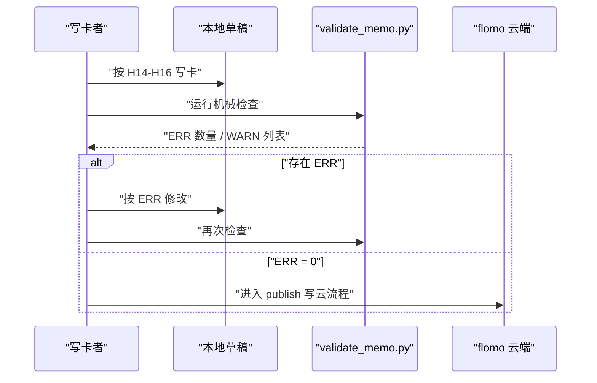

# 3.6 卡片写作

<cite>
**本文引用的文件**   
- [SKILL.md](file://SKILL.md)
- [README.md](file://README.md)
- [validate_memo.py](file://scripts/validate_memo.py)
</cite>

## 目标

本节把 SKILL.md 中 H14–H16 的卡片格式规范，翻译成写卡时可逐条对照的操作指南：一张卡必须写成“一行标签段 + 空行 + 概念名 + 空行 + 正文”，并明确概念名命名、标签空格、占位符与匿名出处、以及禁止出现的元素。写完草稿后，应使用 `scripts/validate_memo.py` 做机械检查，只有 ERR 为 0 才进入写云流程。

## 一、卡片骨架：三段四行

| 位置 | 内容 | 说明 |
|---|---|---|
| 第 1 行 | 标签段 | 由若干 `#顶层/二级` 组成，彼此用空格分隔 |
| 第 2 行 | 概念名 | 简明概括主题的**名词短语** |
| 第 3 行 | 空行 | 分隔概念名与正文 |
| 第 4 行起 | 正文 | 首句直接写结论句，后续要点按结构化列表展开 |



**图示来源**
- [SKILL.md:243-266](file://SKILL.md#L243-L266)
- [validate_memo.py:238-294](file://scripts/validate_memo.py#L238-L294)

**章节来源**
- [SKILL.md:243-266](file://SKILL.md#L243-L266)
- [validate_memo.py:238-294](file://scripts/validate_memo.py#L238-L294)

## 二、标签段：空格分隔与两级约束

### 规则要点

1. **每个标签都必须带 `#`**，裸词不进入标签系统。
2. **多个标签之间只用空格分隔**，不用逗号、分号、换行或制表符。
3. **合法形态只有 `#顶层/二级`**，三段及以上非法；宁可在现有二级内细分，也不下探第三层。
4. **子标签必须带主前缀**，不能裸写二级词（例如应写 `#思想/协调博弈`，不应只写 `#协调博弈`）。
5. **顶层禁用泛指词头**（如 `#概念/`、`#方法/`）、emoji 与特殊字符；英文词用下划线（如 `#Apple_seed`）。

### 示例

| 类型 | 写法 | 是否合法 |
|---|---|---:|
| 最小合法 | `#科技/算法` | ✅ |
| 多标签 | `#科技/算法 #认知科学/记忆` | ✅ |
| 用逗号分隔 | `#科技/算法,#认知科学/记忆` | ❌ |
| 三级标签 | `#科技/安全/邮件认证` | ❌ |
| 裸二级 | `#协调博弈` | ❌ |
| 含 emoji | `#科技/🚀` | ❌ |

**章节来源**
- [SKILL.md:286-300](file://SKILL.md#L286-L300)
- [validate_memo.py:12-16](file://scripts/validate_memo.py#L12-L16)

## 三、概念名：命名原则

### 正面判据

概念名必须是**一个名词短语**，回答“这是什么 / 谁”。它不是句子，不是“标题 + 副标题”，也不是“对象 + 限定”的组合。切片限定（时间、版本、阶段号等）和谓语动作信息都应放到正文要点里，而不是塞进概念名。

### 禁止项

| 类别 | 表现 | 处理 |
|---|---|---|
| 空概念名 | 第二行为空 | ERR |
| 条目名 | 第二行是“要点：”之类小标题 | ERR |
| 冒号结尾 | 第二行以冒号结尾 | ERR |
| 整句 | 概念名包含逗号、句号等分句标点 | ERR |
| 切片限定 | 概念名标识对象的某个片段而非对象本身 | ERR |
| 来源标注 | 概念名括号内出现报道方、通报方、平台等 | ERR |
| 以 `#` 开头 | 误把标签写在概念名行 | ERR |

### 示例

| 概念名 | 判定 | 原因 |
|---|---|---|
| `马尔科夫链` | ✅ | 简洁名词短语 |
| `马尔可夫链在金融定价中的应用` | ❌ | “在…中的应用”是切片限定 |
| `什么是马尔科夫链` | ❌ | 疑问句形式 |
| `马尔科夫链：定义与性质` | ❌ | “标题 + 副标题”结构 |
| `马尔科夫链（2024 年修订版）` | ❌ | 版本号是切片限定 |
| `马尔科夫链（中央纪委通报）` | ❌ | 括号内混入来源 |

**章节来源**
- [SKILL.md:243-266](file://SKILL.md#L243-L266)
- [validate_memo.py:756-793](file://scripts/validate_memo.py#L756-L793)
- [validate_memo.py:822-855](file://scripts/validate_memo.py#L822-L855)

## 四、占位符与匿名出处

### 尖括号占位符

尖括号 `<...>` 是写给执行者看的占位符，落卡时**必须替换成真实内容**。如果草稿中还保留 `<概念名称>`、`<正文>` 之类的尖括号，`validate_memo.py` 会报 ERR。

### 匿名出处引导语

SKILL 中提到的匿名出处（如“史载”“据载”“史书载”）属于**来源信息的一种形态**，受 H15/H16 约束：卡片正文不得出现任何来源、作者、机构、报道、参考信息，无论独立行还是句子形式。这类引导语若只是交代“材料从哪来”，应删除；若它是概念自身的结构要点，则需确认是否真的属于知识内容而非流程备注。

### 示例

| 原文片段 | 处理方式 |
|---|---|
| `<概念名称>` | 替换为真实概念名，如 `马尔科夫链` |
| `<正文>` | 替换为结论句与要点 |
| “据载，该机制…” | 判断是否为来源引导语；若是则删除 |
| “史书载《条例》第 X 条” | 法规名作为处分依据时可保留，其余来源表述删除 |

**章节来源**
- [SKILL.md:263-266](file://SKILL.md#L263-L266)
- [validate_memo.py:650-660](file://scripts/validate_memo.py#L650-L660)
- [validate_memo.py:756-793](file://scripts/validate_memo.py#L756-L793)

## 五、禁止出现的元素

以下元素在 H14–H16 下均被禁止，多数会被 `validate_memo.py` 以 ERR 阻断：

| 禁止项 | 规则编号 | 说明 |
|---|---:|---|
| 第二行以 `#` 开头 | H14 | 标签只能出现在首行标签段 |
| 缺少概念名行或空行 | H14 | 破坏卡片签名与闸门凭证 |
| 模板指令回显 | H14 | 如“结论先行：”“占位符必须替换”等 SKILL 条目名原样写入正文 |
| 未替换的尖括号占位符 | H14 | `<...>` 必须在落卡前替换 |
| 富文本强调标记 | H14 | 加粗、斜体、删除线、反引号、高亮、下划线等均 ERR |
| 正文行内 `#` | H14 | 会被 flomo 当成标签，产生脏标签 |
| 正文超过 20000 字 | H14 | 须精简，禁止超限写云 |
| 来源、作者、机构、报道信息 | H15 | 无论独立行或句子形式，一律删除 |
| 面向自身的流程备注 | H15 | 如“本卡基于摘要写作”“待补抓”等 |
| 载体信息 | H16 | 截图、PPT、页码、UP 主、公众号等不得交代“这张卡从哪抄下来” |
| 截断占位符 | H11/H14 | 检索回包中的长正文截断标记不能落卡 |

**章节来源**
- [SKILL.md:243-300](file://SKILL.md#L243-L300)
- [validate_memo.py:290-374](file://scripts/validate_memo.py#L290-L374)
- [validate_memo.py:408-450](file://scripts/validate_memo.py#L408-L450)
- [validate_memo.py:540-550](file://scripts/validate_memo.py#L540-L550)

## 六、示例卡片

### 最小合法卡片

```text
#科技/算法

马尔科夫链

马尔科夫链是一类随机过程，其未来状态仅依赖当前状态，与历史路径无关。

要点：
- 无记忆性：下一时刻概率分布只取决于当前状态
- 常用场景：排队论、自然语言建模、状态机
```

### 带多标签卡片

```text
#认知科学/记忆 #教育心理学/学习策略

间隔重复

间隔重复是一种通过拉长复习间隔来巩固长期记忆的编码策略。

要点：
- 核心原理：提取难度越大，记忆巩固效果越强
- 常见工具：Anki、SuperMemo 等闪卡软件
- 适用边界：对事实性知识有效，对程序性技能仍需练习
```

### 更新既有卡片的前缀

更新既有卡片时，命令入口要带上覆盖 id，让流程先回读目标卡、比对概念名后再覆盖。根据 README 与 SKILL 的描述，典型前缀形如：

```bash
python scripts/publish.py --draft <草稿路径> --verify <留痕路径> --update-id <memo_id>
```

其中：

- `--draft` 指向本轮草稿。
- `--verify` 指向 SOP 闸门产生的留痕凭证。
- `--update-id` 指定要覆盖的云端 memo id。
- 若确属改名，需显式加上允许改名的参数；仅传 `--allow-rename` 而无 `--update-id` 会按参数错误拒绝。

**章节来源**
- [README.md:68-84](file://README.md#L68-L84)
- [SKILL.md:381-383](file://SKILL.md#L381-L383)

## 七、写完后必须运行 validate_memo

写卡流程的第 7 步要求“自检并写云”，其中自检由 `scripts/validate_memo.py` 承担。它检查卡片格式、标签、来源、载体、字数等机械项，并把结果分为：

| 级别 | 含义 | 能否写云 |
|---|---|---:|
| ERR | 错误，违反硬限 | ❌ 必须修复 |
| WARN | 警告，通常交人读复核 | ⚠️ 视情况处理 |

脚本输出 ERR 数量非 0 时，应回到草稿按提示修改，直到 ERR 为 0。即使全部为 WARN，也建议人工核对警告所指行，因为部分 WARN 来自云端回读存储层行为（例如标签段后自动补空行），不代表本地草稿一定没问题。



**图示来源**
- [README.md:68-84](file://README.md#L68-L84)
- [validate_memo.py:1052-1093](file://scripts/validate_memo.py#L1052-L1093)

**章节来源**
- [README.md:68-84](file://README.md#L68-L84)
- [validate_memo.py:1052-1093](file://scripts/validate_memo.py#L1052-L1093)

## 八、常见问题速查

| 现象 | 可能原因 | 处理 |
|---|---|---|
| 第二行报错“应为概念名称” | 第二行是空行、“要点：”或以冒号结尾 | 改为名词短语概念名 |
| 标签报错“非两级” | 写了三级标签或裸顶层 | 合并到现有二级或新建合法两级标签 |
| 正文报错“模板指令回显” | 把 SKILL 条目名原样写进正文 | 删除“结论先行：”等格式指令 |
| 正文报错“含截断占位符” | 直接从检索回包复制了长正文 | 用 `memo_batch_get` 取全文重写 |
| 概念名报错“含切片限定” | 概念名带了时间、版本、阶段号 | 把切片信息移到正文要点 |
| 概念名报错“含来源” | 概念名括号里写了报道方或平台 | 删除来源，只保留概念补充说明 |
| 更新时报“无法比对概念名” | 目标卡没有稳定概念名，或 id 抄错 | 先用 `--update-id` 回读确认，再决定是否加允许改名参数 |

**章节来源**
- [SKILL.md:243-300](file://SKILL.md#L243-L300)
- [validate_memo.py:756-855](file://scripts/validate_memo.py#L756-L855)

## 九、总结

写一张合规卡片，只需记住五个步骤：

1. 首行写若干个 `#顶层/二级`，用空格分隔。
2. 第二行写一个名词短语的概念名，不带 `#`、不带切片限定、不带来源。
3. 第三行留空。
4. 第四行起写正文，首句即结论句，不使用富文本强调标记。
5. 运行 `scripts/validate_memo.py`，ERR 为 0 后再进入写云流程。

**章节来源**
- [SKILL.md:243-300](file://SKILL.md#L243-L300)
- [README.md:68-84](file://README.md#L68-L84)