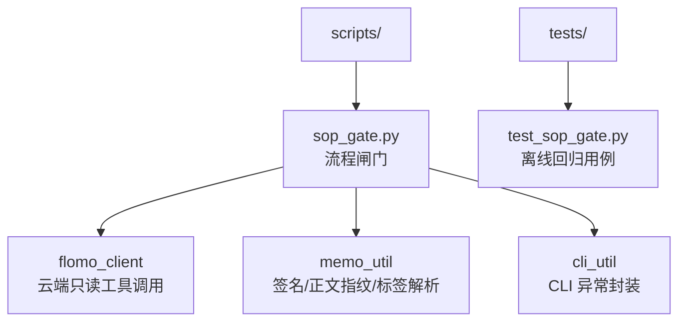
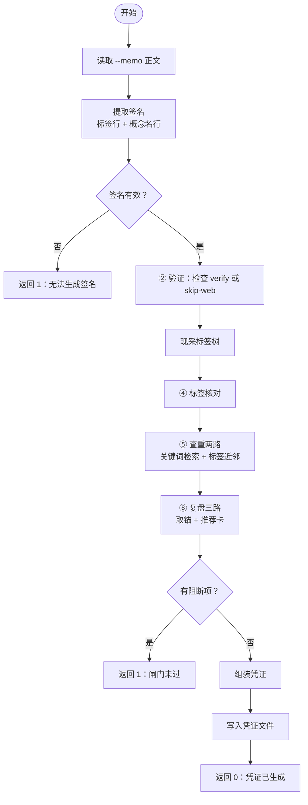
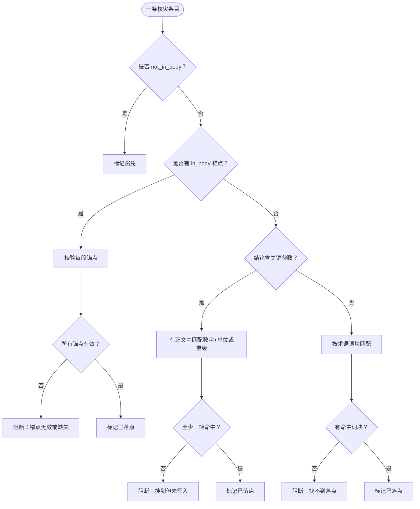
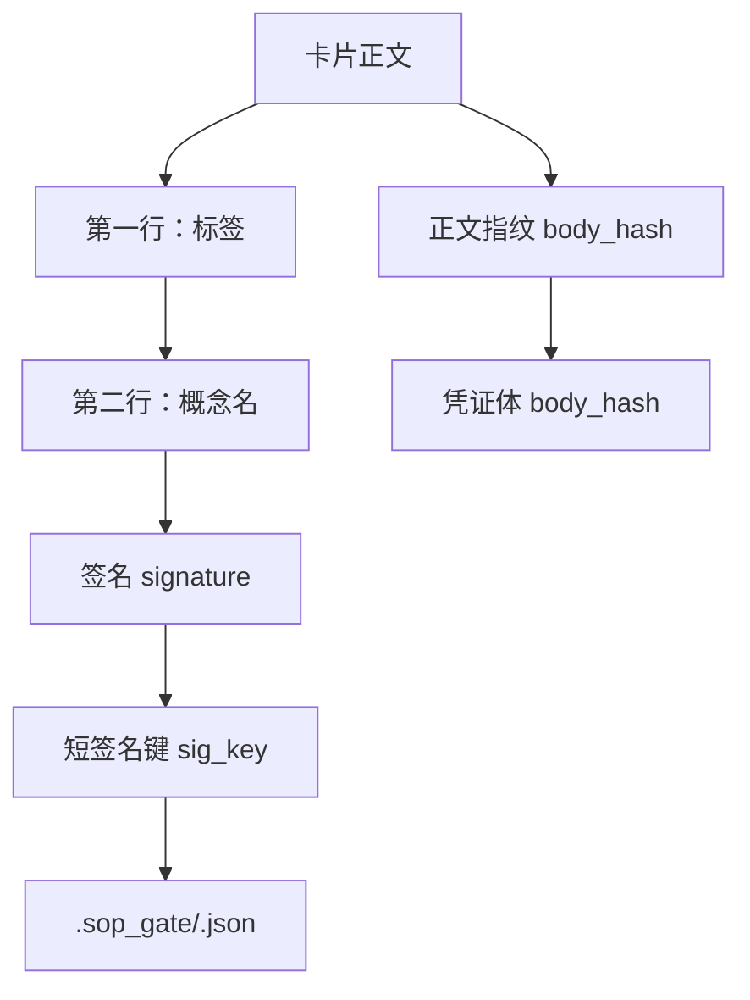
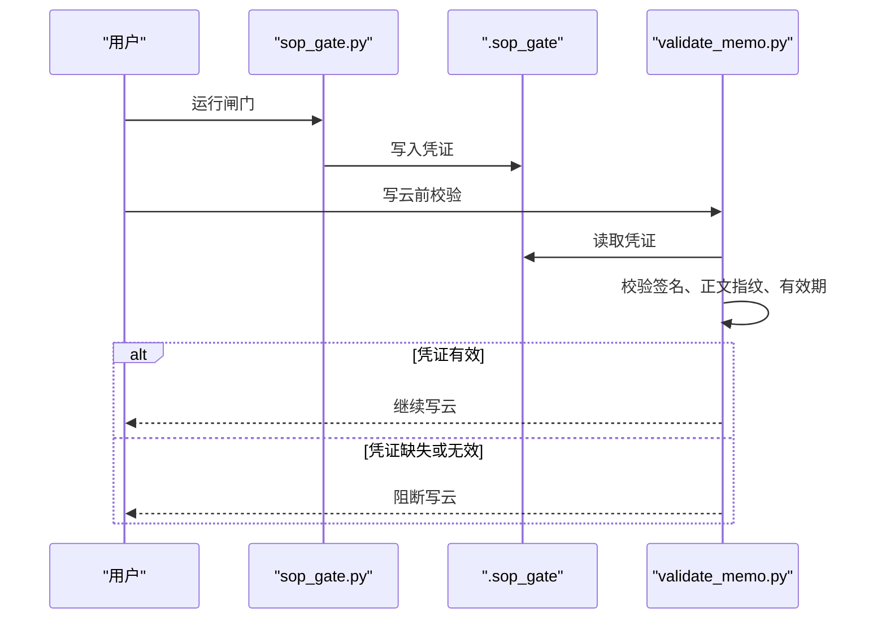
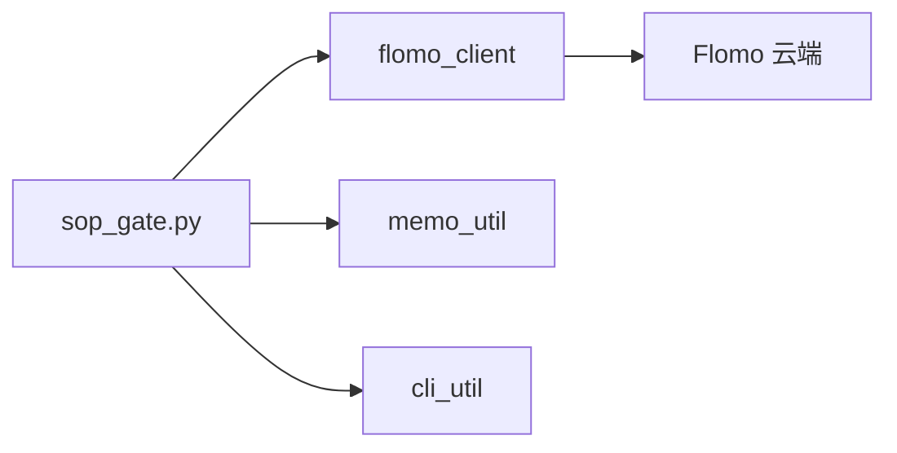

# 3.7 流程闸门（sop_gate）

<cite>
**本文引用的文件**   
- [scripts/sop_gate.py](file://scripts/sop_gate.py)
- [tests/test_sop_gate.py](file://tests/test_sop_gate.py)
</cite>

## 目录
1. [引言](#引言)
2. [项目结构定位](#项目结构定位)
3. [核心职责与入口](#核心职责与入口)
4. [架构总览](#架构总览)
5. [凭证模型](#凭证模型)
6. [三路检查逻辑](#三路检查逻辑)
7. [正文指纹与签名规则](#正文指纹与签名规则)
8. [缺失凭证的阻断行为](#缺失凭证的阻断行为)
9. `--force` 等参数的使用边界
10. [命令示例与恢复步骤](#命令示例与恢复步骤)
11. [依赖关系分析](#依赖关系分析)
12. [故障排查指南](#故障排查指南)
13. [结论](#结论)

## 引言
`sop_gate.py` 是 SOP 流程中的“流程闸门”。它把此前依赖执行者自觉的三个检查型步骤——验证、查重、复盘——收敛为一次代跑并落盘凭证。凭证由写云前的校验脚本消费；只要缺少有效凭证，或凭证不匹配当前卡片，写云就会被判定为错误。因此，“漏做”在物理上不再可能：没跑闸门 → 没有凭证 → 写云失败。

该文档面向两类读者：
- 需要理解闸门为何能强制执行的维护者；
- 需要按规范生成凭证、处理阻断错误的日常使用者。

## 项目结构定位
`sop_gate.py` 位于仓库根目录下的 `scripts/` 中，属于脚本层工具。测试用例位于 `tests/test_sop_gate.py`，用于离线回归凭证生成与校验逻辑。



**图表来源**
- [scripts/sop_gate.py:1-200](file://scripts/sop_gate.py#L1-L200)

**章节来源**
- [scripts/sop_gate.py:1-200](file://scripts/sop_gate.py#L1-L200)

## 核心职责与入口
`sop_gate.py` 的核心职责可概括为四件事：

| 职责 | 说明 |
|---|---|
| 读取卡片正文 | 从 `--memo` 指定路径读取正文，提取签名 |
| 代跑三路与两路检查 | 验证、标签核对、查重、复盘 |
| 产出凭证 | 通过 `assemble_gate` 组装结构化凭证 |
| 落盘凭证文件 | 默认写入 `.sop_gate/<sig_key>.json` |

入口函数是 `main()`，其命令行参数定义如下：

| 参数 | 是否必填 | 作用 |
|---|---:|---|
| `--memo` | 是 | 卡片正文文件路径 |
| `--verify` | 否 | 第 2 步网络搜索验证记录 JSON 路径；非术语卡应改用 `--skip-web` |
| `--skip-web` | 否 | 显式声明无需第 2 步网络验证 |
| `--out` | 否 | 自定义凭证输出路径；默认位于 `.sop_gate` |
| `--anchor-id` | 否 | 复盘时使用的锚点 ID，常用于更新已有卡片 |
| `--allow-no-gate` | 否 | 授权本卡在写云侧降级闸门，仅限批量处理历史卡，必须附带理由 |

退出码约定：
- `0`：闸门全部通过并已生成凭证；
- `1`：存在阻塞项，未生成凭证；
- 其他非零值：云端调用异常（由 `cli_entry` 包装）。

**章节来源**
- [scripts/sop_gate.py:1-200](file://scripts/sop_gate.py#L1-L200)
- [scripts/sop_gate.py:401-594](file://scripts/sop_gate.py#L401-L594)

## 架构总览
闸门的运行顺序是线性的：先构造正文签名，再依次执行验证、标签树采集、标签核对、查重、复盘，最后汇总阻断项与审计笔记。只有无阻断时才落盘凭证。



**图表来源**
- [scripts/sop_gate.py:401-594](file://scripts/sop_gate.py#L401-L594)

**章节来源**
- [scripts/sop_gate.py:201-400](file://scripts/sop_gate.py#L201-L400)
- [scripts/sop_gate.py:401-594](file://scripts/sop_gate.py#L401-L594)

## 凭证模型
凭证是一个 JSON 对象，包含签名信息、正文指纹、时间戳、三路检查结果以及机器盲区标注。

| 字段 | 类型 | 含义 |
|---|---|---|
| `signature` | 对象 | 卡片签名，含 `tagline` 和 `concept` |
| `sig_key` | 字符串 | 凭证文件名使用的短签名键 |
| `body_hash` | 字符串 | 正文 SHA-256 指纹 |
| `generated_at` | 整数 | 凭证生成时间戳 |
| `expires_at` | 整数 | 凭证过期时间戳 |
| `web` | 对象 | 第 2 步验证结果 |
| `tag_check` | 对象 | 第 4 步标签核对结果 |
| `dedup` | 对象 | 第 5 步查重结果 |
| `review` | 对象 | 第 8 步复盘结果 |
| `human_judgment` | 数组 | 机器判不了的判断项，仅留痕 |
| `no_gate_authorized` | 布尔值 | 是否存在 `--allow-no-gate` 授权 |
| `no_gate_reason` | 字符串 | 降级授权理由 |

### 关键字段说明

#### 正文指纹
`body_hash` 来自正文内容的哈希值。写云前会重新计算当前正文指纹并与凭证比较；不一致即报错，防止“先跑闸门后改正文”。

#### 验证结果 `web`
- 正常搜索：包含 `searched`、`term_count`、`landed`。
- 显式跳过：包含 `web_skipped = true`。

#### 标签核对结果 `tag_check`
- `tags`：每个标签的状态记录。
- `checked`：实际检查数量。

#### 查重结果 `dedup`
- `keyword_hits`：关键词检索命中。
- `tag_neighbors`：同主标签细分的近邻簇列表。

#### 复盘结果 `review`
- `anchor`：实际使用的锚点 ID。
- `anchor_source`：锚点来源。
- `recommended`：推荐卡 ID 列表。

#### 人类判断边界 `human_judgment`
这是闸门有意暴露的盲区清单，包括命名语义判断、查重候选语义合并、写云后才存在的全文自查等。它不参与放行判定，只是审计依据。

**章节来源**
- [scripts/sop_gate.py:201-400](file://scripts/sop_gate.py#L201-L400)
- [scripts/sop_gate.py:401-594](file://scripts/sop_gate.py#L401-L594)

## 三路检查逻辑

### 第 2 步：验证
验证不是“只证明搜了”，而是同时证明“搜到的内容写进了正文”。

判定顺序如下：



**图表来源**
- [scripts/sop_gate.py:201-270](file://scripts/sop_gate.py#L201-L270)

关键规则：
- `in_body` 必须是正文真实子串；不能等于术语本身，也不能被术语完全包含。
- 若结论含关键参数，至少一个参数须出现在正文。
- 若结论不含关键参数，则按术语词块比对。
- 确实不该写进正文的条目，必须用 `not_in_body` 显式豁免并给出理由。
- 空白、千分位逗号、大小写在比对前统一归一化。

### 第 4 步：标签核对
标签核对的要点是区分“写错”和“新建”。

| 情况 | 行为 |
|---|---|
| 标签与现有标签只差空白、全半角斜杠、大小写 | 阻断：写入会分裂成两个簇 |
| 二级不在树中但顶层存在 | 提示：将新建此二级，并列出相近二级 |
| 顶层也不存在 | 提示：连顶层一起新建 |
| 首行标签不是合法两级标签 | 提示格式问题 |
| 标签树未取到 | 阻断：标签树为空，后续查重标签路也空转 |

注意：新建二级本身不阻断。只有确定是“写错导致同名异写”才阻断。

### 第 5 步：查重两路
查重由两条路径组成：

1. **关键词检索**：从概念名派生关键词，调用 `memo_search`。
2. **标签近邻**：基于主标签查找同顶级下相同或更深的标签路径。

闸门只负责确认“两路都跑了、结果都被读到”，并不做“是否撞卡”的语义合并。命中候选会写入凭证供人工复核。

“0 个簇”有两种含义，闸门会明确区分：
- 标签在树中，但该簇下没有卡；
- 标签根本不在树中，意味着这一路实际没有扫到同类卡。

### 第 8 步：复盘三路
复盘补查 `memo_recommended`，但服务端要求传入目标卡 ID，而写云前本卡尚不存在，因此需要锚点。

锚点取用顺序：
1. 调用方显式传入 `--anchor-id`；
2. 用概念名派生关键词检索，取首条；
3. 回退到本卡标签簇检索，取首条；
4. 都取不到则阻断，并在阻断文案中指出出路。

复盘结果会记录锚点 ID、锚点来源和推荐卡 ID 列表。

**章节来源**
- [scripts/sop_gate.py:201-400](file://scripts/sop_gate.py#L201-L400)
- [scripts/sop_gate.py:401-594](file://scripts/sop_gate.py#L401-L594)

## 正文指纹与签名规则

### 签名提取
签名由卡片正文的前两行非空内容决定：
- 第一行必须是标签行；
- 第二行是概念名；
- 不足两行非空内容或首行不是标签，则无法生成签名。

### 正文指纹
正文指纹是对完整正文内容计算得到的哈希值。凭证保存的是生成时的正文指纹；写云前会重新计算当前正文指纹并比较。

### 文件名键
凭证文件名使用 `sig_key`，由签名的标签行和概念名组合后取短键。这样保证同一张卡的凭证文件名稳定，且与写云侧一致。



**图表来源**
- [scripts/sop_gate.py:401-594](file://scripts/sop_gate.py#L401-L594)

**章节来源**
- [scripts/sop_gate.py:201-400](file://scripts/sop_gate.py#L201-L400)
- [scripts/sop_gate.py:401-594](file://scripts/sop_gate.py#L401-L594)

## 缺失凭证的阻断行为
写云前的 `validate_memo.py` 会调用闸门校验逻辑。根据测试用例，以下情况会被阻断：

| 情形 | 行为 |
|---|---|
| 凭证目录为空 | 报“缺少 SOP 流程闸门凭证” |
| 正文指纹不匹配 | 报正文指纹相关错误 |
| 凭证过期 | 报凭证已过期 |
| 文件名对得上但凭证内签名不符 | 报签名与当前卡片不符 |
| 验证未执行且未显式跳过 | 报验证未执行 |
| 显式 `web_skipped=true` | 不报验证错误 |

测试用例还覆盖了“正文指纹防篡改”场景：如果先跑闸门，再修改正文，写云时会因指纹不一致而被阻断。



**图表来源**
- [tests/test_sop_gate.py:1-200](file://tests/test_sop_gate.py#L1-L200)

**章节来源**
- [tests/test_sop_gate.py:1-200](file://tests/test_sop_gate.py#L1-L200)

## `--force` 等参数的使用边界
`sop_gate.py` 当前没有 `--force` 参数。它的参数集中在“如何执行检查”和“如何控制降级授权”两个维度：

| 参数 | 边界说明 |
|---|---|
| `--memo` | 必需；用于生成签名和正文指纹 |
| `--verify` | 术语卡必须提供验证记录；否则阻断 |
| `--skip-web` | 仅适用于非术语卡；会在凭证中标记 `web_skipped` |
| `--out` | 仅改变凭证落盘位置，不改变闸门逻辑 |
| `--anchor-id` | 仅影响复盘取锚；不绕过其他检查 |
| `--allow-no-gate` | 仅授权写云侧接受“无凭证”状态；不会让闸门自己跳过检查 |

特别注意：
- `--allow-no-gate` 不会让 `sop_gate.py` 跳过验证、查重或复盘；它只是在凭证里写入 `no_gate_authorized` 和 `no_gate_reason`，供 `validate_memo.py` 决定是否接受无凭证。
- 凭证自带过期时间；超期必须重跑，不能复用旧凭证。
- 物理上无法跳过闸门：即使使用 `--allow-no-gate`，也只是降级授权，而不是绕过三路与两路检查。

**章节来源**
- [scripts/sop_gate.py:401-594](file://scripts/sop_gate.py#L401-L594)

## 命令示例与恢复步骤

### 情形一：全部凭证齐全
适用条件：
- 已完成第 2 步网络搜索并导出验证记录；
- 标签核对通过；
- 查重两路完成；
- 复盘三路完成。

命令示例：
```bash
python scripts/sop_gate.py --memo memo.txt --verify verify.json
```

预期结果：
- 终端打印审计笔记；
- 无阻断项；
- 凭证写入 `.sop_gate/<sig_key>.json`；
- 退出码为 0。

恢复建议：
- 直接继续写云流程；
- 如需查看凭证，打开对应 JSON 文件确认 `body_hash`、`expires_at`、`web`、`tag_check`、`dedup`、`review` 均存在。

**章节来源**
- [scripts/sop_gate.py:401-594](file://scripts/sop_gate.py#L401-L594)

### 情形二：缺少查重凭证
这里“缺少查重凭证”通常表现为查重结果不完整、关键词无命中、标签路近邻为 0，或复盘取锚失败。

常见原因：
- 概念名无法派生关键词；
- 关键词检索无命中；
- 标签簇为空；
- 未传 `--anchor-id`，且自动取锚失败。

命令示例：
```bash
python scripts/sop_gate.py --memo memo.txt --verify verify.json --anchor-id <已有卡id>
```

恢复步骤：
1. 先检查首行标签是否正确；标签写错会导致查重与复盘两路同时空转。
2. 若概念名无法派生关键词，手动补充 `--anchor-id`，指向最接近的已有卡。
3. 重新运行闸门，确认 `dedup.keyword_hits`、`dedup.tag_neighbors`、`review.anchor`、`review.recommended` 均有内容。
4. 如仍失败，检查云端 `memo_search`、`memo_recommended` 是否可用。

**章节来源**
- [scripts/sop_gate.py:201-400](file://scripts/sop_gate.py#L201-L400)
- [scripts/sop_gate.py:401-594](file://scripts/sop_gate.py#L401-L594)

### 情形三：复盘失败
复盘失败的典型阻断文案会指出“无法取锚”，并说明关键词检索与标签簇检索的结果。

命令示例：
```bash
python scripts/sop_gate.py --memo memo.txt --verify verify.json --anchor-id <最近似卡id>
```

恢复步骤：
1. 确认已传入 `--anchor-id`。
2. 若概念名无法派生关键词，不要依赖自动取锚。
3. 若标签簇为空，检查首行标签是否写错。
4. 重新运行后检查凭证中 `review.anchor_source` 是否为“调用方提供”。
5. 若仍失败，确认云端 `memo_recommended` 支持传入的锚点 ID。

**章节来源**
- [scripts/sop_gate.py:401-594](file://scripts/sop_gate.py#L401-L594)

## 依赖关系分析
`sop_gate.py` 的运行时依赖分为三类：

| 依赖类别 | 模块 | 作用 |
|---|---|---|
| 标准库 | `argparse`、`json`、`re`、`sys`、`time`、`pathlib`、`difflib` | CLI、JSON、正则、时间、路径、相似度 |
| 本地库 | `flomo_client` | 加载 token、初始化客户端、调用 `tag_tree`、`memo_search`、`memo_recommended` |
| 本地库 | `memo_util` | 正文哈希、概念关键词、签名、标签解析 |
| 本地库 | `cli_util` | 将云端调用异常转为统一退出码 |



**图表来源**
- [scripts/sop_gate.py:1-200](file://scripts/sop_gate.py#L1-L200)
- [scripts/sop_gate.py:401-594](file://scripts/sop_gate.py#L401-L594)

**章节来源**
- [scripts/sop_gate.py:1-200](file://scripts/sop_gate.py#L1-L200)
- [scripts/sop_gate.py:401-594](file://scripts/sop_gate.py#L401-L594)

## 故障排查指南

| 现象 | 可能原因 | 处理建议 |
|---|---|---|
| 终端报“无法生成签名” | 正文不足两行非空内容，或首行不是标签 | 按 H14 补齐标签行和概念名行 |
| 报“未提供第 2 步验证记录” | 术语卡未传 `--verify` | 提供验证记录，或使用 `--skip-web` |
| 报“验证记录 searched 必须为布尔 true” | 验证记录未真正执行搜索 | 重新执行第 2 步并导出 JSON |
| 报验证术语无落点 | 结论参数或术语词块未在正文出现 | 把结论融入正文，或用 `not_in_body` 显式豁免 |
| 报标签与现有写法只差空白或大小写 | 标签会分裂成两个簇 | 改为现有标签写法 |
| 报标签不在树中 | 可能是新建二级，也可能是写错 | 确认是否应为新簇；必要时修正标签 |
| 报查重关键词无法派生 | 概念名太短或不可解析 | 检查概念名，必要时手动补锚点 |
| 报复盘无法取锚 | 关键词无命中、标签簇为空、未传 `--anchor-id` | 传入 `--anchor-id` 或修正标签 |
| 写云时报正文指纹不符 | 跑闸门后修改了正文 | 重新跑闸门 |
| 写云时报凭证过期 | 凭证超过 TTL | 重新跑闸门 |
| 写云时报签名不符 | 凭证属于另一张卡 | 删除旧凭证，为当前卡重新生成 |

**章节来源**
- [scripts/sop_gate.py:201-400](file://scripts/sop_gate.py#L201-L400)
- [scripts/sop_gate.py:401-594](file://scripts/sop_gate.py#L401-L594)
- [tests/test_sop_gate.py:1-200](file://tests/test_sop_gate.py#L1-L200)

## 结论
`sop_gate.py` 的关键价值是把“靠自觉”的检查变成“必须留痕”的机械流程。它不只是记录“做了什么”，还通过正文指纹、签名、过期时间和三路两路结果，确保：
- 验证不仅做了，而且结论写进了正文；
- 标签写错会被阻断，新建会有审计痕迹；
- 查重两路结果可追溯；
- 复盘有锚点、有推荐；
- 凭证过期或被篡改时，写云仍可拦截。

更重要的是，`publish` 或写云流程只消费凭证，不重新执行这些检查。因此，闸门不是“可选前置步骤”，而是写云的物理门槛。凭证齐全不代表结论正确，但它能排除“流程根本没做”这类事故。