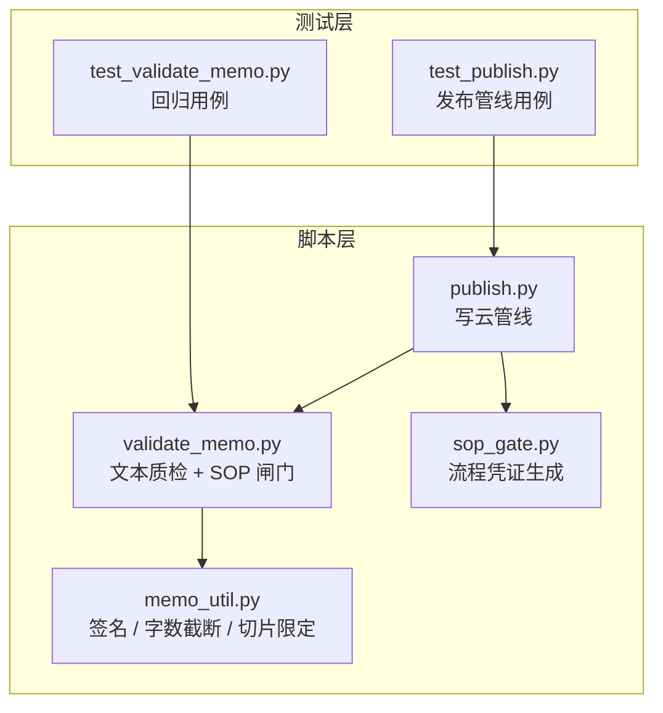
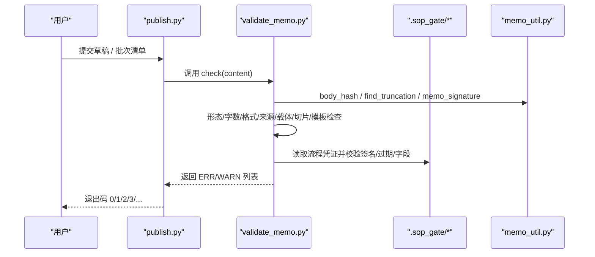
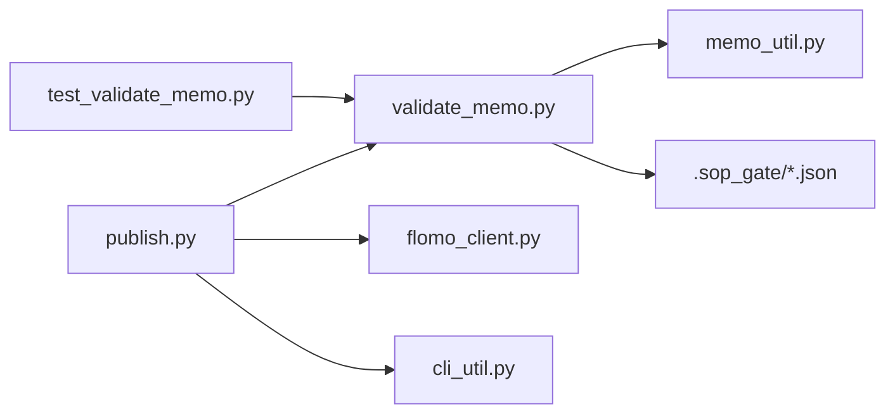

# 3.8 文本质检（validate_memo）

<cite>
**本文引用的文件**   
- [scripts/validate_memo.py](file://scripts/validate_memo.py)
- [tests/test_validate_memo.py](file://tests/test_validate_memo.py)
- [scripts/publish.py](file://scripts/publish.py)
- [scripts/memo_util.py](file://scripts/memo_util.py)
</cite>

## 目录
1. [引言](#引言)
2. [项目结构中的定位](#项目结构中的定位)
3. [核心校验项总览](#核心校验项总览)
4. [架构与调用流程](#架构与调用流程)
5. [逐项规则、失败语义与修复建议](#逐项规则失败语义与修复建议)
6. [合格草稿与典型违规样例](#合格草稿与典型违规样例)
7. [作为 publish 前置闸门的作用](#作为-publish-前置闸门的作用)
8. [控制台编辑与批次清单的差异处理](#控制台编辑与批次清单的差异处理)
9. [依赖关系分析](#依赖关系分析)
10. [故障排查](#故障排查)
11. [结论](#结论)

## 引言
`scripts/validate_memo.py` 是卡片写云前的静态自检程序，负责在 `publish.py` 调用之前对草稿卡进行机械检查。它把 SKILL 中对 H14（概念名与卡片格式）、H15/H16（来源与载体不得写入正文或概念名）等要求转成可复现的正则与分支判断，输出两类结果：

- ERR：必须修复的错误，退出码为 1；
- WARN：不阻塞写云，但提示写卡人注意措辞、材料指示词或摘要依赖等问题。

它还承担“SOP 流程闸门”的辅助校验：只有 `.sop_gate` 下存在对应签名凭证，且凭证未过期、包含标签树核对与网络搜索记录，才允许写云。若显式使用 `--no-gate`，还必须配套由 `sop_gate.py --allow-no-gate <理由>` 生成的授权凭证，否则同样判 ERR。

## 项目结构中的定位
仓库中与该主题直接相关的脚本和测试如下：



**图表来源**
- [scripts/validate_memo.py:1-100](file://scripts/validate_memo.py#L1-L100)
- [scripts/publish.py:1-80](file://scripts/publish.py#L1-L80)
- [scripts/memo_util.py](file://scripts/memo_util.py)
- [tests/test_validate_memo.py:1-30](file://tests/test_validate_memo.py#L1-L30)

**章节来源**
- [scripts/validate_memo.py:1-100](file://scripts/validate_memo.py#L1-L100)
- [scripts/publish.py:1-80](file://scripts/publish.py#L1-L80)
- [tests/test_validate_memo.py:1-30](file://tests/test_validate_memo.py#L1-L30)

## 核心校验项总览
按实现顺序，`check(content)` 主要覆盖以下维度：

| 阶段 | 编号 | 检查目标 | 级别 | 关键约束 |
|---|---:|---|---:|---|
| 输入 | 0 | 截断占位符 | ERR | 正文含 `...[此处省略N字]...` 即阻断 |
| 形态 | 1 | 首行标签段 | ERR | 两级 `#顶层/二级`，合法字符，禁止裸顶层、三级及以上、疑似裸子标签 |
| 形态 | 2 | 概念名行与空行 | ERR/WARN | 第二行非空；第三行为空行接正文；第二行不得以 `#` 开头 |
| 字数 | 3 | 全文长度 | ERR | 含标签段不超过 20000 字符 |
| 格式 | 4 | Markdown/HTML 残留 | ERR/WARN | 禁止加粗、删除线、斜体、粗斜体、反引号、图片语法、不受支持 HTML；标题/引用/链接/表格/邮箱仅警告 |
| 标签 | 4.5 | 正文内意外 `#xxx` | ERR | 除 URL 行外，正文中出现 `#` 后紧跟非空白字符均判错 |
| 内容 | 5 | 占位/生造内容 | ERR | `example.com`、`placeholder`、`TODO`、`lorem` 等 |
| 旧格式 | 5.5 | 状态行/来源行 | WARN | 末尾两行、白名单修饰词 + 冒号 + 短尾 |
| 载体 | 5.6 | 截图/讲义/页码/UP主等载体元信息 | ERR | 括号注释或要点句内出现载体标注即阻断 |
| 来源 | 5.6 | 报道方/通报方/发布方 | ERR | “据某媒体消息”“机构网站发布”“史载”等多种引导语 |
| 概念名 | 5.6 | 概念名携带来源 | ERR | 概念名括号或任何位置带通报方/媒体/来源 |
| 模板 | 5.7 | 指令前缀回显 | ERR | “结论先行”“一句话核心结论：”等 SKILL 条目名 |
| 切片 | 5.8 | 概念名切片限定 | ERR | 时间、版本、轮次、地域语种、事件动作等切片限定 |
| 摘要 | 6 | 预印本摘要依赖 | WARN | 正文暗示仅依据摘要 |
| 材料 | 7 | 材料指示词 | WARN | “本文”“文中”“作者指出”等脱离材料不可指代 |
| 闸门 | gate | SOP 凭证 | ERR | 缺少、签名不符、正文指纹不符、过期、缺标签核对、缺网络搜索 |

**章节来源**
- [scripts/validate_memo.py:201-430](file://scripts/validate_memo.py#L201-L430)
- [scripts/validate_memo.py:600-803](file://scripts/validate_memo.py#L600-L803)
- [scripts/validate_memo.py:804-1073](file://scripts/validate_memo.py#L804-L1073)

## 架构与调用流程
`validate_memo.py` 的典型调用链如下：



**图表来源**
- [scripts/publish.py:1-80](file://scripts/publish.py#L1-L80)
- [scripts/validate_memo.py:201-430](file://scripts/validate_memo.py#L201-L430)
- [scripts/validate_memo.py:804-1073](file://scripts/validate_memo.py#L804-L1073)

**章节来源**
- [scripts/publish.py:1-80](file://scripts/publish.py#L1-L80)
- [scripts/validate_memo.py:201-430](file://scripts/validate_memo.py#L201-L430)
- [scripts/validate_memo.py:804-1073](file://scripts/validate_memo.py#L804-L1073)

## 逐项规则、失败语义与修复建议

### H14：卡片形态与概念名

| 规则 | 失败消息语义 | 修复建议 |
|---|---|---|
| 首行必须是标签段 | 无 `#` 开头，无法检索 | 把标签放在第一行，如 `#科技/安全` |
| 标签非法字符 | 标签只允许中文、英文、数字、下划线、层级 `/` | 去掉星号、空格、标点等非法字符 |
| 裸顶层标签 | 缺少二级标签，形如 `#数学` | 补二级，如 `#数学/泛函方程` |
| 三级及以上 | 层级超过两级 | 降为两级，不要写 `#科技/安全/邮件认证` |
| 疑似裸子标签 | 已有主标签时二级不带 `/` | 写成 `#主/子`，不要单独建一个顶层标签 |
| 第二行应为概念名 | 第二行为空或不是名词短语 | 填写简明概括主题的术语；删掉“要点：” |
| 标题后缺空行 | 标题与正文合并，flomo 无法识别标题 | 概念名下一行留空行再写正文 |
| 第二行以 `#` 开头 | 多行标签破坏签名，导致幂等查重与闸门失效 | 把多余标签移到首行标签段 |
| 概念名以冒号结尾 | 像条目名而非概念 | 改为名词短语，例如“某某模型”，而不是“某某模型发布” |
| 概念名含分句标点 | 概念名变成整句，失去稳定签名 | 把句子移到正文首段，概念名只保留对象名 |
| 概念名含切片限定 | 名称标识了时间、版本、轮次、地域等切片 | 把切片信息下沉到正文要点，概念名取稳定指称 |

**章节来源**
- [scripts/validate_memo.py:201-280](file://scripts/validate_memo.py#L201-L280)
- [scripts/validate_memo.py:804-870](file://scripts/validate_memo.py#L804-L870)
- [tests/test_validate_memo.py:189-250](file://tests/test_validate_memo.py#L189-L250)

### 标签语法

| 规则 | 失败消息语义 | 修复建议 |
|---|---|---|
| 两级标签硬限 | 零个或两个以上 `/` | 严格写成 `#顶层/二级` |
| 非法字符 | 出现星号、空格、标点等 | 只保留字母、中文、数字、下划线、`/` |
| 正文意外 `#xxx` | flomo 会把任意 `#xxx` 当标签，造成脏标签 | 把数学符号写成 `♯`，或用文字描述；URL 行整体豁免 |
| URL 行豁免 | 含 `http` 的行跳过脏标签检查 | 不要把来源写在 URL 行里伪装 |

**章节来源**
- [scripts/validate_memo.py:201-240](file://scripts/validate_memo.py#L201-L240)
- [scripts/validate_memo.py:430-470](file://scripts/validate_memo.py#L430-L470)
- [tests/test_validate_memo.py:20-50](file://tests/test_validate_memo.py#L20-L50)

### 来源与载体字段（H15/H16）

| 类别 | 规则 | 失败消息语义 | 修复建议 |
|---|---|---|---|
| 载体 | 截图、B站直播截图、UP主、课程讲义、第 N 页、字幕等载体元信息出现在正文或概念名 | 载体信息混入概念卡正文 | 删除载体标注，把事实本身写进要点 |
| 来源引导语 | “据某媒体消息”“根据路透社报道”“援引自…” | 事件自身的报道方不得写入正文 | 删除引导语，保留事件内容；整条来源性要点删除 |
| 发布动作式 | “中央纪委国家监委网站 九月十八日发布”“公众号发布公告” | 发布渠道与事件内容混在一起 | 删除发布主体/渠道，只写事件事实 |
| 匿名出处 | “史载”“据载”“史书载” | 匿名转述也是来源，必须删除 | 改写成陈述本身 |
| 概念名来源 | 概念名括号内带纪委监委、网站、通报、媒体等 | 概念名只能写概念或事件本身 | 删除括号内来源，只保留概念名 |
| 行内来源冒号 | “参考链接：…”“数据来源：…” | 歧义：可能是出处也可能是概念结构 | 交代出处按 H15 删除；概念结构要点保留 |

**章节来源**
- [scripts/validate_memo.py:600-803](file://scripts/validate_memo.py#L600-L803)
- [tests/test_validate_memo.py:50-188](file://tests/test_validate_memo.py#L50-L188)
- [tests/test_validate_memo.py:250-373](file://tests/test_validate_memo.py#L250-L373)

### 字数下限与上限

当前实现明确的是**上限**：

| 规则 | 失败消息语义 | 修复建议 |
|---|---|---|
| 全文超过 20000 字符 | 卡片膨胀，可能违反“单卡一事” | 精简内容，或按 H7 拆成多张卡 |

仓库文档和注释说明“所有卡片均为追踪卡，后续进展用 memo_update 更新”，因此“字数下限”更多来自 SKILL 写作纪律：概念名要简短、正文要聚焦具体概念或事件，而不是靠脚本强制最小字数。脚本目前不会因“太短”而判 ERR，但会检测空正文、缺失概念名、截断占位符等边界情况。

**章节来源**
- [scripts/validate_memo.py:20-40](file://scripts/validate_memo.py#L20-L40)
- [scripts/validate_memo.py:280-320](file://scripts/validate_memo.py#L280-L320)
- [tests/test_validate_memo.py:10-20](file://tests/test_validate_memo.py#L10-L20)

### 签名一致性（SOP 闸门）

| 检查点 | 失败消息语义 | 修复建议 |
|---|---|---|
| 签名为空 | 首行不是标签段，或第二行不是不以 `#` 开头的概念名 | 先修形态，使签名可计算 |
| 缺少凭证 | 没有 `.sop_gate/<sig_key>.json` | 执行 `scripts/sop_gate.py` 再生成凭证 |
| 签名不一致 | 凭证针对另一张卡 | 重新跑闸门，不要用 A 卡的凭证写 B 卡 |
| 正文指纹不符 | 闸门通过后又改过正文 | 重新跑闸门 |
| 过期时间缺失 | 凭证格式过旧或被篡改 | 重新跑闸门 |
| 过期时间非法 | 凭证被改过 | 重新跑闸门 |
| 已过期 | 不再代表现查结果 | 重新执行 `sop_gate.py` |
| 网络搜索未执行 | 术语卡必须先查网络 | 补跑第 ② 步验证 |
| 标签核对缺失 | 凭证缺少 tag_check | 重新跑闸门，确保第 ④ 步标签树核对 |
| 降级闸门 | 使用 `--no-gate` 但没有授权凭证 | 先用 `sop_gate.py --allow-no-gate <理由>` 授权 |

**章节来源**
- [scripts/validate_memo.py:870-1073](file://scripts/validate_memo.py#L870-L1073)

## 合格草稿与典型违规样例

### 合格草稿示例
一个基本合格的草稿应满足：

1. 首行是两级标签；
2. 第二行是名词性概念名；
3. 第三行为空行；
4. 正文不含 markdown 强调、HTML 标签、正文内 `#xxx`；
5. 正文不写截图、讲义、页码、UP主等载体信息；
6. 正文不写“据某媒体报道”“某网站发布”“史载”等来源表述；
7. 概念名不带来源、不带时间/版本/轮次等切片；
8. 全文不超过 20000 字符；
9. 已通过 `sop_gate.py` 生成有效凭证。

测试用例中的“正常卡片”即体现这一形态：两级标签、概念名、空行、要点列表，ERR 与 WARN 都为零。

**章节来源**
- [tests/test_validate_memo.py:10-20](file://tests/test_validate_memo.py#L10-L20)

### 典型违规样例分类

| 类型 | 违规表现 | 预期结果 |
|---|---|---|
| 标签错误 | `#科技/安全/邮件认证`、`#数学`、`#科技*安全` | ERR |
| 结构错误 | 标题后无空行、第二行是“要点：” | ERR |
| 正文超字数 | 正文约 20010 字 | ERR |
| 表格误报 | 绝对值竖线 `|p|≤r` | 不应报错 |
| 真表格 | 分隔行、竖线包裹行 | 警告 |
| Markdown 残留 | `**加粗**`、`~~删除线~~`、`*斜体*`、反引号、`<b>` | ERR |
| HTML 残留 | `<mark>`、`<u>`、`<br>`、占位符 `<origin>` | ERR |
| 正文脏标签 | `issue #8435`、`f#(z)` | ERR |
| 载体信息 | “直播截图”“UP主”“课程讲义”“第 9 页”“字幕重复” | ERR |
| 来源信息 | “据路透社报道”“新华社报道称”“纪委消息”“史载” | ERR |
| 概念名来源 | 概念名括号内带通报方 | ERR |
| 模板前缀 | “结论先行”“一句话核心结论：” | ERR |
| 概念名切片 | 带时间、版本、轮次、地域等限定 | ERR |
| 摘要依赖 | 正文暗示仅依据摘要 | WARN |
| 材料指示词 | “本文”“文中”“作者指出” | WARN |
| 闸门缺失 | 无 `.sop_gate` 凭证 | ERR |

**章节来源**
- [tests/test_validate_memo.py:10-188](file://tests/test_validate_memo.py#L10-L188)
- [tests/test_validate_memo.py:189-373](file://tests/test_validate_memo.py#L189-L373)

## 作为 publish 前置闸门的作用
`publish.py` 把写云链路固定成一次调用，并明确三条纪律：

1. 闸门不过，一个字节不发云端；
2. 质检不是 0 ERR，不发；
3. create 只发一次，失败即停，绝不重发。

其退出码语义与 `validate_memo.py` 衔接如下：

| publish 退出码 | 含义 | 与 validate_memo 的关系 |
|---:|---|---|
| 0 | 写入成功且机器项复核全过 | 闸门通过、质检无 ERR、云端写入成功 |
| 1 | 前置检查不通过 | 草稿或留痕文件不存在 |
| 2 | 闸门未过 | `sop_gate.py` 或外部流程未通过 |
| 3 | 文本质检有 ERR | `validate_memo.py` 返回 ERR |
| 4 | 写入失败 | 云端创建失败，不重试 |
| 5 | 已写入但机器项复核失败 | 卡已写入，不改写、不重发 |
| 6 | 目标卡确认不通过 | 读不到卡、读不到概念名、概念名不符 |
| 7 | 草稿比原卡少了读数或出现断口 | 需人工确认，可加 `--allow-content-loss` |

因此，`validate_memo.py` 是 publish 的第 3 条纪律的直接执行者：只要它有 ERR，publish 就返回 3，不会进入云端写入阶段。

**章节来源**
- [scripts/publish.py:1-80](file://scripts/publish.py#L1-L80)

## 控制台编辑与批次清单的差异处理

### 控制台编辑
控制台编辑通常对应单卡写云路径：

- 入口是 `publish.py --draft ... --verify ...`；
- 每次编辑后都要重新跑闸门和质检；
- 覆盖既有卡时使用 `--update-id`，并在概念名变化时显式使用 `--allow-rename`；
- 覆盖路径会在写前读取目标卡，比对概念名，并把云端原文落为快照，写后逐行对比草稿与云端快照；
- 净删行数不为零时，会列出删除行，由人工确认是否有意删除。

这意味着：从控制台编辑覆盖旧卡时，`validate_memo.py` 不仅检查新草稿，还会通过 publish 的覆盖逻辑间接保护“概念名身份不变”和“内容不被静默覆盖”。

**章节来源**
- [scripts/publish.py:1-80](file://scripts/publish.py#L1-L80)

### 批次清单
批次清单每行形如：

```
草稿 | 留痕 | 覆盖 id | rename
```

其中后三段可省或用 `-` 占位，第四段只认 `rename`。批量的不变量是：

- 先把 N 张卡全部预检（闸门 + 质检 + 覆盖对象身份）；
- 任何一张不过，一张都不写；
- 全部通过后才逐张写入并立刻复核；
- 退出码 2/3/6 若在预检阶段发生，表示一张都没写；
- 第 k 张写入时出错，前 k−1 张已成功，输出中的 `[批次汇总]` 与 `[批次] 已写 id：` 是重跑依据。

差异在于：批量模式更强调“原子预检”，避免每张卡重复跑两次闸门；单卡模式不需要先 `--dry-run`，因为闸门不过本来就不写云。

**章节来源**
- [scripts/publish.py:1-80](file://scripts/publish.py#L1-L80)

## 依赖关系分析



关键依赖：

- `memo_util.py`：提供正文哈希、截断标记查找、卡片签名、签名键、概念名切片限定解析；
- `.sop_gate`：保存流程凭证，包含签名、正文指纹、过期时间、网络搜索标记、标签核对结果；
- `publish.py`：作为上层编排器，串联闸门、质检、写云、覆写、复核；
- `test_validate_memo.py`：锁定历史行为，防止正则漂移导致表格、BOM、CRLF、正文 `#`、来源引导语等回归。

**图表来源**
- [scripts/validate_memo.py:20-40](file://scripts/validate_memo.py#L20-L40)
- [scripts/validate_memo.py:870-1073](file://scripts/validate_memo.py#L870-L1073)
- [scripts/publish.py:1-80](file://scripts/publish.py#L1-L80)
- [tests/test_validate_memo.py:1-30](file://tests/test_validate_memo.py#L1-L30)

**章节来源**
- [scripts/validate_memo.py:20-40](file://scripts/validate_memo.py#L20-L40)
- [scripts/validate_memo.py:870-1073](file://scripts/validate_memo.py#L870-L1073)
- [scripts/publish.py:1-80](file://scripts/publish.py#L1-L80)
- [tests/test_validate_memo.py:1-30](file://tests/test_validate_memo.py#L1-L30)

## 故障排查

| 现象 | 可能原因 | 处理步骤 |
|---|---|---|
| 首行报错 | 没有 `#` 或标签不在第一行 | 把标签移到首行 |
| 标签层级报错 | 裸顶层或三级及以上 | 改成 `#顶层/二级` |
| 第二行报错 | 第二行为空、以 `#` 开头、或以冒号结尾 | 填概念名，删掉“要点：” |
| 标题后缺空行 | 概念名后直接写正文 | 插入空行 |
| 正文含截断占位符 | 从检索回包复制长正文 | 用 `memo_batch_get` 重新取全文重写 |
| 正文超 20000 字 | 卡片膨胀或混装多事件 | 拆分卡片或精简 |
| Markdown/HTML 报错 | 使用了加粗、斜体、删除线、反引号、HTML 标签 | 改写为纯文本 |
| 正文脏标签 | 出现 `#xxx` | 改用 `♯` 或文字描述 |
| 来源/载体报错 | 写了媒体、纪委、截图、讲义、页码 | 删除来源/载体，只保留事实 |
| 概念名来源报错 | 概念名括号带通报方 | 删除括号内来源 |
| 模板前缀报错 | 把 SKILL 指令词写进正文 | 删除“结论先行”等前缀 |
| 概念名切片报错 | 名称带时间、版本、轮次 | 切片下沉到正文 |
| 闸门凭证缺失 | 没跑 `sop_gate.py` | 重新运行闸门脚本 |
| 闸门凭证过期 | 时间戳小于当前时间 | 重新运行闸门脚本 |
| 正文指纹不符 | 闸门后修改了正文 | 重新运行闸门脚本 |
| 使用 `--no-gate` 仍报错 | 没有配套授权凭证 | 用 `sop_gate.py --allow-no-gate <理由>` 生成授权 |
| publish 返回 3 | validate_memo 有 ERR | 先解决 ERR，再重试 publish |
| publish 返回 6 | 覆盖卡概念名不符或读不到 | 确认目标卡，必要时加 `--allow-rename` |
| publish 返回 7 | 覆盖后净删行数不为零 | 人工确认是否有意删内容 |

**章节来源**
- [scripts/validate_memo.py:201-430](file://scripts/validate_memo.py#L201-L430)
- [scripts/validate_memo.py:600-1073](file://scripts/validate_memo.py#L600-L1073)
- [scripts/publish.py:1-80](file://scripts/publish.py#L1-L80)

## 结论
`validate_memo.py` 把 H14-H16 等 SKILL 纪律落到可执行的正则、行号定位与 S.O.P 凭证校验上，核心目标是保证：

- 卡片形态稳定：标签两级、概念名名词化、标题与正文分离；
- 正文纯文本：禁用 Markdown 强调、HTML 强调、正文内脏标签；
- 来源与载体不出现在正文或概念名：事件报道方、发布渠道、截图、讲义、页码、UP主一律视为来源类信息；
- 概念名稳定：不包含切片限定，从而保障签名、幂等查重与闸门凭证一致；
- 流程可追溯：只有通过 `sop_gate.py` 的凭证才能写云，且凭证必须未过期、包含标签树核对和网络搜索记录。

它不是最终审核工具，而是 publish 的前置闸门：ERR 会阻止写云，WARN 提醒写卡人注意摘要依赖、材料指示词和歧义来源标注。控制台编辑与批次清单共享同一份检核逻辑，区别主要在 publish 层的幂等、覆盖、快照与批量原子预检。