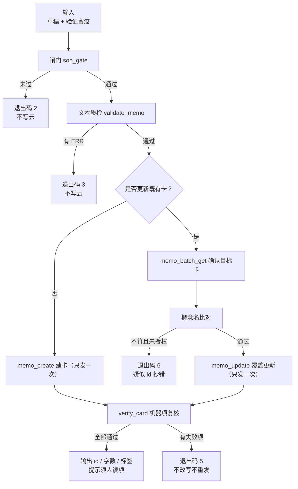
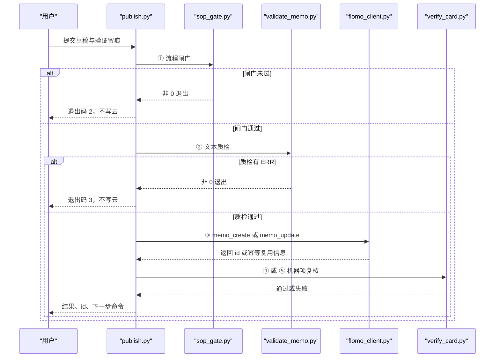

# 3.9 写云与复核（publish + verify_card）

<cite>
**本文引用的文件**   
- [scripts/publish.py](file://scripts/publish.py)
- [scripts/verify_card.py](file://scripts/verify_card.py)
- [tests/test_publish.py](file://tests/test_publish.py)
- [tests/test_verify_card.py](file://tests/test_verify_card.py)
- [README.md](file://README.md)
- [ENVIRONMENT.md](file://ENVIRONMENT.md)
</cite>

## 目录
1. [引言](#引言)
2. [端到端链路总览](#端到端链路总览)
3. [入口与关键参数](#入口与关键参数)
4. [闸门 → 质检 → 建卡 / 覆盖](#闸门--质检--建卡--覆盖)
5. [批次清单与覆盖率统计](#批次清单与覆盖率统计)
6. [回读复核与差异汇总](#回读复核与差异汇总)
7. [verify_card 的回读宽容规则](#verify_card-的回读宽容规则)
8. [命令示例](#命令示例)
9. [部分失败后的重试与修正指南](#部分失败后的重试与修正指南)
10. [退出码速查](#退出码速查)
11. [故障排查要点](#故障排查要点)
12. [结论](#结论)

## 引言
`publish.py` 与 `verify_card.py` 共同构成 flomo-note 流程的第 7 步「自检并写云」和第 8 步「复盘读全文」。前者把「闸门、质检、云端写入、写后机器项复核」固定成一次调用，避免手工拼接请求、重复建卡或抄错 id；后者在写云之后按 H11 要求做可机械判定的回读自查，并把必须人读的两项明确列出。

项目说明中强调：卡片只存在于云端账号，本地不落盘；写云前必须先跑过验证、查重、写作与标签核对，再通过 `publish.py` 这条链完成写云与复核。批量场景则通过 `--batch` 替代逐张手动 dry-run。

**章节来源**
- [README.md:1-200](file://README.md#L1-L200)

## 端到端链路总览



**图表来源**
- [scripts/publish.py:201-462](file://scripts/publish.py#L201-L462)
- [scripts/publish.py:463-753](file://scripts/publish.py#L463-L753)
- [scripts/publish.py:754-1038](file://scripts/publish.py#L754-L1038)
- [scripts/verify_card.py:1-297](file://scripts/verify_card.py#L1-L297)

该链路的核心纪律有三条：

1. 闸门不过，一个字节不发云端。
2. 文本质检存在 ERR，不发。
3. 建卡 `memo_create` 只发一次；失败即停，绝不自动重发。

覆盖既有卡的链路比建卡更危险，因为 id 是人工抄来的，抄错可能把一张卡的正文盖到另一张卡上。因此覆盖路径在写前额外做一次 `memo_batch_get`，读取目标卡并比对概念名；概念名不一致时默认阻塞，只有显式加 `--allow-rename` 才放行。

**章节来源**
- [scripts/publish.py:1-120](file://scripts/publish.py#L1-L120)
- [scripts/publish.py:463-753](file://scripts/publish.py#L463-L753)

## 入口与关键参数

### publish.py 的关键选项

| 参数 | 作用 | 行为说明 |
|---|---|---|
| `--draft <草稿>` | 指定待写云的卡片正文草稿 | 必填；不存在直接返回退出码 1 |
| `--verify <留痕>` | 指定第 2 步搜索留痕文件 | 可选；若提供则必须存在 |
| `--update-id <id>` | 覆盖既有卡片 | 会先读目标卡、比对概念名，再整篇替换 |
| `--allow-rename` | 允许覆盖时更改概念名 | 仅对 `--update-id` 有意义；单独使用返回错误 |
| `--allow-content-loss` | 允许写前内容丢失检查失败 | 覆盖时若发现读数减少或删除断口，可显式放行 |
| `--dry-run` | 只跑到质检 | 不触发建卡或覆盖，也不写云 |
| `--skip-web` | 透传闸门的跳过网页模式 | 传给 `sop_gate.py` |
| `--no-verify-card` | 关闭写后机器项复核 | 一般不建议，除非后续单独处理复核 |
| `--batch <清单>` | 批量写入 | 命令行上的 `--draft`、`--verify`、`--update-id`、`--allow-rename` 不能与 `--batch` 同时出现 |

批量的核心不变量是：**预检全过才写**。预检包括闸门、质检和覆盖对象身份确认；任何一行预检失败，整个批次一张都不写。

**章节来源**
- [scripts/publish.py:1-120](file://scripts/publish.py#L1-L120)
- [scripts/publish.py:754-1038](file://scripts/publish.py#L754-L1038)
- [tests/test_publish.py:201-320](file://tests/test_publish.py#L201-L320)

### verify_card.py 的关键选项

| 参数 | 作用 | 行为说明 |
|---|---|---|
| `--id <id>` | 必填；指定要回读的卡片 id | 从云端取回单卡全文 |
| `--draft <草稿>` | 追加一项机械比对 | 将云端回读与本地草稿按同一归一化口径逐字比较 |
| `--json` | 输出 JSON | 供自动化消费；包含检查项、元信息与须人读项 |
| `--show-body` | 打印云端全文 | 用于两条「须人读」项的当场核对；不与 `--json` 同时生效 |

verify_card 不是“所有问题都查完”的保证书。它会明确列出两项脚本无法判断的内容：首尾是否同一事件、是否串入他卡内容。

**章节来源**
- [scripts/verify_card.py:1-120](file://scripts/verify_card.py#L1-L120)
- [scripts/verify_card.py:201-297](file://scripts/verify_card.py#L201-L297)
- [tests/test_verify_card.py:1-120](file://tests/test_verify_card.py#L1-L120)

## 闸门 → 质检 → 建卡 / 覆盖

### 闸门与质检

`publish.py` 先以子进程方式运行 `sop_gate.py`，传入草稿与验证留痕；随后运行 `validate_memo.py` 做文本质检。闸门未过返回退出码 2，质检存在 ERR 返回退出码 3，两者都不会触发云端写入。



**图表来源**
- [scripts/publish.py:754-1038](file://scripts/publish.py#L754-L1038)

### 建卡路径

建卡路径只做一件事：把草稿交给 `flomo_client.py` 的 `memo_create`，并从成功输出中解析 id。实现上明确禁止自动重发；如果云端返回幂等复用信息，脚本会报告复用 id 而不是新建。

### 覆盖路径

覆盖路径比建卡路径多三步：

1. 调用 `memo_batch_get` 读取目标卡。
2. 提取目标卡与草稿的前两行非空行，比对概念名。
3. 若概念名不同且未加 `--allow-rename`，直接拒绝。

此外，覆盖路径会把云端原文作为改前快照落盘，并在写后生成覆盖差异报告。

**章节来源**
- [scripts/publish.py:463-753](file://scripts/publish.py#L463-L753)
- [tests/test_publish.py:321-486](file://tests/test_publish.py#L321-L486)

## 批次清单与覆盖率统计

### 批次清单格式

`--batch` 接收一个文本清单，每行最多四段，用竖线分隔：

```
草稿 | 留痕 | 覆盖 id | rename
```

- 后三段可以省略或用 `-` 占位。
- 以 `#` 开头的行是注释，会被忽略。
- 第 4 段只接受 `rename`：表示这张覆盖操作允许修改概念名。
- 如果某行写了 `rename` 但没有覆盖 id，解析阶段直接报错。

### 预检阶段的去重

批量化预检不只是逐行检查文件是否存在，还会做以下校验：

| 检查项 | 目的 |
|---|---|
| 草稿不存在 | 防止漏配 |
| 留痕存在性 | 防止漏配验证记录 |
| 同一路径草稿重复 | 防止同一份草稿建两张卡 |
| 正文指纹相同 | 防止复制草稿后改名再跑，造成语义重复卡 |
| 同一 id 被覆盖多次 | 防止第二行草稿覆盖第一行已写结果 |
| 覆盖对象身份 | 预检期就发现 id 抄错，避免前面几张已经写进云端 |

### 覆盖率统计

`publish.py` 本身不是覆盖率工具。它会在批次汇总中打印：

- 计划张数。
- 本次实际写入张数。
- 每张卡的状态：成功、失败或未执行。
- 已成功写入的 id 列表。
- 建议的后续命令：逐张 `verify_card --show-body` 与 `dedup.py --id`。

覆盖率统计的真正来源是测试用例模块中的 `COVERS` 声明，由 `covers.py` 与 `check_skill_docs.py` 解析。`publish.py` 与 `verify_card.py` 各自在回归用例中声明自己覆盖的目标脚本，但这属于“有没有测试认领”，不是运行时覆盖率。

**章节来源**
- [scripts/publish.py:754-1038](file://scripts/publish.py#L754-L1038)
- [tests/test_publish.py:1-200](file://tests/test_publish.py#L1-L200)
- [README.md:1-200](file://README.md#L1-L200)

## 回读复核与差异汇总

### 写后机器项复核

无论建卡还是覆盖，成功后都会调用 `verify_card.py`，并带上草稿路径与 JSON 模式，以便 publish 解析检查结果。如果 verify_card 返回非 0，publish 标记为退出码 5，并明确提示“卡已写入，不改写不重发”。

### 覆盖差异

覆盖路径会在写前保存云端原文，写后把“云端原文”与“本轮草稿”按同一归一化口径做行级差异：

- 丢弃平台渲染补的空行。
- 还原 Markdown 转义。
- 去除行内水平空白。
- 按行序比对，删除行与新增行分别列出。
- 超过显示上限时只列前若干行，并说明剩余行数。
- 删除行数达到改前正文 20% 以上时给出额外警告。

注意：差异报告不是失败条件。即使覆盖差异很大，只要机器项复核通过，publish 仍可返回退出码 0；但删除行必须由人确认是有意的。

### 截断时的差异策略

如果回读目标卡时检测到 `content_truncated`，publish 会跳过差异报告，因为快照只是前半截，拿它 diff 会把没取到的部分误报为删除。

**章节来源**
- [scripts/publish.py:201-462](file://scripts/publish.py#L201-L462)
- [scripts/publish.py:463-753](file://scripts/publish.py#L463-L753)
- [scripts/publish.py:754-1038](file://scripts/publish.py#L754-L1038)
- [tests/test_publish.py:487-600](file://tests/test_publish.py#L487-L600)

## verify_card 的回读宽容规则

verify_card 并不盲目比较原始字节。它对平台层行为做了分类处理：

| 平台差异类型 | 处理方式 | 原因 |
|---|---|---|
| 标签段后补空行 | 结构还原时剔除 | 存储/渲染层插入，本地草稿没有 |
| “要点：”后补空行 | 不参与结构判断 | 避免把平台行为误判为结构异常 |
| Markdown 元字符转义 | 归一化时还原 | 存储层可能对 `[`、`]`、`_` 加反斜杠 |
| 行内水平空白 | 归一化时两侧同去 | 平台可能在标点或代码片段间插空格 |
| 末尾换行 | 不计入净长度 | 存储层可能修掉文件末尾换行 |
| 渲染层补空行 | 结构还原时识别并标记 | 让“第二行是概念名”不因为渲染补行而失败 |

需要特别注意：**空白与行内空白的宽容只用于数字分解与净字符口径，不参与逐字比对。** 当传入 `--draft` 时，verify_card 会把云端回读与本地草稿都经过 `FC._norm_body` 归一化后再逐字比较。也就是说：

- 空行、行内空白、Markdown 转义不参与差异判定。
- 行界与非转义字符不宽容。
- 只要有一个真实字符位置不同，就会报告首个差异位置。

此外，verify_card 还检查：

- 回读是否被截断。
- 首行是否为完整标签段。
- 第二行是否为概念名。
- 形态检查是否通过（复用 `validate_memo.check()`）。
- 是否存在公式占位符残留。
- 是否存在检索回包的截断占位符。
- 实测字数、净字符数、行数、标签、首行、次行、末行等信息。

**章节来源**
- [scripts/verify_card.py:1-200](file://scripts/verify_card.py#L1-L200)
- [scripts/verify_card.py:201-297](file://scripts/verify_card.py#L201-L297)
- [tests/test_verify_card.py:121-320](file://tests/test_verify_card.py#L121-L320)

## 命令示例

> 以下命令中的 `<token>`、`<草稿>`、`<留痕>`、`<id>` 均为占位值。实际 token 应来自 `.mcp.json` 或 `FLOMO_TOKEN`，不应写进仓库。

### 单卡写入

```bash
python scripts/publish.py --draft _tmp/memo_body_XX.txt --verify _tmp/verify_XX.json
```

适用场景：已完成 SOP 第 1–6 步，现在写云。

如果希望先验证闸门与质检而不真正写云：

```bash
python scripts/publish.py --draft _tmp/memo_body_XX.txt --verify _tmp/verify_XX.json --dry-run
```

写云成功后，可按脚本提示复现后续步骤：

```bash
python scripts/verify_card.py --id <新卡 id> --show-body
python scripts/dedup.py --id <新卡 id>
```

### 批量写入

```bash
python scripts/publish.py --batch _tmp/batch.txt
```

批次清单示例：

```text
# 本轮三张
_tmp/memo_body_1.txt | _tmp/verify_1.json | -
_tmp/memo_body_2.txt | _tmp/verify_2.json | -
_tmp/memo_body_fix.txt | _tmp/verify_fix.json | MjUzMzgyODYz
```

### 更新既有卡片

```bash
python scripts/publish.py --draft _tmp/memo_body_XX.txt --verify _tmp/verify_XX.json --update-id MjYxODU0MzI5
```

如果这次确实要改概念名：

```bash
python scripts/publish.py --draft _tmp/memo_body_XX.txt --verify _tmp/verify_XX.json --update-id MjYxODU0MzI5 --allow-rename
```

### 强制跳过写后复核

```bash
python scripts/publish.py --draft _tmp/memo_body_XX.txt --verify _tmp/verify_XX.json --no-verify-card
```

仅建议在已有独立复核流程时使用；默认应该保留 verify_card 复核。

**章节来源**
- [scripts/publish.py:1-120](file://scripts/publish.py#L1-L120)
- [scripts/verify_card.py:1-120](file://scripts/verify_card.py#L1-L120)
- [tests/test_publish.py:201-486](file://tests/test_publish.py#L201-L486)

## 部分失败后的重试与修正指南

### 闸门未过（退出码 2）

- 尚未写云。
- 优先修复验证留痕或草稿中的上游问题。
- 不要直接重跑写云；应重新执行前置流程后再走 publish 链。

### 文本质检有 ERR（退出码 3）

- 尚未写云。
- 修改正文后必须重新跑闸门，因为闸门凭证依赖正文签名或指纹。
- publish 的错误消息会明确提示“改正文后须重跑闸门”。

### 写云失败（退出码 4）

- publish **不会自动重发**。
- 建卡失败时，先用 dedup 按概念名检索，确认云端是否已有同名卡。
- 覆盖失败时，先确认云端当前内容，因为覆盖是整篇替换，重发可能覆盖别人刚改的内容。

### 写后复核失败（退出码 5）

- 卡片已经写进云端。
- publish 不会改写，也不会重发。
- 应运行 `verify_card.py --id <id> --show-body` 查看全文，对照失败项判断是平台渲染差异、草稿不一致，还是真的写错了。
- 如果是真错，修正草稿后重新走 publish 链；若是 id 抄错，先确认正确 id 再重试。

### 覆盖对象确认失败（退出码 6）

常见原因：

1. `--update-id` 抄错。
2. 目标卡已被删除。
3. 目标卡概念名与草稿不同。
4. 云端回包协议形态变化，导致结构无法解析。

处理顺序：

1. 先确认 id 是否对应预期卡片。
2. 如果确实是改名，加 `--allow-rename`。
3. 如果回包无法解析，不要当成“卡不存在”反复重试；应先检查协议形态和网络通道。
4. 如果是 id 抄错，修正 id 后重试。

### 写前内容丢失（退出码 7）

覆盖路径会检测：

- 读数是否减少。
- 是否出现“删在了词中间”的片段。

如果这是有意重写，例如把长卡压缩成机制卡，可以加 `--allow-content-loss`，但必须在 verify_card 的全文核对中逐条认领这些丢失项。

### 批次部分失败

批量的关键原则是：**已成功的行不改写、不重发；只继续未执行的行。**

推荐做法：

1. 看 `[批次汇总]` 中哪些行已执行、哪些未执行。
2. 把已成功的行在清单中注释掉。
3. 只保留失败的行再次运行。
4. 对已成功卡片单独跑 `verify_card --show-body` 与 `dedup --id`。

**章节来源**
- [scripts/publish.py:463-753](file://scripts/publish.py#L463-L753)
- [scripts/publish.py:754-1038](file://scripts/publish.py#L754-L1038)
- [tests/test_publish.py:201-600](file://tests/test_publish.py#L201-L600)

## 退出码速查

### publish.py

| 退出码 | 含义 | 是否已写云 | 下一步 |
|---|---|---:|---|
| 0 | 成功且机器项复核全过 | 是 | 人读全文 + 定向复查 |
| 1 | 前置检查不通过 | 否 | 检查草稿、留痕、参数 |
| 2 | 闸门未过 | 否 | 修复上游验证/查重问题后重跑 |
| 3 | 文本质检有 ERR | 否 | 改正文并重跑闸门 |
| 4 | 写入失败 | 不确定 | 先确认云端现状，禁止自动重发 |
| 5 | 已写入但机器项复核失败 | 是 | 不改写不重发，按失败项人工处置 |
| 6 | 目标卡确认不通过 | 否 | 核对 id、概念名或协议形态 |
| 7 | 写前内容丢失 | 否 | 修正或显式放行并认领丢失项 |

### verify_card.py

| 退出码 | 含义 |
|---|---|
| 0 | 机械项全过 |
| 1 | 有机械项失败，或回读失败 |

**章节来源**
- [scripts/publish.py:1-120](file://scripts/publish.py#L1-L120)
- [scripts/verify_card.py:201-297](file://scripts/verify_card.py#L201-L297)
- [tests/test_publish.py:1-200](file://tests/test_publish.py#L1-L200)

## 故障排查要点

### 网络与代理

写云与回读共用 net_util 的网络通道逻辑。沙箱环境中 HTTP 代理常返回 502，因此“网络不通”的判断必须结合代理情况。env 中 `PYTHONUTF8=1` 与 `PYTHONIOENCODING=utf-8` 会被 publish 注入到子进程环境，避免 GBK 控制台下子脚本打印崩溃。

### 凭据缺失

当找不到 flomo token 时，底层 `FlomoError` 会被统一收敛为一行错误消息和非 0 退出码，而不是 traceback。因此看到“未找到 flomo token”类提示时，应优先检查 `.mcp.json` 或 `FLOMO_TOKEN`，而不是继续重试写云。

### 云端回读协议形态

verify_card 和 publish 都依赖 `flomo_client.tool_data` 或 `tool_data_or_none` 解析回包。如果云端协议形态变化，可能出现：

- 回包里没有结构化数据。
- 整个信封被误当卡片。
- `memos` 为空。

这类错误不应简单理解为“云端没有这张卡”，否则可能重建重复卡。

### 渲染层差异干扰

verify_card 专门处理标签段后补空行、“要点：”后补空行、Markdown 转义、行内空白等问题。若自行编写二次校验脚本，不应直接比较原始字节，而应复用 `FC._norm_body` 的同口径归一化逻辑。

**章节来源**
- [ENVIRONMENT.md:1-200](file://ENVIRONMENT.md#L1-L200)
- [scripts/verify_card.py:1-200](file://scripts/verify_card.py#L1-L200)
- [scripts/publish.py:1-120](file://scripts/publish.py#L1-L120)

## 结论

`publish.py` 负责把写云动作收敛成一条不可跳过的链：闸门 → 质检 → 建卡或覆盖 → 机器项复核。它用“只发一次”“预检全过才写”“写前概念名比对”三条硬约束，降低重复卡、id 抄错和内容丢失的风险。

`verify_card.py` 负责写云之后的回读自查：它承担可机械判定的部分，同时明确标出必须人读的两项，避免自动化输出制造“已全面检查”的假象。

两者配合时，最佳实践是：

1. 先跑 `--dry-run` 确认闸门与质检。
2. 正式写云后，至少运行一次 `verify_card --id <id> --show-body`。
3. 批量写入时根据 `[批次汇总]` 只续跑未完成行。
4. 遇到退出码 4、5、6、7 时，不要盲目重试，先按对应分支确认云端现状与 id 正确性。
5. 差异报告中出现的删除行，尤其是超过 20% 的重写，必须逐条确认为有意改动。