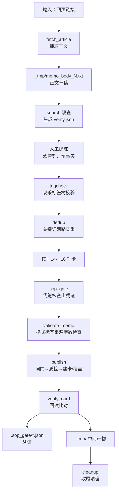
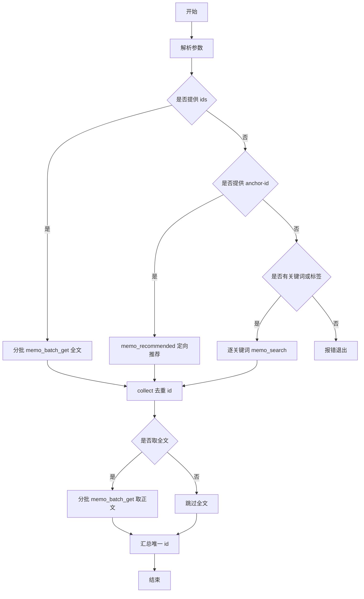
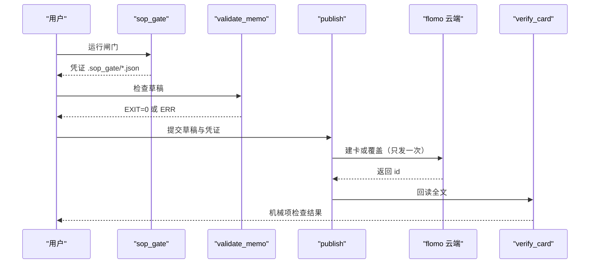
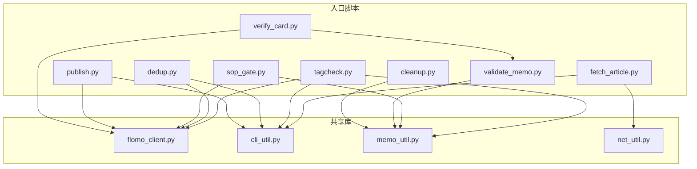

# 写卡 SOP 详解

<cite>
**本文引用的文件**   
- [README.md](file://README.md)
- [SKILL.md](file://SKILL.md)
- [ENVIRONMENT.md](file://ENVIRONMENT.md)
- [scripts/fetch_article.py](file://scripts/fetch_article.py)
- [scripts/tagcheck.py](file://scripts/tagcheck.py)
- [scripts/dedup.py](file://scripts/dedup.py)
- [scripts/sop_gate.py](file://scripts/sop_gate.py)
- [scripts/validate_memo.py](file://scripts/validate_memo.py)
- [scripts/publish.py](file://scripts/publish.py)
- [scripts/verify_card.py](file://scripts/verify_card.py)
- [scripts/cleanup.py](file://scripts/cleanup.py)
</cite>

## 目录
1. [引言](#引言)
2. [整体流水线与产物总览](#整体流水线与产物总览)
3. [第 1 步：内容抓取 fetch_article](#第-1-步内容抓取-fetch_article)
4. [第 2 步：术语验证 search 与 verify.json](#第-2-步术语验证-search-与-verifyjson)
5. [第 3 步：内容提炼](#第-3-步内容提炼)
6. [第 4 步：标签确定 tagcheck](#第-4-步标签确定-tagcheck)
7. [第 5 步：查重 dedup](#第-5-步查重-dedup)
8. [第 6 步：卡片写作](#第-6-步卡片写作)
9. [第 7 步：流程闸门 sop_gate](#第-7-步流程闸门-sop_gate)
10. [第 8 步：文本质检 validate_memo](#第-8-步文本质检-validate_memo)
11. [第 9 步：写云 publish 与复核 verify_card](#第-9-步写云-publish-与复核-verify_card)
12. [完整命令行示例：从链接到云端卡片](#完整命令行示例从链接到云端卡片)
13. [失败场景与恢复方式](#失败场景与恢复方式)
14. [依赖关系图](#依赖关系图)
15. [结论](#结论)

## 引言
本教程面向 flomo-note 的「写卡 SOP」，按 SKILL.md 定义的执行顺序讲解九步流水线。目标是让即使不熟悉代码的人也能理解每一步要做什么、调用哪个命令、产生什么中间产物、失败时如何判断和恢复，并给出一条可直接复现的完整命令行路径。

核心原则来自项目总则与细则：
- 抓回正文必须读回，不能只凭摘要或记忆落笔。
- 专业术语、机构、产品、模型简称等必须现查并留痕。
- 标签必须现采树、严格两级、同顶层兄弟二级可参考。
- 查重必须逐关键词现查，id 去重后分批取全文。
- 写云前必须过闸门 + 质检；写云后必须回读比对。
- 收尾清理临时文件，避免残留堆积。

**章节来源**
- [README.md:1-120](file://README.md#L1-L120)
- [SKILL.md:1-151](file://SKILL.md#L1-L151)

## 整体流水线与产物总览
九步不是九个孤立动作，而是一条有输入输出、有中间态、有强制留痕的流水线。下图把每步的命令、主要参数、关键中间产物串起来：



**图表来源**
- [scripts/fetch_article.py:1-60](file://scripts/fetch_article.py#L1-L60)
- [scripts/tagcheck.py:1-40](file://scripts/tagcheck.py#L1-L40)
- [scripts/dedup.py:1-60](file://scripts/dedup.py#L1-L60)
- [scripts/sop_gate.py:1-60](file://scripts/sop_gate.py#L1-L60)
- [scripts/validate_memo.py:1-40](file://scripts/validate_memo.py#L1-L40)
- [scripts/publish.py:1-60](file://scripts/publish.py#L1-L60)
- [scripts/verify_card.py:1-40](file://scripts/verify_card.py#L1-L40)
- [scripts/cleanup.py:1-40](file://scripts/cleanup.py#L1-L40)

**章节来源**
- [README.md:60-120](file://README.md#L60-L120)
- [ENVIRONMENT.md:170-220](file://ENVIRONMENT.md#L170-L220)

## 第 1 步：内容抓取 fetch_article
### 目标
把网页正文落到 `_tmp/`，并附带标题、发布日期、字符数等信息，供后续「抓回即读回」。

### 命令与参数
```bash
python scripts/fetch_article.py <url> --out _tmp/memo_body_1.txt
```

常用参数：
| 参数 | 含义 | 默认值 | 说明 |
|---|---|---:|---|
| `--out` | 正文输出路径 | 由脚本决定 | 建议显式写到 `_tmp/memo_body_N.txt` |
| `--min-chars` | 抽取阶段最小字数阈值 | 300 | 低于阈值会判为抽取结果过短 |
| `--timeout` | 请求超时秒数 | 30 | 网络慢时可适当放大 |
| `--via` | 出网通道策略 | auto | auto 先环境代理再直连；direct 强制直连；proxy 强制代理 |
| `--print` | 同时打印正文到 stdout | 关 | 短文调试可用 |

### 中间产物
- `_tmp/memo_body_1.txt`：清洗后的正文文本。
- 标准输出中会提示下一步应读取的文件名。

### 行为要点
- 优先使用站内专用选择器，通用页面走兜底抽取。
- 首尾噪音（面包屑、日期、来源、作者、推荐位、下载 APP、声明）会裁剪并打印 `[裁剪]` 行。
- 若抽取后半截缺失，会用页面小节标题对比并打印 `[告警]`，提醒先核对原文。
- 出网通道自动回退：先走环境代理，不通就直连重试，并说明实际走通的那条。
- 两条通道都失败时，会把两个失败原因一起报出。

### 失败场景与恢复
| 现象 | 退出码 | 原因 | 恢复方式 |
|---|---:|---|---|
| HTTP 非 HTML / 连接失败 | 1 | 网络问题或目标页不是文章正文 | 用 `netdoctor.py` 排查代理；必要时加 `--via direct` 或 `--via proxy` |
| 正文过短 | 2 | SPA 渲染页、反爬页或 JS 未执行 | 换 webfetch、镜像站或预印本通道；不要硬改 min-chars 绕过 |
| 代理端口错误 | 1 | 沙箱代理端口会话级变化，旧端口失效 | 不写死端口，交给脚本自动回退或先用 netdoctor 诊断 |

**章节来源**
- [scripts/fetch_article.py:1-60](file://scripts/fetch_article.py#L1-L60)
- [scripts/fetch_article.py:60-180](file://scripts/fetch_article.py#L60-L180)
- [ENVIRONMENT.md:30-90](file://ENVIRONMENT.md#L30-L90)

## 第 2 步：术语验证 search 与 verify.json
### 目标
对专业术语、机构、产品、模型简称等进行「现查」，并把搜索记录写入 `verify.json`，供闸门核验。

### 命令与产物
这一步通常由 AI 助手在 MCP 或控制台里调用搜索工具完成。SOP 要求：
- 每个可疑术语至少一次真实搜索。
- 搜索结果不得只停留在对话里，必须落盘成 JSON。
- 写卡时由 `sop_gate.py` 读取该文件进行校验。

典型 `verify.json` 结构：
```json
{
  "searched": true,
  "terms": [
    {
      "term": "某术语",
      "query": "搜索词",
      "conclusion": "确认为某标准称谓",
      "in_body": ["正文中出现的证据片段"],
      "not_in_body": "本次结论不需要写进正文的理由"
    }
  ]
}
```

### 闸门对 verify.json 的要求
`sop_gate.py` 不仅检查「是否搜过」，还要检查「搜到的东西有没有写进卡」：
1. 优先看 `in_body`：每项必须是正文真实子串，且不能等于术语本身。
2. 若结论含数字 + 单位或星级评级，这些关键参数至少有一项出现在正文。
3. 纯命名类核实：术语本身的词块至少一个出现在正文。
4. 确实不该写进正文的条目，须显式写 `not_in_body` 并给出理由。

### 失败场景与恢复
| 现象 | 处理 |
|---|---|
| 没有 `verify.json` | 补做搜索并落盘；若卡片主体确实不是术语，可改用 `--skip-web` 并在凭证中留痕 |
| 只有搜索记录，正文没引用 | 补充证据片段到正文，或明确写 `not_in_body` 并解释 |
| 关键参数没落正文 | 把数字、单位、星级等实质信息写进要点或正文 |

**章节来源**
- [scripts/sop_gate.py:1-120](file://scripts/sop_gate.py#L1-L120)
- [README.md:60-100](file://README.md#L60-L100)

## 第 3 步：内容提炼
### 目标
从抓取正文中过滤营销话术、事件包装、重复叙述，提取事实、数据、因果链和概念本体。

### 处理规则
- 不把「材料不是概念」直接退回；应从报道、财报、通告、观点文中提取一个独立概念。
- 概念名是名词短语，标识对象本身，不含谓语、不含切片限定。
- 事件的时间线、动机、话术属于载体素材，不应成为概念名；关键参数进入正文要点。
- 一事一卡，标签聚合。

### 失败场景与恢复
| 现象 | 恢复 |
|---|---|
| 概念名像一句话 | 去掉谓语和事件限定，改为稳定指称对象的名词短语 |
| 概念名带时间/版本/地区限定 | 把限定移到正文要点，概念名保持跨切片不变 |
| 正文全是叙事 | 先回答「这个东西是什么」，再把事件细节放进要点 |

**章节来源**
- [SKILL.md:152-300](file://SKILL.md#L152-L300)
- [README.md:60-100](file://README.md#L60-L100)

## 第 4 步：标签确定 tagcheck
### 目标
现采云端标签树，校验拟用标签是否合法、是否存在，并列出同顶层兄弟二级，防止近义簇分裂。

### 命令与参数
```bash
python scripts/tagcheck.py --tags "AI/Agent,科技/测试"
```

可选参数：
| 参数 | 含义 | 默认值 | 说明 |
|---|---|---:|---|
| `--tags` | 待校验标签，逗号分隔 | 空 | 支持全角逗号、顿号；可省略 `#` |
| `--grep` | 正则匹配现有标签名 | 空 | 只列匹配项，不做判定 |
| `--limit` | 标签树查询上限 | 2000 | 若 total 与返回条数不符，视为截断 |

### 校验规则
- 严格两级：`#顶层/二级`，禁止单层、三级及以上。
- 同名差异归一化：只差空白、全半角斜杠、大小写的标签被视为同一簇，照原样写入会造成簇分裂。
- 若顶级不存在但有子标签，视为顶级存在。
- 列出同顶层兄弟二级，帮助判断复用还是新建更精准。

### 失败场景与恢复
| 现象 | 退出码 | 恢复 |
|---|---:|---|
| 标签层级不合规 | 2 | 改成严格两级 |
| 标签与现有写法只差空白/全半角/大小写 | 2 | 改回树中已有写法 |
| 标签不存在 | 2 | 根据顶层是否存在决定是否新建二级 |
| 标签树被截断 | 1 | 增大 `--limit` 重新现采 |

**章节来源**
- [scripts/tagcheck.py:1-120](file://scripts/tagcheck.py#L1-L120)
- [scripts/tagcheck.py:120-201](file://scripts/tagcheck.py#L120-L201)

## 第 5 步：查重 dedup
### 目标
对概念名派生的关键词进行「逐次现查」，再做 id 去重，并按服务端限制分批取全文，避免手抄 id 导致指向另一张卡。

### 命令与参数
```bash
python scripts/dedup.py --keywords "智能体,agent,工具契约" --tag "AI/Agent"
```

可选参数：
| 参数 | 含义 | 默认值 | 说明 |
|---|---|---:|---|
| `--keywords` | 关键词，支持半角/全角逗号、顿号、分号、换行 | 空 | 每个关键词单独调一次 |
| `--tag` | 标签查重路 | 空 | 与关键词路并行 |
| `--id` | 复盘锚点 id | 空 | 调用 `memo_recommended` 定向推荐 |
| `--ids` | 点名读全文的 id 列表 | 空 | 不受 `--max-full` 限制 |
| `--limit` | 每次检索条数 | 10 | 下限 1 |
| `--max-full` | 全文卡片数上限 | 8 | 超出部分只列 id |
| `--no-full` | 只看命中清单，不取全文 | 关 | 调试或大批量时使用 |

### 处理流程


**图表来源**
- [scripts/dedup.py:60-220](file://scripts/dedup.py#L60-L220)

### 失败场景与恢复
| 现象 | 退出码 | 恢复 |
|---|---:|---|
| 未提供任何输入 | 1 | 至少给 `--keywords`、`--tag`、`--id` 或 `--ids` 之一 |
| 云端调用失败 | 1 | 查重未完成，不得据此判无命中，也不得进入写云 |
| 全文未全部取到 | 1 | 显式用 `--ids ID1,ID2` 点名读其中几张 |
| 超过 `--max-full` | 正常输出但带告警 | 缩小范围或点名读重点卡 |

**章节来源**
- [scripts/dedup.py:1-120](file://scripts/dedup.py#L1-L120)
- [scripts/dedup.py:120-220](file://scripts/dedup.py#L120-L220)

## 第 6 步：卡片写作
### 目标
按照 SKILL.md 的 H14–H16 格式规范写出一张「一事一卡」的 flomo 卡片。

### 基本形态
- 首行：标签段，形式为 `#顶层/二级`。
- 第二行：概念名称，是名词短语，标识对象本身。
- 第三行起：正文，包含要点、结构等内容。
- 所有卡片均为追踪卡，后续进展用更新接口维护。

### 写作纪律
- 概念名不可是主谓句，不可带事件切片限定。
- 正文首句应回答「这个概念是什么 / 怎么工作」。
- 营销话术、事件动机、无关时间线不写进概念名。
- 关键参数、数据、阈值、版本、覆盖范围进入正文要点。
- 标签必须通过 tagcheck 校验，不得出现近义簇分裂写法。

### 失败场景与恢复
| 现象 | 恢复 |
|---|---|
| 第二行像句子 | 改为名词短语，把事件描述移入正文 |
| 概念名带版本/时间/地区 | 把限定移入要点，概念名保持稳定 |
| 标签写成三级或单层 | 回到第 4 步重新确定两级标签 |

**章节来源**
- [SKILL.md:152-300](file://SKILL.md#L152-L300)
- [README.md:60-100](file://README.md#L60-L100)

## 第 7 步：流程闸门 sop_gate
### 目标
把「靠自觉」的第 2、4、5、8 步变成机械强制留痕：代跑标签核对、查重两路、复盘三路，校验验证记录，并通过后落 `.sop_gate/<signature>.json` 凭证。

### 命令与参数
```bash
python scripts/sop_gate.py --memo _tmp/memo_body_1.txt --verify _tmp/verify_1.json
```

可选参数：
| 参数 | 含义 | 说明 |
|---|---|---|
| `--skip-web` | 声明无需第 2 步术语验证 | 仅当卡片主体不是术语/机构/产品/模型/定理简称时使用 |
| `--anchor-id` | 更新场景指定复盘锚点 id | 与 `--id` 复盘逻辑配合 |
| `--out` | 自定义凭证路径 | 默认落 `.sop_gate/` |
| `--allow-no-gate` | 批量历史卡降级闸门 | 必须写明理由，凭证中保留授权标记 |

### 闸门职责
- 校验 verify.json 中的术语是否真正落进正文。
- 现采标签树，逐项校验严格两级、是否存在、是否与现有标签只差写法。
- 从概念名派生关键词，代跑查重两路。
- 记录机器无法判定的边界项，如「命中候选是否同一事件」。
- 通过后写出带正文指纹的凭证。

### 失败场景与恢复
| 现象 | 退出码 | 恢复 |
|---|---:|---|
| 术语结论未落正文 | 1 | 补充 in_body 或把关键参数写进正文 |
| 标签不在树中或层级不对 | 1 | 回到第 4 步修正标签 |
| 凭证过期 | 1 | 凭证有效期 6 小时，需重跑闸门 |
| 批量历史卡无凭证 | 1 | 用 `--allow-no-gate` 留痕理由，仅限特殊场景 |

**章节来源**
- [scripts/sop_gate.py:1-200](file://scripts/sop_gate.py#L1-L200)
- [ENVIRONMENT.md:170-220](file://ENVIRONMENT.md#L170-L220)

## 第 8 步：文本质检 validate_memo
### 目标
在写云前对草稿做格式、标签、来源、载体、字数的静态自检，并校验闸门凭证。

### 命令与参数
```bash
python scripts/validate_memo.py --file _tmp/memo_body_1.txt
```

可选参数：
| 参数 | 含义 | 说明 |
|---|---|---|
| `--file` | 指定草稿文件 | 也支持 `--create`、`--content` 等多种输入形态 |
| `--no-gate` | 降级闸门为警告 | 必须有 `--allow-no-gate` 授权标记才放行 |

### 检查项
- 格式：首行标签段、第二行概念名、空行接正文。
- 标签：严格两级，不允许裸顶层或三级以上。
- 来源：URL 必须真实抓取并基于实际内容写作。
- 载体：不得混入平台截图、临时占位符、渲染层残留。
- 字数：实测长度不超过硬限。
- 闸门凭证：存在、签名匹配、未过期。

### 失败场景与恢复
| 现象 | 退出码 | 恢复 |
|---|---:|---|
| 格式错误 | 1 | 按 H14–H16 修复 |
| 标签不合规 | 1 | 回到第 4 步重新定标签 |
| 缺少来源或来源未真实抓取 | 1 | 补抓正文并确认 URL |
| 闸门凭证缺失或过期 | 1 | 重跑 `sop_gate.py` |
| 需要批量处理历史卡 | 1 | 闸门授权后再用 `--no-gate` |

**章节来源**
- [scripts/validate_memo.py:1-120](file://scripts/validate_memo.py#L1-L120)
- [scripts/validate_memo.py:120-300](file://scripts/validate_memo.py#L120-L300)

## 第 9 步：写云 publish 与复核 verify_card
### 目标
把一条链固定为：闸门 → 质检 → 建卡或覆盖 → 机器项复核 → 回读比对。新建只发一次，覆盖前先回读目标卡身份，写后逐字对账。

### 命令与参数
```bash
python scripts/publish.py --draft _tmp/memo_body_1.txt --verify _tmp/verify_1.json
```

覆盖既有卡：
```bash
python scripts/publish.py --draft _tmp/memo_body_1.txt --verify _tmp/verify_1.json --update-id MjYxODU0MzI5
```

可选参数：
| 参数 | 含义 | 说明 |
|---|---|---|
| `--batch` | 批次清单路径 | 每行 `草稿 | 留痕 | 覆盖 id | rename` |
| `--allow-rename` | 允许覆盖时改名 | 更新场景下修改概念名 |
| `--allow-content-loss` | 允许有意重写导致内容减少 | 谨慎使用 |
| `--dry-run` | 只跑到质检 | 不写云 |
| `--skip-web` | 透传闸门的 skip-web | 非术语卡 |
| `--no-verify-card` | 跳过写后机器项复核 | 不建议关闭 |

### 写云流程


**图表来源**
- [scripts/publish.py:1-120](file://scripts/publish.py#L1-L120)
- [scripts/verify_card.py:1-120](file://scripts/verify_card.py#L1-L120)

### verify_card 的职责
- 回读全文，检查是否被截断。
- 检查首行标签段、第二行概念名。
- 复用 validate_memo 的形态检查逻辑。
- 检查公式占位符、截断占位符。
- 按统一口径计算净字符数，并与本地草稿比对。
- 显式列出两项必须由人读的盲区：首尾是否同一事件、是否串入他卡内容。

### 失败场景与恢复
| 现象 | 退出码 | 恢复 |
|---|---:|---|
| 闸门未过 | 2 | 回到第 4–7 步修复 |
| 文本质检 ERR | 3 | 回到第 6–8 步修复 |
| 写入失败 | 4 | 不重发，先人工核实 |
| 已写入但机器项复核失败 | 5 | 不改写、不重发，按报告修复 |
| 目标卡确认失败 | 6 | 检查 id、概念名，改名需 `--allow-rename` |
| 内容意外减少 | 7 | 检查删改，确有意图可加 `--allow-content-loss` |

**章节来源**
- [scripts/publish.py:1-200](file://scripts/publish.py#L1-L200)
- [scripts/verify_card.py:1-200](file://scripts/verify_card.py#L1-L200)

## 完整命令行示例：从链接到云端卡片
以下示例假设当前仓库根为工作目录，token 已通过 `.mcp.json` 或 `FLOMO_TOKEN` 配置好。

```bash
# 0. 准备
cd flomo-note
mkdir -p _tmp

# 1. 抓取正文
python scripts/fetch_article.py https://example.com/article \
  --out _tmp/memo_body_1.txt

# 2. 术语验证（由 MCP 搜索或控制台搜索完成）
# 将结果落盘为 verify.json，字段见第 2 步说明

# 3. 提炼内容并写出卡片草稿
# 编辑 _tmp/memo_body_1.txt，确保符合 H14–H16

# 4. 校验标签
python scripts/tagcheck.py --tags "AI/Agent"

# 5. 查重
python scripts/dedup.py --keywords "智能体,agent,工具契约" --tag "AI/Agent"

# 6. 再次确认草稿符合格式（可选）
python scripts/validate_memo.py --file _tmp/memo_body_1.txt

# 7. 流程闸门
python scripts/sop_gate.py --memo _tmp/memo_body_1.txt --verify _tmp/verify_1.json

# 8. 文本质检（publish 内部也会跑，这里可提前自检）
python scripts/validate_memo.py --file _tmp/memo_body_1.txt

# 9. 写云与复核
python scripts/publish.py --draft _tmp/memo_body_1.txt --verify _tmp/verify_1.json

# 10. 复盘（可选）
python scripts/dedup.py --id MjYxODU0MzI5
python scripts/verify_card.py --id MjYxODU0MzI9 --show-body

# 11. 收尾清理
python scripts/cleanup.py
```

**章节来源**
- [README.md:60-120](file://README.md#L60-L120)
- [scripts/fetch_article.py:1-60](file://scripts/fetch_article.py#L1-L60)
- [scripts/tagcheck.py:1-40](file://scripts/tagcheck.py#L1-L40)
- [scripts/dedup.py:1-60](file://scripts/dedup.py#L1-L60)
- [scripts/sop_gate.py:1-60](file://scripts/sop_gate.py#L1-L60)
- [scripts/validate_memo.py:1-40](file://scripts/validate_memo.py#L1-L40)
- [scripts/publish.py:1-60](file://scripts/publish.py#L1-L60)
- [scripts/verify_card.py:1-40](file://scripts/verify_card.py#L1-L40)
- [scripts/cleanup.py:1-40](file://scripts/cleanup.py#L1-L40)

## 失败场景与恢复
### 通用排障顺序
1. 先看退出码：0 成功，1 阻塞，2 参数错误，其余由具体脚本定义。
2. 先看网络：代理端口可能变化，优先用 `netdoctor.py` 诊断。
3. 再看 token：没有 token 时所有云端调用都会失败。
4. 再看中间产物：`.sop_gate/*.json`、`verify.json`、`_tmp/memo_body_*.txt`。
5. 最后按步骤回溯：标签 → 查重 → 闸门 → 质检 → 写云 → 复核。

### 常见错误矩阵
| 步骤 | 典型错误 | 恢复 |
|---|---|---|
| fetch_article | 代理 502、SPA 无正文 | 用 netdoctor 诊断；换 via 或直接走 sni_fetch 通道 |
| verify.json | 术语未落正文 | 补充 in_body 或 key evidence；非术语用 `--skip-web` |
| tagcheck | 标签三级或单层 | 改成严格两级；复制树中已有写法 |
| dedup | 云端调用中断 | 不判无命中，修复网络后重跑 |
| sop_gate | 凭证过期 | 重跑闸门；历史卡批量需 `--allow-no-gate` |
| validate_memo | 格式/标签/来源错误 | 按 ERR 逐项修复 |
| publish | id 抄错或概念名不符 | 不重发；确认 id，改名需 `--allow-rename` |
| verify_card | 回读截断 | 用 memo_batch_get 重取全文 |
| cleanup | 残留未清 | 用 `--list-rules` 查看扫描规则，确认窗口与保留项 |

**章节来源**
- [scripts/fetch_article.py:1-60](file://scripts/fetch_article.py#L1-L60)
- [scripts/tagcheck.py:120-201](file://scripts/tagcheck.py#L120-L201)
- [scripts/dedup.py:120-220](file://scripts/dedup.py#L120-L220)
- [scripts/sop_gate.py:120-200](file://scripts/sop_gate.py#L120-L200)
- [scripts/publish.py:120-200](file://scripts/publish.py#L120-L200)
- [scripts/cleanup.py:1-120](file://scripts/cleanup.py#L1-L120)

## 依赖关系图
各脚本并非独立工具，而是围绕 flomo_client、cli_util、memo_util、net_util 组成的流水线：



**图表来源**
- [scripts/fetch_article.py:1-60](file://scripts/fetch_article.py#L1-L60)
- [scripts/tagcheck.py:1-60](file://scripts/tagcheck.py#L1-L60)
- [scripts/dedup.py:1-60](file://scripts/dedup.py#L1-L60)
- [scripts/sop_gate.py:1-60](file://scripts/sop_gate.py#L1-L60)
- [scripts/validate_memo.py:1-60](file://scripts/validate_memo.py#L1-L60)
- [scripts/publish.py:1-60](file://scripts/publish.py#L1-L60)
- [scripts/verify_card.py:1-60](file://scripts/verify_card.py#L1-L60)
- [scripts/cleanup.py:1-60](file://scripts/cleanup.py#L1-L60)

## 结论
flomo-note 的写卡 SOP 不是「写完再发」，而是一套以留痕和凭证为中心的流水线。  
- 第 1 步保证正文真实可读。  
- 第 2 步保证术语有据可查。  
- 第 4 步保证标签不分裂。  
- 第 5 步保证查重不靠手抄 id。  
- 第 7 步把漏做变成物理不可能。  
- 第 9 步保证写云幂等、覆盖安全、回读可验。  

只要按顺序跑完九步，并用 `cleanup.py` 收尾，就能把「链接 → 正文 → 草稿 → 凭证 → 云端卡片」这条链路固定下来，而不是依赖每次不同的临时命令。