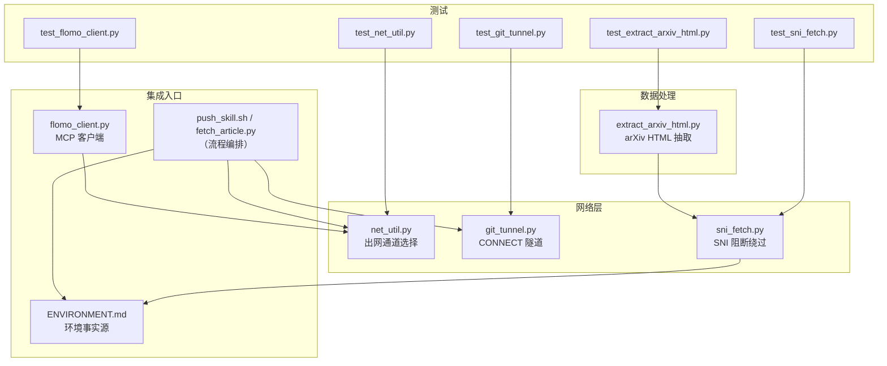
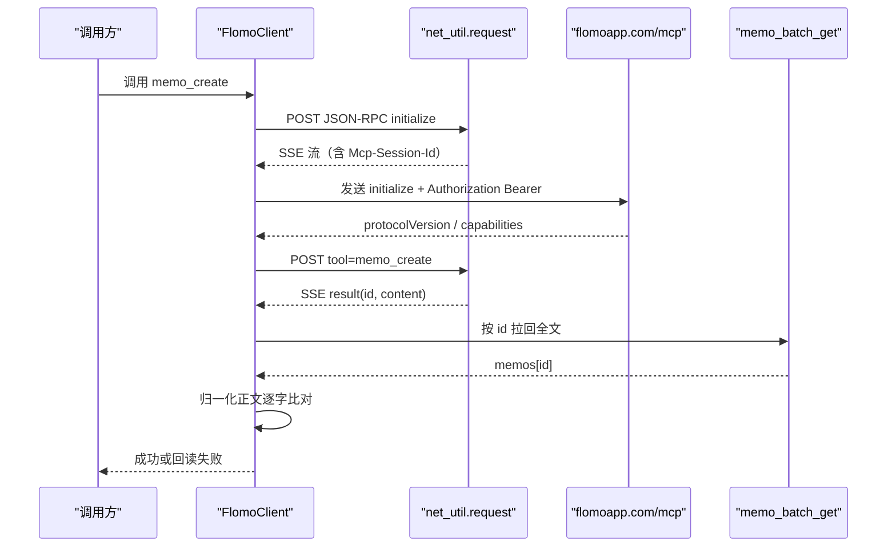
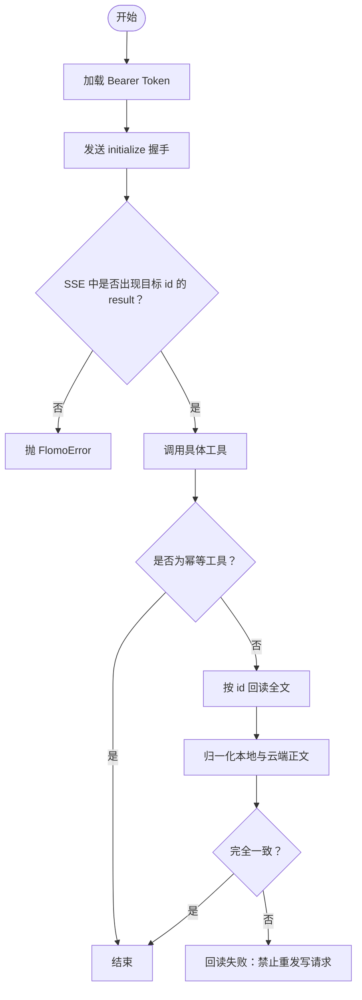
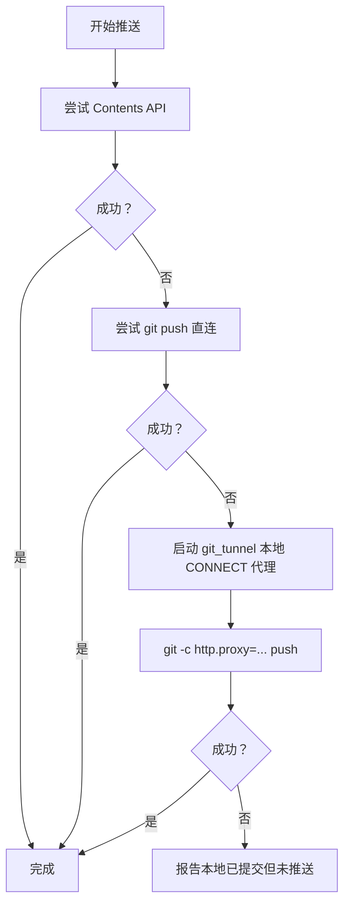
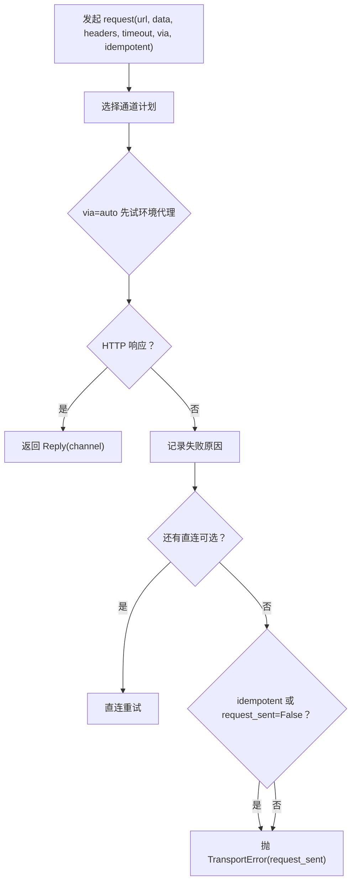
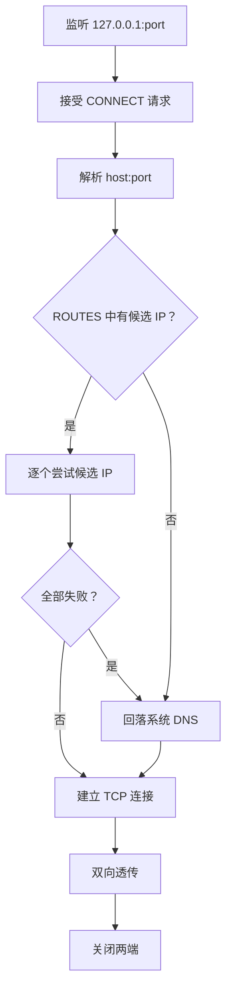
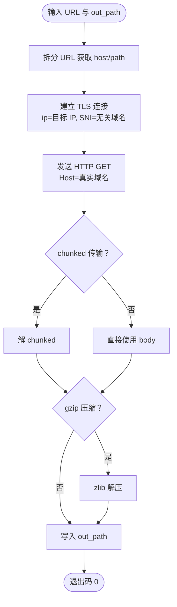
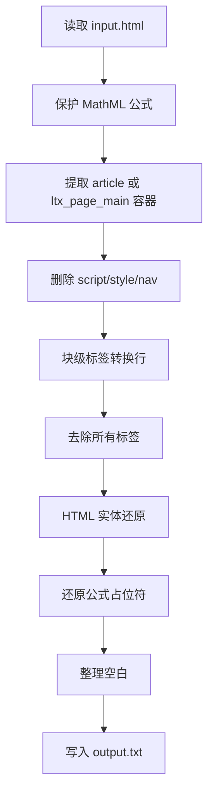
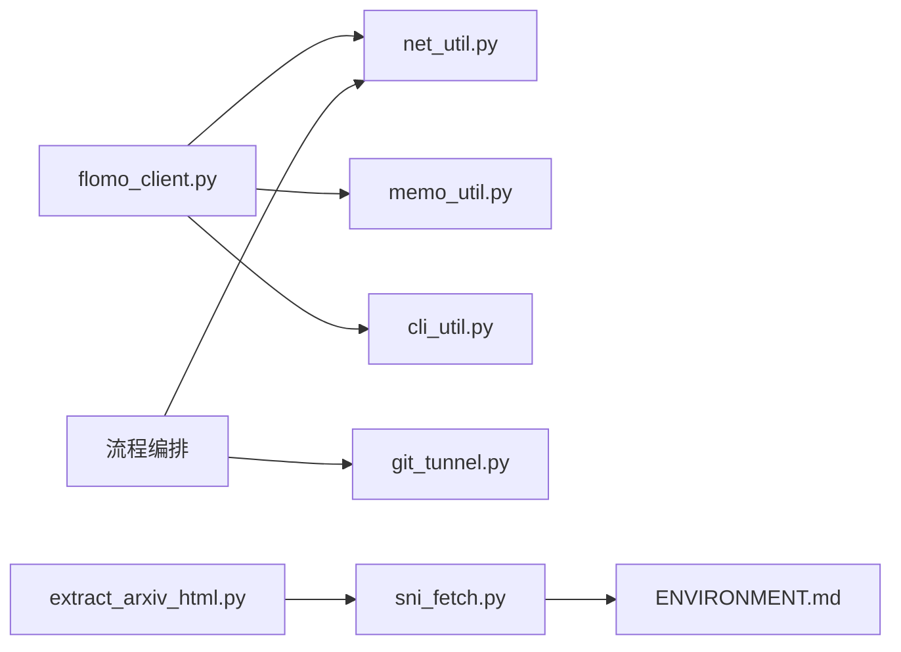

# 外部集成

<cite>
**本文引用的文件**   
- [flomo_client.py](file://scripts/flomo_client.py)
- [net_util.py](file://scripts/net_util.py)
- [git_tunnel.py](file://scripts/git_tunnel.py)
- [sni_fetch.py](file://scripts/sni_fetch.py)
- [extract_arxiv_html.py](file://scripts/extract_arxiv_html.py)
- [test_flomo_client.py](file://tests/test_flomo_client.py)
- [test_net_util.py](file://tests/test_net_util.py)
- [test_git_tunnel.py](file://tests/test_git_tunnel.py)
- [test_sni_fetch.py](file://tests/test_sni_fetch.py)
- [test_extract_arxiv_html.py](file://tests/test_extract_arxiv_html.py)
- [ENVIRONMENT.md](file://ENVIRONMENT.md)
</cite>

## 目录
1. [引言](#引言)
2. [项目结构](#项目结构)
3. [核心组件](#核心组件)
4. [架构总览](#架构总览)
5. [详细组件分析](#详细组件分析)
6. [依赖关系分析](#依赖关系分析)
7. [性能与可靠性特征](#性能与可靠性特征)
8. [故障排查指南](#故障排查指南)
9. [结论](#结论)

## 引言
本专题聚焦 flomo-note 的「外部集成」能力，覆盖五类关键路径：
- flomo MCP 客户端：握手、协议发现、Bearer Token 鉴权、SSE 流解析、写后回读全文比对。
- GitHub 推送通道：Contents API / git push / 本地 CONNECT 代理三通道回退策略。
- 网络代理与隧道：`git_tunnel.py` 的 GitHub DNS 隧道，以及 `net_util.py` 的环境代理失败自动转直连。
- SNI 阻断绕过：`sni_fetch.py` 的域名前置原理与使用场景。
- arXiv HTML 抽取：`extract_arxiv_html.py` 从 LaTeXML HTML 中抽取正文并保留数学公式。

这些模块共同解决一个现实问题：沙箱/本机代理不稳定、GitHub DNS 被劫持、arXiv 受 SNI 关键字过滤，而 flomo MCP 写入又必须做强一致性验收。

## 项目结构
相关脚本集中在 `scripts/`，回归用例集中在 `tests/`；环境差异与连接细节记录在 `ENVIRONMENT.md`。

**图表来源**
- [flomo_client.py:1-200](file://scripts/flomo_client.py#L1-L200)
- [net_util.py:1-196](file://scripts/net_util.py#L1-L196)
- [git_tunnel.py:1-200](file://scripts/git_tunnel.py#L1-L200)
- [sni_fetch.py:1-166](file://scripts/sni_fetch.py#L1-L166)
- [extract_arxiv_html.py:1-74](file://scripts/extract_arxiv_html.py#L1-L74)
- [ENVIRONMENT.md:1-200](file://ENVIRONMENT.md#L1-L200)

**章节来源**
- [ENVIRONMENT.md:1-200](file://ENVIRONMENT.md#L1-L200)

## 核心组件
- **flomo MCP 客户端**：封装 initialize、工具调用、SSE 响应解析、Token 加载、写后回读校验。
- **出网通管**：统一代理/直连选择、HTTPError 与 TransportError 分类、可重发判定。
- **GitHub CONNECT 隧道**：按候选 IP 顺序建连，全失败回落系统 DNS，对非 CONNECT 请求返回 405，不可达返回 502。
- **SNI 取件器**：将 TLS SNI 与 HTTP Host 分离，绕过按 SNI 关键字 RST 阻断。
- **arXiv HTML 抽取器**：保护 MathML → 提取容器 → 去脚本样式 → 块级断行 → 实体还原 → 公式回填。

**章节来源**
- [flomo_client.py:1-200](file://scripts/flomo_client.py#L1-L200)
- [net_util.py:1-196](file://scripts/net_util.py#L1-L196)
- [git_tunnel.py:1-200](file://scripts/git_tunnel.py#L1-L200)
- [sni_fetch.py:1-166](file://scripts/sni_fetch.py#L1-L166)
- [extract_arxiv_html.py:1-74](file://scripts/extract_arxiv_html.py#L1-L74)

## 架构总览
下图展示一次「创建 flomo 卡片」的外部集成链路：凭据读取、出网通道选择、MCP 握手与 SSE 解析、写操作、写后回读比对。

**图表来源**
- [flomo_client.py:1-200](file://scripts/flomo_client.py#L1-L200)
- [net_util.py:1-196](file://scripts/net_util.py#L1-L196)

## 详细组件分析

### 1. flomo MCP 集成

#### 触发条件
- 通过命令行或上层流程调用 `flomo_client.py`。
- 需要访问 `https://flomoapp.com/mcp` 进行 JSON-RPC over SSE 的工具调用。

#### 配置项
- Token 来源优先级：
  - 项目根 `.mcp.json` 中的 `mcpServers.flomo.headers.Authorization`。
  - 环境变量 `FLOMO_TOKEN`（仅在 `.mcp.json` 不存在时后备）。
- 会话复用：首次 initialize 成功后缓存 `Mcp-Session-Id`。
- 超时：默认 30 秒，构造时可传入。

#### 握手与协议发现
- 发送 `initialize`，携带固定 `protocolVersion`、空 `capabilities` 和客户端标识。
- SSE 解析器按 `id` 匹配本次请求结果；遇到 error 直接抛错。
- 服务端返回 `Mcp-Session-Id` 后，后续请求附带该会话头。

#### 鉴权
- 所有请求头部带 `Authorization: Bearer <token>`。
- Token 缺失抛出 `FlomoError`；JSON-RPC error 也包装为 `FlomoError`。

#### 写后回读全文比对
- 对 `memo_create` / `memo_update` 等写操作，成功后立即调用 `memo_batch_get` 拉回完整内容。
- 比对前对正文做归一化：忽略多余空行、统一 CRLF、放宽行内空白、宽容平台自动链接化、宽容 Markdown 元字符转义。
- 不一致、未取到、另一张卡、或被截断均判失败，并禁止据此再次重发写请求。

**图表来源**
- [flomo_client.py:1-200](file://scripts/flomo_client.py#L1-L200)
- [test_flomo_client.py:1-200](file://tests/test_flomo_client.py#L1-L200)

#### 失败回退路径
- 网络层错误由 `net_util.TransportError` 转为 `CloudUnreachable`，区分「确定没发出」与「可能已发出」。
- 仅当 `request_sent=False` 时才允许换通道重试；否则停止并提示人工核对。
- HTTP 4xx/5xx 不视为通道失败，而是服务端应答，不应盲目重试。

#### 故障排查
- 确认 `.mcp.json` 存在且 `Authorization` 以 `Bearer ` 开头，或 `FLOMO_TOKEN` 已设置。
- 若报 `CloudUnreachable`，先检查代理端口是否变化、再判断是否为超时或中断。
- 若写后回读失败，查看诊断信息中的字数、首个差异位置，不要直接重发。

**章节来源**
- [flomo_client.py:1-200](file://scripts/flomo_client.py#L1-L200)
- [test_flomo_client.py:1-200](file://tests/test_flomo_client.py#L1-L200)
- [ENVIRONMENT.md:1-200](file://ENVIRONMENT.md#L1-L200)

### 2. GitHub 推送通道

#### 触发条件
- 流程需要把变更推送到 GitHub，包括仓库元数据更新、技能文档发布、README 抓取等。

#### 通道优先级
1. **GitHub Contents API**：最稳定，适合单文件改动。依次调用 `GET ref/heads/<branch>` → `POST git/blobs` → `POST git/trees` → `POST git/commits` → `PATCH git/refs/heads/<branch>`。
2. **git push 直连**：去除代理、修正 `/etc/hosts` 后尝试；大文件可能遇到 TLS 握手失败。
3. **本地 CONNECT 代理**：启动 `git_tunnel.py`，用 `git -c http.proxy=http://127.0.0.1:18123 push`。

#### 配置项
- 分支名必须显式为 `master`，不能写 `main`。
- Git 认证使用明文缓存与 `insteadOf` 映射，禁用凭据管理器。
- hosts 片段通过 `python scripts/git_tunnel.py --print-hosts` 生成。

#### 失败回退路径
- Contents API 失败时降级到 `git push`。
- `git push` TLS 失败或网络抖动时，重启干净隧道并重试（最多 4 次）。
- 所有通道都失败时，不得断言「GitHub 不可用」，应报告「本地已提交、未推送 + commit hash」。

**图表来源**
- [ENVIRONMENT.md:1-200](file://ENVIRONMENT.md#L1-L200)
- [git_tunnel.py:1-200](file://scripts/git_tunnel.py#L1-L200)

#### 故障排查
- 先用 `netdoctor` 或 `net_util.probe` 判断是哪条通道失败，而不是只看 git 报错。
- 如果 `api.github.com` 通但 `raw.githubusercontent.com` 不通，优先走 README HTML 解析而非 raw 下载。
- 注意 `/etc/hosts` 在沙箱重启后会还原，持久化需写入用户 hosts。

**章节来源**
- [ENVIRONMENT.md:1-200](file://ENVIRONMENT.md#L1-L200)
- [git_tunnel.py:1-200](file://scripts/git_tunnel.py#L1-L200)

### 3. 网络代理与隧道

#### 3.1 net_util.py：代理失败自动转直连

##### 设计要点
- 统一实现 `auto/proxy/direct` 三种通道模式。
- 自动模式下先环境代理，失败再直连。
- 使用空 `ProxyHandler({})` 表示真直连，避免环境变量污染。
- 对所有传输异常进行分类：只有 `ConnectionRefusedError` 与 `socket.gaierror` 算「确定没发出」。

##### 可重发判定
- 幂等请求：任何传输失败都可换通道重试。
- 非幂等请求：仅当 `request_sent=False` 才换通道；超时、连接中断一律视为「可能已发出」。

**图表来源**
- [net_util.py:1-196](file://scripts/net_util.py#L1-L196)

##### 故障排查
- 如果两个通道都失败，查看 `TransportError` 消息中的通道说明。
- 如果代理端口变化导致连接被拒，不要硬编码端口，让脚本现读环境变量。
- 探测时 403/404 也算通道可用，因为包已到服务器。

**章节来源**
- [net_util.py:1-196](file://scripts/net_util.py#L1-L196)
- [test_net_util.py:1-200](file://tests/test_net_util.py#L1-L200)

#### 3.2 git_tunnel.py：GitHub DNS 隧道

##### 工作原理
- 监听本地 TCP 端口，接收 HTTP CONNECT 请求。
- 对 `github.com`、`api.github.com`、`codeload.github.com` 等域名，按 `ROUTES` 表逐个尝试候选 IP。
- 候选全部失败时回落系统 DNS。
- 非 CONNECT 请求返回 405；目标不可达返回 502。
- 建立连接后双向透传，任一端关闭即收尾。

##### 配置项
- 默认监听 `127.0.0.1:18123`，可通过参数指定端口。
- `--quiet` 关闭逐连接日志，`--print-hosts` 输出 hosts 片段。
- `ROUTES` 是 GitHub 可达 IP 的唯一事实源。

**图表来源**
- [git_tunnel.py:1-200](file://scripts/git_tunnel.py#L1-L200)

##### 故障排查
- 如果所有候选 IP 都返回 502，检查 `ROUTES` 是否过时。
- 如果系统 DNS 也不通，说明不是候选表问题，而是真实网络不可达。
- 使用 `--print-hosts` 重新生成 hosts 片段，并用 DNS 查询接口验证新 IP。

**章节来源**
- [git_tunnel.py:1-200](file://scripts/git_tunnel.py#L1-L200)
- [test_git_tunnel.py:1-120](file://tests/test_git_tunnel.py#L1-L120)

### 4. SNI 阻断绕过

#### 触发条件
- TLS 能建立 TCP 连接，但 ServerHello 之前或握手早期收到 RST。
- 典型现象：curl 报握手失败，Python 报 `ConnectionResetError`，换 SNI 后正常。
- 目标服务（如 arXiv）走 Fastly，Fastly 按 HTTP `Host` 头路由。

#### 工作原理
- 使用原始 socket 连接目标 IP，但 `ssl.wrap_socket(server_hostname=sni)` 使用无关域名。
- HTTP 请求头中保留真实 `Host`。
- 支持 chunked 解码、gzip 解压、最大 6 次重定向。
- 证书校验关闭主机名校验与证书验证，因为证书属于 SNI 域名而非 Host 域名。

**图表来源**
- [sni_fetch.py:1-166](file://scripts/sni_fetch.py#L1-L166)

#### 使用场景
- 下载 arXiv PDF 或 abs HTML。
- 作为通用 SNI 变量绕过工具，通过 `--sni` 指定替代 SNI，通过 `--ip` 指定边缘 IP。

#### 故障排查
- 如果落盘文件大小异常小，检查 chunked 截断处理：旧实现会静默按声明长度切片，新实现返回实际已得部分。
- 如果重定向循环，检查 `Location` 头解析是否正确处理冒号与相对路径。
- 如果证书校验失败，确认当前实现已关闭主机名校验。

**章节来源**
- [sni_fetch.py:1-166](file://scripts/sni_fetch.py#L1-L166)
- [test_sni_fetch.py:1-75](file://tests/test_sni_fetch.py#L1-L75)

### 5. arXiv HTML 抽取

#### 触发条件
- 已通过 `sni_fetch.py` 或其他通道拿到 arXiv `/html/` 版 LaTeX HTML（LaTeXML 产物）。
- 需要把 HTML 转换为可读纯文本，同时保留数学公式。

#### 处理逻辑
1. **保护 MathML**：扫描 `<math>` 标签，优先取 `alttext`，其次取 `<annotation>` 中的 TeX，放入占位符列表。
2. **提取正文容器**：优先匹配 `<article class="ltx_document">`，兜底匹配 `
`。
3. **清理噪声**：删除 `<script>`、`<style>`、`<nav>` 等。
4. **块级断行**：段落、标题、列表、表格、引用等块级标签转为换行。
5. **去标签**：移除剩余 HTML 标签。
6. **实体还原**：HTML 实体转义还原。
7. **公式回填**：把占位符替换为 `$TeX$`。
8. **空白整理**：合并多余空格、连续空行。

**图表来源**
- [extract_arxiv_html.py:1-74](file://scripts/extract_arxiv_html.py#L1-L74)

#### 故障排查
- 如果输出中出现 `〈M0〉` 之类的占位符，说明公式未被正确回填。
- 如果导航、页脚噪声进入正文，说明容器匹配失败。
- 如果实体未还原，检查 `&amp;`、`&lt;` 等是否仍出现在输出中。
- 诊断信息会在 stderr 打印容器匹配情况、公式数量与空公式数。

**章节来源**
- [extract_arxiv_html.py:1-74](file://scripts/extract_arxiv_html.py#L1-L74)
- [test_extract_arxiv_html.py:1-100](file://tests/test_extract_arxiv_html.py#L1-L100)

## 依赖关系分析

**图表来源**
- [flomo_client.py:1-200](file://scripts/flomo_client.py#L1-L200)
- [net_util.py:1-196](file://scripts/net_util.py#L1-L196)
- [git_tunnel.py:1-200](file://scripts/git_tunnel.py#L1-L200)
- [sni_fetch.py:1-166](file://scripts/sni_fetch.py#L1-L166)
- [extract_arxiv_html.py:1-74](file://scripts/extract_arxiv_html.py#L1-L74)

### 耦合与内聚
- `net_util.py` 是出网通道唯一实现，被 `flomo_client.py`、`fetch_article.py`、`netdoctor.py` 共用，避免判据分叉。
- `flomo_client.py` 只负责 MCP 通道与业务异常，参数解析下沉到 `cli_util.py`。
- `git_tunnel.py` 独立维护 GitHub 候选 IP，与 `ENVIRONMENT.md` 用法解耦。
- `sni_fetch.py` 与 `extract_arxiv_html.py` 形成上游取件 → 下游抽取的流水线。

### 潜在风险
- 如果 `net_util.py` 的可重发判据发生变化，需要同步更新 `flomo_client.py` 的行为。
- 如果 `git_tunnel.py` 的 `ROUTES` 长时间不更新，隧道会持续回 502。
- 如果 arXiv HTML 结构变化，`extract_arxiv_html.py` 的正则容器匹配可能失效。

**章节来源**
- [net_util.py:1-196](file://scripts/net_util.py#L1-L196)
- [flomo_client.py:1-200](file://scripts/flomo_client.py#L1-L200)
- [git_tunnel.py:1-200](file://scripts/git_tunnel.py#L1-L200)
- [extract_arxiv_html.py:1-74](file://scripts/extract_arxiv_html.py#L1-L74)

## 性能与可靠性特征

### flomo MCP
- SSE 流按行解析，避免一次性加载超长响应。
- 写操作不幂等，禁止盲目重试；索引滞后窗口内重发会造重复卡。
- 回读比对归一化空白，减少渲染层差异导致的误报。

### GitHub 推送
- Contents API 单次 IO 少、语义清晰，是最稳通道。
- git push 易受 TLS、DNS、代理影响，适合作为回退。
- CONNECT 隧道把复杂网络问题收敛到本地进程，便于重启与日志观察。

### 网络通道
- 自动回退只在失败时切换，成功路径无额外开销。
- 探针把 403/404 视为通道可用，避免误判。
- UA 统一，防止探测与抓取行为不一致。

### SNI 取件
- 手动 chunked/gzip 解析，避免引入第三方库。
- 限制重定向次数，防止循环。
- 失败时不写空文件，便于调用方判断。

### arXiv 抽取
- 正则处理速度快，适合批量 HTML。
- 公式保护/回填两步法，避免正文清洗破坏数学内容。
- 输出体积远小于原始 HTML，便于后续检索与归档。

[本节为通用性能讨论，不直接分析具体代码段]

## 故障排查指南

| 现象 | 可能原因 | 定位步骤 | 修复建议 |
|---|---|---|---|
| MCP 初始化失败 | Token 缺失或格式不对 | 检查 `.mcp.json` 是否存在、`Authorization` 是否以 `Bearer ` 开头 | 补全配置或设置 `FLOMO_TOKEN` |
| MCP 写成功但回读失败 | 正文被平台修改、截断或 id 不对 | 查看回读诊断中的字数与首个差异位置 | 不要重发写请求，人工核对内容 |
| 代理连接被拒 | 沙箱代理端口每次会话变化 | 用 `netdoctor` 或 `net_util.probe` 查通道 | 不要写死端口，让脚本现读环境变量 |
| 超时或连接中断 | 可能已发送请求 | 检查 `TransportError.request_sent` | 非幂等请求不得换通道重试 |
| GitHub 推送 502 | 候选 IP 失效或系统 DNS 也不通 | 运行 `git_tunnel.py --print-hosts` | 更新 `ROUTES`，重新生成 hosts |
| arXiv 下载 RST | SNI 关键字阻断 | 用 `sni_fetch.py` 换 SNI 对比 | 使用 `--sni` 指定无关域名 |
| arXiv HTML 输出丢公式 | 容器匹配失败或公式回填失败 | 检查 stderr 诊断中的 `math_placeholders` | 验证 HTML 结构，必要时调整正则 |

**章节来源**
- [test_flomo_client.py:1-200](file://tests/test_flomo_client.py#L1-L200)
- [test_net_util.py:1-200](file://tests/test_net_util.py#L1-L200)
- [test_git_tunnel.py:1-120](file://tests/test_git_tunnel.py#L1-L120)
- [test_sni_fetch.py:1-75](file://tests/test_sni_fetch.py#L1-L75)
- [test_extract_arxiv_html.py:1-100](file://tests/test_extract_arxiv_html.py#L1-L100)
- [ENVIRONMENT.md:1-200](file://ENVIRONMENT.md#L1-L200)

## 结论
这套外部集成的核心思想是「把不确定性收敛到明确边界」：
- Token 与 MCP 协议收敛到 `flomo_client.py`。
- 网络出口收敛到 `net_util.py`，区分「通道失败」与「服务端拒绝」。
- GitHub 可达性收敛到 `git_tunnel.py`，并以 Contents API 为首选。
- SNI 阻断收敛到 `sni_fetch.py`，用 SNI 与 Host 分离绕过。
- arXiv HTML 收敛到 `extract_arxiv_html.py`，用占位符保护数学公式。

每个组件都有对应的离线回归用例，重点覆盖静默失败路径：写后回读、chunked 截断、候选 IP 回退、公式丢失、可重发判定。这使集成在面对沙箱、代理、DNS、TLS 和云端渲染差异时，仍能保持可观测、可回退、可验证。