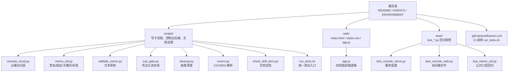
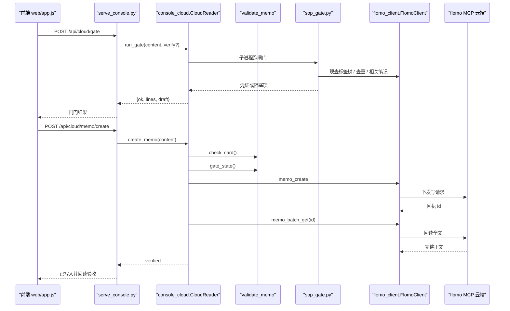
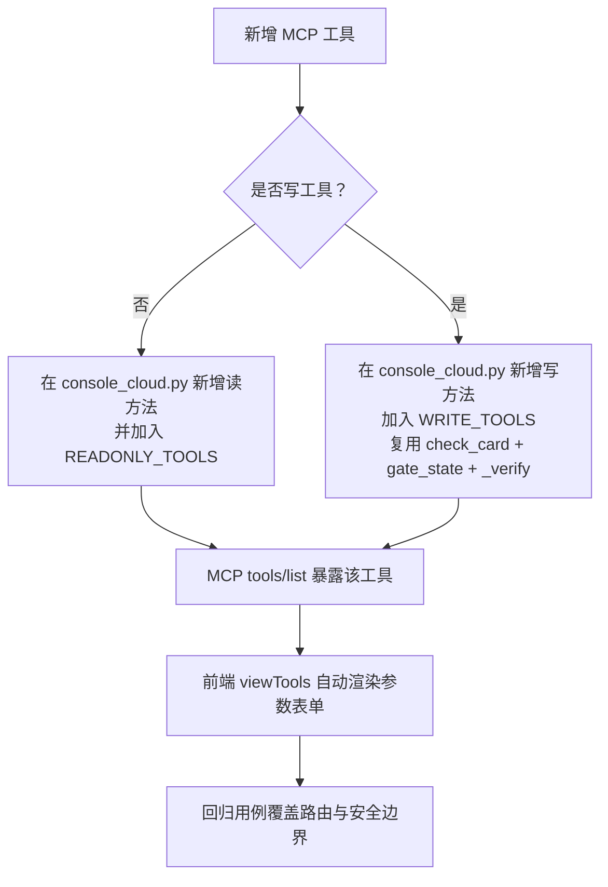
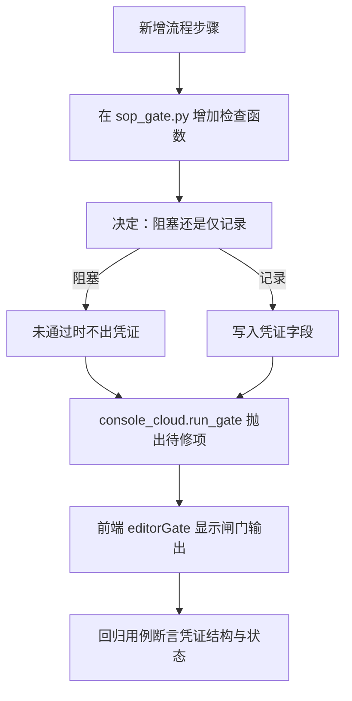
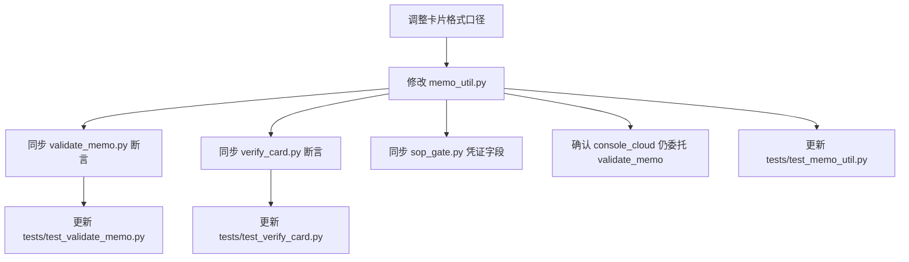
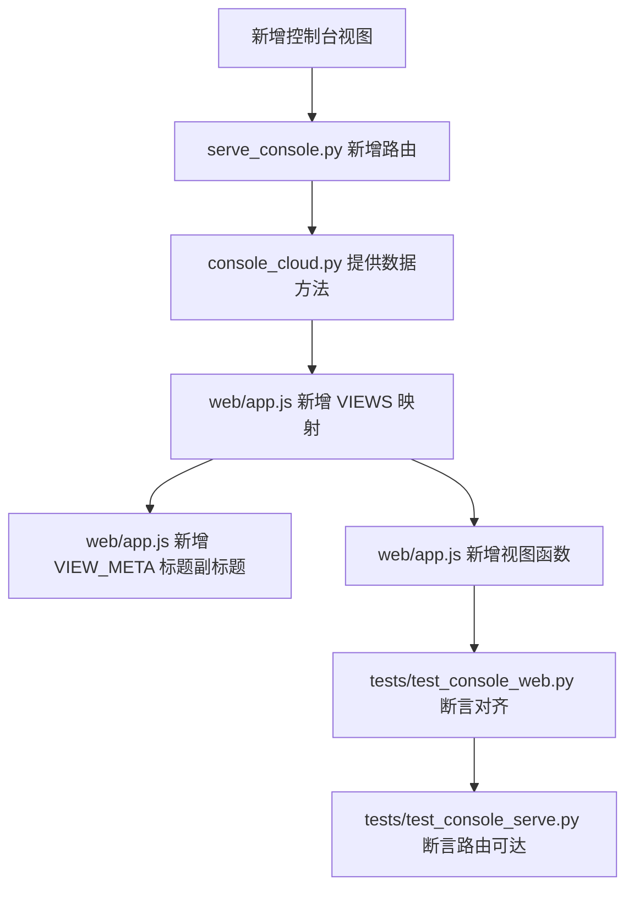
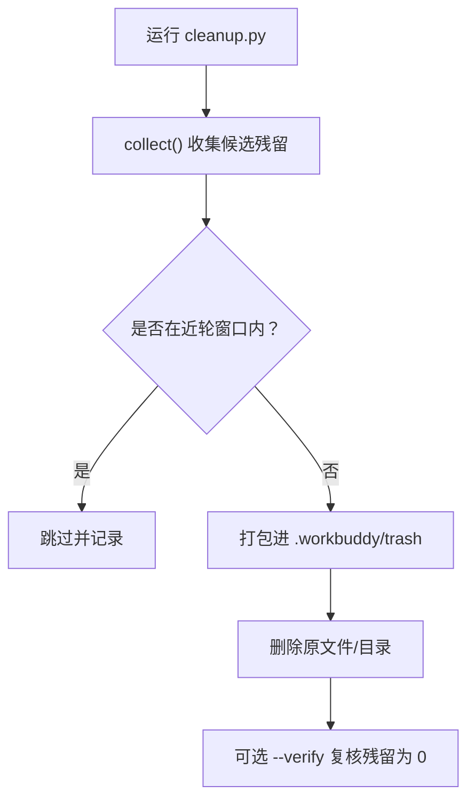
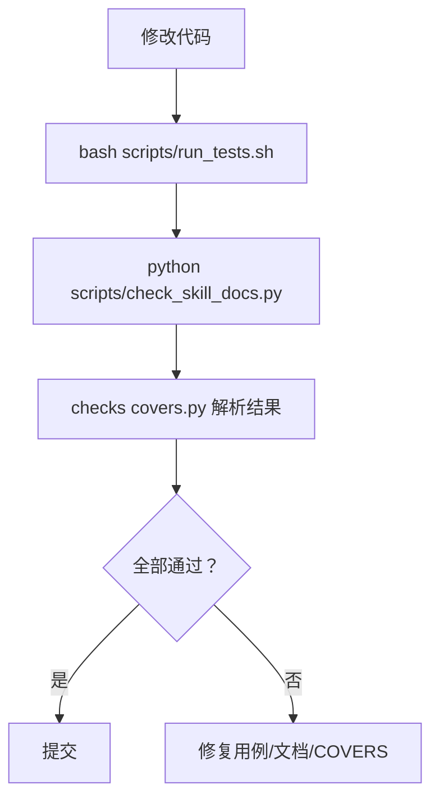
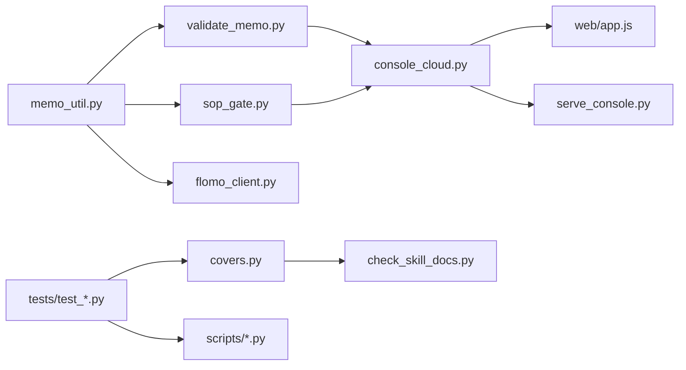

# 开发指南

<cite>
**本文引用的文件**   
- [README.md](file://README.md)
- [scripts/console_cloud.py](file://scripts/console_cloud.py)
- [scripts/memo_util.py](file://scripts/memo_util.py)
- [scripts/validate_memo.py](file://scripts/validate_memo.py)
- [scripts/sop_gate.py](file://scripts/sop_gate.py)
- [web/app.js](file://web/app.js)
- [scripts/covers.py](file://scripts/covers.py)
- [scripts/check_skill_docs.py](file://scripts/check_skill_docs.py)
- [scripts/run_tests.sh](file://scripts/run_tests.sh)
- [scripts/cleanup.py](file://scripts/cleanup.py)
- [scripts/scan_concept_duplication.py](file://scripts/scan_concept_duplication.py)
- [tests/test_console_serve.py](file://tests/test_console_serve.py)
- [tests/test_console_web.py](file://tests/test_console_web.py)
- [tests/test_memo_util.py](file://tests/test_memo_util.py)
- [tests/test_validate_memo.py](file://tests/test_validate_memo.py)
- [tests/test_verify_card.py](file://tests/test_verify_card.py)
</cite>

## 目录
1. [简介](#简介)
2. [项目结构](#项目结构)
3. [核心组件](#核心组件)
4. [架构总览](#架构总览)
5. [扩展指南：新增 MCP 工具](#扩展指南新增-mcp-工具)
6. [扩展指南：新增流程步骤](#扩展指南新增流程步骤)
7. [扩展指南：调整卡片格式口径](#扩展指南调整卡片格式口径)
8. [扩展指南：扩展控制台视图](#扩展指南扩展控制台视图)
9. [回归用例编写规范](#回归用例编写规范)
10. [清理与治理脚本](#清理与治理脚本)
11. [提交前自检命令](#提交前自检命令)
12. [最小可运行扩展示例](#最小可运行扩展示例)
13. [依赖关系分析](#依赖关系分析)
14. [故障排查](#故障排查)
15. [结语](#结语)

## 简介
flomo-note 是一个 AI 辅助的云端笔记技能：把网页、文章、想法整理成 flomo 云端卡片，本地不落盘，所有正文只存在于云端账号。仓库本身保存的是技能文档、工具脚本、控制台前端与离线回归用例。

对贡献者而言，最重要的纪律是：**规则以 `SKILL.md` 为准，仓库 README 不复制 SKILL 细节；新增行为必须同时落到“实现 + 控制台接入 + 回归用例 + 文档自检”。**

本指南聚焦五种常见扩展场景，并给出最小可操作步骤、涉及文件、流程图和检查命令。

**章节来源**
- [README.md:1-200](file://README.md#L1-L200)

## 项目结构
仓库按职责分层组织，不是按语言分目录：



**图示来源**
- [README.md:100-200](file://README.md#L100-L200)
- [scripts/console_cloud.py:1-80](file://scripts/console_cloud.py#L1-L80)
- [scripts/memo_util.py:1-30](file://scripts/memo_util.py#L1-L30)
- [web/app.js:1-40](file://web/app.js#L1-L40)

**章节来源**
- [README.md:100-200](file://README.md#L100-L200)

## 核心组件
| 组件 | 角色 | 贡献者影响面 |
|---|---|---|
| `memo_util.py` | 卡片签名、正文指纹、概念关键词、标签拆分、截断占位符识别的唯一实现 | 改动会同时影响查重、闸门、质检、存量扫描 |
| `validate_memo.py` | 写入前静态自检：格式、标签、来源、载体、字数、切片限定等 ERR/WARN | 改判据需同步断言 |
| `sop_gate.py` | 把验证、查重、复盘等“靠自觉”的步骤变成可留痕的凭证 | 新增流程步骤要落在这里 |
| `console_cloud.py` | 控制台云端访问层：读/写白名单、方法封装、写路径两道闸门 + 回读验收 | 新增 MCP 能力先加方法，再加白名单 |
| `web/app.js` | 控制台前端：云端笔记、标签、参考、能力四视图 | 新增路由要同步导航、视图函数、元信息 |
| `covers.py` | “脚本有没有用例”的唯一解析器 | 新增脚本若无人声明 COVER，会被自检拦下 |
| `check_skill_docs.py` | 内容纪律自检 + 跨文件结构检查 | 提交前必跑 |
| `run_tests.sh` | CI 与本地共用的一条测试命令 | 新用例必须能被它收集 |

**章节来源**
- [scripts/memo_util.py:1-30](file://scripts/memo_util.py#L1-L30)
- [scripts/validate_memo.py:1-40](file://scripts/validate_memo.py#L1-L40)
- [scripts/sop_gate.py:1-40](file://scripts/sop_gate.py#L1-L40)
- [scripts/console_cloud.py:1-80](file://scripts/console_cloud.py#L1-L80)
- [web/app.js:1-40](file://web/app.js#L1-L40)
- [scripts/covers.py:1-40](file://scripts/covers.py#L1-L40)
- [scripts/check_skill_docs.py:1-40](file://scripts/check_skill_docs.py#L1-L40)
- [scripts/run_tests.sh:1-40](file://scripts/run_tests.sh#L1-L40)

## 架构总览
控制台是把 MCP 能力接出来的入口：前端发 `/api/*`，后端用 `CloudReader.call` 做白名单校验，再调 `FlomoClient` 走 MCP 通道。写操作不走通用执行入口，而是经过 `check_card`（格式）→ `gate_state`（流程凭证）→ `create_memo/update_memo` → `_verify`（回读全文）。



**图示来源**
- [scripts/console_cloud.py:600-946](file://scripts/console_cloud.py#L600-L946)
- [scripts/sop_gate.py:1-120](file://scripts/sop_gate.py#L1-L120)
- [web/app.js:546-700](file://web/app.js#L546-L700)

**章节来源**
- [scripts/console_cloud.py:500-946](file://scripts/console_cloud.py#L500-L946)
- [web/app.js:500-700](file://web/app.js#L500-L700)

## 扩展指南：新增 MCP 工具
目标：让一个 MCP 工具既能被控制台读取到，又能被页面直接执行（若是读工具），或通过专属入口写入（若是写工具）。

### 步骤一：在 `console_cloud.py` 添加读/写白名单
`console_cloud.py` 有两个硬集合：

- `READONLY_TOOLS`：只读工具白名单，必须与本模块实际调用的只读方法完全一致。
- `WRITE_TOOLS`：写工具白名单，当前为 `memo_create`、`memo_update`、`tag_rename`。

新增只读工具时，至少要做两件事：

1. 在 `CloudReader` 中新增对应方法（例如 `list_memos`、`memo_detail`、`recommended` 的形态）。
2. 把该工具名加入 `READONLY_TOOLS`。

新增写工具时，不要直通 `call(..., write=True)`；应复用 `check_card` 与 `gate_state`，并在写入后调用 `_verify_or_unknown` 做回读验收。

### 步骤二：在 `tools/list` 注册
控制台能力清单来自云端协议发现接口 `tools/list`。若工具尚未暴露给 MCP，应先完成 MCP 侧注册；否则控制台“能力”视图会把它列在未接出工具中。

### 步骤三：前端自动渲染（读工具）
读工具的表单由 `viewTools()` 根据云端返回的 `inputSchema` 动态生成，不需要逐工具写死参数。只要工具出现在 `tools/list` 且被 `READONLY_TOOLS` 放行，前端就能显示“执行”按钮。

### 步骤四：写工具指路（不直通执行）
写工具在 `writePanel` 中只显示“去专属入口”的按钮，禁止挂在 `data-run` 上。用户最终要回到“新建笔记”“编辑笔记”或“标签重命名”页面，走服务端的写接口。



**图示来源**
- [scripts/console_cloud.py:120-180](file://scripts/console_cloud.py#L120-L180)
- [web/app.js:800-1000](file://web/app.js#L800-L1000)
- [tests/test_console_serve.py:120-220](file://tests/test_console_serve.py#L120-L220)

**章节来源**
- [scripts/console_cloud.py:100-200](file://scripts/console_cloud.py#L100-L200)
- [scripts/console_cloud.py:500-824](file://scripts/console_cloud.py#L500-L824)
- [web/app.js:750-1000](file://web/app.js#L750-L1000)
- [tests/test_console_serve.py:100-200](file://tests/test_console_serve.py#L100-L200)

## 扩展指南：新增流程步骤
`sop_gate.py` 负责把 SOP 中“靠自觉”的检查型步骤强制留痕。典型步骤包括：

- 第 ② 步：网络验证专业术语、机构、产品、模型简称。
- 第 ⑤ 步：查重两路并行。
- 第 ⑧ 步：复盘三路现查。
- 第 ④ 步：标签核对。

新增流程步骤时，应遵循以下顺序：

1. **定义检查逻辑**：放在 `sop_gate.py` 中独立的检查函数里，明确输入、输出、阻塞条件。
2. **产出凭证字段**：凭证是后续 `validate_memo.check_gate()` 校验的对象，新增字段必须能被现有校验逻辑消费。
3. **更新凭证边界说明**：机器判不了的项仍放入 `human_judgment`，不能假装全过。
4. **在控制台接入**：通过 `console_cloud.run_gate` 触发子进程，并把草稿、验证记录、锚点 id 传过去。
5. **在编辑器 UI 提示**：前端 `editorGate` 需要显示闸门输出、草稿名、未通过原因。
6. **写回归用例**：覆盖正常通过、阻塞项、凭证过期、非术语卡跳过、验证记录缺失等分支。



**图示来源**
- [scripts/sop_gate.py:1-120](file://scripts/sop_gate.py#L1-L120)
- [scripts/console_cloud.py:700-824](file://scripts/console_cloud.py#L700-L824)
- [web/app.js:546-620](file://web/app.js#L546-L620)

**章节来源**
- [scripts/sop_gate.py:1-200](file://scripts/sop_gate.py#L1-L200)
- [scripts/console_cloud.py:680-824](file://scripts/console_cloud.py#L680-L824)
- [web/app.js:546-620](file://web/app.js#L546-L620)

## 扩展指南：调整卡片格式口径
当 SKILL 修改了卡片格式、标签规则、概念名判据或关键词口径时，必须同步修改以下位置：

| 修改点 | 作用 | 需要同步的断言 |
|---|---|---|
| `memo_util.py` | 签名、指纹、关键词、标签拆分、切片限定、截断占位符 | `tests/test_memo_util.py` |
| `validate_memo.py` | 写入前静态自检 ERR/WARN | `tests/test_validate_memo.py` |
| `verify_card.py` | 写云后回读机械项 | `tests/test_verify_card.py` |
| `console_cloud.py` | 格式闸门委托 `validate_memo.check` | 控制台写路径断言 |
| `sop_gate.py` | 凭证中的标签核查与结论落点 | `tests/test_sop_gate.py` |

### 关键原则
1. **签名口径只在 `memo_util.memo_signature` 一处变化**，其他模块一律 import。
2. **关键词口径只在 `keywords_of_concept` / `concept_keywords` 处变化**，查重与闸门共用。
3. **标签拆分只在 `tag_leaves` / `tag_key` 处变化**，定标签与写前闸门必须同键。
4. **截断占位符只在 `find_truncation` 处变化**，写前闸门、写后验收、存量扫描共用。



**图示来源**
- [scripts/memo_util.py:1-60](file://scripts/memo_util.py#L1-L60)
- [scripts/memo_util.py:200-347](file://scripts/memo_util.py#L200-L347)
- [scripts/validate_memo.py:1-60](file://scripts/validate_memo.py#L1-L60)
- [tests/test_memo_util.py:1-40](file://tests/test_memo_util.py#L1-L40)
- [tests/test_validate_memo.py:1-40](file://tests/test_validate_memo.py#L1-L40)
- [tests/test_verify_card.py:1-40](file://tests/test_verify_card.py#L1-L40)

**章节来源**
- [scripts/memo_util.py:1-60](file://scripts/memo_util.py#L1-L60)
- [scripts/memo_util.py:200-347](file://scripts/memo_util.py#L200-L347)
- [scripts/validate_memo.py:1-60](file://scripts/validate_memo.py#L1-L60)
- [tests/test_memo_util.py:1-40](file://tests/test_memo_util.py#L1-L40)
- [tests/test_validate_memo.py:1-40](file://tests/test_validate_memo.py#L1-L40)
- [tests/test_verify_card.py:1-40](file://tests/test_verify_card.py#L1-L40)

## 扩展指南：扩展控制台视图
控制台有四个视图：云端笔记、标签、参考、能力。新增视图需要前后端同步。

### 后端：在 `serve_console.py` 添加路由
- GET 路由用于拉取数据。
- POST 路由用于写操作或带参数的只读执行。
- 所有云端访问必须经 `CloudReader`，不得绕过白名单。
- 新增路由需考虑鉴权头、Origin、Host、路径逃逸防护。

### 前端：在 `web/app.js` 添加视图逻辑
前端必须满足三条对齐约束：

1. 导航项 ↔ 视图注册表 ↔ 视图元信息三者一致。
2. 前端请求的 `/api/*` 必须存在于服务路由表。
3. 新增视图函数必须真实存在，且默认视图高亮一致。



**图示来源**
- [web/app.js:1-60](file://web/app.js#L1-L60)
- [web/app.js:200-350](file://web/app.js#L200-L350)
- [tests/test_console_web.py:1-80](file://tests/test_console_web.py#L1-L80)
- [tests/test_console_serve.py:1-60](file://tests/test_console_serve.py#L1-L60)

**章节来源**
- [web/app.js:1-60](file://web/app.js#L1-L60)
- [web/app.js:200-350](file://web/app.js#L200-L350)
- [tests/test_console_web.py:1-120](file://tests/test_console_web.py#L1-L120)
- [tests/test_console_serve.py:1-120](file://tests/test_console_serve.py#L1-L120)

## 回归用例编写规范
每个回归用例都是离线的、不联网的、不读 token 的 Python 模块。命名与绑定必须遵守两条硬性约定：

1. 文件名必须以 `test_` 开头，否则 `run_tests.sh` 不会收集。
2. 必须用模块级 `COVERS = ("脚本名", ...)` 声明自己验证了哪些脚本，不能用文件名同名推断。

### 最小用例模板
```python
#!/usr/bin/env python3
"""test_example.py — 简短描述被测脚本的行为。"""

COVERS = ("target_script",)

def main():
    # 断言示例
    assert True
    return 0

if __name__ == "__main__":
    raise SystemExit(main())
```

### 四类常用用例
| 用例类型 | 目的 | 关键断言 |
|---|---|---|
| 单元用例 | 测纯函数或局部逻辑 | 输入输出相等、异常类型正确 |
| 集成用例 | 测多个模块协作 | 凭证结构、返回值字段、错误文案 |
| 服务冒烟 | 真起服务、真发 HTTP | 状态码、JSON、安全边界 |
| 前后端对齐 | 静态比对路由与视图 | 导航、元信息、API 调用一一对应 |

**章节来源**
- [scripts/run_tests.sh:1-40](file://scripts/run_tests.sh#L1-L40)
- [scripts/covers.py:1-60](file://scripts/covers.py#L1-L60)
- [tests/test_console_serve.py:1-60](file://tests/test_console_serve.py#L1-L60)
- [tests/test_console_web.py:1-60](file://tests/test_console_web.py#L1-L60)

## 清理与治理脚本

### cleanup.py：收尾强制清理
`cleanup.py` 的职责是每轮收尾清理临时文件，避免工作区堆积。关键点：

- 使用近轮窗口保留当轮与近轮素材。
- 清理范围包括项目根 `_tmp_*`、`tmp_*`、`memo_body*.txt`，以及临时目录下的抓取件、请求体、中间产物。
- 清理后支持 `--verify` 复核残留是否为 0。
- 归档目标 `.workbuddy/trash/` 只保留最近若干包。
- 凭证目录 `.sop_gate/` 会删除超期凭证文件。



**图示来源**
- [scripts/cleanup.py:1-120](file://scripts/cleanup.py#L1-L120)
- [scripts/cleanup.py:120-220](file://scripts/cleanup.py#L120-L220)

**章节来源**
- [scripts/cleanup.py:1-200](file://scripts/cleanup.py#L1-L200)

### scan_* 治理脚本用途
| 脚本 | 用途 | 是否写云 |
|---|---|---|
| `scan_concept_duplication.py` | 找同一对象因切片限定不同被切成多张卡的实例 | 否，只读 |
| `scan_qualified_concepts.py` | 统计概念名里的切片限定分布 | 否，只读 |
| `scan_truncated.py` | 找正文被检索回包截断标记覆盖过的卡 | 否，只读 |
| `dedup.py` | 查重执行器，支持 `--id` 复盘、`--ids` 批量 | 否，只读 |
| `tagcheck.py` | 现采标签树并核两级标签 | 否，只读 |

这些脚本共同构成存量取证与治理管线，帮助发现历史数据问题，而不是替代写卡流程。

**章节来源**
- [scripts/scan_concept_duplication.py:1-126](file://scripts/scan_concept_duplication.py#L1-L126)
- [README.md:140-200](file://README.md#L140-L200)

## 提交前自检命令
提交前应依次执行：

1. **统一测试入口**
   ```bash
   bash scripts/run_tests.sh
   ```
   它会：
   - 检测 Python 解释器。
   - 处理受限环境的临时目录权限。
   - 确保 `tests/test_*.py` 至少有一个。
   - 先跑 `check_skill_docs.py`，再跑全部回归用例。
   - 任一失败即退出码非 0。

2. **文档与结构自检**
   ```bash
   python scripts/check_skill_docs.py
   ```
   它检查：
   - 技能文档中出现具体日期或历史事件叙事。
   - README 是否遗漏脚本。
   - 用例是否以 `test_` 开头。
   - 内部交叉引用是否失效。
   - 命令行选项是否与脚本实现一致。
   - 每个脚本是否有人认领 `COVERS`。

3. **COVERS 解析器自检**
   `covers.py` 是“脚本有没有用例”的唯一解析器。新增脚本若不在任何 `COVERS` 中，`check_skill_docs.py` 会报 ERR。



**图示来源**
- [scripts/run_tests.sh:1-95](file://scripts/run_tests.sh#L1-L95)
- [scripts/check_skill_docs.py:1-80](file://scripts/check_skill_docs.py#L1-L80)
- [scripts/covers.py:1-60](file://scripts/covers.py#L1-L60)

**章节来源**
- [scripts/run_tests.sh:1-95](file://scripts/run_tests.sh#L1-L95)
- [scripts/check_skill_docs.py:1-120](file://scripts/check_skill_docs.py#L1-L120)
- [scripts/covers.py:1-118](file://scripts/covers.py#L1-L118)

## 最小可运行扩展示例
下面给出一个新手最容易复现的最小扩展示例：**新增一个只读 MCP 工具**。

### 假设
新增一个只读工具 `memo_search_by_tag`，参数为 `tag`，返回匹配卡片摘要。

### 步骤
1. 在 `scripts/console_cloud.py` 中：
   - 新增 `CloudReader.search_by_tag(self, tag)` 方法。
   - 方法内部调用 `self.call("memo_search_by_tag", {"tag": tag})`。
   - 把 `"memo_search_by_tag"` 加入 `READONLY_TOOLS`。
2. 在 MCP 侧注册 `memo_search_by_tag` 工具。
3. 启动控制台：
   ```bash
   python scripts/serve_console.py
   ```
4. 打开“能力”视图，确认工具出现在“只读工具 · 直接执行”列表。
5. 填写 `tag` 参数，点击“执行”，查看返回结果。
6. 新增回归用例：
   ```python
   # tests/test_new_tool.py
   COVERES = ("console_cloud",)

   def test_readonly_whitelist():
       # 断言工具在白名单中
       pass
   ```
7. 运行：
   ```bash
   bash scripts/run_tests.sh
   ```

如果工具是写工具，则不应添加到 `READONLY_TOOLS`，而应添加到 `WRITE_TOOLS`，并通过 `create_memo`/`update_memo`/`rename_tag` 这类已有写路径或新增写方法处理，且必须经过格式闸门、流程闸门和回读验收。

**章节来源**
- [scripts/console_cloud.py:120-180](file://scripts/console_cloud.py#L120-L180)
- [scripts/console_cloud.py:500-824](file://scripts/console_cloud.py#L500-L824)
- [web/app.js:800-1000](file://web/app.js#L800-L1000)
- [tests/test_console_serve.py:120-200](file://tests/test_console_serve.py#L120-L200)

## 依赖关系分析
各核心文件的依赖方向如下：



- `memo_util.py` 是最底层的公共口径，向上被 `validate_memo`、`sop_gate`、`flomo_client` 消费。
- `console_cloud.py` 是控制台与 MCP 之间的唯一边界，集中白名单、参数归一化、错误转译。
- `web/app.js` 不直接调 MCP，只调 `/api/*`。
- `covers.py` 被 `check_skill_docs.py` 与控制台数据层共用，避免两处得出相反结论。

**图示来源**
- [scripts/memo_util.py:1-30](file://scripts/memo_util.py#L1-L30)
- [scripts/validate_memo.py:1-40](file://scripts/validate_memo.py#L1-L40)
- [scripts/sop_gate.py:1-40](file://scripts/sop_gate.py#L1-L40)
- [scripts/console_cloud.py:1-80](file://scripts/console_cloud.py#L1-L80)
- [scripts/covers.py:1-40](file://scripts/covers.py#L1-L40)

**章节来源**
- [scripts/memo_util.py:1-60](file://scripts/memo_util.py#L1-L60)
- [scripts/console_cloud.py:1-120](file://scripts/console_cloud.py#L1-L120)
- [scripts/covers.py:1-118](file://scripts/covers.py#L1-L118)

## 故障排查
| 现象 | 可能原因 | 排查方式 |
|---|---|---|
| 新增 MCP 工具前端无法执行 | 工具名未加入 `READONLY_TOOLS` | 检查 `console_cloud.py` 白名单 |
| 通用执行入口拒绝写工具 | 这是预期行为，写工具不走 `/api/cloud/tool` | 改用新建/编辑/重命名入口 |
| 写云后回读不一致 | 正文归一化差异或云端截断 | 看 `_normalize` 与 `content_truncated` |
| 流程闸门不出凭证 | 验证记录缺失、跳过网络验证未勾选、标签不在树中 | 看 `run_gate` 输出与 `gate_state` |
| 控制台视图渲染但点击无反应 | 导航项与视图函数未对齐 | 跑 `tests/test_console_web.py` |
| 新增用例未被 CI 执行 | 文件名不是 `test_*.py` | 改名并重跑 `run_tests.sh` |
| 新增脚本被报告没有回归用例 | 未在任意 `COVERS` 中声明 | 在测试文件顶部加 `COVERS = ("脚本名",)` |
| 清理脚本报残留 | 清理规则与扫描口径不一致 | 检查 `cleanup.SCAN` 与 `check_skill_docs` 使用的瞬时产物模式 |
| 概念名切片误报或漏报 | 自定义正则与 `memo_util.slice_qualifiers` 不一致 | 直接用 `memo_util`，不要另写一套 |

**章节来源**
- [scripts/console_cloud.py:500-946](file://scripts/console_cloud.py#L500-L946)
- [scripts/cleanup.py:1-200](file://scripts/cleanup.py#L1-L200)
- [scripts/memo_util.py:200-347](file://scripts/memo_util.py#L200-L347)
- [tests/test_console_web.py:1-120](file://tests/test_console_web.py#L1-L120)
- [tests/test_console_serve.py:100-220](file://tests/test_console_serve.py#L100-L220)

## 结语
扩展 flomo-note 的核心纪律是：**不要复制判据，不要静默截断，不要绕过白名单，不要把凭证当成覆盖率。**

最稳妥的扩展示范式是：

1. 先在 `memo_util.py` 或目标脚本中实现纯逻辑。
2. 再通过 `console_cloud.py` 暴露为 MCP 访问方法。
3. 在 `web/app.js` 中添加视图或工具面板。
4. 在 `tests/` 下写 `test_*.py`，并用 `COVERS` 声明绑定。
5. 最后跑 `bash scripts/run_tests.sh` 与 `python scripts/check_skill_docs.py`。

只要这五步都通过，新增功能就不会成为下一个“静默失配”的历史问题。