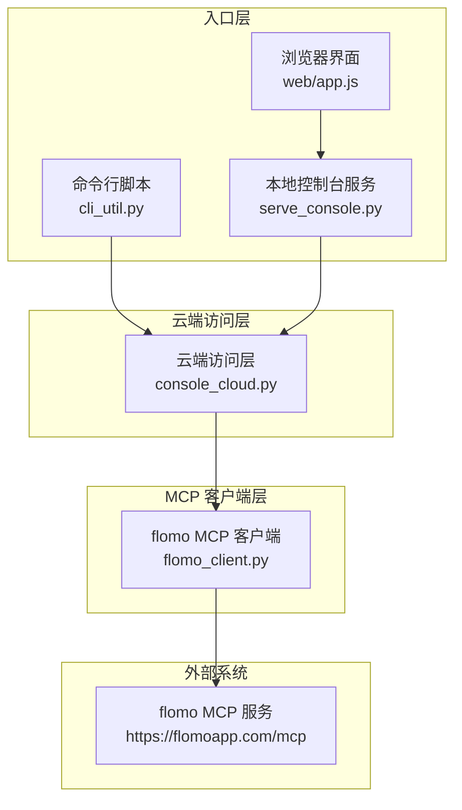
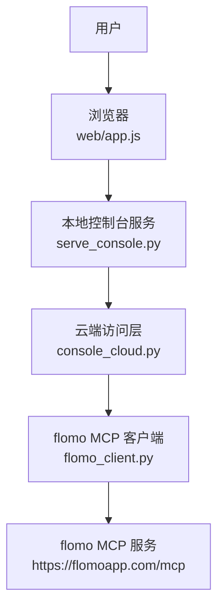
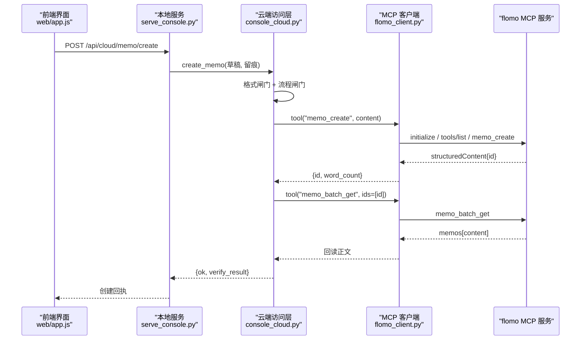
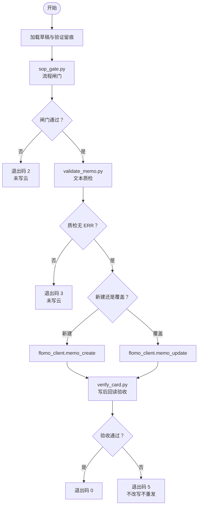
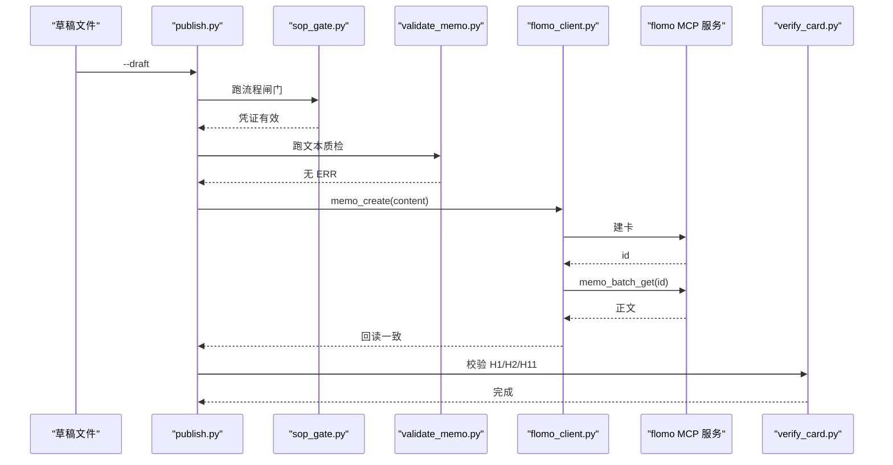
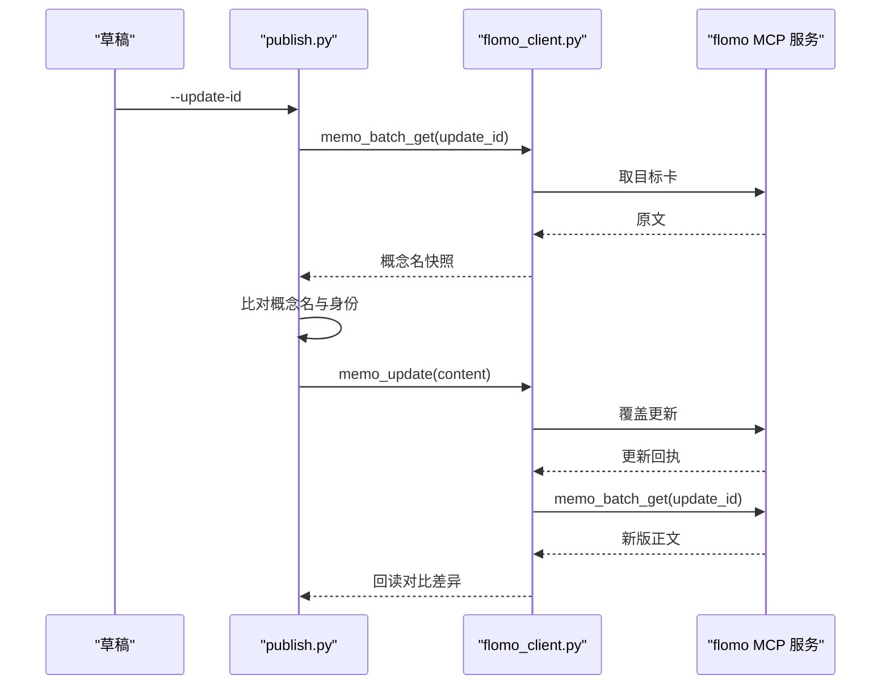
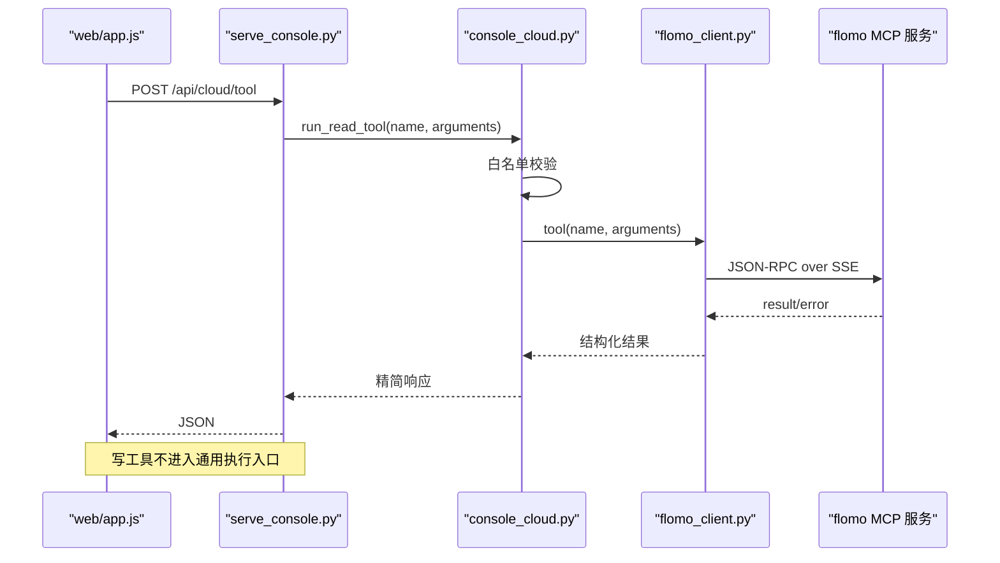
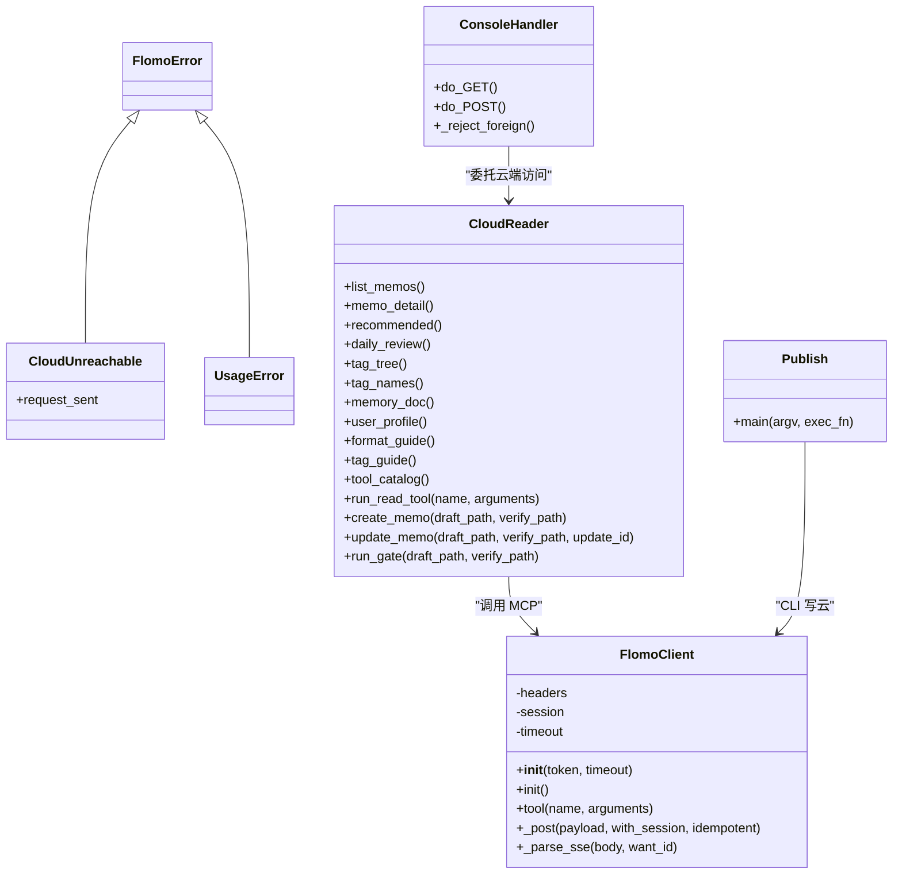
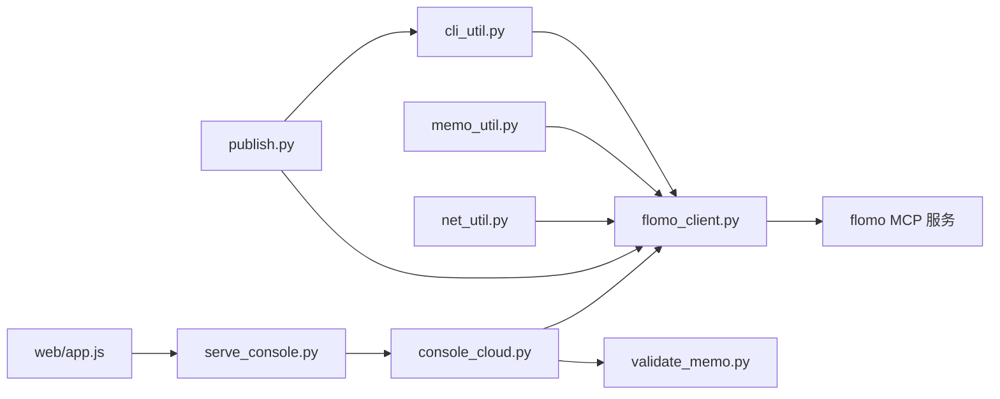
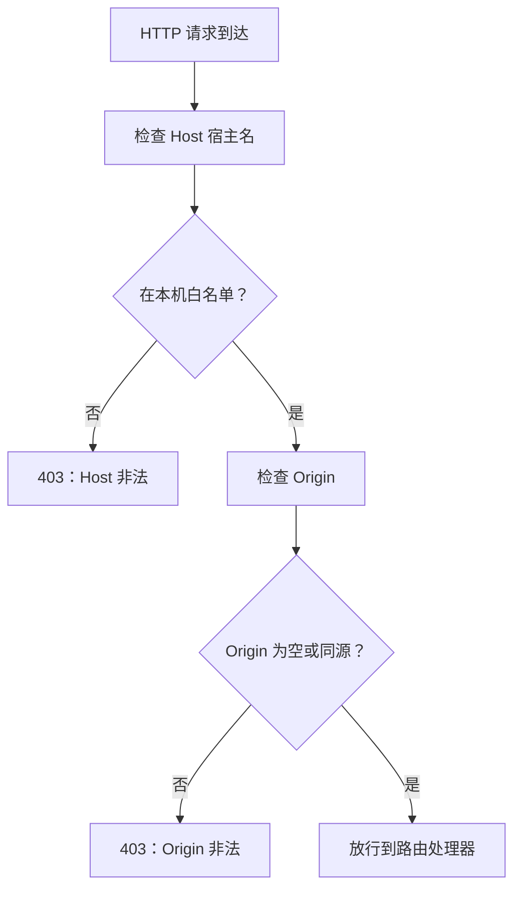

# 架构设计

<cite>
**本文引用的文件**   
- [README.md](file://README.md)
- [scripts/serve_console.py](file://scripts/serve_console.py)
- [scripts/console_cloud.py](file://scripts/console_cloud.py)
- [scripts/flomo_client.py](file://scripts/flomo_client.py)
- [scripts/cli_util.py](file://scripts/cli_util.py)
- [scripts/publish.py](file://scripts/publish.py)
- [web/app.js](file://web/app.js)
- [tests/test_flomo_client.py](file://tests/test_flomo_client.py)
- [tests/test_console_web.py](file://tests/test_console_web.py)
- [tests/test_publish.py](file://tests/test_publish.py)
</cite>

## 目录
1. [引言](#引言)
2. [项目结构](#项目结构)
3. [核心组件](#核心组件)
4. [架构总览](#架构总览)
5. [详细组件分析](#详细组件分析)
6. [依赖关系分析](#依赖关系分析)
7. [性能与容量特征](#性能与容量特征)
8. [安全边界](#安全边界)
9. [错误处理策略](#错误处理策略)
10. [故障排查指南](#故障排查指南)
11. [结论](#结论)

## 引言
flomo-note 是一个“AI 辅助的云端笔记技能”，把网页、文章或想法整理成 flomo 云端卡片。仓库不持久化笔记，仅保存工具脚本、文档与前端静态资源；所有卡片只存在于 flomo MCP 服务中。

整体采用四层分层：

| 层级 | 职责 | 主要实现 |
|---|---|---|
| 入口层（CLI/Web） | 命令行入口、本地控制台 HTTP 服务、浏览器界面 | `cli_util.py`、`serve_console.py`、`web/app.js` |
| 云端访问层 | 工具白名单、读结果精简、写路径闸门与回读验收 | `console_cloud.py` |
| MCP 客户端层 | 握手、协议发现、SSE 解析、凭据读取、HTTP 出网 | `flomo_client.py` |
| 外部 flomo MCP 服务 | 提供 `memo_search`、`memo_create`、`tag_tree`、`tools/list` 等能力 | 远端 `https://flomoapp.com/mcp` |

本设计的关键约束是：**写操作不走通用 MCP 执行入口**，必须经过格式与流程闸门，并在写入后按 id 回读全文验收。

**章节来源**
- [README.md:1-120](file://README.md#L1-L120)

## 项目结构
仓库按“交付物”划分：`scripts/` 是工具与后端，`web/` 是前端静态资源，`tests/` 是离线回归用例，顶层 README、AGENTS、ENVIRONMENT 分别承担使用说明、总则与环境事实。

**图表来源**
- [scripts/serve_console.py:1-40](file://scripts/serve_console.py#L1-L40)
- [scripts/console_cloud.py:1-80](file://scripts/console_cloud.py#L1-L80)
- [scripts/flomo_client.py:1-40](file://scripts/flomo_client.py#L1-L40)
- [web/app.js:1-20](file://web/app.js#L1-L20)

**章节来源**
- [README.md:90-160](file://README.md#L90-L160)

## 核心组件

### 门面模式：flomo_client 封装 MCP 握手、SSE 与 token
`flomo_client.FlomoClient` 是 flomo MCP 调用的唯一复用入口。它隐藏以下复杂性：

- 从 `.mcp.json` 或 `FLOMO_TOKEN` 读取 token。
- 向 `https://flomoapp.com/mcp` 发送 JSON-RPC 请求。
- 解析 SSE 流，按请求 `id` 匹配 result，拒绝 error。
- 复用 `Mcp-Session-Id` 会话头。
- 通过 `net_util.request` 统一走代理或直连通道。
- 对非幂等写工具禁止自动重发。

这种封装让上层 `publish.py` 和 `console_cloud.py` 不必关心 MCP 协议细节，只需调用 `tool()` 并处理结构化返回。

**章节来源**
- [scripts/flomo_client.py:1-120](file://scripts/flomo_client.py#L1-L120)
- [scripts/flomo_client.py:120-260](file://scripts/flomo_client.py#L120-L260)

### 白名单准入：console_cloud 的工具读写分离
`console_cloud.CloudReader` 不是 MCP 的全量代理。它维护两个互斥集合：

| 集合 | 内容 | 用途 |
|---|---|---|
| `READONLY_TOOLS` | `memo_search`、`memo_batch_get`、`memo_recommended`、`get_daily_review`、`tag_tree`、`tag_search`、`memory_context`、`memory_user`、`get_format_guide`、`get_tag_guide` | 通用只读执行入口允许的工具 |
| `WRITE_TOOLS` | `memo_create`、`memo_update`、`tag_rename` | 专属写接口允许的工具 |

白名单外任何工具名直接拒绝。这样即使 MCP 暴露新工具，也不会被前端“能力台”误用为任意命令执行点。

**章节来源**
- [scripts/console_cloud.py:80-160](file://scripts/console_cloud.py#L80-L160)

### 纯叶子层：cli_util.py 的依赖倒置
`cli_util` 只依赖 Python 标准库，不 import 任何项目内模块。它提供：

- `Opt`：声明式选项定义。
- `parse_options`：集中处理缺值、重复、未知参数。
- `int_arg` / `float_arg`：严格数值转换。
- `UsageError`：用法错误的专用异常。
- `cli_entry`：统一入口出口，将预期失败转为退出码。

这使得纯本地脚本（如抓取、查重、标签检查）无需引入网络、token 或 MCP 语义，降低耦合。

**章节来源**
- [scripts/cli_util.py:1-166](file://scripts/cli_util.py#L1-L166)

## 架构总览

### 系统上下文图

**图表来源**
- [scripts/serve_console.py:1-40](file://scripts/serve_console.py#L1-L40)
- [scripts/console_cloud.py:1-80](file://scripts/console_cloud.py#L1-L80)
- [scripts/flomo_client.py:1-40](file://scripts/flomo_client.py#L1-L40)
- [web/app.js:1-20](file://web/app.js#L1-L20)

### 组件交互图

**图表来源**
- [scripts/serve_console.py:1-60](file://scripts/serve_console.py#L1-L60)
- [scripts/console_cloud.py:1-120](file://scripts/console_cloud.py#L1-L120)
- [scripts/flomo_client.py:120-260](file://scripts/flomo_client.py#L120-L260)
- [web/app.js:1-40](file://web/app.js#L1-L40)

## 详细组件分析

### 写云数据流：草稿 → validate_memo → publish → memo_create/update → verify_card
`publish.py` 是 CLI 写云主链；`console_cloud.py` 在控制台写路径中复用了同一套闸门与回读验收逻辑。

**图表来源**
- [scripts/publish.py:1-80](file://scripts/publish.py#L1-L80)
- [scripts/publish.py:80-160](file://scripts/publish.py#L80-L160)
- [scripts/console_cloud.py:1-120](file://scripts/console_cloud.py#L1-L120)
- [tests/test_publish.py:1-120](file://tests/test_publish.py#L1-L120)

#### 新建卡片序列

**图表来源**
- [scripts/publish.py:1-120](file://scripts/publish.py#L1-L120)
- [scripts/flomo_client.py:120-260](file://scripts/flomo_client.py#L120-L260)
- [tests/test_publish.py:120-220](file://tests/test_publish.py#L120-L220)

#### 更新卡片序列

**图表来源**
- [scripts/publish.py:1-160](file://scripts/publish.py#L1-L160)
- [scripts/flomo_client.py:120-260](file://scripts/flomo_client.py#L120-L260)

### HTTP 请求到 MCP 的完整链路
前端不会直连云端 MCP；所有写操作都走本地服务。

**图表来源**
- [web/app.js:1-80](file://web/app.js#L1-L80)
- [scripts/serve_console.py:1-120](file://scripts/serve_console.py#L1-L120)
- [scripts/console_cloud.py:1-160](file://scripts/console_cloud.py#L1-L160)
- [scripts/flomo_client.py:120-260](file://scripts/flomo_client.py#L120-L260)
- [tests/test_console_web.py:1-120](file://tests/test_console_web.py#L1-L120)

### 门面模式类图

**图表来源**
- [scripts/flomo_client.py:120-260](file://scripts/flomo_client.py#L120-L260)
- [scripts/console_cloud.py:1-160](file://scripts/console_cloud.py#L1-L160)
- [scripts/serve_console.py:1-120](file://scripts/serve_console.py#L1-L120)
- [scripts/publish.py:1-120](file://scripts/publish.py#L1-L120)

## 依赖关系分析

**图表来源**
- [scripts/cli_util.py:1-166](file://scripts/cli_util.py#L1-L166)
- [scripts/flomo_client.py:1-80](file://scripts/flomo_client.py#L1-L80)
- [scripts/publish.py:1-80](file://scripts/publish.py#L1-L80)
- [scripts/console_cloud.py:1-120](file://scripts/console_cloud.py#L1-L120)
- [scripts/serve_console.py:1-60](file://scripts/serve_console.py#L1-L60)
- [web/app.js:1-40](file://web/app.js#L1-L40)

关键依赖特性：

1. **单向依赖**：高层依赖底层，`cli_util.py` 不被其他模块反向依赖，保持叶子地位。
2. **MCP 客户端是单点抽象**：所有外部 MCP 调用集中在 `flomo_client.py`，便于替换协议细节而不影响业务。
3. **控制台与服务解耦**：`web/app.js` 只知 `/api/*`，不知道 MCP、token 或 MCP 会话。
4. **测试对齐契约**：`test_console_web.py` 断言前端路由、后端路由、白名单行为三者一致，避免“改了后端忘了前端”。

**章节来源**
- [scripts/cli_util.py:1-60](file://scripts/cli_util.py#L1-L60)
- [scripts/flomo_client.py:1-80](file://scripts/flomo_client.py#L1-L80)
- [tests/test_console_web.py:1-80](file://tests/test_console_web.py#L1-L80)

## 性能与容量特征

| 维度 | 设计决策 | 原因 |
|---|---|---|
| 握手与会话 | `FlomoClient` 复用会话 | 避免每请求重新初始化，减少 MCP 握手开销 |
| 列表摘要 | `--brief` 压缩列表型回包 | 搜索/推荐/标签树每次可能返回 27–55 KB 原始 JSON |
| 批量全文上限 | 前端 `BATCH_LIMIT = 10`，服务端 `BATCH_MAX = 10` | 与 MCP `memo_batch_get` 硬限一致 |
| 标签树上限 | `TAG_MAX_LIMIT = 1000` | 对应云端 limit 上限 |
| 闸门超时 | `GATE_TIMEOUT = 300` | 闸门需现查云端，不能无限等待 |
| 端口冲突检测 | 启动时探测端口 | ThreadingHTTPServer 地址复用会静默绑定成功，双实例极难排查 |
| 会话复用 | 进程级 `CloudReader` 单例 | 避免每个 HTTP 请求重建 MCP 连接 |

这些限制并非随意设置，而是由 MCP 协议、云端行为和本地服务稳定性共同决定。

**章节来源**
- [scripts/flomo_client.py:1-80](file://scripts/flomo_client.py#L1-L80)
- [scripts/console_cloud.py:160-240](file://scripts/console_cloud.py#L160-L240)
- [scripts/serve_console.py:60-120](file://scripts/serve_console.py#L60-L120)
- [web/app.js:1-40](file://web/app.js#L1-L40)

## 安全边界

### Host 白名单与 Origin 校验
`serve_console.ConsoleHandler._reject_foreign` 实施两道校验：

1. **Host 宿主名必须在本机白名单内**：拦截 DNS 重绑定请求。
2. **带 Origin 时必须同源**：拦截浏览器跨站写请求。

默认监听回环地址不等于只有本机能发起请求；同源策略只控制“能否读取响应”，不控制“请求是否到达”。因此这两道校验缺一不可。

**图表来源**
- [scripts/serve_console.py:120-220](file://scripts/serve_console.py#L120-L220)

### 工具白名单
`console_cloud.py` 的 `READONLY_TOOLS` 与 `WRITE_TOOLS` 是实际方法调用的精确集合。测试要求“一个不多、一个不少”，新增能力必须先加方法再扩白名单。

这防止两类问题：

- 前端“能力台”动态列出 MCP 工具后，直接执行危险工具。
- 新 MCP 工具未经审查就被控制台间接暴露。

**章节来源**
- [scripts/console_cloud.py:80-160](file://scripts/console_cloud.py#L80-L160)
- [tests/test_console_web.py:80-160](file://tests/test_console_web.py#L80-L160)

### 凭证安全
token 只在建立连接时使用，不出返回值、响应体或日志。`.mcp.json` 优先，`FLOMO_TOKEN` 仅作为后备，因为环境变量中的 token 可能过期。

**章节来源**
- [scripts/flomo_client.py:80-160](file://scripts/flomo_client.py#L80-L160)
- [scripts/console_cloud.py:1-80](file://scripts/console_cloud.py#L1-L80)

## 错误处理策略

### 异常类型分层
| 异常 | 含义 | 处置 |
|---|---|---|
| `UsageError` | 命令行参数错误 | 由 `cli_entry` 转用法退出码 |
| `FlomoError` | 凭据缺失、握手失败、HTTP 错误、JSON-RPC 错误 | CLI 入口转退出码；HTTP 服务中不能被吞掉 |
| `CloudUnreachable` | 网络通道不可达，含 `request_sent` 标记 | 区分“可安全重发”和“可能已发出，禁止重发” |
| `CloudError` | 控制台云端访问失败、越权调用、工具报错 | 控制台 API 返回结构化错误 |

### 幂等性保护
`WRITE_TOOLS = {"memo_create", "memo_update", "tag_rename"}` 被标记为非幂等。若 HTTP 层不确定请求是否已到达 MCP，不得自动重试，否则可能产生重复卡片。

### 写后回读验收
`readback_check` 使用假客户端桩验证机械逻辑，确保：

- 空白差异、平台补空行、全角标点空格、Markdown 转义不导致误报。
- 内容不一致、id 不符、正文截断、取不到卡均判失败。
- 失败信息明确禁止据此重发写请求。

**章节来源**
- [scripts/flomo_client.py:120-260](file://scripts/flomo_client.py#L120-L260)
- [tests/test_flomo_client.py:1-120](file://tests/test_flomo_client.py#L1-L120)
- [tests/test_flomo_client.py:120-220](file://tests/test_flomo_client.py#L120-L220)

### publish.py 退出码语义
| 退出码 | 含义 | 是否写云 |
|---:|---|---:|
| 0 | 成功且机器项复核通过 | 是 |
| 1 | 前置检查失败 | 否 |
| 2 | 闸门未过 | 否 |
| 3 | 文本质检有 ERR | 否 |
| 4 | 写入失败，不重发 | 可能已写出，须人工核对 |
| 5 | 已写入但复核失败 | 是，不改写不重发 |
| 6 | 目标卡确认不通过 | 否 |
| 7 | 草稿读数异常或断口删除 | 否 |

**章节来源**
- [scripts/publish.py:1-80](file://scripts/publish.py#L1-L80)
- [tests/test_publish.py:1-120](file://tests/test_publish.py#L1-L120)

## 故障排查指南

| 现象 | 可能原因 | 排查步骤 |
|---|---|---|
| 所有脚本报“未找到 flomo token” | `.mcp.json` 缺失或结构错误，且未设置 `FLOMO_TOKEN` | 检查项目根 `.mcp.json` 的 `mcpServers.flomo.headers.Authorization` |
| 控制台页面显示“本地服务无响应” | `serve_console.py` 未启动或端口被占用 | 先停旧实例，再查看端口探测报错 |
| 控制台 403 | Host 或 Origin 不在白名单 | 使用 `http://127.0.0.1:<端口>/` 打开；不要通过攻击者域名访问 |
| 写卡成功但回读失败 | 云端截断、正文被改写、id 抄错 | 查看 `verify_card` 输出，不要自动重试 |
| 多次运行 `memo_create` 出现重复卡 | 索引滞后窗口内重发 | 以 MCP 返回 id 为准，不再手工重跑 |
| 前端能列出工具但不能执行 | 工具在白名单之外或属于写工具 | 写工具只能走专属入口，通用入口只放行读工具 |
| 控制台前后端接口不一致 | 改了后端路由或前端 URL 没同步 | 跑 `tests/test_console_web.py` |
| 批量取全文数量少于预期 | 超过 `BATCH_MAX` | 前端会提示本次未取条数，不应静默丢弃 |

**章节来源**
- [scripts/flomo_client.py:80-160](file://scripts/flomo_client.py#L80-L160)
- [scripts/serve_console.py:120-220](file://scripts/serve_console.py#L120-L220)
- [tests/test_console_web.py:120-213](file://tests/test_console_web.py#L120-L213)

## 结论

flomo-note 的架构围绕三条纪律展开：

1. **MCP 直连而非第三方面板**：由于当前环境 MCP 面板不可用，`flomo_client.py` 用纯标准库实现握手与 SSE，既保证可脚本化，也避免引入第三方依赖。
2. **凭证化 SOP 强制留痕**：`sop_gate.py` 生成凭证，`publish.py` 与 `console_cloud.py` 都要求凭证存在且签名匹配。漏做闸门无法写云，从而把“验证/查重/复盘”变成硬性流程。
3. **写通道最小权限**：通用 MCP 执行入口只放行读工具；写工具必须走专属接口，过格式与流程闸门，并回读全文验收。

这套设计的权衡很明确：

- 优点：写操作不可绕过闸门；token 不落响应；正文不落盘；MCP 协议细节收敛；前后端契约由测试锁定。
- 代价：每次写云需要多轮 MCP 调用（建卡/更新、回读、相关笔记、标签树等），延迟高于直接写数据库。
- 风险面：本地服务仍需谨慎暴露；默认回环监听更安全，开放局域网时必须理解 Host/Origin 校验的作用范围。

对于后续演进，最安全的做法是继续遵循现有分层：新增 MCP 能力先在 `console_cloud.py` 增加方法并扩展白名单，再由前端按需呈现，而不是让浏览器直接驱动 MCP。