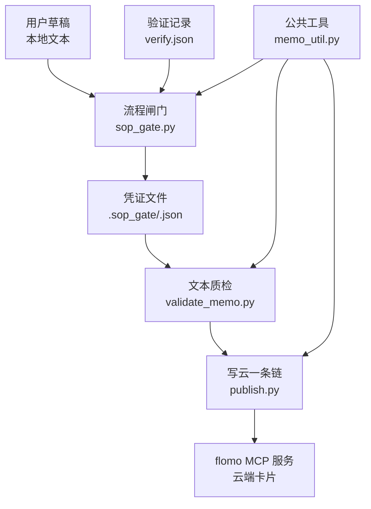
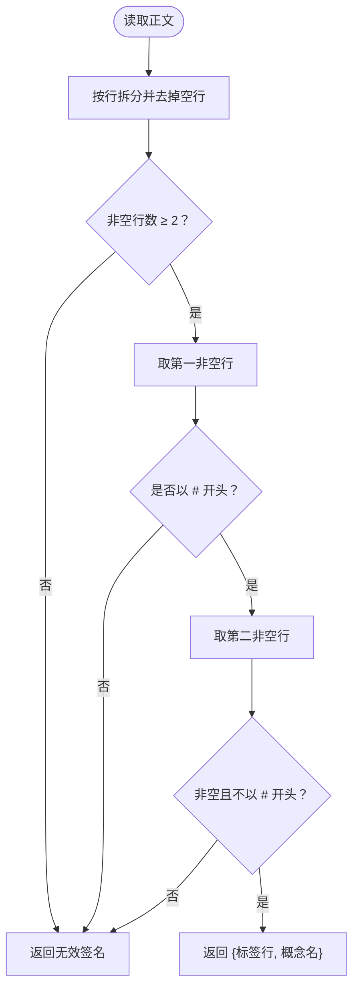
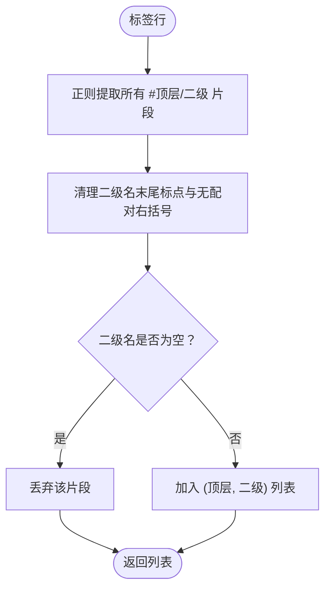
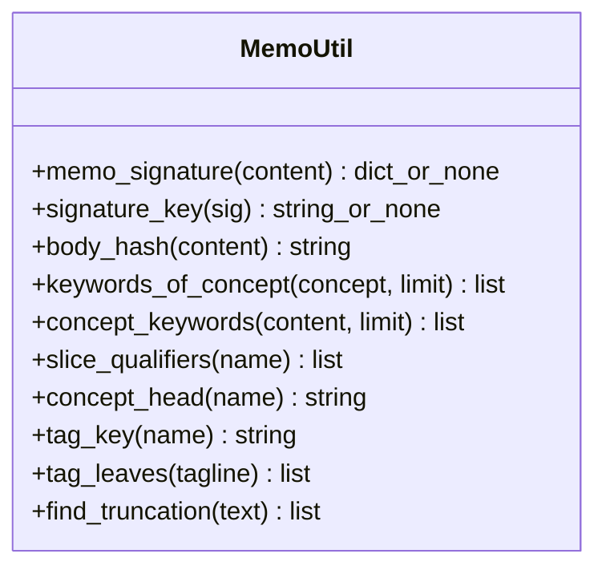
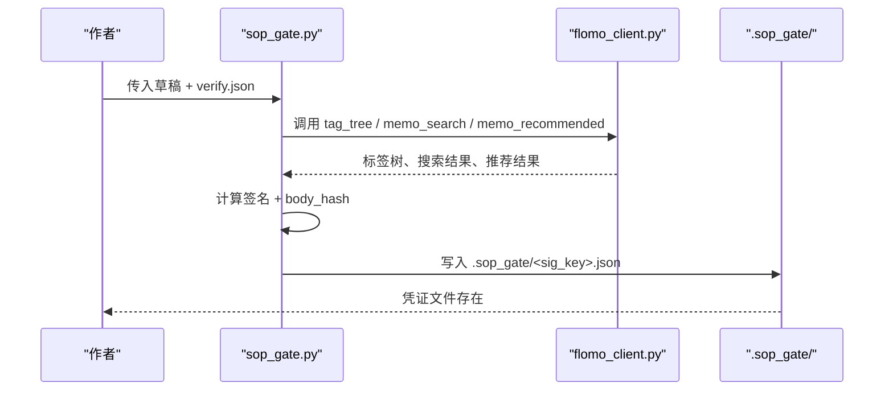
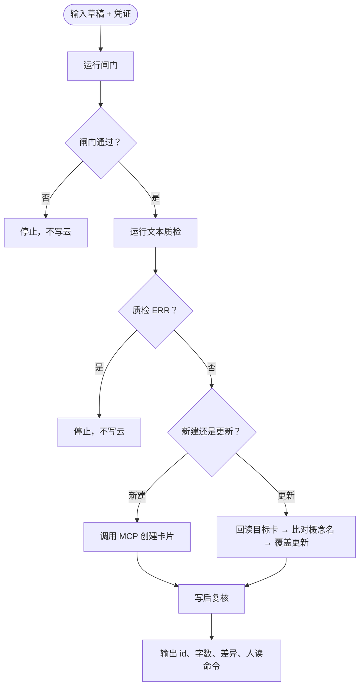
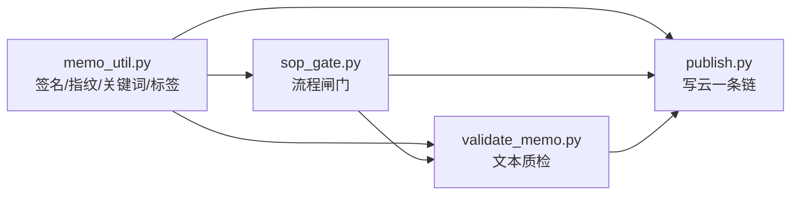

# 核心概念

<cite>
**本文引用的文件**
- [README.md](file://README.md)
- [memo_util.py](file://scripts/memo_util.py)
- [sop_gate.py](file://scripts/sop_gate.py)
- [publish.py](file://scripts/publish.py)
- [validate_memo.py](file://scripts/validate_memo.py)
- [test_memo_util.py](file://tests/test_memo_util.py)
</cite>

## 目录
1. [引言](#引言)
2. [项目结构总览](#项目结构总览)
3. [卡片形态：一事一卡](#卡片形态一事一卡)
4. [标签体系：严格两级与 tagcheck](#标签体系严格两级与tagcheck)
5. [概念名判定与 memo_util.py 契约](#概念名判定与-memo_utilpy-契约)
6. [云端不落盘原则](#云端不落盘原则)
7. [流程闸门与凭证机制](#流程闸门与凭证机制)
8. [写云流程一条链](#写云流程一条链)
9. [示例与错误对照](#示例与错误对照)
10. [依赖关系图](#依赖关系图)
11. [常见问题排查](#常见问题排查)
12. [结论](#结论)

## 引言
flomo-note 是一个 AI 辅助的云端笔记技能，目标是把网页、文章和想法沉淀为 **flomo 云端卡片**。它不是本地笔记仓库，而是“抓取 → 验证 → 提炼 → 定标签 → 查重 → 写作 → 自检并写云 → 复盘”的流水线。最终数据落进 flomo 账号；本地只保留草稿、验证记录、凭证等过程产物。

本文件面向两类读者：
- 初学者：用通俗语言解释什么是卡片、什么是标签、为什么要有凭证。
- 开发者：说明 `memo_util.py` 中签名、指纹、关键词、标签拆分的输入输出契约，以及这些契约如何影响闸门、质检与写云。

**章节来源**
- [README.md:1-60](file://README.md#L1-L60)

## 项目结构总览
从“核心概念”角度，仓库可理解为四层：



- 草稿是作者写的原始正文。
- 闸门负责把“自觉检查”变成“必须留痕”。
- 凭证是闸门的产物，包含签名、正文指纹和各步结果。
- 质检检查卡片格式、标签、截断占位符等。
- publish 是真正调 MCP 写云的入口，且保证幂等与安全。
- memo_util 是所有签名字段的唯一实现，避免三处口径漂移。

**图表来源**
- [sop_gate.py:1-60](file://scripts/sop_gate.py#L1-L60)
- [validate_memo.py:1-40](file://scripts/validate_memo.py#L1-L40)
- [publish.py:1-60](file://scripts/publish.py#L1-L60)
- [memo_util.py:1-20](file://scripts/memo_util.py#L1-L20)

**章节来源**
- [README.md:60-160](file://README.md#L60-L160)

## 卡片形态：一事一卡
卡片的基本形态是“一事一卡”，即一张卡只表达一个概念或事件。其标准结构如下：

| 行号 | 内容 | 规则 |
|---|---|---|
| 第 1 行 | 标签段 | 一行以 `#` 开头的标签串，多个标签空格分隔 |
| 第 2 行或第 3 行 | 概念名 | 非空、不以 `#` 开头，概括卡片主题 |
| 第 3 行或第 4 行 | 空行 | flomo 存储层可能自动插入空行 |
| 第 4 行起 | 正文 | 事实、数据、因果链，不含营销话术 |

关键细节：
- 概念名不是整句，而是名词性短语，标识对象本身。
- 标签必须是严格两级 `#顶层/二级`，不能三级、也不能只有顶层。
- 一行标签段里可以放多个标签，但每个标签都要符合两级规则。
- 如果标签段后直接跟概念名，或者中间夹一个空行，都算合法。

这个形态由 `memo_signature` 统一解析：取正文前两个非空行，首行必须以 `#` 开头，第二非空行不得为空且不得以 `#` 开头。



**图表来源**
- [memo_util.py:18-45](file://scripts/memo_util.py#L18-L45)

**章节来源**
- [README.md:12-40](file://README.md#L12-L40)
- [memo_util.py:18-45](file://scripts/memo_util.py#L18-L45)
- [test_memo_util.py:30-46](file://tests/test_memo_util.py#L30-L46)

## 标签体系：严格两级与 tagcheck
标签体系有两个层次：
- 顶层：如 `科技`、`AI`、`投资`。
- 二级：如 `机器人`、`物理AI`、`一级市场`。

正式写法是 `#顶层/二级`，多个标签之间用空格分隔。例如：

| 类型 | 示例 | 是否合法 | 原因 |
|---|---|---:|---|
| 合法 | `#科技/机器人 #AI/物理AI` | 是 | 两个严格两级标签，空格分隔 |
| 合法 | `#科技/机器人（人形）` | 是 | 成对括号属于二级名的一部分 |
| 非法 | `#科技/安全/邮件` | 否 | 三级标签 |
| 非法 | `#科技` | 否 | 只有顶层，没有二级 |
| 非法 | `#科技/机器人。` | 作为完整标签行不合法 | 末尾句号应剔除后仍须存在有效二级名；实际使用中应以清洗后的二级名为准 |
| 非法 | `#科技／机器人` | 视比对场景 | 全角斜杠在键比较时会归一，但存在性校验仍需逐字匹配 |

`tag_leaves` 负责从标签行中提取合法的 `(顶层, 二级)` 对：
- 正则只匹配恰含一个 `/` 的两级形式。
- 二级名末尾的句读标点会被剥离。
- 无配对的右括号被当作收尾符剔除。
- 有配对的括号保留在二级名中。
- 三级及以上路径整体不被当成合法两级标签。

`tag_key` 用于判断“同一簇的不同写法”，只做空白折叠、全半角斜杠归一和小写转换；它不是存在性判据，存在性必须由 `tagcheck.py` 现采标签树后逐字核对。



**图表来源**
- [memo_util.py:255-305](file://scripts/memo_util.py#L255-L305)

**章节来源**
- [README.md:20-40](file://README.md#L20-L40)
- [memo_util.py:255-305](file://scripts/memo_util.py#L255-L305)
- [test_memo_util.py:95-135](file://tests/test_memo_util.py#L95-L135)

## 概念名判定与 memo_util.py 契约
概念名是卡片的核心身份之一。它必须标识“对象本身”，而不是某个时间切片、版本切片、轮次、地域版本，也不是“谁做了什么”的事件描述。

### 概念名判定的两条红线
1. **禁止切片限定**：年份区间、季度、相对时间词、版本号、阶段号、代次轮次、地域语种版本、谓语动作等都属于“切片”或“事件”，不能作为概念名主体。
2. **禁止谓语动作**：概念名应是名词短语，不能出现发布、上线、推出、新增、夺冠等动词构成的主谓结构。

`slice_qualifiers` 会返回命中的切片或谓语标签，例如：
- 命中“年份”“季度”“v 版本号”“第 X 代”“中文版”等。
- 命中“发布”“上线”“新增”等谓语时，也会标记为“谓语动作”。

概念名标题部分还会通过 `concept_head` 截断冒号、破折号、句号之后的摘要，避免摘要里的“当前”“近日”等词误判概念名本身。

### memo_util.py 关键函数契约

| 函数 | 输入 | 输出 | 用途 |
|---|---|---|---|
| `memo_signature(content)` | 正文字符串 | `{tagline, concept}` 或 `None` | 从正文前两个非空行提取签名 |
| `signature_key(sig)` | 签名字典或 `None` | 16 位短十六进制字符串或 `None` | 凭证文件名等稳定短键 |
| `body_hash(content)` | 任意类型值 | 固定长度哈希字符串 | 防“闸门通过后改正文” |
| `keywords_of_concept(concept, limit=2)` | 概念名字符串 + 可选限制数 | 去重保序的短关键词列表 | 从概念名派生检索关键词 |
| `concept_keywords(content, limit=2)` | 正文 + 可选限制数 | 去重保序的短关键词列表 | 先取签名再委托概念名派生 |
| `slice_qualifiers(name)` | 概念名字符串 | 命中标签列表 | 检测切片限定与谓语动作 |
| `concept_head(name)` | 概念名字符串 | 标题部分字符串 | 遇冒号、破折号、句号截断 |
| `tag_key(name)` | 标签名字符串 | 归一化键 | 判断不同写法是否同一簇 |
| `tag_leaves(tagline)` | 标签行字符串 | `(顶层, 二级)` 元组列表 | 提取严格两级标签 |
| `find_truncation(text)` | 正文或 `None` | 截断占位符字面列表 | 检测 `[此处省略...]` 类标记 |

其中：
- `memo_signature` 对空串、`None`、非字符串一律返回 `None`，不抛异常。
- `body_hash` 对非字符串输入会加类型前缀，使 `None` 与空串可区分。
- `keywords_of_concept` 从概念名最长中文连续段（≥4 字）和前 8 个干净字符派生关键词。
- `tag_leaves` 不会接受三级标签，也不会让末尾标点污染二级名。
- `find_truncation` 只认带括号的截断标记，避免普通文本中“省略”二字造成误报。



**图表来源**
- [memo_util.py:18-347](file://scripts/memo_util.py#L18-L347)

**章节来源**
- [memo_util.py:18-347](file://scripts/memo_util.py#L18-L347)
- [test_memo_util.py:30-200](file://tests/test_memo_util.py#L30-L200)

## 云端不落盘原则
项目明确采用“云端不落盘”策略：
- 笔记最终写入 flomo 云端账号。
- 本地只保存草稿、验证记录、凭证、临时工具和脚本。
- 写云通道通过 MCP token 访问 flomo MCP 服务，token 来自 `.mcp.json` 或环境变量。
- 若未找到 token，命令会非 0 退出并提示未找到 token。

这意味着：
- 不能假设本地文件系统里有全部历史卡片。
- 回读全文通常要通过 MCP 接口或控制台接口。
- 本地存在的 `_tmp/` 目录主要是抓取的页面、草稿、快照和批处理中间文件。
- 凭证放在 `.sop_gate/` 下，只证明“闸门跑过”，不代表卡片已写云。

**章节来源**
- [README.md:12-40](file://README.md#L12-L40)
- [README.md:20-40](file://README.md#L20-L40)

## 流程闸门与凭证机制
`sop_gate.py` 是流程闸门，核心作用是：**把靠自觉的检查变成必须留痕**。它代跑以下步骤：
1. 网络搜索验证（或显式跳过）。
2. 标签树现采与标签存在性核对。
3. 查重两路：关键词检索 + 同主标签近邻比对。
4. 复盘三路：关键词锚点、标签簇锚点、指定锚点，最后调推荐接口。
5. 组装并写入凭证。

凭证文件位于 `.sop_gate/<signature_key>.json`，关键字段包括：

| 字段 | 含义 |
|---|---|
| `signature` | 从正文前两个非空行解析出的 `{tagline, concept}` |
| `sig_key` | 基于签名计算的 16 位短键，用作凭证文件名 |
| `body_hash` | 正文 SHA-256 指纹，防止闸门通过后修改正文 |
| `generated_at` | 凭证生成时间戳 |
| `expires_at` | 凭证过期时间，默认 6 小时 |
| `web` | 网络验证记录，包括术语数量、是否落正文、豁免项 |
| `tag_check` | 标签树核对结果，逐条记录是否存在、是否新建、是否有相近名 |
| `dedup` | 查重结果，包括关键词命中与标签近邻 |
| `review` | 复盘结果，包括锚点来源和推荐卡片 id |
| `human_judgment` | 机器无法判断、只能人工判断的事项 |

凭证有效期是硬性约束：同一张卡在时限内可重复使用凭证自检，超期必须重跑闸门，避免“昨天的凭证给今天的卡用”。



**图表来源**
- [sop_gate.py:1-60](file://scripts/sop_gate.py#L1-L60)
- [sop_gate.py:201-504](file://scripts/sop_gate.py#L201-L504)
- [memo_util.py:18-45](file://scripts/memo_util.py#L18-L45)

**章节来源**
- [sop_gate.py:1-60](file://scripts/sop_gate.py#L1-L60)
- [sop_gate.py:201-504](file://scripts/sop_gate.py#L201-L504)
- [memo_util.py:18-45](file://scripts/memo_util.py#L18-L45)

## 写云流程一条链
`publish.py` 是写云入口，把“闸门 → 质检 → 建卡或覆盖 → 复核”固化为一次调用。它的三条纪律是：
1. 闸门不过，一个字节不发云端。
2. 质检报错，不发。
3. create 只发一次；失败即停，绝不重发。

对于更新既有卡，publish 会：
- 先回读目标卡。
- 比对概念名，不一致则阻塞，除非显式允许改名。
- 写前保存云端原文快照。
- 写后对比草稿与快照，列出删除行和新增行。
- 净删行数不为零时提示人工确认。

批次模式支持多张卡预检：任何一张预检失败，整批都不写；全部通过后再逐张写入并复核。



**图表来源**
- [publish.py:1-60](file://scripts/publish.py#L1-L60)
- [publish.py:60-160](file://scripts/publish.py#L60-L160)

**章节来源**
- [publish.py:1-60](file://scripts/publish.py#L1-L60)
- [publish.py:60-160](file://scripts/publish.py#L60-L160)

## 示例与错误对照

### 正确卡片示例
以下示例展示“一事一卡”的标准形态：

```text
#科技/机器人 #AI/物理AI

德塔智能 Delta 0 双足人形机器人基础模型

正文开始：这是一张关于某双足人形机器人基础模型的卡片，包含事实、数据和因果链。
```

对应语义：
- 标签段：`#科技/机器人 #AI/物理AI`
- 概念名：`德塔智能 Delta 0 双足人形机器人基础模型`
- 空行：可选，存储层可能自动插入
- 正文：具体说明

测试用例中使用了相同结构的卡片来验证签名、关键词和标签拆分。

**章节来源**
- [test_memo_util.py:30-46](file://tests/test_memo_util.py#L30-L46)

### 标签错误示例
| 错误写法 | 问题 | 修正方向 |
|---|---|---|
| `#科技/安全/邮件` | 三级标签 | 改为两级，例如 `#科技/安全管理` |
| `#科技` | 只有顶层 | 补充二级，例如 `#科技/机器人` |
| `#科技/机器人。` | 末尾标点未清洗前可能被误认为二级名一部分 | 实际使用时应确保二级名清洗后仍有效 |
| `#AI／Agent` | 全角斜杠 | 建议改为半角 `/`；键比较会归一，但存在性需逐字匹配 |
| `#科技/机器人）` | 无配对右括号 | 右括号被视为收尾符，二级名应为 `机器人` |

**章节来源**
- [memo_util.py:255-305](file://scripts/memo_util.py#L255-L305)
- [test_memo_util.py:95-135](file://tests/test_memo_util.py#L95-L135)

### 概念名错误示例
| 概念名 | 问题 | 说明 |
|---|---|---|
| `某模型 2026 年度财报` | 时间切片 | 应聚焦模型本身，而非某年财报 |
| `某市场 Q3 格局` | 季度切片 | 季度是期间切片 |
| `最新的大模型进展` | 相对时间词 | “最新”是切片限定 |
| `某工具 v0.21.4` | 语义化版本号 | 版本后缀属于切片 |
| `谷歌第七代TPU` | 代次/轮次 | “第七代”是切片 |
| `某赛事第 3 轮` | 轮次切片 | “第 3 轮”是切片 |
| `某产品中文版` | 地域/语种版本 | 版本形态属于切片 |
| `某基准赛夺冠` | 谓语动作 | “夺冠”是事件动词 |
| `某大会 举办` | 谓语动作 | “举办”是事件动词 |
| `Grok Voice Transcribe 2.0 语音转文本模型` | 不应命中 | 2.0 是型号的一部分，不是切片 |
| `阶跃星辰 Step 5 Preview 大模型` | 不应命中 | Preview 是型号名称的一部分 |

**章节来源**
- [memo_util.py:201-254](file://scripts/memo_util.py#L201-L254)
- [test_memo_util.py:138-200](file://tests/test_memo_util.py#L138-L200)

### 凭证文件结构说明
凭证是由闸门组装的 JSON，核心字段已在前面表格中说明。从开发者视角，重点理解三类值：
- `signature`：由 `memo_signature` 决定，是卡片身份的轻量表示。
- `sig_key`：由 `signature_key` 决定，用于凭证文件名。
- `body_hash`：由 `body_hash` 决定，用于锁定闸门通过的正文版本。

凭证不是“已写云证明”，而是“已跑过闸门证明”。写云成功与否要看 publish 的输出和 MCP 回包。

**章节来源**
- [sop_gate.py:201-504](file://scripts/sop_gate.py#L201-L504)
- [memo_util.py:18-45](file://scripts/memo_util.py#L18-L45)

## 依赖关系图
从核心概念看，模块之间的依赖关系如下：



- `memo_util.py` 是底层工具，不依赖写卡流程脚本。
- `sop_gate.py` 依赖 `memo_util.py` 生成签名、关键词和标签解析结果。
- `validate_memo.py` 依赖 `memo_util.py` 做签名、正文指纹、切片限定和截断检测。
- `publish.py` 依赖闸门和质检，最终调 MCP 写云。

**图表来源**
- [memo_util.py:1-20](file://scripts/memo_util.py#L1-L20)
- [sop_gate.py:40-60](file://scripts/sop_gate.py#L40-L60)
- [validate_memo.py:20-40](file://scripts/validate_memo.py#L20-L40)
- [publish.py:40-80](file://scripts/publish.py#L40-L80)

**章节来源**
- [memo_util.py:1-20](file://scripts/memo_util.py#L1-L20)
- [sop_gate.py:40-60](file://scripts/sop_gate.py#L40-L60)
- [validate_memo.py:20-40](file://scripts/validate_memo.py#L20-L40)
- [publish.py:40-80](file://scripts/publish.py#L40-L80)

## 常见问题排查
| 现象 | 可能原因 | 处理建议 |
|---|---|---|
| 命令行提示未找到 flomo token | `.mcp.json` 和环境变量都没有可用 token | 先配置 token，否则所有写云命令都不会执行 |
| 闸门报“无法从概念名派生查重关键词” | 概念名太短或全是不可派生的符号 | 检查概念名是否可读、是否含足够中文或字母数字 |
| 闸门报标签不在树中 | 二级名写错或确实需要新建 | 先看相近二级名；新建二级是常态，但要确认是否语义重复 |
| 闸门报“复盘无法取锚” | 关键词无命中、标签簇无卡、也未传 `--anchor-id` | 更新旧卡时传 `--anchor-id`；全新主题需人工指定锚点 |
| 写云时报概念名不符 | 目标卡概念名与草稿不一致，且未允许改名 | 检查 update-id 是否抄错；确属改名时使用允许改名选项 |
| 写云后复核发现删行 | 覆盖更新时草稿比原卡少内容 | 人工确认删除是否有意；无意删除应恢复或删除 `allow-content-loss` |
| 正文含截断占位符 | 卡片曾被检索回包覆盖或正文不完整 | 用 `verify_card.py --show-body` 查看全文并修复 |

**章节来源**
- [README.md:20-40](file://README.md#L20-L40)
- [sop_gate.py:201-504](file://scripts/sop_gate.py#L201-L504)
- [publish.py:60-160](file://scripts/publish.py#L60-L160)
- [memo_util.py:305-347](file://scripts/memo_util.py#L305-L347)

## 结论
flomo-note 的核心概念可以压缩为五句话：
1. 一张卡只表达一个概念，形态是“标签段 + 概念名 + 正文”。
2. 标签必须严格两级，由 tagcheck 和 `tag_leaves` 共同保障。
3. 概念名要标识对象本身，不能用时间、版本、轮次、地域版本或谓语事件代替。
4. 所有卡片最终写入 flomo MCP 服务，本地只保留草稿与凭证。
5. 闸门产出带正文指纹的凭证，publish 只消费凭证；漏做闸门在物理上不可能通过写云链路。

对初学者来说，最重要的是记住：**先写卡，再跑闸门，再写云**。对开发者来说，最重要的是记住：**不要在三处各自实现签名和标签解析，一切以 `memo_util.py` 为准**。