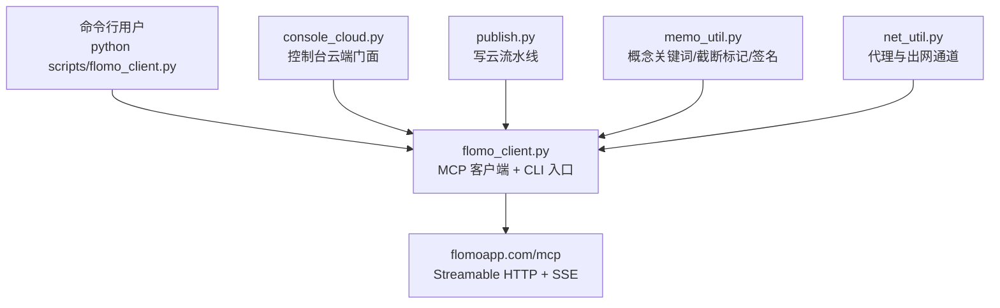
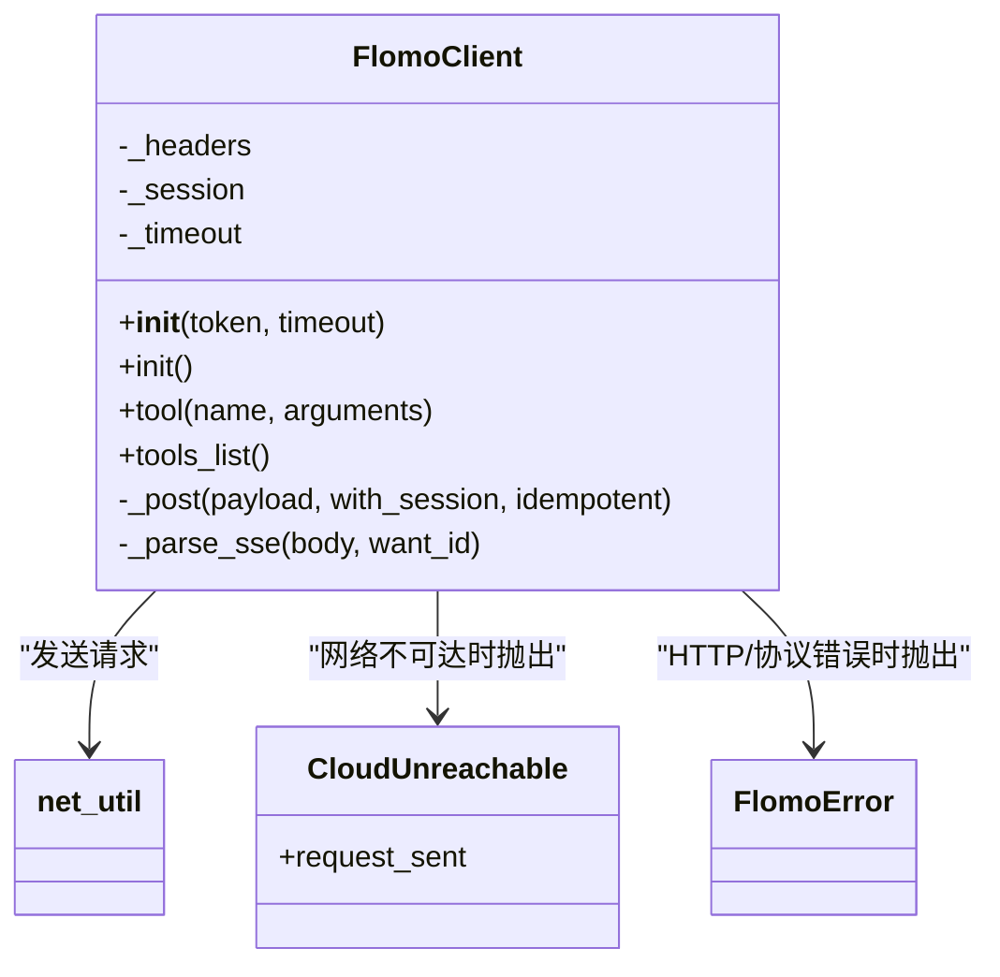
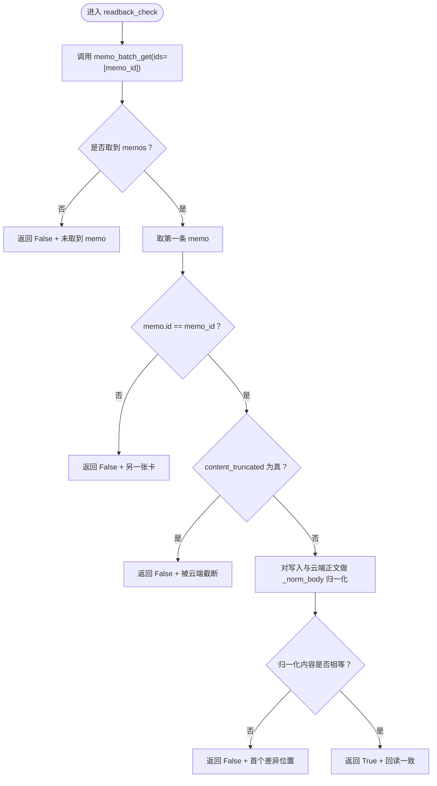
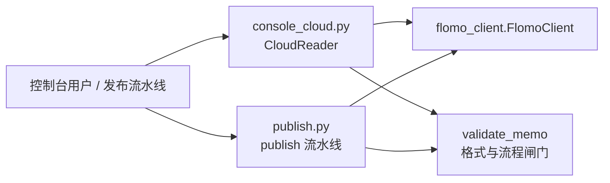
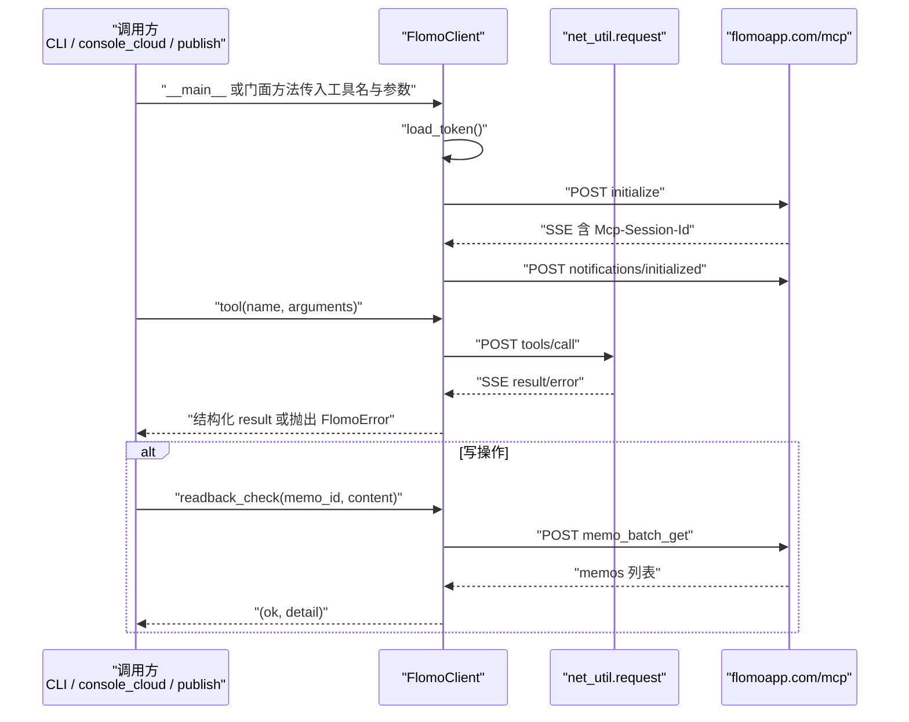
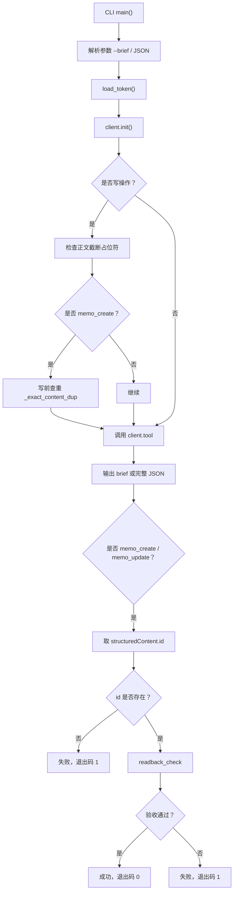
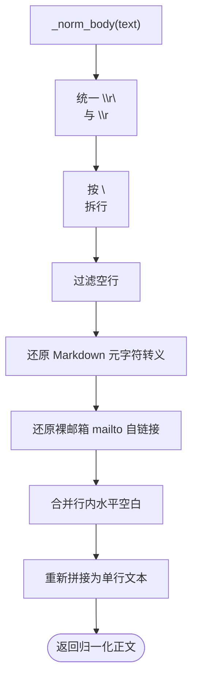
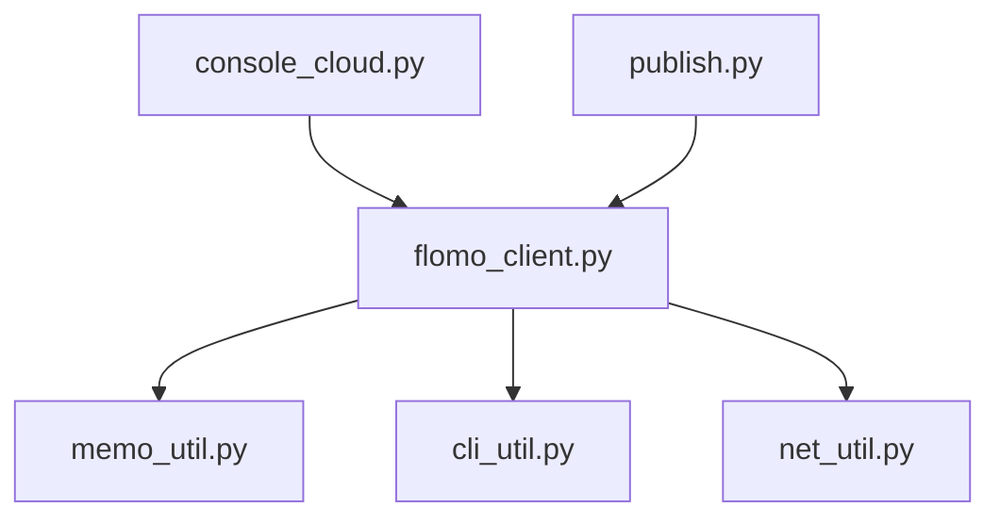

# MCP 客户端 flomo_client.py

<cite>
**本文引用的文件**   
- [scripts/flomo_client.py](file://scripts/flomo_client.py)
- [scripts/console_cloud.py](file://scripts/console_cloud.py)
- [scripts/publish.py](file://scripts/publish.py)
- [tests/test_flomo_client.py](file://tests/test_flomo_client.py)
</cite>

## 目录
1. [引言](#引言)
2. [项目结构定位](#项目结构定位)
3. [核心组件与门面职责](#核心组件与门面职责)
4. [架构总览](#架构总览)
5. [详细组件分析](#详细组件分析)
6. [依赖关系分析](#依赖关系分析)
7. [性能与幂等特性](#性能与幂等特性)
8. [故障场景与排查指南](#故障场景与排查指南)
9. [结论](#结论)

## 引言
`scripts/flomo_client.py` 是一个用 Python 标准库实现的 flomo MCP 客户端封装，目标是把以下协议细节收敛到一处：
- 直连 `https://flomoapp.com/mcp` 的 Streamable HTTP / SSE 握手；
- `initialize`、`notifications/initialized`、`tools/list`、`tools/call`；
- Bearer Token 从 `.mcp.json` 或环境变量读取；
- 工具调用与结构化回包解析；
- 写操作后的 memo id 回读全文比对。

它同时承担两条角色：
- **库层**：提供 `FlomoClient`、`readback_check`、`tool_data` 等可复用函数，供 `console_cloud.py`、`publish.py` 等上层脚本调用；
- **CLI 层**：通过 `__main__` 暴露命令行入口，直接执行任意 MCP 工具并输出结果。

模块文档强调：**所有异常（凭据缺失、网络失败、JSON-RPC 错误）都抛出 `FlomoError` 及其子类，而不是 `SystemExit`**。这样“库”可以安全地被 HTTP 服务或其他进程捕获，CLI 侧再在入口处统一转成退出码。

**章节来源**
- [scripts/flomo_client.py:1-70](file://scripts/flomo_client.py#L1-L70)
- [scripts/flomo_client.py:671-681](file://scripts/flomo_client.py#L671-L681)

## 项目结构定位
该文件位于仓库 `scripts/` 目录，是云端访问链路的底层实现之一。其上游和下游关系如下：

**图示来源**
- [scripts/flomo_client.py:1-40](file://scripts/flomo_client.py#L1-L40)
- [scripts/flomo_client.py:201-230](file://scripts/flomo_client.py#L201-L230)
- [scripts/console_cloud.py:1-40](file://scripts/console_cloud.py#L1-L40)
- [scripts/publish.py:1-60](file://scripts/publish.py#L1-L60)

**章节来源**
- [scripts/flomo_client.py:1-40](file://scripts/flomo_client.py#L1-L40)
- [scripts/console_cloud.py:1-40](file://scripts/console_cloud.py#L1-L40)
- [scripts/publish.py:1-60](file://scripts/publish.py#L1-L60)

## 核心组件与门面职责

### FlomoClient：MCP 连接与工具调用门面
`FlomoClient` 是对外暴露的主要类，隐藏了 JSON-RPC 构造、SSE 流解析、会话 ID 管理、超时与代理转发。典型职责包括：
- 设置 `Content-Type`、`Accept`、`Authorization: Bearer <token>`；
- 维护 `Mcp-Session-Id` 会话头；
- 将 `net_util.request` 抛出的网络异常转换为 `CloudUnreachable`；
- 把 HTTP 错误包装为 `FlomoError`；
- 按请求 `id` 精确匹配 SSE 响应中的 `result`。

**图示来源**
- [scripts/flomo_client.py:110-190](file://scripts/flomo_client.py#L110-L190)
- [scripts/flomo_client.py:191-230](file://scripts/flomo_client.py#L191-L230)

**章节来源**
- [scripts/flomo_client.py:110-230](file://scripts/flomo_client.py#L110-L230)

### load_token：Bearer Token 读取门面
Token 读取遵循明确优先级：
1. 项目根 `.mcp.json` 中 `mcpServers.flomo.headers.Authorization`，且必须以 `Bearer ` 开头；
2. 环境变量 `FLOMO_TOKEN`；
3. 都取不到则抛 `FlomoError`。

返回值为 `(token, source)` 元组，source 用于诊断 Token 来自配置文件还是环境变量。

**章节来源**
- [scripts/flomo_client.py:71-109](file://scripts/flomo_client.py#L71-L109)

### readback_check：写后回读验收门面
`readback_check(client, memo_id, written)` 是 H11 回读验收的核心门面：
- 调用 `memo_batch_get` 拉回目标 id 的完整正文；
- 校验是否取到记录；
- 校验返回 memo 的 id 是否与写入 id 一致；
- 检测 `content_truncated`；
- 使用 `_norm_body` 归一化本地写入内容与云端存储内容；
- 返回 `(ok, detail)`。

**图示来源**
- [scripts/flomo_client.py:400-450](file://scripts/flomo_client.py#L400-L450)
- [scripts/flomo_client.py:451-470](file://scripts/flomo_client.py#L451-L470)

**章节来源**
- [scripts/flomo_client.py:400-470](file://scripts/flomo_client.py#L400-L470)

### console_cloud 与 publish：门面模式的使用者
- `console_cloud.py` 定义 `CloudReader`，只暴露读能力与受控写能力；它不直接让用户拼装 JSON-RPC，而是调用 `flomo_client.FlomoClient`、`load_token`、`tool_data_or_none`、`_result_memos` 等内部接口。
- `publish.py` 把闸门、质检、建卡/更新、复核串成一条流水线，并通过 `import flomo_client as FC` 复用 `_norm_body` 与写流程语义，避免各自重写一套正文归一化逻辑。

**图示来源**
- [scripts/console_cloud.py:1-40](file://scripts/console_cloud.py#L1-L40)
- [scripts/publish.py:1-60](file://scripts/publish.py#L1-L60)
- [scripts/flomo_client.py:110-230](file://scripts/flomo_client.py#L110-L230)

**章节来源**
- [scripts/console_cloud.py:1-40](file://scripts/console_cloud.py#L1-L40)
- [scripts/publish.py:1-60](file://scripts/publish.py#L1-L60)

## 架构总览

**图示来源**
- [scripts/flomo_client.py:191-230](file://scripts/flomo_client.py#L191-L230)
- [scripts/flomo_client.py:400-470](file://scripts/flomo_client.py#L400-L470)
- [scripts/flomo_client.py:671-681](file://scripts/flomo_client.py#L671-L681)

## 详细组件分析

### 握手与协议发现

#### initialize 流程
- `FlomoClient.init()` 先发起一次不带会话头的 `initialize` 请求；
- 服务端通过响应头 `Mcp-Session-Id` 建立会话；
- 随后发送 `notifications/initialized` 通知；
- 后续 `tools/call` 会带上 `Mcp-Session-Id`。

关键行为：
- 首次 `_post` 使用 `with_session=False`，确保会话头由服务端回传后再复用；
- `_parse_sse` 仅匹配当前请求的 `id`，防止误吞并发通知或响应。

**章节来源**
- [scripts/flomo_client.py:191-230](file://scripts/flomo_client.py#L191-L230)

#### tools/list 处理
`tools_list()` 不是普通工具调用，而是 MCP 协议发现方法：
- 使用 `method: "tools/list"`；
- 不走工具白名单；
- 不读任何卡片数据，只返回 MCP server 暴露的工具元信息。

它与 `tool()` 的区别在于：`tool()` 走 `tools/call`，受 `WRITE_TOOLS` 幂等策略影响；`tools_list()` 直接拼 JSON-RPC 请求并调用 `_post`。

**章节来源**
- [scripts/flomo_client.py:221-230](file://scripts/flomo_client.py#L221-L230)

### Bearer Token 读取

#### load_token
- 优先读取项目根 `.mcp.json`；
- 要求路径 `mcpServers.flomo.headers.Authorization` 存在；
- Authorization 值必须以 `Bearer ` 开头，否则跳过该配置；
- 若 `.mcp.json` 不存在或字段缺失，退回到 `FLOMO_TOKEN` 环境变量；
- 两者都缺则抛 `FlomoError`。

常见错误来源：
- `.mcp.json` 路径不在项目根；
- `Authorization` 缺少 `Bearer ` 前缀；
- JSON 结构不完整；
- 环境变量未导出。

**章节来源**
- [scripts/flomo_client.py:71-109](file://scripts/flomo_client.py#L71-L109)

### 工具调用与 SSE 解析

#### FlomoClient._post
- 构造 JSON-RPC payload；
- 合并 `Mcp-Session-Id`；
- 通过 `net_util.request` 发出请求；
- 捕获 `urllib.error.HTTPError` 转为 `FlomoError`；
- 捕获 `net_util.TransportError` 转为 `CloudUnreachable`；
- 解析响应头中的 `Mcp-Session-Id` 并缓存；
- 调用 `_parse_sse` 返回 `result`。

#### FlomoClient._parse_sse
- 逐行扫描 `data:` 行；
- 尝试 JSON 解析；
- 忽略无 `id` 的行；
- 若无期望 `want_id`，则取第一个非空 `id` 作为本次匹配目标；
- 遇到 `error` 直接抛 `FlomoError`；
- 遇到匹配的 `result` 立即返回；
- 通知型 JSON-RPC 无 `result/error` 时返回 `None`。

#### FlomoClient.tool
- 固定使用 `method: "tools/call"`；
- 参数为 `{name, arguments}`；
- 非 `WRITE_TOOLS` 的工具允许在通道失败时换出口重发；
- `WRITE_TOOLS` 永远以 `idempotent=False` 发送，禁止自动重试。

**章节来源**
- [scripts/flomo_client.py:130-190](file://scripts/flomo_client.py#L130-L190)
- [scripts/flomo_client.py:191-220](file://scripts/flomo_client.py#L191-L220)

### write tool 执行路径

CLI 中写操作（`memo_create`、`memo_update`、`tag_rename`）经过以下顺序：
1. 解析参数；
2. 读取 token；
3. 初始化 MCP 会话；
4. 对 `memo_create` 与 `memo_update` 检查正文是否包含截断占位符；
5. 对 `memo_create` 做写前查重；
6. 调用 `client.tool(name, arguments)`；
7. 根据 `--brief` 输出短表或完整 JSON；
8. 校验结构化 `id`；
9. 调用 `readback_check` 进行 H11 回读验收；
10. 成功返回 0，失败返回非 0。

**图示来源**
- [scripts/flomo_client.py:471-670](file://scripts/flomo_client.py#L471-L670)

**章节来源**
- [scripts/flomo_client.py:471-670](file://scripts/flomo_client.py#L471-L670)

### memo_batch_get 回读比较

`readback_check` 使用 `memo_batch_get` 拉回目标 id 的完整内容，并与写入正文做归一化比对。关键判断分支：
- 未取到 memos → 失败；
- 返回 memo 的 id 不同 → 失败；
- `content_truncated` 为真 → 失败；
- 归一化后文本不一致 → 失败，并报告首个差异字符位置；
- 一致 → 成功。

`_norm_body` 负责忽略平台渲染差异：
- 统一 CRLF；
- 忽略空行；
- 还原 Markdown 元字符反斜杠转义；
- 还原裸邮箱自动链接化；
- 忽略行内水平空白；
- 但保留行界与非空白字符差异。

**图示来源**
- [scripts/flomo_client.py:350-400](file://scripts/flomo_client.py#L350-L400)

**章节来源**
- [scripts/flomo_client.py:350-470](file://scripts/flomo_client.py#L350-L470)

### 结构化回包解析

`_extract_data(result)` 是唯一解析点：
- 如果 result 不是对象 → 返回 None；
- 如果 `isError` 为真 → 提取 `content[].text` 组成错误消息；
- 优先取 `structuredContent`；
- 其次遍历 `content[].text` 并尝试 JSON 解析；
- 最后返回 None 与原因。

`tool_data` 用于读路径：取不到即抛 `FlomoError`；  
`tool_data_or_none` 用于写后回读：取不到返回 None，避免被误判为“0 条”。

**章节来源**
- [scripts/flomo_client.py:231-310](file://scripts/flomo_client.py#L231-L310)

### CLI 参数解析

`_load_arguments(argv)`：
- 支持可选 JSON 字符串参数；
- 支持 `--file <路径>` 加载参数文件；
- JSON 解析失败抛 `UsageError`；
- 非对象类型抛 `UsageError`；
- 用法错与云端失败分开，退出码不同。

**章节来源**
- [scripts/flomo_client.py:471-520](file://scripts/flomo_client.py#L471-L520)

### 门面契约：FLOMO_MCP_TOOLS

文件末尾声明了本项目常用的 flomo MCP 工具镜像契约，包括 `memo_create`、`memo_update`、`memo_search`、`memo_batch_get`、`memo_recommended`、`tag_tree`、`tag_rename`、`get_format_guide`、`get_tag_guide`。这是给审计工具使用的客户端侧镜像，不代表代码强制限制工具名。

**章节来源**
- [scripts/flomo_client.py:600-670](file://scripts/flomo_client.py#L600-L670)

## 依赖关系分析

- `memo_util`：提供概念关键词、截断标记检测、memo 签名。
- `cli_util`：提供 `UsageError`、`cli_entry` 等 CLI 通用能力。
- `net_util`：提供真实出网通道、代理、超时、请求已发送状态。
- `console_cloud`：封装只读能力与带闸门的写能力，是控制台后端门面。
- `publish`：封装发布流水线，复用 `_norm_body` 与写语义。

**图示来源**
- [scripts/flomo_client.py:20-30](file://scripts/flomo_client.py#L20-L30)
- [scripts/console_cloud.py:30-50](file://scripts/console_cloud.py#L30-L50)
- [scripts/publish.py:40-70](file://scripts/publish.py#L40-L70)

**章节来源**
- [scripts/flomo_client.py:20-30](file://scripts/flomo_client.py#L20-L30)
- [scripts/console_cloud.py:30-50](file://scripts/console_cloud.py#L30-L50)
- [scripts/publish.py:40-70](file://scripts/publish.py#L40-L70)

## 性能与幂等特性

### 幂等保护
- `WRITE_TOOLS` 定义为 `{"memo_create", "memo_update", "tag_rename"}`；
- 这些工具在 `_post` 中以 `idempotent=False` 发送，禁止因通道失败而自动重试；
- `memo_create` 额外在写前调用 `_exact_content_dup`，通过 `memo_search` 候选 + memo 签名比对，复用已有 id，避免重复建卡。

### 索引滞后窗口
模块注释明确指出：`memo_create` 的幂等有索引滞后窗口，实测 13 秒内重发可能重复建卡。因此“通道失败”不能简单等同于“请求没发出”，必须依赖 `CloudUnreachable.request_sent` 区分。

### 简要输出优化
`--brief` 只对列表型回包压缩：
- 只输出 id、字数、标签与前两行签名；
- `memo_batch_get` 例外，始终走全文分支；
- 避免每次携带 27–55 KB 原始 JSON。

**章节来源**
- [scripts/flomo_client.py:30-40](file://scripts/flomo_client.py#L30-L40)
- [scripts/flomo_client.py:310-350](file://scripts/flomo_client.py#L310-L350)
- [scripts/flomo_client.py:520-600](file://scripts/flomo_client.py#L520-L600)

## 故障场景与排查指南

### 故障分类

| 故障类别 | 异常类型 | 含义 | 建议动作 |
|---|---|---|---|
| 凭据缺失 | `FlomoError` | `.mcp.json` 无有效 Authorization，且无 `FLOMO_TOKEN` | 检查配置路径、Authorization 前缀、环境变量 |
| HTTP 错误 | `FlomoError` | 服务端返回 HTTP 状态码及响应体 | 查看状态码、响应体、Host 白名单 |
| 协议错误 | `FlomoError` | JSON-RPC 响应含 `error` | 抓包确认 method、id、result/error 形态 |
| 网络不可达 | `CloudUnreachable` | DNS、连接拒绝、超时、中断 | 检查代理、端口、防火墙、`request_sent` |
| 参数错误 | `UsageError` | JSON 非法、非对象、缺少 `--file` 路径 | 修正参数形式或改用 `--file` |
| 回读失败 | CLI 非 0 退出 | id 未落库、id 对不上、正文不一致、被截断 | 人工核对 memo id，不要盲目重发 |

### 典型故障排查步骤

1. **抓包验证 Host 与端点**
   - 确认请求目标是 `https://flomoapp.com/mcp`；
   - 确认请求头包含 `Authorization: Bearer <token>`；
   - 确认首次请求没有 `Mcp-Session-Id`，后续请求带有该会话头。

2. **检查 .mcp.json**
   - 路径应为项目根 `.mcp.json`；
   - 结构应包含 `mcpServers.flomo.headers.Authorization`；
   - Authorization 值应以 `Bearer ` 开头。

3. **检查环境变量**
   - 若 `.mcp.json` 不存在，需设置 `FLOMO_TOKEN`；
   - 注意该 env 只是后备来源，可能过期。

4. **检查 Host 白名单与代理**
   - 如果看到 `CloudUnreachable`，说明出网通道不可用；
   - 检查代理端口、域名解析、防火墙；
   - 注意 `net_util.proxy_label()` 可在错误信息中提示当前代理出口。

5. **检查 JSON-RPC 响应**
   - 正常工具调用返回 `result`；
   - 若返回 `error`，会被转换为 `FlomoError`；
   - 若收到通知型 JSON-RPC（无 `result`），`_parse_sse` 会返回 `None`。

6. **写后回读失败**
   - 若 `memo_batch_get` 未返回目标 id → 可能是写请求未落库；
   - 若返回的 id 不同 → 可能是 id 抄错或被并发覆盖；
   - 若 `content_truncated` 为真 → 无法逐字比对；
   - 若正文不一致 → 检查 Markdown 转义、空行、行内空格、裸邮箱链接化。

7. **不要盲目重发写请求**
   - 回读失败、id 缺失、正文不一致都应停止并重发；
   - 模块多处明确提示“禁止据此重发写请求”；
   - CLI 对这类失败返回非 0 退出码。

**章节来源**
- [scripts/flomo_client.py:71-109](file://scripts/flomo_client.py#L71-L109)
- [scripts/flomo_client.py:110-190](file://scripts/flomo_client.py#L110-L190)
- [scripts/flomo_client.py:400-470](file://scripts/flomo_client.py#L400-L470)
- [scripts/flomo_client.py:671-681](file://scripts/flomo_client.py#L671-L681)

## 结论
`scripts/flomo_client.py` 把 flomo MCP 的握手、协议发现、Token 读取、工具调用与写后回读验收收敛成一个可复用的客户端门面。它通过 `FlomoClient` 隐藏 JSON-RPC/SSE 细节，通过 `load_token` 统一凭据来源，通过 `readback_check` 保证写操作不只是拿到 id，还要证明云端存的正是这份正文。

上层 `console_cloud.py` 和 `publish.py` 利用这个门面实现业务级控制面：前者暴露受控的只读 API 与带闸门的写能力，后者把闸门、质检、建卡/更新、复核串成一条不可靠人脑记忆的流程。两者的共同点是：不把 MCP 协议细节交给调用方，也不让凭据泄露到返回值或日志中。

对于使用者来说，最关键的纪律有三条：
1. 凭据放在 `.mcp.json` 或 `FLOMO_TOKEN`，并确保 Host 可达；
2. 写操作失败不等于“可以重试”，必须先人工核对 id 与正文；
3. 回读失败、id 缺失、正文不一致、被截断都是硬失败，不应静默降级。

**章节来源**
- [scripts/flomo_client.py:1-40](file://scripts/flomo_client.py#L1-L40)
- [scripts/console_cloud.py:1-40](file://scripts/console_cloud.py#L1-L40)
- [scripts/publish.py:1-60](file://scripts/publish.py#L1-L60)