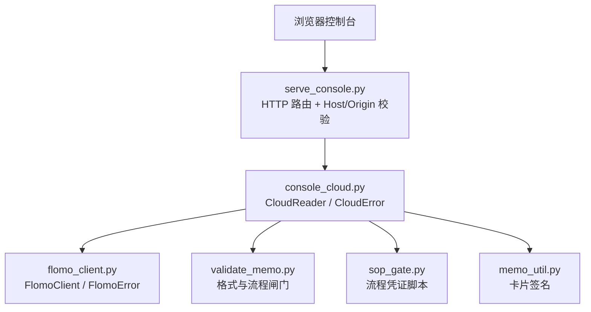
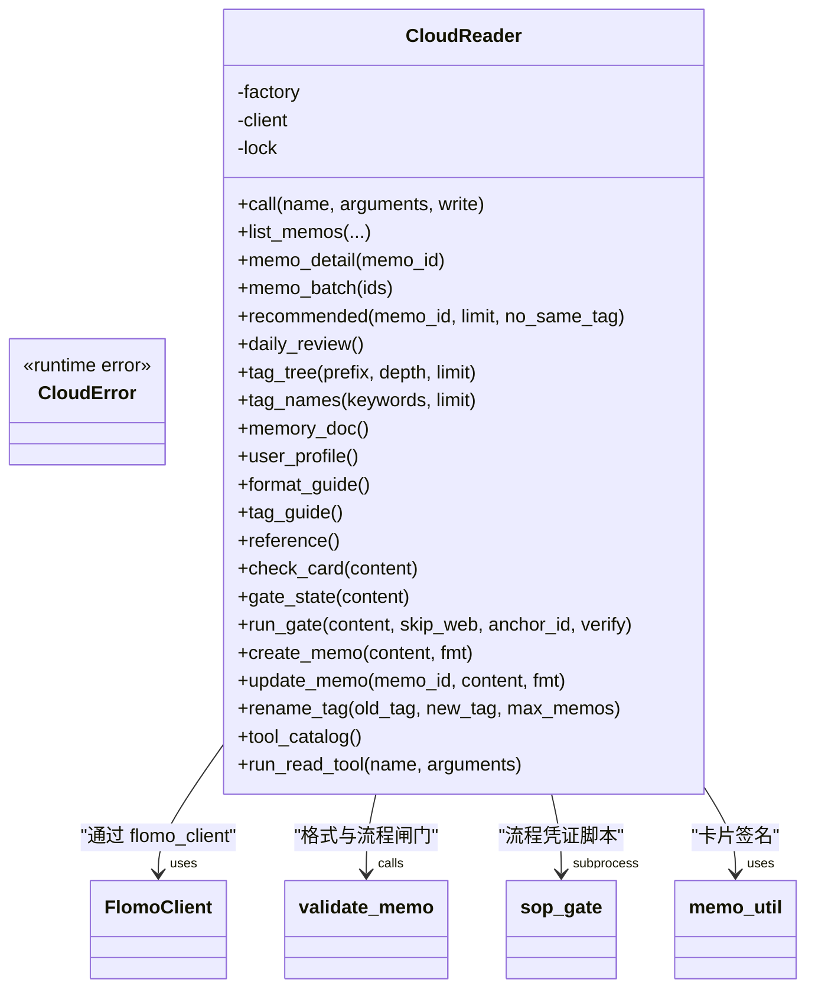
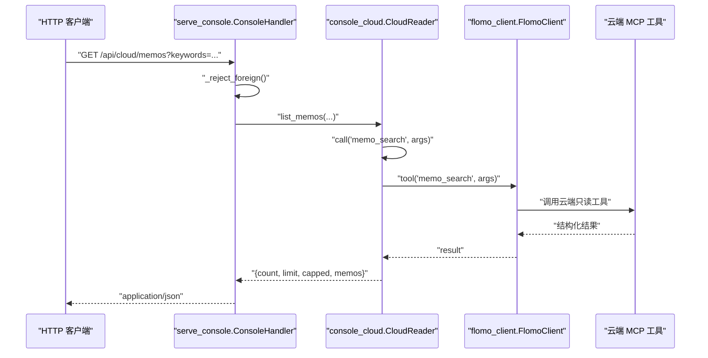
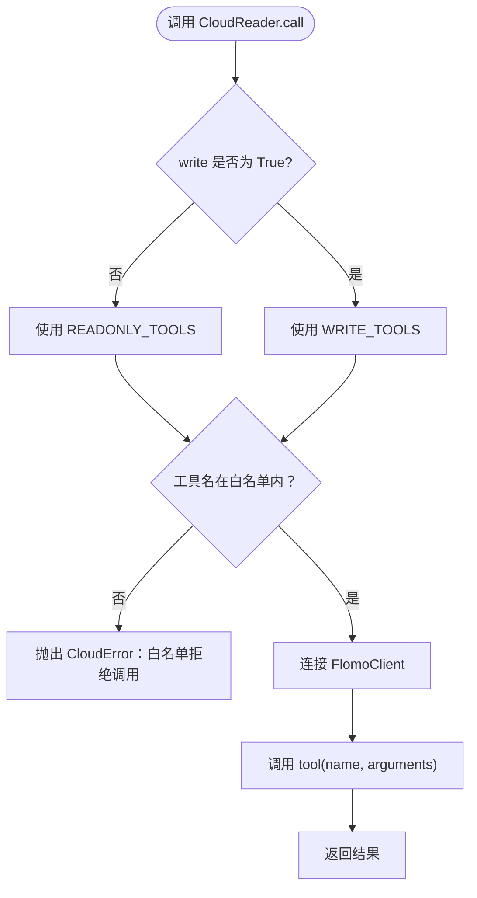
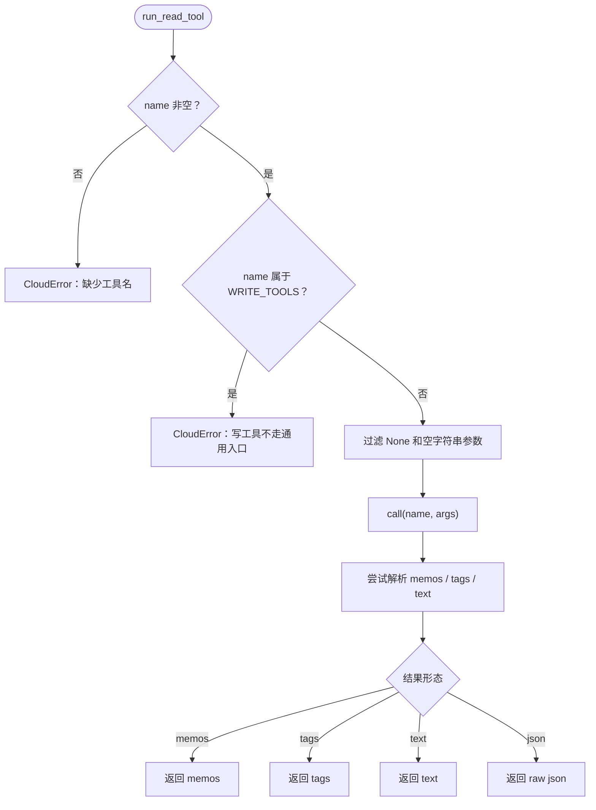
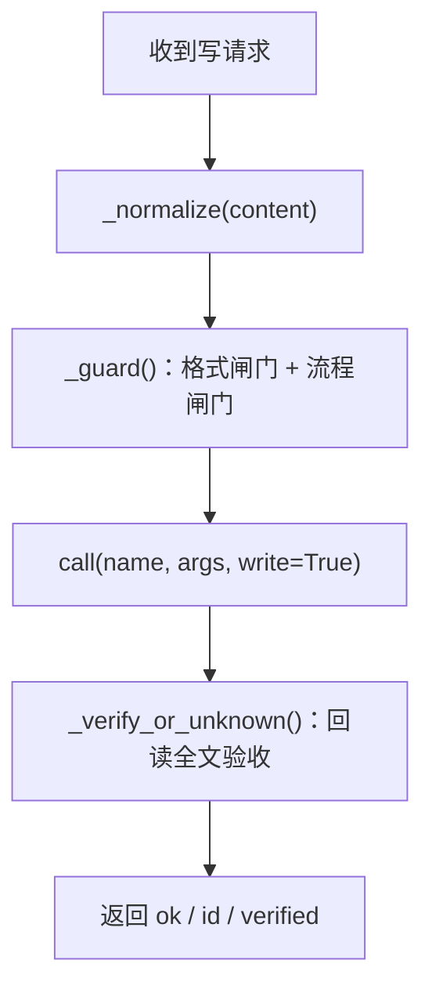
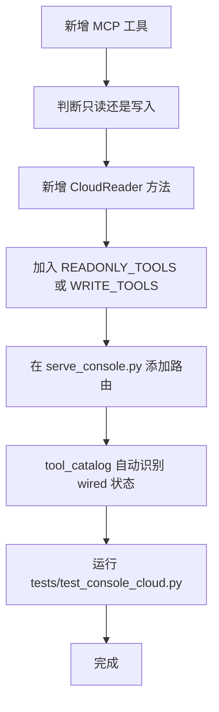

# 云端访问层 console_cloud.py

<cite>
**本文引用的文件**   
- [scripts/console_cloud.py](file://scripts/console_cloud.py)
- [scripts/serve_console.py](file://scripts/serve_console.py)
- [scripts/flomo_client.py](file://scripts/flomo_client.py)
- [scripts/validate_memo.py](file://scripts/validate_memo.py)
- [scripts/memo_util.py](file://scripts/memo_util.py)
- [scripts/sop_gate.py](file://scripts/sop_gate.py)
- [tests/test_console_cloud.py](file://tests/test_console_cloud.py)
</cite>

## 目录
1. [引言](#引言)
2. [项目结构中的位置](#项目结构中的位置)
3. [核心组件总览](#核心组件总览)
4. [架构概览：HTTP 路由到 MCP 调用](#架构概览http-路由到-mcp-调用)
5. [白名单机制与安全边界](#白名单机制与安全边界)
6. [能力清单与通用只读执行器](#能力清单与通用只读执行器)
7. [只读方法参考](#只读方法参考)
8. [写入方法与流程闸门](#写入方法与流程闸门)
9. [错误语义与排错](#错误语义与错误排查)
10. [HTTP API 请求示例](#http-api-请求示例)
11. [新增 MCP 工具的同步清单](#新增-mcp-工具的同步清单)
12. [安全注意事项](#安全注意事项)
13. [常见问题排查](#常见问题排查)
14. [结论](#结论)

## 引言

`scripts/console_cloud.py` 是 flomo-note 控制台的**云端访问层**。它把「读取和修改云端笔记」这件事收敛到一个 Python 模块中，并作为 `scripts/serve_console.py` 的 HTTP JSON 接口后端。

它的职责可以概括为四件事：

1. **封装 MCP 调用**：通过 `flomo_client.FlomoClient` 连接云端 MCP，调用只读工具、写工具和工具清单发现接口。
2. **白名单限制**：用 `READONLY_TOOLS` 和 `WRITE_TOOLS` 两个集合硬拦未注册工具，避免控制台被扩展成任意 MCP 代理。
3. **数据归一化**：把云端的 memo、tag、text、structured content 等原始结果转成前端可直接渲染的结构。
4. **写入闸门**：所有写操作必须先过格式校验和流程闸门，并在写入后回读全文验收。

需要特别注意：**本模块不是通用的 MCP 客户端 SDK**。它是专门为控制台 UI 准备的桥接层；MCP 协议细节由 `flomo_client` 处理，本层关注的是“哪些工具能调”“参数怎么约束”“返回给界面什么”。

**章节来源**
- [scripts/console_cloud.py:1-110](file://scripts/console_cloud.py#L1-L110)

## 项目结构中的位置



**图示来源**
- [scripts/serve_console.py:1-60](file://scripts/serve_console.py#L1-L60)
- [scripts/console_cloud.py:1-110](file://scripts/console_cloud.py#L1-L110)
- [scripts/flomo_client.py](file://scripts/flomo_client.py)
- [scripts/validate_memo.py](file://scripts/validate_memo.py)
- [scripts/sop_gate.py](file://scripts/sop_gate.py)
- [scripts/memo_util.py](file://scripts/memo_util.py)

在仓库结构中，`console_cloud.py` 位于 `scripts/`，与以下关键文件同目录或同脚本路径：

| 文件 | 角色 |
|---|---|
| `serve_console.py` | HTTP 服务入口，负责静态页面、JSON 路由、Host/Origin 校验 |
| `flomo_client.py` | MCP 客户端实现，负责 token、连接、tool、tools_list |
| `validate_memo.py` | 笔记格式校验与 SOP 流程闸门检查 |
| `memo_util.py` | 卡片签名等辅助逻辑 |
| `sop_gate.py` | 流程闸门可执行脚本，生成 `.sop_gate/<签名>.json` |
| `test_console_cloud.py` | 回归用例，扫描源码锁定白名单与具体方法的一致性 |

**章节来源**
- [scripts/serve_console.py:1-60](file://scripts/serve_console.py#L1-L60)
- [scripts/console_cloud.py:1-110](file://scripts/console_cloud.py#L1-L110)

## 核心组件总览

`console_cloud.py` 的核心类型和方法如下：

| 类型 / 函数 | 作用 |
|---|---|
| `CloudError` | 本层统一抛出的异常，代表 token 缺失、网络异常、工具报错、越权调用等 |
| `CloudReader` | 云端访问器，懒建立连接，提供全部只读和写入方法 |
| `cloud_status()` | 查询云端可用性，不返回 token |
| `check_card()` | 委托 `validate_memo.check()` 做格式自检 |
| `gate_state()` | 委托 `validate_memo.check_gate()` 查看流程凭证状态 |
| `run_gate()` | 运行 `sop_gate.py` 生成流程凭证草稿 |
| `create_memo()` | 新建卡片：格式闸门 → 流程闸门 → MCP 写入 → 回读验收 |
| `update_memo()` | 更新卡片：先取旧文 → 闸门 → MCP 写入 → 回读验收 |
| `rename_tag()` | 批量重命名标签：本地前置校验 → MCP 调用 → 回执结论 |
| `tool_catalog()` | 从 MCP `tools/list` 拉取能力清单并标注是否已接入 |
| `run_read_tool()` | 通用只读执行器，按能力清单动态执行任一读工具 |



**图示来源**
- [scripts/console_cloud.py:110-200](file://scripts/console_cloud.py#L110-L200)
- [scripts/console_cloud.py:451-750](file://scripts/console_cloud.py#L451-L750)
- [scripts/console_cloud.py:751-946](file://scripts/console_cloud.py#L751-L946)

**章节来源**
- [scripts/console_cloud.py:110-200](file://scripts/console_cloud.py#L110-L200)
- [scripts/console_cloud.py:451-750](file://scripts/console_cloud.py#L451-L750)
- [scripts/console_cloud.py:751-946](file://scripts/console_cloud.py#L751-L946)

## 架构概览：HTTP 路由到 MCP 调用

`serve_console.py` 暴露两类 JSON 接口：

- **GET 接口**：列表、详情、相关笔记、今日回顾、标签树、标签搜索、参考文档、能力清单。
- **POST 接口**：验证卡片、跑流程闸门、新建卡片、更新卡片、重命名标签、通用只读工具执行。



**图示来源**
- [scripts/serve_console.py:261-350](file://scripts/serve_console.py#L261-L350)
- [scripts/console_cloud.py:451-550](file://scripts/console_cloud.py#L451-L550)

### 路由映射表

| HTTP 方法 | 路径 | 对应 CloudReader 方法 | 说明 |
|---|---|---|---|
| GET | `/api/cloud/memos` | `list_memos` | 关键词、标签、起止日期、来源、是否含标签 |
| GET | `/api/cloud/memo` | `memo_detail` | 单卡全文 |
| GET | `/api/cloud/memos/batch` | `memo_batch` | 多选批量全文 |
| GET | `/api/cloud/review` | `daily_review` | 今日回顾 |
| GET | `/api/cloud/related` | `recommended` | 相关笔记 |
| GET | `/api/cloud/tagtree` | `tag_tree` | 标签树 |
| GET | `/api/cloud/tags` | `tag_names` | 标签名搜索 |
| GET | `/api/cloud/reference` | `reference` | 记忆、画像、格式规范、标签规范 |
| GET | `/api/cloud/tools` | `tool_catalog` | 能力清单 |
| POST | `/api/cloud/validate` | `check_card` | 格式自检 |
| POST | `/api/cloud/gate` | `run_gate` | 流程闸门 |
| POST | `/api/cloud/memo/create` | `create_memo` | 新建卡片 |
| POST | `/api/cloud/memo/update` | `update_memo` | 更新卡片 |
| POST | `/api/cloud/tag/rename` | `rename_tag` | 批量重命名标签 |
| POST | `/api/cloud/tool` | `run_read_tool` | 通用只读执行 |

**章节来源**
- [scripts/serve_console.py:261-350](file://scripts/serve_console.py#L261-L350)
- [scripts/serve_console.py:350-424](file://scripts/serve_console.py#L350-L424)

## 白名单机制与安全边界

### 两套白名单

`console_cloud.py` 定义了两组不可变集合：

| 常量 | 内容 | 用途 |
|---|---|---|
| `READONLY_TOOLS` | `memo_search`、`memo_batch_get`、`memo_recommended`、`get_daily_review`、`tag_tree`、`tag_search`、`memory_context`、`memory_user`、`get_format_guide`、`get_tag_guide` | 默认 `call(write=False)` 只允许这些工具 |
| `WRITE_TOOLS` | `memo_create`、`memo_update`、`tag_rename` | 必须显式 `write=True` 才放行 |

关键点：

1. **读路径不能走写工具**：即使某个写工具恰好也在 `READONLY_TOOLS` 里（当前并非如此），`call` 也必须显式传入 `write=True`。
2. **写路径不能直通**：只有 `create_memo`、`update_memo`、`rename_tag` 三个专用入口；`run_read_tool` 会拒绝任何 `WRITE_TOOLS`。
3. **白名单外一律报错**：抛出 `CloudError("工具白名单拒绝调用...")`。
4. **回归锁定**：`test_console_cloud.py` 扫描源码，确保白名单与具体方法调用一致。



**图示来源**
- [scripts/console_cloud.py:451-475](file://scripts/console_cloud.py#L451-L475)

### 白名单设计原则

| 原则 | 含义 |
|---|---|
| 明确授权 | 允许调用的都是“明确有人用”的工具，不预留空位 |
| 最小权限 | 读方法默认只读，写方法必须显式开启 |
| 单一边界 | 控制台与云端之间的唯一调用边界在 `call` |
| 回归保护 | 测试扫描源码，新增工具时必须同时改白名单 |
| 非代理 | 控制台不是 MCP 代理，不能把所有 MCP 工具都暴露出去 |

**章节来源**
- [scripts/console_cloud.py:110-170](file://scripts/console_cloud.py#L110-L170)
- [scripts/console_cloud.py:451-475](file://scripts/console_cloud.py#L451-L475)

## 能力清单与通用只读执行器

### 能力清单：`tool_catalog()`

`tool_catalog()` 调用 `tools/list`，这是 MCP 协议的能力发现接口，本身**不读取任何笔记正文**。返回结构包括：

| 字段 | 类型 | 含义 |
|---|---|---|
| `count` | int | 工具总数 |
| `read` | int | 读工具数量 |
| `write` | int | 写工具数量 |
| `wired` | int | 本控制台已接出的工具数量 |
| `tools` | list | 工具列表 |

每个工具对象包含：

| 字段 | 类型 | 含义 |
|---|---|---|
| `name` | string | MCP 工具名 |
| `kind` | "read" \| "write" | 根据是否在 `WRITE_TOOLS` 判断 |
| `wired` | bool | 是否在本控制台实际可用 |
| `summary` | string | 描述首句摘要 |
| `args` | string[] | 参数名列表 |
| `arg_specs` | object[] | 参数规格：`name`、`type`、`required`、`desc` |
| `reason` | string | 写工具附加说明“写入前须过格式与流程闸门...” |

`arg_specs.type` 已经归一化为单个 token：`boolean`、`integer`、`number`、`array`、其余按 `string`。联合类型如 `["null", "boolean"]` 会被转为 `boolean`，因为 `null` 表示“可缺省”，不是独立类型。

### 通用只读执行器：`run_read_tool()`

`run_read_tool(name, arguments)` 是“能力页直接执行 MCP 读工具”的落点。流程：

1. 校验工具名非空。
2. 拒绝任何写工具。
3. 过滤掉值为 `None` 或空字符串的参数。
4. 调用 `call(name, args)`，再次受 `READONLY_TOOLS` 白名单保护。
5. 解析结果为 `memos`、`tags`、`text`、`json` 四类之一。

返回结构：

| 字段 | 类型 | 含义 |
|---|---|---|
| `tool` | string | 工具名 |
| `arguments` | dict | 最终传给 MCP 的参数 |
| `kind` | "memos" \| "tags" \| "text" \| "json" | 结果形态 |
| `memos` | list | 若检测到 memo 列表则填充 |
| `tags` | list | 若检测到 tag 列表则填充 |
| `total` | any | 结构化结果中的 total |
| `truncated` | bool | 结构化结果中的 truncated |
| `text` | string | 纯文本结果 |
| `raw` | dict | 原始 result，供调试 |



**图示来源**
- [scripts/console_cloud.py:900-946](file://scripts/console_cloud.py#L900-L946)

**章节来源**
- [scripts/console_cloud.py:800-946](file://scripts/console_cloud.py#L800-L946)

## 只读方法参考

### 列 / 搜卡片：`list_memos`

| 参数 | 类型 | 必填 | 默认值 | 语义 |
|---|---|---:|---|---|
| `keywords` | string | 否 | 无 | 关键词搜索 |
| `tag` | string | 否 | 无 | **完整标签路径**，例如 `AI/决策模型`；云端不接受裸顶层名 |
| `start_date` | string | 否 | 无 | 起始日期 |
| `end_date` | string | 否 | 无 | 结束日期 |
| `source` | string | 否 | 无 | 来源，对应云端的 `from` |
| `has_tag` | bool / string | 否 | 无 | 三态开关：真、假、不传；字符串支持 `1/true/yes/on` 与 `0/false/no/off` |
| `limit` | int / string | 否 | `DEFAULT_LIMIT` | 单次上限，内部钳制到 `[1, MAX_LIMIT]` |

返回结构：

| 字段 | 类型 | 含义 |
|---|---|---|
| `count` | int | 返回 memo 数量 |
| `limit` | int | 实际使用的 limit |
| `capped` | bool | 是否达到云端上限，提示还能继续筛 |
| `keywords` | string | 回填关键词 |
| `tag` | string | 回填标签 |
| `start_date` | string | 回填起始日期 |
| `end_date` | string | 回填结束日期 |
| `source` | string | 回填来源 |
| `has_tag` | bool\|None | 三态 |
| `memos` | list | 精简 memo 列表 |

每个 memo 精简字段：

| 字段 | 类型 | 含义 |
|---|---|---|
| `id` | string | 卡片 id |
| `tags` | string[] | 标签数组 |
| `title` | string | 概念名，无则为 `(无概念名)` |
| `excerpt` | string | 正文摘要，最多 `EXCERPT_CHARS` 字 |
| `word_count` | any | 字数 |
| `created_at` | string | 创建时间 |
| `updated_at` | string | 更新时间 |
| `url` | string | 链接 |
| `from` | string | 来源 |
| `truncated` | bool | 云端是否截断正文 |
| `has_image` | bool | 是否含图片 |
| `has_link` | bool | 是否含链接 |

**章节来源**
- [scripts/console_cloud.py:475-530](file://scripts/console_cloud.py#L475-L530)

### 单卡全文：`memo_detail`

| 参数 | 类型 | 必填 | 语义 |
|---|---|---:|---|
| `memo_id` | string | 是 | 卡片 id |

返回结构：

| 字段 | 类型 | 含义 |
|---|---|---|
| `memo` | dict | 精简字段 + `content` + `content_truncated` |
| `omitted_ids` | string[] | 云端省略的其他 id |

如果云端没有返回该 memo，抛出 `CloudError("未取到 memo：...")`。

**章节来源**
- [scripts/console_cloud.py:530-545](file://scripts/console_cloud.py#L530-L545)

### 批量全文：`memo_batch`

| 参数 | 类型 | 必填 | 语义 |
|---|---|---:|---|
| `ids` | string[] | 是 | 卡片 id 列表；空串会被忽略 |

返回结构：

| 字段 | 类型 | 含义 |
|---|---|---|
| `count` | int | 实际取回数量 |
| `requested` | int | 清理后的请求数量 |
| `dropped` | int | 因云端上限被丢弃的数量 |
| `memos` | list | 全文 memo 列表 |
| `omitted_ids` | string[] | 云端省略的其他 id |

云端单次上限 `BATCH_MAX = 10`，超出部分不会静默吞掉——`dropped` 会如实上报，前端应提示用户。

**章节来源**
- [scripts/console_cloud.py:545-570](file://scripts/console_cloud.py#L545-L570)

### 相关笔记：`recommended`

| 参数 | 类型 | 必填 | 默认值 | 语义 |
|---|---|---:|---|---|
| `memo_id` | string | 是 | 无 | 目标卡片 id |
| `limit` | int / string | 否 | 10 | 推荐数量，内部钳制到 `[1, MAX_LIMIT]` |
| `no_same_tag` | bool / string | 否 | 无 | 三态开关 |

返回结构：

| 字段 | 类型 | 含义 |
|---|---|---|
| `id` | string | 原卡片 id |
| `count` | int | 返回数量 |
| `memos` | list | 精简 memo 列表 |

**章节来源**
- [scripts/console_cloud.py:570-585](file://scripts/console_cloud.py#L570-L585)

### 今日回顾：`daily_review`

无输入参数。返回结构与列表类似，只是不包含查询条件回填。

| 字段 | 类型 | 含义 |
|---|---|---|
| `count` | int | 回顾数量 |
| `memos` | list | 精简 memo 列表 |

**章节来源**
- [scripts/console_cloud.py:585-595](file://scripts/console_cloud.py#L585-L595)

### 标签树：`tag_tree`

| 参数 | 类型 | 必填 | 默认值 | 语义 |
|---|---|---:|---|---|
| `prefix` | string | 否 | 无 | 按前缀收窄 |
| `depth` | int / string | 否 | 无 | 深度，内部钳制到 `[1, 10]` |
| `limit` | int / string | 否 | `TAG_DEFAULT_LIMIT` | 条数上限，内部钳制到 `[1, TAG_MAX_LIMIT]` |

返回结构：

| 字段 | 类型 | 含义 |
|---|---|---|
| `tags` | string[] | 标签名列表 |
| `total` | any | 云端 total |
| `returned` | any | 实际返回数量 |
| `limit` | any | 实际 limit |
| `truncated` | bool | 是否达到云端上限 |
| `hint` | string | 提示信息 |

**章节来源**
- [scripts/console_cloud.py:595-615](file://scripts/console_cloud.py#L595-L615)

### 标签名搜索：`tag_names`

| 参数 | 类型 | 必填 | 默认值 | 语义 |
|---|---|---:|---|---|
| `keywords` | string | 否 | 无 | 关键词；为空时直接返回空列表 |
| `limit` | int / string | 否 | 20 | 搜索结果数量，内部钳制到 `[1, TAG_MAX_LIMIT]` |

返回结构：

| 字段 | 类型 | 含义 |
|---|---|---|
| `keywords` | string | 回填关键词 |
| `count` | int | 返回标签名数量 |
| `tags` | string[] | 标签名列表 |

**章节来源**
- [scripts/console_cloud.py:615-625](file://scripts/console_cloud.py#L615-L625)

### 参考文档

| 方法 | MCP 工具 | 返回结构 |
|---|---|---|
| `memory_doc()` | `memory_context` | `{doc: "memory", content: string}` |
| `user_profile()` | `memory_user` | `{doc: "user", content: string}` |
| `format_guide()` | `get_format_guide` | `{doc: "format", content: string}` |
| `tag_guide()` | `get_tag_guide` | `{doc: "tag", content: string}` |
| `reference()` | 组合四次调用 | `{memory, user, format, tag}` |

纯文本结果优先取结构化内容的 `content` 字符串；若内层是 JSON，会尝试解析并取 `content`；失败时退回原文。

**章节来源**
- [scripts/console_cloud.py:625-650](file://scripts/console_cloud.py#L625-L650)

## 写入方法与流程闸门

### 写通道总览

所有写方法共享同一安全策略：



**图示来源**
- [scripts/console_cloud.py:700-780](file://scripts/console_cloud.py#L700-L780)

### 格式闸门与流程闸门

| 闸门 | 实现 | 失败后果 |
|---|---|---|
| 格式闸门 | `validate_memo.check()` | 阻止写云，返回 `errors` |
| 流程闸门 | `validate_memo.check_gate()` | 阻止写云，要求 `.sop_gate/<签名>.json` 存在且签名匹配 |
| 执行闸门 | `run_gate()` 调用 `sop_gate.py` | 超时抛错，否则返回进程输出和最新 gate_state |

`_guard()` 会依次执行：

1. `check_card()`：清空并调用 `validate_memo.check`，若有 `errors` 则抛 `CloudError`。
2. `gate_state()`：清空并调用 `validate_memo.check_gate`，若有 `errors` 则抛 `CloudError`。

当真正执行流程闸门时，`run_gate()` 会：

1. 归一化正文。
2. 写当轮草稿 `memo_body_gate_<时间戳>.txt`。
3. 可选地写验证记录 `memo_body_verify_<时间戳>.txt`。
4. 调用 `sop_gate.py --memo <draft> [--skip-web|--verify <path>] [--anchor-id <id>]`。
5. 超时限制 `GATE_TIMEOUT = 300` 秒。
6. 返回 `ok`、`skip_web`、`draft`、`lines`、`gate`。

草稿文件名落在仓库根，已被 `cleanup.py` 扫描表和 `.gitignore` 覆盖，由收尾清理回收。

**章节来源**
- [scripts/console_cloud.py:650-750](file://scripts/console_cloud.py#L650-L750)

### 新建卡片：`create_memo`

| 参数 | 类型 | 必填 | 默认值 | 语义 |
|---|---|---:|---|---|
| `content` | string | 是 | 无 | 卡片正文 |
| `fmt` | string | 否 | 无 | 传递给 MCP 的 format |

返回结构：

| 字段 | 类型 | 含义 |
|---|---|---|
| `ok` | bool | 是否拿到新 id |
| `id` | string | 新卡片 id，可能为空 |
| `id_inferred` | bool | 是否通过签名回搜推断出 id |
| `word_count` | any | MCP 回执字数 |
| `verified` | dict\|None | 回读验收结果；id 为空时为 None |

如果 MCP 回执没带 id，会按概念名搜索最近几条卡片，找到签名相同的最新一条作为兜底，并标记 `id_inferred=true`。

**章节来源**
- [scripts/console_cloud.py:751-800](file://scripts/console_cloud.py#L751-L800)

### 更新卡片：`update_memo`

| 参数 | 类型 | 必填 | 默认值 | 语义 |
|---|---|---:|---|---|
| `memo_id` | string | 是 | 无 | 要更新的卡片 id |
| `content` | string | 是 | 无 | 新正文 |
| `fmt` | string | 否 | 无 | 传递给 MCP 的 format |

返回结构：

| 字段 | 类型 | 含义 |
|---|---|---|
| `ok` | bool | 固定为 true，表示请求成功下发 |
| `id` | string | 原卡片 id |
| `before` | dict | 更新前正文长度和概念名 |
| `word_count` | any | MCP 回执字数 |
| `verified` | dict | 回读验收结果 |

更新前必须调用 `memo_detail` 取全文，满足 H22 要求。

**章节来源**
- [scripts/console_cloud.py:800-825](file://scripts/console_cloud.py#L800-L825)

### 重命名标签：`rename_tag`

| 参数 | 类型 | 必填 | 默认值 | 语义 |
|---|---|---:|---|---|
| `old_tag` | string | 是 | 无 | 原标签，自动去除 `#` 和前导空白 |
| `new_tag` | string | 是 | 无 | 新标签，同样去除 `#` 和前导空白 |
| `max_memos` | int / string | 否 | 无 | 批量规模；默认 200，绝对上限 2000 |

本地前置校验：

- 新旧标签都不能为空。
- 新旧标签不能相同。
- 新标签不能是原标签的子树。
- 新标签不能包含空白、`<`、`#`。
- `max_memos` 必须是正整数，不能超过 `TAG_RENAME_MAX = 2000`。

返回结构：

| 字段 | 类型 | 含义 |
|---|---|---|
| `old_tag` | string | 原标签 |
| `new_tag` | string | 新标签 |
| `max_memos_requested` | int\|None | 请求的批量规模 |
| `matched_memos` | int\|None | 匹配的笔记数 |
| `updated_memos` | int\|None | 实际修改的笔记数 |
| `updated_tags` | int\|None | 实际修改的标签数 |
| `warnings` | string[] | 警告信息 |
| `result` | dict | 原始结构化回执 |
| `ok` | bool | 是否成功 |
| `status` | string | `unknown`、`no_match`、`needs_scale`、`inconsistent`、`partial`、`done` |
| `hint` | string | 面向用户的解释 |

状态语义：

| status | 含义 | 建议 |
|---|---|---|
| `unknown` | 回执缺 `matched_memos` 或 `updated_memos` | 按新标签现查，不要当作完成 |
| `no_match` | 没有匹配到挂旧标签的笔记 | 标签名不存在或已无卡片 |
| `needs_scale` | 匹配超过默认 200，但一条都没写 | 带 `max_memos` 重试 |
| `inconsistent` | 实改数多于匹配数 | 回执自相矛盾 |
| `partial` | 只改了部分 | 标签分裂，需重试或逐卡收尾 |
| `done` | 完全成功 | `updated_memos` 条已改挂新标签 |

**章节来源**
- [scripts/console_cloud.py:201-250](file://scripts/console_cloud.py#L201-L250)
- [scripts/console_cloud.py:825-900](file://scripts/console_cloud.py#L825-L900)

## 错误语义与错误排查

### 异常体系

| 异常 | 来源 | 含义 |
|---|---|---|
| `CloudError` | `console_cloud.py` | 控制台与云端之间的统一边界异常 |
| `FlomoError` | `flomo_client.py` | MCP 客户端层面的错误 |
| `ValueError` | `serve_console.py` | 请求体不是合法 JSON |
| 普通异常 | 各层 | 网络、协议、子进程等意外情况 |

`ConsoleHandler._cloud()` 会把 `CloudError` 包装成 JSON 响应，并设置 502；其他异常设为 500。写路径额外使用 422 区分“请求内容不合规”和“云端连不上”。

### 常见错误分类

| 场景 | 典型错误 | 原因 | 处理方式 |
|---|---|---|---|
| 工具不在白名单 | `CloudError：工具白名单拒绝调用...` | 调用未注册 MCP 工具 | 先在 `READONLY_TOOLS` 或 `WRITE_TOOLS` 注册 |
| 通用入口调写工具 | `CloudError：写工具不走通用入口...` | 写工具必须走专用方法 | 改用 `create_memo`、`update_memo`、`rename_tag` |
| 缺少 memo id | `CloudError：缺少 memo id` | `memo_detail`、`memo_batch` 未提供有效 id | 检查 URL 参数或表单 |
| 未取到 memo | `CloudError：未取到 memo：...` | 云端没有该 id | 检查 id 是否有效 |
| 格式闸门失败 | `CloudError：格式闸门未过：...` | `validate_memo.check` 检出错误 | 修复笔记格式 |
| 流程闸门失败 | `CloudError：流程闸门未过：...` | 缺少 `.sop_gate/<签名>.json` 或签名不匹配 | 执行流程闸门 |
| 流程闸门超时 | `CloudError：流程闸门超时（300s 内云端现查未返回）` | `sop_gate.py` 执行超 300 秒 | 检查云端网络和依赖任务 |
| 重命名标签参数非法 | `CloudError：新标签...` | 新标签为空、与原标签相同、位于子树下、含非法字符 | 修正标签名 |
| 重命名规模超限 | `CloudError：max_memos=... 超过服务端上限 2000` | `max_memos > TAG_RENAME_MAX` | 分批执行 |
| 重命名回执异常 | `ok=false, status=partial/needs_scale/unknown` | 云端回执不完整或部分成功 | 按 hint 重试或人工处理 |
| Host 不合法 | HTTP 403 | Host 不在本机白名单 | 使用 `127.0.0.1` 或本机主机名访问 |
| Origin 跨站 | HTTP 403 | 浏览器跨站请求写接口 | 同源访问或移除 Origin |
| 端口占用 | 启动失败 | 同一地址端口已有服务 | 换端口或停旧实例 |

**章节来源**
- [scripts/console_cloud.py:110-170](file://scripts/console_cloud.py#L110-L170)
- [scripts/console_cloud.py:451-475](file://scripts/console_cloud.py#L451-L475)
- [scripts/console_cloud.py:650-750](file://scripts/console_cloud.py#L650-L750)
- [scripts/console_cloud.py:825-900](file://scripts/console_cloud.py#L825-L900)
- [scripts/serve_console.py:300-424](file://scripts/serve_console.py#L300-L424)

## HTTP API 请求示例

以下示例基于 `serve_console.py` 的路由定义。实际使用时请替换端口、token、id 和标签名。

### 列出卡片

```http
GET http://127.0.0.1:8787/api/cloud/memos?keywords=标签树&limit=20
```

返回关键字段：`count`、`limit`、`capped`、`memos`。

### 获取单卡全文

```http
GET http://127.0.0.1:8787/api/cloud/memo?id=<memo_id>
```

返回关键字段：`memo.content`、`memo.truncated`、`omitted_ids`。

### 批量获取全文

```http
GET http://127.0.0.1:8787/api/cloud/memos/batch?ids=id1,id2,id3
```

注意：单次最多 10 条，超出会返回 `dropped`。

### 今日回顾

```http
GET http://127.0.0.1:8787/api/cloud/review
```

### 相关笔记

```http
GET http://127.0.0.1:8787/api/cloud/related?id=<memo_id>&limit=10&no_same_tag=false
```

### 标签树

```http
GET http://127.0.0.1:8787/api/cloud/tagtree?prefix=AI&depth=3&limit=200
```

### 标签名搜索

```http
GET http://127.0.0.1:8787/api/cloud/tags?keywords=AI&limit=20
```

### 参考文档

```http
GET http://127.0.0.1:8787/api/cloud/reference
```

返回 `memory`、`user`、`format`、`tag` 四个文档。

### 能力清单

```http
GET http://127.0.0.1:8787/api/cloud/tools
```

返回 `read`、`write`、`wired` 计数及每个工具的 `arg_specs`。

### 格式自检

```http
POST http://127.0.0.1:8787/api/cloud/validate
Content-Type: application/json

{
  "content": "#标签\n概念名\n\n正文..."
}
```

返回 `ok`、`errors`、`warnings`、`tagline`、`concept`。

### 流程闸门

```http
POST http://127.0.0.1:8787/api/cloud/gate
Content-Type: application/json

{
  "content": "#标签\n概念名\n\n正文...",
  "skip_web": false,
  "anchor_id": "<可选锚点 id>",
  "verify": null
}
```

返回 `ok`、`skip_web`、`draft`、`lines`、`gate`。

### 新建卡片

```http
POST http://127.0.0.1:8787/api/cloud/memo/create
Content-Type: application/json

{
  "content": "#标签\n概念名\n\n正文...",
  "format": null
}
```

返回 `ok`、`id`、`id_inferred`、`word_count`、`verified`。

### 更新卡片

```http
POST http://127.0.0.1:8787/api/cloud/memo/update
Content-Type: application/json

{
  "id": "<memo_id>",
  "content": "#标签\n概念名\n\n新正文...",
  "format": null
}
```

返回 `ok`、`id`、`before`、`word_count`、`verified`。

### 重命名标签

```http
POST http://127.0.0.1:8787/api/cloud/tag/rename
Content-Type: application/json

{
  "old_tag": "旧标签",
  "new_tag": "新标签",
  "max_memos": 200
}
```

返回 `ok`、`status`、`hint`、`matched_memos`、`updated_memos` 等。

### 通用只读执行

```http
POST http://127.0.0.1:8787/api/cloud/tool
Content-Type: application/json

{
  "name": "memo_search",
  "arguments": {
    "keywords": "AI",
    "limit": 20
  }
}
```

返回 `kind` 为 `memos`、`tags`、`text` 或 `json`，并附带 `raw`。

**章节来源**
- [scripts/serve_console.py:261-424](file://scripts/serve_console.py#L261-L424)

## 新增 MCP 工具的同步清单

新增 MCP 工具时，不能只在 `flomo_client.py` 加一个方法就完事。应根据工具用途选择以下同步位置：

### 第一步：确认工具类别

| 工具用途 | 应加入 | 是否允许 `run_read_tool` |
|---|---|---:|
| 只读 MCP 工具 | `READONLY_TOOLS` | 是 |
| 写 MCP 工具 | `WRITE_TOOLS` | 否 |
| 协议发现工具（如 `tools/list`） | 不加入任一方 | 否 |

### 第二步：新增 CloudReader 方法

- 只读工具：新增 `CloudReader.xxx()` 方法，内部调用 `self.call("mcp_tool_name", args)`。
- 写工具：新增专用方法，内部调用 `self.call("mcp_tool_name", args, write=True)`，并加上 `_guard()` 和回读验收。
- 参数校验：使用 `_clamp_limit`、`_positive_int`、`_tri_bool` 等辅助函数，避免前端直传危险值。
- 返回结构：优先返回精简字段，全文走专用接口。

### 第三步：更新白名单

- 只读工具：把 MCP 工具名加入 `READONLY_TOOLS`。
- 写工具：把 MCP 工具名加入 `WRITE_TOOLS`。
- 两者都必须“恰等于”实际调用集合，不能多也不能少。

### 第四步：更新 HTTP 路由

在 `serve_console.py` 的 `cloud_routes` 或 POST 路由中加入对应路径，并把参数从 `self._q(q, key)` 或 `body.get(key)` 传入。

### 第五步：更新能力清单显示

如果工具需要特殊说明：

- 写工具：复用 `WRITE_TOOLS_REASON`，说明“写入前须过格式与流程闸门，写入后回读全文验收”。
- 特殊行为：可在 `tool_catalog()` 的工具对象中补充 `reason` 字段。
- `arg_specs.type` 会自动归一化，不需要前端理解联合类型。

### 第六步：回归测试

`tests/test_console_cloud.py` 会扫描源码，锁定白名单与实际调用的一致性。新增方法后必须确保测试通过。



**图示来源**
- [scripts/console_cloud.py:110-170](file://scripts/console_cloud.py#L110-L170)
- [scripts/console_cloud.py:800-946](file://scripts/console_cloud.py#L800-L946)
- [scripts/serve_console.py:261-424](file://scripts/serve_console.py#L261-L424)

**章节来源**
- [scripts/console_cloud.py:110-170](file://scripts/console_cloud.py#L110-L170)
- [scripts/console_cloud.py:800-946](file://scripts/console_cloud.py#L800-L946)
- [scripts/serve_console.py:261-424](file://scripts/serve_console.py#L261-L424)
- [tests/test_console_cloud.py](file://tests/test_console_cloud.py)

## 安全注意事项

### Host 白名单

`serve_console.py` 启动时会计算 `ALLOWED_HOSTNAMES`：

- 默认包含 `127.0.0.1`、`localhost`、`::1`。
- 绑定具体地址时增加该地址。
- 绑定通配地址 `0.0.0.0` 或 `::` 时，会增加本机各接口地址。
- DNS 重绑定攻击者域名不会被接受，因为 Host 头来自浏览器，通常不是本机名。

**重要**：绑定回环不等于只有本机能用。HTTP 服务器仍会接收 TCP 连接；同源策略管的是“浏览器能不能读响应”，不管“别人能不能发请求”。因此 Host 校验对写接口尤其关键。

### Origin 校验

- 如果请求携带 `Origin`，其宿主名必须在 `ALLOWED_HOSTNAMES` 内。
- `Origin: null` 也会被拒绝。
- 没有 `Origin` 的请求视为非浏览器客户端，放行——这样 curl 和回归测试不受影响。

### 仅允许受控工具

- 控制台不是 MCP 代理。
- 所有 MCP 调用必须经过 `call()`。
- `call()` 使用 `READONLY_TOOLS` 或 `WRITE_TOOLS` 硬拦。
- `run_read_tool()` 额外拒绝写工具。
- 新增工具必须同时改白名单和路由。

### 正文不落盘

- 卡片正文仅在内存和 HTTP 响应之间传递。
- 唯一落盘的是流程闸门的草稿 `memo_body*.txt`，由收尾清理回收。
- token 只在建连时使用，不出进程、不入返回值、不入日志。

### 局域网风险

`main()` 默认拒绝绑定非回环地址。若使用 `--allow-lan`，等同于把云端卡片读取和批量改标签开放给同网段任何人，因为本服务没有鉴权。

**章节来源**
- [scripts/serve_console.py:60-150](file://scripts/serve_console.py#L60-L150)
- [scripts/serve_console.py:350-424](file://scripts/serve_console.py#L350-L424)
- [scripts/console_cloud.py:1-110](file://scripts/console_cloud.py#L1-L110)

## 常见问题排查

| 现象 | 可能原因 | 排查步骤 |
|---|---|---|
| 调用 MCP 工具报白名单拒绝 | 工具未加入 `READONLY_TOOLS` 或 `WRITE_TOOLS` | 检查工具名拼写，确认类别，同步白名单 |
| 通用入口调写工具失败 | 写工具不能走 `/api/cloud/tool` | 改用专用写接口 |
| 新建卡片成功但没有 id | MCP 回执未携带 id | 检查 `id_inferred`；若为 false，说明既没回执也没回搜到 |
| 更新卡片失败 | 缺少 memo_id 或格式/流程闸门未过 | 先看 422 错误消息，再检查 `validate_memo` 报错 |
| 重命名标签报 `needs_scale` | 匹配笔记超过 200 条 | 带 `max_memos` 重试，不超过 2000 |
| 重命名标签报 `partial` | 标签分裂，部分成功 | 按 hint 重试或用 `memo_update` 逐卡收尾 |
| 流程闸门超时 | `sop_gate.py` 云端查询慢 | 检查网络、依赖服务、`.sop_gate` 目录权限 |
| 浏览器跨站请求被拒 | Origin 不同源 | 用本机地址打开控制台，不要从外部网页发起 |
| 自定义 Host 被拒 | Host 不在本机白名单 | 用 `127.0.0.1` 或本机主机名访问 |
| 端口无法启动 | 端口已被占用 | 停旧实例或换端口 |
| 能力清单显示某工具未接入 | 工具名未在白名单 | 在 `tool_catalog` 的判断逻辑之外，仍需加入白名单才能 `wired=true` |
| 列表看不到更多结果 | 达到 `MAX_LIMIT` | 看 `capped=true`，使用更精确的筛选条件 |
| 批量全文少于请求数 | 超过 `BATCH_MAX=10` | 看 `dropped`，前端应提示用户 |

**章节来源**
- [scripts/console_cloud.py:451-475](file://scripts/console_cloud.py#L451-L475)
- [scripts/console_cloud.py:545-570](file://scripts/console_cloud.py#L545-L570)
- [scripts/console_cloud.py:650-750](file://scripts/console_cloud.py#L650-L750)
- [scripts/console_cloud.py:825-900](file://scripts/console_cloud.py#L825-L900)
- [scripts/serve_console.py:300-424](file://scripts/serve_console.py#L300-L424)

## 结论

`console_cloud.py` 是一个以安全为中心的控制台云端访问层。它不是万能 MCP 客户端，而是把“控制台需要看的云端能力”收敛到一组有白名单、有参数校验、有写入闸门、有回读验收的方法中。

它最重要的三条边界是：

1. **工具白名单硬拦**：读只放行 `READONLY_TOOLS`，写只放行 `WRITE_TOOLS`，两者必须与实际调用一致。
2. **写不是直通**：写工具必须经过格式闸门、流程闸门和回读验收，不能通过通用入口绕过。
3. **敏感数据不出进程**：token 不入响应，正文不落盘，草稿由收尾清理回收。

对于新增 MCP 工具，最关键的规则是：**先加方法，再加白名单，再加路由，再跑回归测试**。能力清单可以动态发现 MCP 工具元信息，但不能替代白名单——否则 UI 能看到工具却打不开，或者误把未授权工具暴露出去。