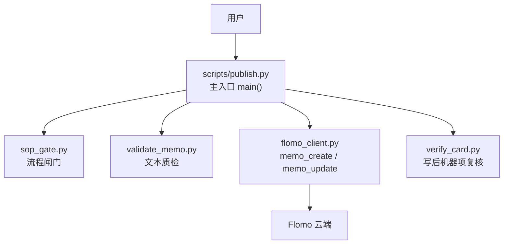
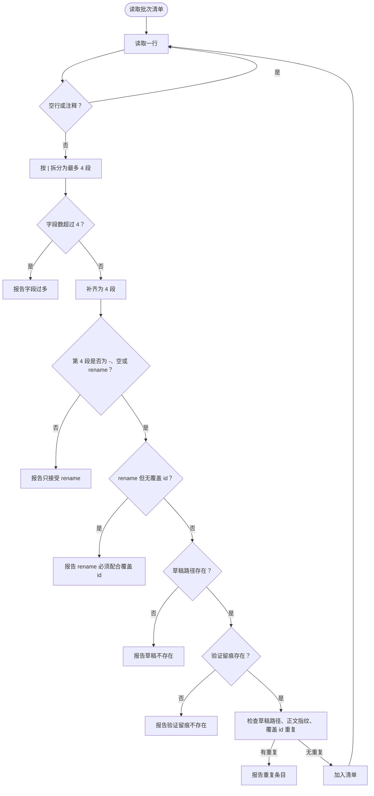
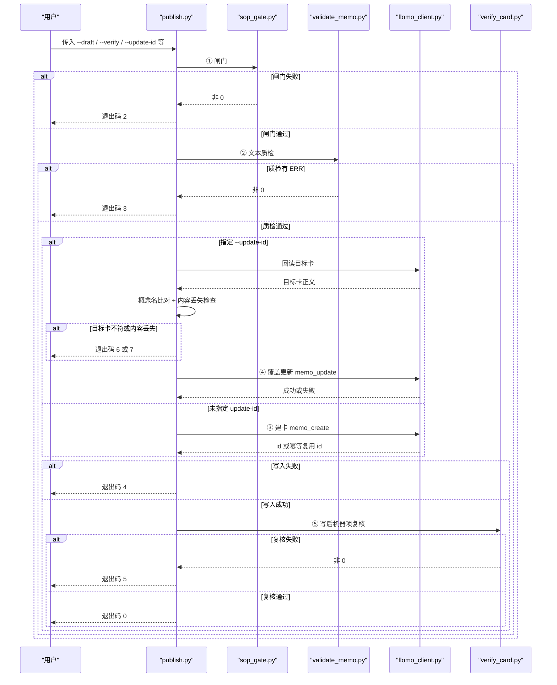
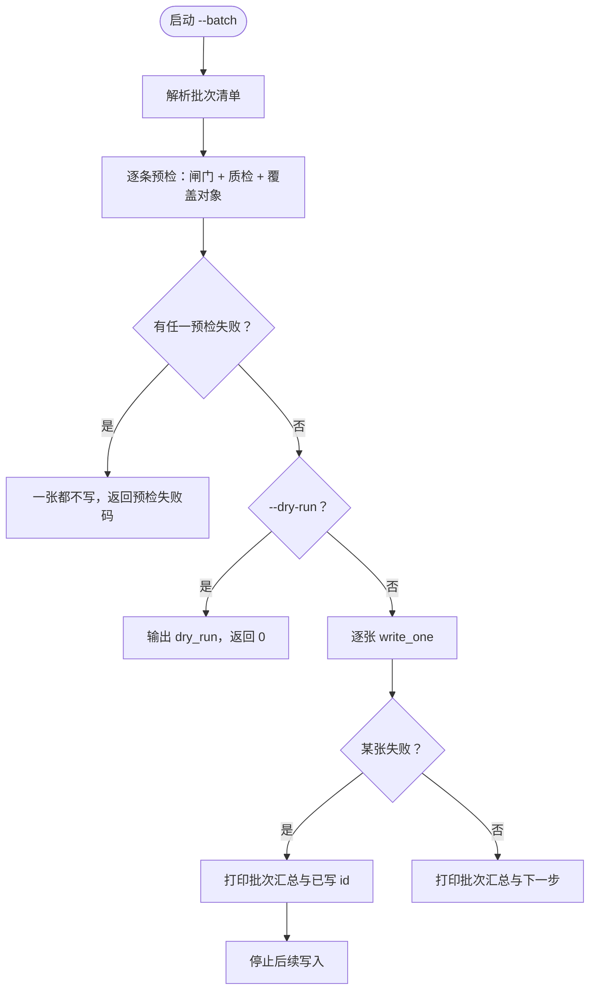
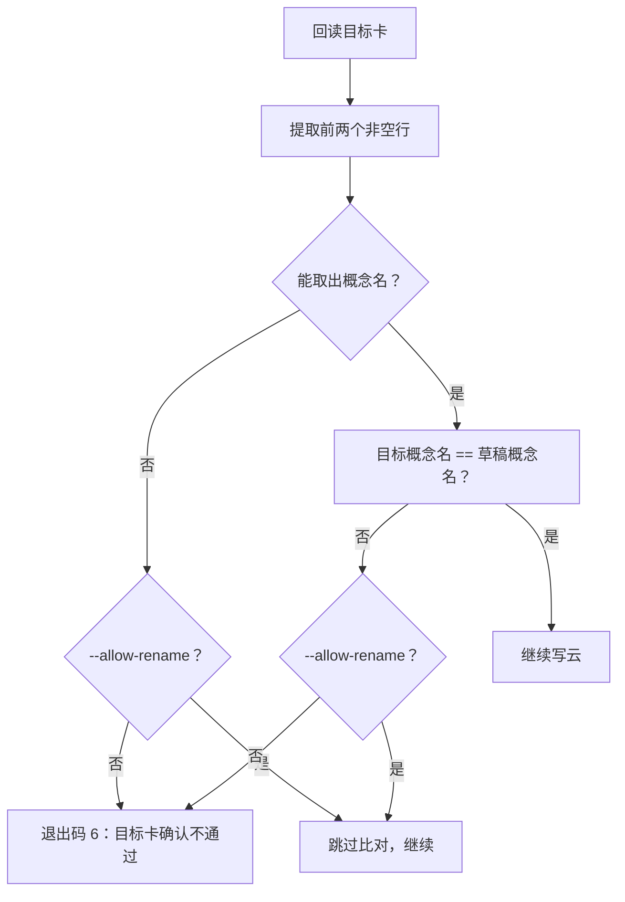
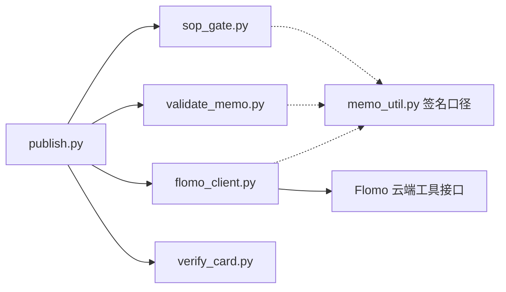

# 写云一条链 publish.py

<cite>
**本文引用的文件**   
- [scripts/publish.py](file://scripts/publish.py)
- [scripts/memo_util.py](file://scripts/memo_util.py)
- [tests/test_publish.py](file://tests/test_publish.py)
</cite>

## 目录
1. [引言](#引言)
2. [项目结构与定位](#项目结构与定位)
3. [核心职责与调用关系](#核心职责与调用关系)
4. [命令行参数](#命令行参数)
5. [批次清单格式](#批次清单格式)
6. [单卡写入流程](#单卡写入流程)
7. [批量写入流程](#批量写入流程)
8. [内部状态与返回结果](#内部状态与返回结果)
9. [关键边界处理](#关键边界处理)
10. [依赖分析](#依赖分析)
11. [性能与可靠性建议](#性能与可靠性建议)
12. [故障排查](#故障排查)
13. [结论](#结论)

## 引言
`scripts/publish.py` 是 Flomo 卡片写云的“一条链”入口：把过去需要人工依次执行的闸门校验、文本质检、建卡或覆盖更新、写后回读复核，固定成一次命令。它重点解决三个历史问题：
- 手拼 create 请求容易重复执行，索引滞后时可能产生重复卡。
- 手动抄错 `memo id` 会导致复核指向另一张卡。
- 覆盖既有卡时若概念名不对，会把 A 卡正文盖到 B 卡上。

脚本通过“闸门不过不写云、质检非零 ERR 不写云、create 只发一次”三条纪律，把安全边界写进代码，而不是靠操作者记忆。

**章节来源**
- [scripts/publish.py:1-200](file://scripts/publish.py#L1-L200)

## 项目结构与定位
`publish.py` 位于 `scripts/` 下，与其他 Flomo 工具脚本并列。它本身不直接实现云端网络通信，而是：
- 作为统一入口解析命令行参数；
- 串行调度 `sop_gate`、`validate_memo`、`flomo_client`、`verify_card`；
- 在覆盖路径中读取目标卡并落改前快照；
- 汇总批次预检与写入结果。



**图示来源**
- [scripts/publish.py:551-845](file://scripts/publish.py#L551-L845)
- [scripts/publish.py:901-1038](file://scripts/publish.py#L901-L1038)

**章节来源**
- [scripts/publish.py:901-1038](file://scripts/publish.py#L901-L1038)

## 核心职责与调用关系
| 阶段 | 职责 | 调用方 | 被调脚本/模块 | 失败策略 |
|---|---|---|---|---|
| ① 闸门 | 检查草稿是否符合流程要求 | `precheck()` | `sop_gate.py` | 退出码 2，不写云 |
| ② 文本质检 | 检查正文是否存在 ERR | `precheck()` | `validate_memo.py` | 退出码 3，不写云 |
| ③ 建卡 | 新建卡片，幂等复用已有签名卡 | `_create_card()` | `flomo_client.py memo_create` | 退出码 4，禁止重发 |
| ④ 覆盖更新 | 确认目标卡身份后整篇替换 | `_update_card()` | `flomo_client.py memo_update` | 退出码 4，禁止重发 |
| ⑤ 写后复核 | 按 id 回读并逐项核对 | `write_one()` | `verify_card.py` | 退出码 5，不改写不重发 |
| ⑥ 差异汇总 | 覆盖场景下比较改前快照与草稿 | `diff_report()` | 纯函数 | 仅输出，不阻塞 |
| ⑦ 内容丢失检查 | 覆盖前检测读数丢失与词中断口 | `content_loss_report()` | 纯函数 | 退出码 7，可 `--allow-content-loss` 放行 |

**章节来源**
- [scripts/publish.py:201-550](file://scripts/publish.py#L201-L550)
- [scripts/publish.py:551-845](file://scripts/publish.py#L551-L845)

## 命令行参数
| 参数 | 类型 | 默认值 | 含义 | 约束 |
|---|---|---|---|---|
| `--draft` | 路径 | 空 | 本地草稿文件路径 | 必须存在且可读 |
| `--verify` | 路径 | 空 | 闸门验证留痕文件 | 可选；存在时必须可读 |
| `--batch` | 路径 | 空 | 批次清单路径 | 与 `--draft`、`--verify`、`--update-id`、`--allow-rename` 互斥 |
| `--update-id` | 字符串 | 空 | 覆盖既有卡的目标 `memo id` | 首尾空白会被去除；配合 `--allow-rename` 允许改名 |
| `--allow-rename` | 标志 | 否 | 允许覆盖时概念名不同 | 没有 `--update-id` 时直接拒绝 |
| `--allow-content-loss` | 标志 | 否 | 允许覆盖时接受读数丢失或词中断口 | 仍需在回读中逐条认领 |
| `--dry-run` | 标志 | 否 | 只跑闸门和质检，不写云 | 单卡和批量均支持 |
| `--skip-web` | 标志 | 否 | 透传给 `sop_gate` | 跳过 web 相关闸门逻辑 |
| `--no-verify-card` | 标志 | 否 | 关闭写后机器项复核 | 关闭后不再提示运行 `verify_card --show-body` |

批模式下的行为补充：
- `--batch` 与 `--draft`、`--verify`、`--update-id`、`--allow-rename` 同时给出会直接报错，避免“批量默认值作用于第一条”这类歧义。
- 批模式下 `--skip-web` 仍透传给每张卡的闸门。
- 批模式下 `--no-verify-card` 控制是否执行每张卡的写后复核。

**章节来源**
- [scripts/publish.py:1-200](file://scripts/publish.py#L1-L200)
- [scripts/publish.py:901-1038](file://scripts/publish.py#L901-L1038)
- [tests/test_publish.py:888-903](file://tests/test_publish.py#L888-L903)

## 批次清单格式
批次清单是文本文件，每行对应一张卡。字段用竖线分隔：

| 列号 | 字段 | 说明 | 示例 |
|---|---|---|---|
| 1 | 草稿路径 | 必填 | `_tmp/draft_zt_1.txt` |
| 2 | 验证留痕 | 可选；省略或用 `-` | `_tmp/verify_zt_1.json` 或 `-` |
| 3 | 覆盖 id | 可选；省略或用 `-`；为空表示建卡 | `-` 或 `MjUzMzgyODYz` |
| 4 | 标志 | 可选；省略或用 `-`；目前只接受 `rename` | `-` 或 `rename` |

规则：
- 以 `#` 开头的行是注释，会被忽略。
- 第 4 段只能是 `-`、空或 `rename`。
- 如果第 4 段是 `rename`，则第 3 段必须有覆盖 id；建卡不允许 rename。
- 同一份草稿路径不能出现两次。
- 同一份正文指纹不能出现两次（防止复制草稿后改名再提交）。
- 同一条覆盖 id 不能出现两次（防止同一张卡被覆盖多次）。



**图示来源**
- [scripts/publish.py:845-901](file://scripts/publish.py#L845-L901)

**章节来源**
- [scripts/publish.py:845-901](file://scripts/publish.py#L845-L901)
- [tests/test_publish.py:848-887](file://tests/test_publish.py#L848-L887)

## 单卡写入流程
单卡模式适合日常逐张写云。其核心顺序是：闸门 → 质检 → 可选覆盖确认 → 建卡或覆盖 → 写后复核。



**图示来源**
- [scripts/publish.py:551-845](file://scripts/publish.py#L551-L845)
- [scripts/publish.py:901-1038](file://scripts/publish.py#L901-L1038)

### 单卡命令示例
以下命令使用占位符表达路径和 id，实际使用时替换为真实值。

- 新建卡片：
  ```
  python scripts/publish.py --draft _tmp/memo_body_68.txt --verify _tmp/verify_68.json
  ```
- 覆盖既有卡片：
  ```
  python scripts/publish.py --draft _tmp/memo_body_68.txt --verify _tmp/verify_68.json --update-id MjYxODU0MzI5
  ```
- 覆盖并允许概念名变化：
  ```
  python scripts/publish.py --draft _tmp/memo_body_68.txt --verify _tmp/verify_68.json --update-id MjYxODU0MzI5 --allow-rename
  ```
- 仅做闸门和质检：
  ```
  python scripts/publish.py --draft _tmp/memo_body_68.txt --verify _tmp/verify_68.json --dry-run
  ```
- 跳过 web 闸门：
  ```
  python scripts/publish.py --draft _tmp/memo_body_68.txt --verify _tmp/verify_68.json --skip-web
  ```
- 关闭写后机器项复核：
  ```
  python scripts/publish.py --draft _tmp/memo_body_68.txt --verify _tmp/verify_68.json --no-verify-card
  ```
- 覆盖时有意重写并接受内容丢失：
  ```
  python scripts/publish.py --draft _tmp/memo_body_68.txt --verify _tmp/verify_68.json --update-id MjYxODU0MzI5 --allow-content-loss
  ```

**章节来源**
- [scripts/publish.py:1-200](file://scripts/publish.py#L1-L200)
- [scripts/publish.py:551-845](file://scripts/publish.py#L551-L845)
- [scripts/publish.py:901-1038](file://scripts/publish.py#L901-L1038)

## 批量写入流程
批模式的核心不变量是：**先全部过预检，任何一张不过则一张都不写**。预检包含闸门、文本质检，以及覆盖对象的身份确认。只有全部预检通过后，才逐张写入并立刻复核。



**图示来源**
- [scripts/publish.py:845-901](file://scripts/publish.py#L845-L901)
- [scripts/publish.py:901-1038](file://scripts/publish.py#L901-L1038)

### 批量命令示例
- 多张卡预检：
  ```
  python scripts/publish.py --batch _tmp/batch.txt
  ```
- 批量只预检不写云：
  ```
  python scripts/publish.py --batch _tmp/batch.txt --dry-run
  ```
- 部分失败后复盘：
  ```
  # 将已经成功的行注释掉，只保留剩余行再跑一遍
  python scripts/publish.py --batch _tmp/batch_remaining.txt
  ```

**章节来源**
- [scripts/publish.py:845-901](file://scripts/publish.py#L845-L901)
- [scripts/publish.py:901-1038](file://scripts/publish.py#L901-L1038)
- [tests/test_publish.py:748-847](file://tests/test_publish.py#L748-L847)

## 内部状态与返回结果
`write_one()` 返回一个结果字典，用于单卡输出和批量汇总：

| 字段 | 类型 | 含义 |
|---|---|---|
| `code` | 整数 | 最终退出码：0 成功、1 前置错误、2 闸门失败、3 质检失败、4 写入失败、5 复核失败、6 目标卡确认失败、7 内容丢失 |
| `id` | 字符串 | 成功后的 `memo id` |
| `reused` | 布尔 | 是否走幂等复用分支 |
| `diff` | 字典或空 | 覆盖场景的改前快照 vs 草稿差异 |
| `word_count` | 整数或空 | 写后复核返回的字数 |
| `tags` | 列表 | 写后复核返回的标签 |
| `checks` | 整数 | 写后复核中的机器项数量 |
| `human` | 列表 | 写后复核中需要人读的条目 |

单卡模式会在成功时打印 `[RESULT] id=...`，幂等复用时还会打印 `[RESULT] reused=1`，并提示人读全文与定向复查的命令。

**章节来源**
- [scripts/publish.py:551-845](file://scripts/publish.py#L551-L845)
- [scripts/publish.py:901-1038](file://scripts/publish.py#L901-L1038)

## 关键边界处理

### 概念名变化
概念名来自卡片正文的前两个非空行：第一行是标签段，第二行是概念名。`memo_util.memo_signature()` 是闸门、质检、查重、写前校验共用的唯一签名实现。

- 覆盖前会读取目标卡，并把目标卡头部两行与草稿头部两行比对。
- 如果概念名不一致，默认阻塞并返回退出码 6。
- 如果明确要改名，可通过 `--allow-rename` 放行；批模式中可在清单第 4 段写 `rename`。
- 如果目标卡无法提取概念名，也视为“无法比对”，默认阻塞；显式加 `--allow-rename` 后才放行，并明确说明这是“跳过比对”，不是“比对通过”。



**图示来源**
- [scripts/memo_util.py:1-80](file://scripts/memo_util.py#L1-L80)
- [scripts/publish.py:551-650](file://scripts/publish.py#L551-L650)
- [tests/test_publish.py:280-315](file://tests/test_publish.py#L280-L315)

**章节来源**
- [scripts/memo_util.py:1-80](file://scripts/memo_util.py#L1-L80)
- [scripts/publish.py:551-650](file://scripts/publish.py#L551-L650)
- [tests/test_publish.py:280-315](file://tests/test_publish.py#L280-L315)

### id 冲突与幂等
`memo_create` 不会简单重复发送 create 请求。`flomo_client` 在建卡前进行幂等查重：
- 如果云端已有相同签名的卡片，返回幂等复用结果；
- `publish.py` 从回包中解析 `reused_id`，不重新建卡；
- 如果回包既没有成功 id 也没有幂等复用 id，则按失败处理，退出码 4，并且明确禁止重发。

对于覆盖更新，`memo_update` 是整篇替换，因此更危险：`id` 抄错可能把 A 卡正文覆盖到 B 卡上。所以覆盖路径必须先读目标卡、比对概念名，再决定是否写入。

**章节来源**
- [scripts/publish.py:551-845](file://scripts/publish.py#L551-L845)
- [tests/test_publish.py:265-315](file://tests/test_publish.py#L265-L315)

### 回读不一致
写后复核由 `verify_card.py` 负责。一旦该步骤返回非 0，`publish.py` 不会改写卡片、也不会重发：
- 卡片已经写入，状态不可由本脚本自动恢复；
- 输出会列出失败项和人读条目；
- 用户应自行运行 `verify_card --show-body` 查看完整回读内容；
- 如需修复，应先理解失败原因，再决定如何修改草稿或目标卡，最后重新执行整条链。

**章节来源**
- [scripts/publish.py:551-845](file://scripts/publish.py#L551-L845)
- [tests/test_publish.py:188-207](file://tests/test_publish.py#L188-L207)

## 依赖分析
`publish.py` 不直接实现以下能力，而是通过子进程调用或导入共享逻辑：

| 依赖 | 作用 | 耦合方式 |
|---|---|---|
| `sop_gate.py` | 流程闸门，检查草稿是否符合发布流程 | 子进程调用，透传 `--verify` 和 `--skip-web` |
| `validate_memo.py` | 文本质检，检查正文 ERR | 子进程调用 |
| `flomo_client.py` | 云端交互库，封装 `memo_create`、`memo_update`、`memo_batch_get` | 子进程调用，并从 stdout 解析 JSON |
| `verify_card.py` | 写后机器项复核，按 id 回读并逐项检查 | 子进程调用，透传 `--json` |
| `memo_util.py` | 卡片签名、关键词、切片限定等共享逻辑 | 间接依赖：闸门、质检、查重都共用其签名口径 |
| `cli_util.py` | 命令行选项解析与统一入口 | 直接导入 |



**图示来源**
- [scripts/publish.py:551-845](file://scripts/publish.py#L551-L845)
- [scripts/memo_util.py:1-80](file://scripts/memo_util.py#L1-L80)

**章节来源**
- [scripts/publish.py:551-845](file://scripts/publish.py#L551-L845)
- [scripts/memo_util.py:1-80](file://scripts/memo_util.py#L1-L80)

## 性能与可靠性建议

### 分批提交
- 大批量清单建议按主题、作者或变更范围拆分，例如“某领域一批”“修复一批”“改名一批”。
- 每批规模不宜过大，以便失败时能快速定位是哪一条草稿或哪一条覆盖 id 有问题。
- 如果一屏输出很长，注意脚本会转发子脚本输出的末尾若干行；前面被截断的行需要单独运行对应脚本查看。

### 重试失败条目
- 不要整批重来。如果第 k 张失败，脚本会打印 `[批次汇总]` 和 `[批次] 已写 id：`，应把前 k-1 条成功行注释掉，只提交剩余行。
- 对写入失败（退出码 4）：不要直接重试 create，因为可能只是客户端网络或工具层失败，而云端可能已经收到请求。应先查索引或回读目标卡，确认是否已有卡片。
- 对复核失败（退出码 5）：不要自动重试写云，因为卡片已经写入。应先运行 `verify_card --show-body` 理解失败项。

### 保留人读命令
- 成功后脚本会输出两条“下一步”命令：`verify_card --id <id> --show-body` 和 `dedup.py --id <id>`。
- 这些命令不仅是操作提示，也是复盘依据。建议在失败或差异较大时保留完整输出，尤其是 `[批次] 已写 id：` 和 `[批次汇总]`。

### 幂等与并发
- 建卡走幂等复用，避免重复建卡。
- 覆盖更新是整篇替换，并发风险高；脚本在覆盖前只读一次目标卡，写入前再做一次确认，但仍需避免多人同时改同一张卡。
- 对长文档，建议单次提交控制在合理行数内，便于差异阅读与回读复核。

[本节为通用建议，不直接分析具体源码片段]

## 故障排查

| 现象 | 可能原因 | 处理建议 |
|---|---|---|
| 闸门未过 | 草稿不符合流程要求 | 先修复草稿，必要时调整 `--verify` 或 `--skip-web` |
| 文本质检有 ERR | 正文存在 ERR 级别问题 | 修改正文后重跑闸门（签名或指纹可能变化） |
| 目标卡确认失败 | 目标卡不存在、读不到概念名、概念名不符 | 检查 `--update-id`；确属改名时使用 `--allow-rename` 或清单第 4 段 `rename` |
| 内容丢失检查失败 | 读数少了或删在了词中间 | 检查草稿是否漏抄；确属重写时使用 `--allow-content-loss` 并在回读中认领 |
| 建卡失败 | 客户端错误、网络错误或回包异常 | 不重发；先查云端是否已有卡片 |
| 覆盖更新失败 | 云端返回失败或网络异常 | 先回读目标卡当前内容，再决定是否重试 |
| 写后复核失败 | 机器项未全过 | 不改写不重发；运行 `verify_card --show-body` 逐项处理 |
| 批量中途失败 | 第 k 张失败 | 保留已写 id，注释掉已成功的行，只跑剩余行 |
| 批次预检失败 | 闸门、质检或覆盖对象任一失败 | 所有行都不写；先修清单或草稿 |

**章节来源**
- [scripts/publish.py:1-200](file://scripts/publish.py#L1-L200)
- [scripts/publish.py:551-845](file://scripts/publish.py#L551-L845)
- [scripts/publish.py:901-1038](file://scripts/publish.py#L901-L1038)
- [tests/test_publish.py:748-1084](file://tests/test_publish.py#L748-L1084)

## 结论
`publish.py` 的价值在于把“闸门、质检、写云、复核”串成一条可重复、可审计的流程。它的关键设计是：
- 用闸门和质检挡掉明显不合格的草稿；
- 用幂等建卡避免重复卡；
- 用覆盖前回读和目标卡概念名比对避免误盖；
- 用改前快照和差异汇总暴露整篇替换的风险；
- 用批次预检保证“全过才写”；
- 用明确的退出码和“下一步”命令指导人工处置。

在实际使用中，最安全的习惯是：小批量提交、保留人读命令、失败后只重跑剩余条目，而不是盲目整批重发。

[本节为总结性内容，不直接分析具体源码片段]