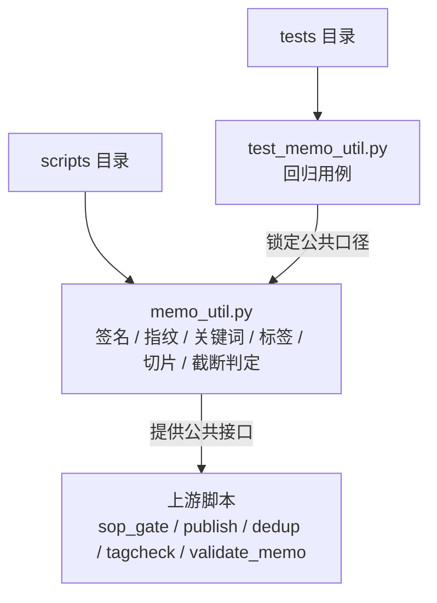
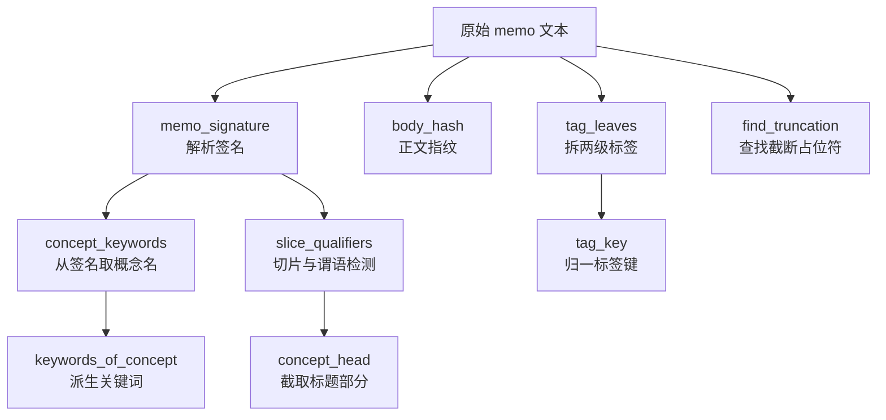
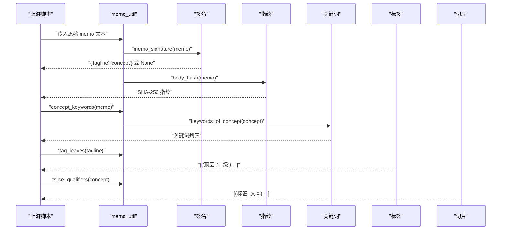
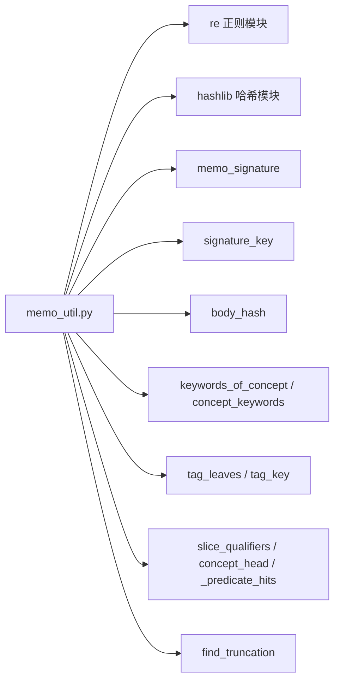

# 卡片语义 memo_util.py

<cite>
**本文引用的文件**   
- [scripts/memo_util.py](file://scripts/memo_util.py)
- [tests/test_memo_util.py](file://tests/test_memo_util.py)
</cite>

## 目录
1. [简介](#简介)
2. [项目结构中的定位](#项目结构中的定位)
3. [核心职责与调用关系](#核心职责与调用关系)
4. [架构总览](#架构总览)
5. [函数参考](#函数参考)
6. [典型调用流程](#典型调用流程)
7. [依赖与一致性约束](#依赖与一致性约束)
8. [性能与复杂度](#性能与复杂度)
9. [调试指南](#调试指南)
10. [维护与变更影响面](#维护与变更影响面)
11. [结论](#结论)

## 简介
`scripts/memo_util.py` 是本项目中关于卡片语义处理的唯一实现模块。它承担以下关键职责：
- 解析卡片的**签名**（首行标签段 + 第二非空概念名），用于幂等查重、闸门凭证与写前校验。
- 计算正文的**整体指纹**，防止“先跑闸门、后改正文”的凭证漂移。
- 从概念名派生**检索关键词**，规避全角标点导致全文检索失败的问题。
- 拆分标签行为**两级标签对**，并归一化标签键以识别同一簇的不同写法。
- 检测概念名中的**切片限定**与**谓语动作**，保证概念名是名词短语而非某次事件或某个时间/版本切片。
- 检测正文是否包含截断占位符，避免长文回包绕过写后校验。

该模块被 `sop_gate`、`publish`、`dedup`、`tagcheck`、`validate_memo` 等多个上游脚本复用，从而保证这些流程对卡片语义的理解保持一致。

**章节来源**
- [scripts/memo_util.py:1-25](file://scripts/memo_util.py#L1-L25)

## 项目结构中的定位
本仓库中与卡片处理相关的 Python 脚本主要位于 `scripts/`，测试用例位于 `tests/`。`memo_util.py` 不依赖网络、数据库或外部服务，是一个纯函数式工具模块；其测试通过 `importlib.util` 直接加载源码路径执行，确保离线回归。

**图表来源**
- [scripts/memo_util.py:1-25](file://scripts/memo_util.py#L1-L25)
- [tests/test_memo_util.py:1-30](file://tests/test_memo_util.py#L1-L30)

**章节来源**
- [scripts/memo_util.py:1-25](file://scripts/memo_util.py#L1-L25)
- [tests/test_memo_util.py:1-30](file://tests/test_memo_util.py#L1-L30)

## 核心职责与调用关系
| 职责 | 主要函数 | 上游复用方 | 用途 |
|---|---|---|---|
| 卡片签名解析 | `memo_signature` | `sop_gate`、`validate_memo`、`dedup` | 取前两非空行作为签名，校验标签行与概念名格式 |
| 签名短键 | `signature_key` | `sop_gate`、`publish` | 生成稳定的 16 字符密钥，用作凭证文件名等 |
| 正文指纹 | `body_hash` | `sop_gate`、`publish` | 防“闸门通过后修改正文”，区分 None 与空串 |
| 检索关键词 | `keywords_of_concept`、`concept_keywords` | `sop_gate`、`validate_memo` | 从概念名提取中文核心段与前 8 字符，用于检索 |
| 标签拆分 | `tag_leaves` | `tagcheck`、`sop_gate` | 拆出合法的两级标签对 |
| 标签键归一 | `tag_key` | `tagcheck`、`sop_gate` | 折叠空白、统一斜杠与小写，识别同一簇 |
| 切片与谓语检测 | `slice_qualifiers`、`concept_head`、`_predicate_hits` | `validate_memo`、`scan_qualified_concepts` | 拦截“对象切片”和“谓语事件”类概念名 |
| 截断占位符 | `find_truncation` | `validate_memo`、扫描类脚本 | 检测 `[此处省略…字]` 类标记 |

**章节来源**
- [scripts/memo_util.py:25-120](file://scripts/memo_util.py#L25-L120)
- [scripts/memo_util.py:201-347](file://scripts/memo_util.py#L201-L347)

## 架构总览
下图展示从原始 memo 文本到签名、指纹、关键词、标签、切片检测结果的主要数据流。

**图表来源**
- [scripts/memo_util.py:25-120](file://scripts/memo_util.py#L25-L120)
- [scripts/memo_util.py:201-347](file://scripts/memo_util.py#L201-L347)

## 函数参考

### `memo_signature(content)`
返回卡片的签名字典或 `None`。

- **输入**
  - `content`：任意类型，期望为字符串形式的卡片正文。
- **输出**
  - 成功：`{"tagline": "首行标签", "concept": "第二非空行"}`
  - 失败：`None`
- **计算规则**
  1. 若 `content` 不是字符串，或去掉空白后为空，返回 `None`。
  2. 按换行切分，过滤空行，取前两个非空行。
  3. 第一行必须以 `#` 开头。
  4. 第二行必须存在且不为空，且不以 `#` 开头。
- **边界情况**
  - `None`、空字符串、非字符串：返回 `None`，不抛异常。
  - 只有 1 个非空行：返回 `None`。
  - 首行不是标签行：返回 `None`。
  - 第二行也是标签行：返回 `None`。
  - 标签行与概念行间有空行：仍能正确取到概念名，兼容 H14 存储层自动插入空行的情况。
- **异常分支**
  - 不抛出异常；所有非法输入都静默返回 `None`，便于上游安全消费。

**章节来源**
- [scripts/memo_util.py:25-52](file://scripts/memo_util.py#L25-L52)

### `signature_key(sig)`
将签名转换为稳定短键。

- **输入**
  - `sig`：由 `memo_signature` 返回的字典，或 `None`。
- **输出**
  - 成功：长度为 16 的小写十六进制字符串。
  - `sig` 为 `None`：返回 `None`。
- **计算规则**
  1. 若 `sig` 为假值，返回 `None`。
  2. 将 `tagline`、换行符、`concept` 拼接为 UTF-8 字节。
  3. 使用 SHA-256 哈希，取前 16 位十六进制。
- **边界情况**
  - 同签名一定得到相同短键。
  - 不同签名通常不同，但短键空间有限，理论上存在碰撞可能。
- **异常分支**
  - `sig` 为 `None` 时不抛异常。

**章节来源**
- [scripts/memo_util.py:54-62](file://scripts/memo_util.py#L54-L62)

### `body_hash(content)`
计算正文整体指纹。

- **输入**
  - `content`：任意类型，期望为字符串。
- **输出**
  - 始终返回长度为 64 的小写十六进制字符串。
- **计算规则**
  1. 若 `content` 不是字符串，生成一个带类型名的虚拟字符串，再哈希。
  2. 若是字符串，直接对其 UTF-8 编码结果做 SHA-256。
- **设计意图**
  - 使 `None` 与空字符串产生不同指纹，避免把“取不到正文”掩盖成“正文恰好为空”。
  - 同正文微改也会改变指纹，可用于检测闸门通过后正文被替换。
- **边界情况**
  - `None`：返回稳定指纹，但不代表真实正文。
  - 数字等非字符串：返回基于类型名的指纹。
  - 字符串 `"1"` 与整数 `1`：指纹不同，因为前者走字符串分支，后者走非字符串分支。
- **异常分支**
  - 不抛异常。

**章节来源**
- [scripts/memo_util.py:64-79](file://scripts/memo_util.py#L64-L79)

### `keywords_of_concept(concept, limit=2)`
从概念名本身派生检索关键词。

- **输入**
  - `concept`：概念名字符串。
  - `limit`：最大返回数量，默认 2。
- **输出**
  - 去重保序的关键词列表，长度不超过 `limit`。
  - 空或非法输入返回空列表。
- **计算规则**
  1. 若非字符串或去除空白后为空，返回 `[]`。
  2. 从概念名中提取所有连续中文段（长度至少 4）。
  3. 若有中文段，加入最长的那个。
  4. 去除概念名中非中英文数字字符，取前 8 个字符作为第二条候选。
  5. 去重保序，最终截断到 `limit`。
- **边界情况**
  - 全角标点不会进入关键词。
  - 同一候选重复时只保留一次。
  - `limit=1` 时最多返回一个关键词。
- **异常分支**
  - 非字符串或空值返回空列表，不抛异常。

**章节来源**
- [scripts/memo_util.py:81-107](file://scripts/memo_util.py#L81-L107)

### `concept_keywords(content, limit=2)`
从完整卡片正文派生检索关键词。

- **输入**
  - `content`：卡片正文。
  - `limit`：最大返回数量。
- **输出**
  - 成功解析签名时，等价于对签名的 `concept` 调用 `keywords_of_concept`。
  - 签名无效时返回 `[]`。
- **计算规则**
  1. 调用 `memo_signature(content)`。
  2. 若签名无效，返回 `[]`。
  3. 否则调用 `keywords_of_concept(sig["concept"], limit)`。
- **边界情况**
  - 非标准卡片：返回空列表。
  - `limit` 控制关键词数量。
- **异常分支**
  - 不抛异常。

**章节来源**
- [scripts/memo_util.py:109-120](file://scripts/memo_util.py#L109-L120)

### `concept_head(name)`
取概念名的标题部分。

- **输入**
  - `name`：概念名字符串或 `None`。
- **输出**
  - 字符串；遇到冒号、破折号、句号即截断。
  - 非字符串或空值返回空字符串。
- **计算规则**
  1. 若非字符串，返回 `""`。
  2. 在名称中搜索第一个 `：`、`:`、`—`、`–` 或 `。`。
  3. 命中则返回冒号前的标题部分；否则返回原字符串。
- **边界情况**
  - 无冒号：返回整名。
  - `None`：返回空字符串，不抛异常。
- **作用**
  - 供切片检测只看概念名标题，不误判摘要中的时间词。

**章节来源**
- [scripts/memo_util.py:217-234](file://scripts/memo_util.py#L217-L234)

### `slice_qualifiers(name)`
检测概念名中的切片限定与谓语动作。

- **输入**
  - `name`：概念名字符串或 `None`。
- **输出**
  - 命中时返回形如 `[(标签, 命中文本), ...]` 的列表，去重保序。
  - 空或非字符串输入返回 `[]`。
- **计算规则**
  1. 先用 `concept_head` 取标题部分。
  2. 用预编译的正则表扫描年份、季度、相对时间词、时间形态词、版本号、阶段号、代次轮次、地域语种版本等切片。
  3. 再用 `_predicate_hits` 检测动词是否为谓语动作。
  4. 合并两类命中，保持去重保序。
- **边界情况**
  - 仅标题部分参与检测，摘要中的“当前”“近日”等词不应触发拦截。
  - 产品代号如 `Step 5 Preview`、`Qwen3`、`iPhone 17 Pro` 不应被误判为切片。
  - 谓语 vs 构词：例如“发布会”是构词，“发布”作谓语才拦截。
- **异常分支**
  - 空值不抛异常，返回空列表。

**章节来源**
- [scripts/memo_util.py:122-215](file://scripts/memo_util.py#L122-L215)
- [scripts/memo_util.py:236-256](file://scripts/memo_util.py#L236-L256)

### `_predicate_hits(head)`
内部函数：检测标题部分是否存在谓语动作。

- **输入**
  - `head`：概念名标题部分字符串。
- **输出**
  - 去重保序的动词列表。
- **判断逻辑**
  1. 枚举已知动词集合。
  2. 若动词前为空，或仅为抽象修饰语，视为构词，放行。
  3. 若动词后为空，或后接型号、代词介词、另一动词，视为强谓语标志。
  4. 其余有后续内容的情况也视为谓语。
- **边界情况**
  - “增量发布”“模型发布”等抽象修饰语+动词视为构词。
  - “GPT-6 发布”“新增命令”等视为谓语。
- **异常分支**
  - 不抛异常。

**章节来源**
- [scripts/memo_util.py:187-215](file://scripts/memo_util.py#L187-L215)

### `tag_key(name)`
标签比对键。

- **输入**
  - `name`：标签字符串或 `None`。
- **输出**
  - 归一后的标签键字符串；空值返回空字符串。
- **计算规则**
  1. 空值转为空字符串。
  2. 将全角斜杠 `／` 替换为半角 `/`。
  3. 删除所有空白和全角空格。
  4. 统一小写。
- **设计意图**
  - 识别同一簇的不同写法，如 `AI/Agent`、`AI / Agent`、`ai/agent`。
  - 不用于判断标签是否存在；存在性仍需逐字匹配，防止把云端不存在的新写法误认为已存在。
- **边界情况**
  - 换字、换层级不构成“近似”，应被视为不同簇。
- **异常分支**
  - `None` 返回空字符串。

**章节来源**
- [scripts/memo_util.py:260-275](file://scripts/memo_util.py#L260-L275)

### `tag_leaves(tagline)`
拆分标签行为合法的两级标签对。

- **输入**
  - `tagline`：标签行字符串或 `None`。
- **输出**
  - 形如 `[(顶层, 二级), ...]` 的列表。
  - 空值或无合法项返回空列表。
- **计算规则**
  1. 用正则匹配 `#顶层/二级` 形式。
  2. 二级名不能包含 `/`，必须以空白或行尾结束。
  3. 调用 `_strip_tail_punct` 清理二级名末尾标点与无配对右括号。
  4. 仅保留清理后非空的二级名。
- **边界情况**
  - `#科技/机器人 #AI/物理AI` → 两对。
  - `#科技/安全/邮件` → 三级标签不被接受。
  - `#科技/机器人。` → 句号剔除。
  - `#科技/机器人（人形）` → 成对括号保留。
  - `#科技/机器人）` → 无配对右括号剔除。
- **异常分支**
  - 空值返回空列表。

**章节来源**
- [scripts/memo_util.py:277-310](file://scripts/memo_util.py#L277-L310)

### `_strip_tail_punct(name)`
内部函数：剔除二级名末尾句读与无配对收尾括号。

- **输入**
  - `name`：二级名字符串。
- **输出**
  - 清理后的字符串。
- **计算规则**
  1. 从末尾向前检查字符。
  2. 若是句读标点，丢弃。
  3. 若是右括号，查找左侧是否有配对左括号：有则停止剔除；无则继续丢弃。
  4. 其他字符停止。
- **边界情况**
  - 保护 `（人形）` 这类成对括号。
  - 允许 `（人形` 这类未闭合左括号原样保留。
- **异常分支**
  - 不抛异常。

**章节来源**
- [scripts/memo_util.py:312-335](file://scripts/memo_util.py#L312-L335)

### `find_truncation(text)`
查找正文中的截断占位符。

- **输入**
  - `text`：正文字符串或 `None`。
- **输出**
  - 命中的占位符字面列表；未命中返回空列表。
- **计算规则**
  1. 使用正则匹配 `[此处省略…字]` 类标记。
  2. 支持半角、全角方括号，中间内容不限定必须含数字。
- **边界情况**
  - 散文里出现“此处省略若干字”但没有括号，不会被误判。
  - 模糊搜索命中“省略”二字不等于检测到截断标记。
- **异常分支**
  - 空值传入时当作空字符串处理。

**章节来源**
- [scripts/memo_util.py:337-347](file://scripts/memo_util.py#L337-L347)

## 典型调用流程

### 从原始 memo 到签名、指纹、关键词、标签

**图表来源**
- [scripts/memo_util.py:25-120](file://scripts/memo_util.py#L25-L120)
- [scripts/memo_util.py:236-347](file://scripts/memo_util.py#L236-L347)

### 示例说明
以下示例描述常见输入及其预期行为，不直接给出代码片段：

| 输入类型 | 调用方式 | 预期行为 |
|---|---|---|
| 标准卡片 | `memo_signature(卡片文本)` | 返回标签行与概念名 |
| 标签后有空行 | `memo_signature("#标签\n\n概念名\n正文")` | 仍返回标签与概念名 |
| 非字符串 | `body_hash(None)` | 返回稳定指纹，不抛异常 |
| 非标准卡片 | `concept_keywords("#单行\n")` | 返回空列表 |
| 多级标签 | `tag_leaves("#A/B/C")` | 返回空列表 |
| 尾部标点 | `tag_leaves("#科技/机器人。")` | 返回 `[("科技","机器人")]` |
| 成对括号 | `tag_leaves("#科技/机器人（人形）")` | 保留括号 |
| 概念名含冒号 | `slice_qualifiers("模型：摘要")` | 只对“模型”检测切片 |
| 截断正文 | `find_truncation("正文[此处省略419字]结尾")` | 返回占位符列表 |

**章节来源**
- [tests/test_memo_util.py:30-221](file://tests/test_memo_util.py#L30-L221)

## 依赖与一致性约束

### 模块内部依赖

**图表来源**
- [scripts/memo_util.py:1-347](file://scripts/memo_util.py#L1-L347)

### 上游复用一致性
- `sop_gate`、`validate_memo`、`dedup` 共用签名与关键词口径，避免“查重通过但凭证对不上”。
- `tagcheck` 与 `sop_gate` 共用 `tag_key`，避免一侧放行、一侧拦截，导致同一簇被重复创建。
- `validate_memo` 与 `scan_qualified_concepts` 共用切片判定逻辑，避免统计口径漂移造成漏报或误报。

**章节来源**
- [scripts/memo_util.py:1-25](file://scripts/memo_util.py#L1-L25)
- [scripts/memo_util.py:257-275](file://scripts/memo_util.py#L257-L275)
- [tests/test_memo_util.py:150-221](file://tests/test_memo_util.py#L150-L221)

## 性能与复杂度
- `memo_signature`：线性切分行，常数级筛选，时间复杂度约为 `O(n)`，其中 `n` 为行数。
- `signature_key`：固定长度字符串哈希，时间复杂度 `O(1)`。
- `body_hash`：对整个正文做一次 UTF-8 编码与 SHA-256，时间复杂度 `O(n)`，其中 `n` 为字节数。
- `keywords_of_concept`：正则扫描概念名，时间复杂度 `O(m)`，`m` 为概念名长度。
- `tag_leaves`：正则匹配标签行，时间复杂度 `O(t)`，`t` 为标签行长度。
- `slice_qualifiers`：对每个切片模式执行正则搜索，并遍历动词集合，时间复杂度与模式数和概念名长度相关，通常可视为常量模式数下的 `O(h)`。
- `find_truncation`：正则查找，时间复杂度 `O(p)`，`p` 为正文长度。

该模块没有外部 I/O、锁或异步操作，适合在批处理、闸门校验和测试中频繁调用。

**章节来源**
- [scripts/memo_util.py:25-120](file://scripts/memo_util.py#L25-L120)
- [scripts/memo_util.py:236-347](file://scripts/memo_util.py#L236-L347)

## 调试指南

### 复现签名差异
1. 确认上游传入的原始 memo 文本完全一致。
2. 分别打印 `memo_signature(content)` 的 `tagline` 与 `concept`。
3. 若两者不一致，优先检查：
   - 首行是否以 `#` 开头。
   - 第二非空行是否不以 `#` 开头。
   - 标签行与概念名之间是否存在空行。
   - 上游是否对正文做了不可见修改，例如换行符、空格、BOM。
4. 比较 `signature_key(sig)`，确认短键是否相同。

**章节来源**
- [scripts/memo_util.py:25-62](file://scripts/memo_util.py#L25-L62)
- [tests/test_memo_util.py:30-60](file://tests/test_memo_util.py#L30-L60)

### 复现正文指纹差异
1. 打印 `body_hash(content)`。
2. 若指纹变化，确认正文是否发生字符级变更。
3. 若一方是 `None`，另一方是空字符串，指纹应不同；这是预期行为，用于暴露“取不到正文”的问题。
4. 若需要排查类型差异，注意字符串 `"1"` 与整数 `1` 的指纹也不同。

**章节来源**
- [scripts/memo_util.py:64-79](file://scripts/memo_util.py#L64-L79)
- [tests/test_memo_util.py:62-78](file://tests/test_memo_util.py#L62-L78)

### 复现关键词不一致
1. 先确认 `memo_signature(content)` 能取出正确的 `concept`。
2. 对比 `concept_keywords(content)` 与 `keywords_of_concept(concept)` 的结果。
3. 检查概念名是否包含全角标点、括号、空格。
4. 调整 `limit` 验证输出数量是否符合预期。

**章节来源**
- [scripts/memo_util.py:81-120](file://scripts/memo_util.py#L81-L120)
- [tests/test_memo_util.py:80-110](file://tests/test_memo_util.py#L80-L110)

### 复现标签拆分或查重问题
1. 对标签行调用 `tag_leaves(tagline)`，查看是否拆出 `(顶层, 二级)`。
2. 对每个二级名调用 `tag_key`，确认空白、全角斜杠、大小写是否被归一。
3. 若上游报告“簇重复”，检查是否只是写法不同；若上游报告“簇缺失”，检查是否因换字或换层级导致不同键。
4. 若标签中包含句号、逗号、括号，确认 `_strip_tail_punct` 是否正确清理。

**章节来源**
- [scripts/memo_util.py:260-335](file://scripts/memo_util.py#L260-L335)
- [tests/test_memo_util.py:112-149](file://tests/test_memo_util.py#L112-L149)

### 复现切片误判或漏判
1. 对概念名调用 `concept_head`，确认是否只扫标题部分。
2. 对概念名调用 `slice_qualifiers`，查看命中标签与文本。
3. 区分“切片限定”和“谓语动作”两类错误：
   - 年份、季度、版本、阶段、代次、地域版本属于切片。
   - “发布”“上线”“新增”等动词若作谓语则拦截。
4. 检查产品代号、型号、地名是否被误伤。

**章节来源**
- [scripts/memo_util.py:122-256](file://scripts/memo_util.py#L122-L256)
- [tests/test_memo_util.py:150-221](file://tests/test_memo_util.py#L150-L221)

### 复现截断占位符检测
1. 对正文调用 `find_truncation(text)`。
2. 确认正文是否包含带括号的 `[此处省略…字]`。
3. 若正文只是普通句子中出现“省略”字样，不应命中。

**章节来源**
- [scripts/memo_util.py:337-347](file://scripts/memo_util.py#L337-L347)

## 维护与变更影响面

### 当上游格式变化时需同步的位置
| 变更类型 | 受影响函数 | 需同步位置 |
|---|---|---|
| 卡片签名规则变化 | `memo_signature` | `sop_gate`、`validate_memo`、`dedup` |
| 凭证短键算法变化 | `signature_key` | `sop_gate`、`publish` |
| 正文指纹算法变化 | `body_hash` | `sop_gate`、`publish` |
| 检索关键词规则变化 | `keywords_of_concept`、`concept_keywords` | `sop_gate`、`validate_memo` |
| 标签层级或清洗规则变化 | `tag_leaves`、`_strip_tail_punct` | `tagcheck`、`sop_gate` |
| 标签归一规则变化 | `tag_key` | `tagcheck`、`sop_gate` |
| 切片或谓语判定规则变化 | `slice_qualifiers`、`concept_head`、`_predicate_hits` | `validate_memo`、`scan_qualified_concepts` |
| 截断占位符形态变化 | `find_truncation` | `validate_memo`、扫描类脚本 |

### 维护建议
1. 任何规则变更都应更新 `tests/test_memo_util.py`，覆盖正常、边界与异常分支。
2. 对“上游复用”的规则，应在注释中明确列出调用方，并在测试中保留“两侧同源契约”类断言。
3. 正则表达式变更后，应同时检查：
   - 标准输入是否命中。
   - 历史合规输入是否不再误伤。
   - 极端空白、全角符号、多标签、嵌套括号是否仍符合预期。
4. 对签名、指纹、短键等幂等值，应添加“同输入同输出”的稳定断言。

**章节来源**
- [scripts/memo_util.py:1-25](file://scripts/memo_util.py#L1-L25)
- [tests/test_memo_util.py:1-30](file://tests/test_memo_util.py#L1-L30)
- [tests/test_memo_util.py:150-221](file://tests/test_memo_util.py#L150-L221)

## 结论
`scripts/memo_util.py` 通过单一实现收敛了卡片签名、正文指纹、检索关键词、标签拆分、切片判定与截断检测等关键语义。它的设计目标是让 `sop_gate`、`publish`、`dedup`、`tagcheck`、`validate_memo` 等上游脚本共享同一份口径，从而避免“一处改规则、另一处静默失配”的幽灵故障。

在使用和维护该模块时，应优先关注：
- 输入合法性与空值分支。
- 正则在空白、全角符号、多标签、括号、冒号、截断标记上的边界行为。
- 上游复用点是否仍指向同一实现。
- 幂等值签名、短键与指纹是否保持稳定。