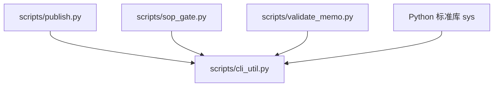
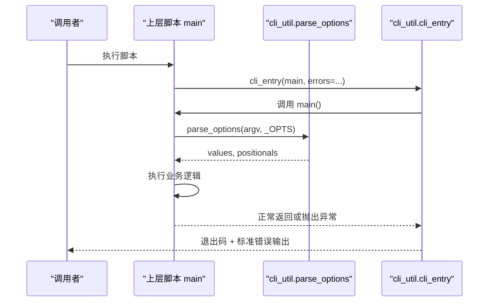
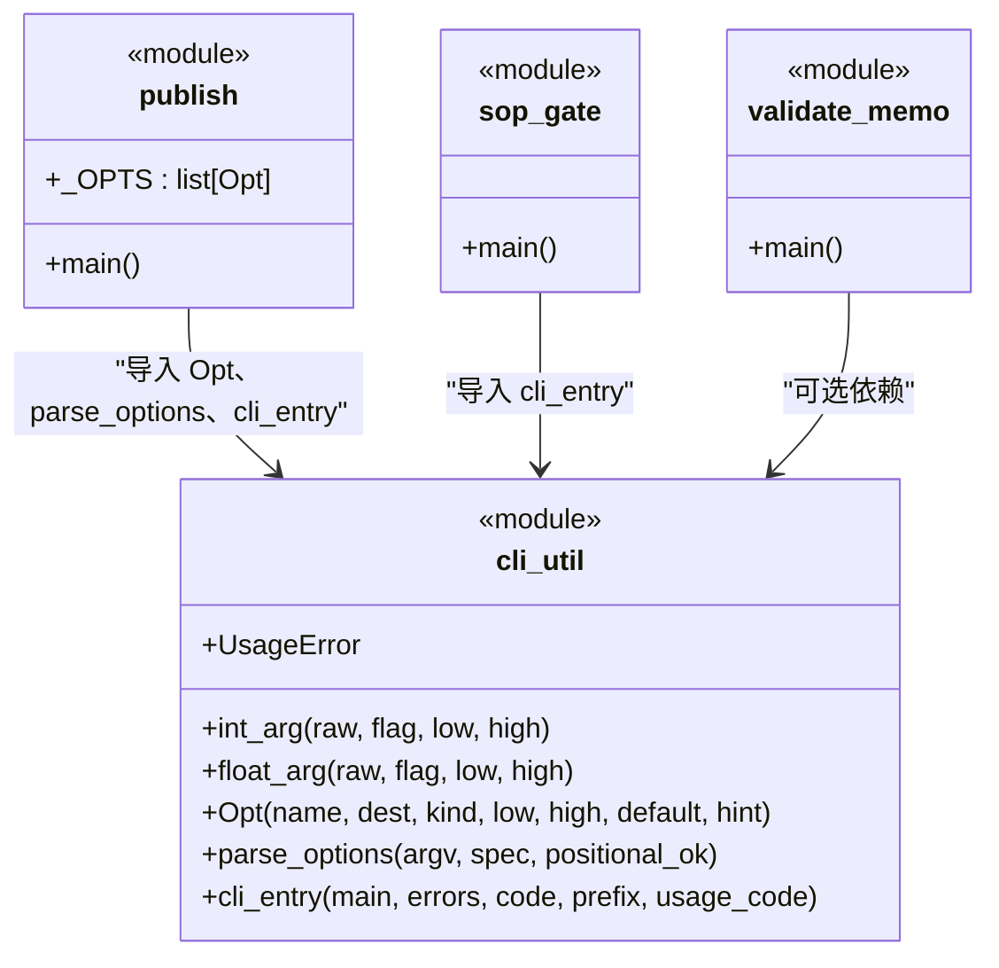
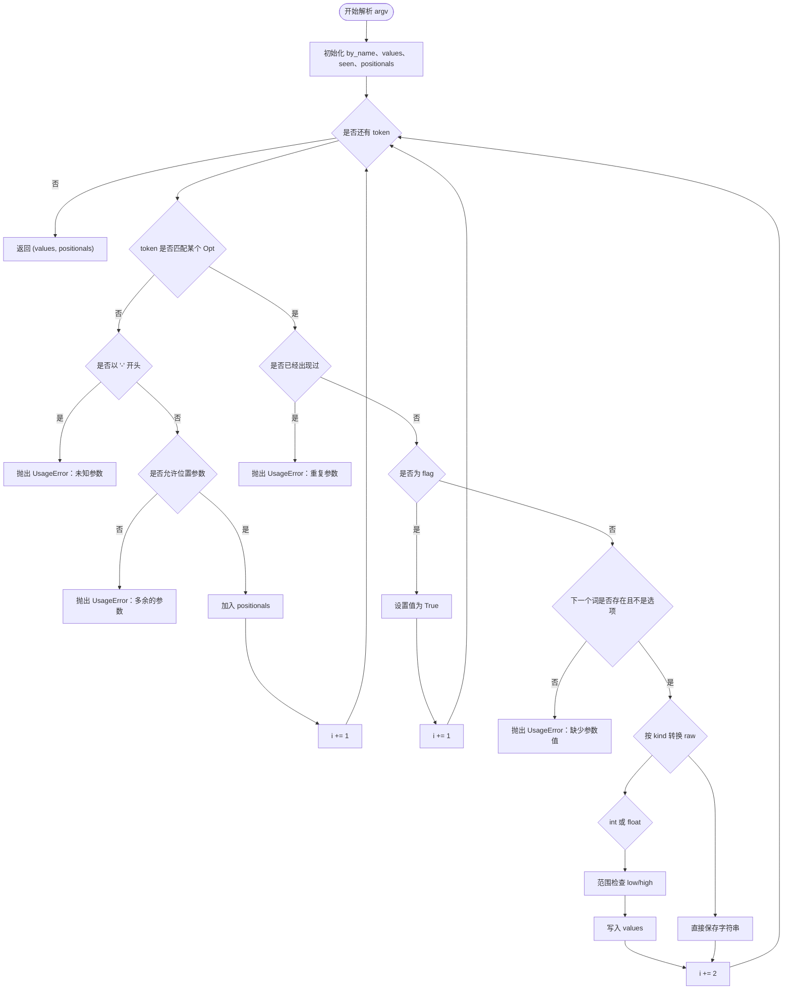

# 命令行契约 cli_util.py

<cite>
**本文引用的文件**   
- [scripts/cli_util.py](file://scripts/cli_util.py)
- [scripts/publish.py](file://scripts/publish.py)
- [scripts/sop_gate.py](file://scripts/sop_gate.py)
- [scripts/validate_memo.py](file://scripts/validate_memo.py)
</cite>

## 目录
1. [引言](#引言)
2. [模块职责与边界](#模块职责与边界)
3. [项目结构定位](#项目结构定位)
4. [公共契约总览](#公共契约总览)
5. [详细函数参考](#详细函数参考)
6. [架构与依赖关系](#架构与依赖关系)
7. [参数解析流程](#参数解析流程)
8. [异常模型与退出码](#异常模型与退出码)
9. [调试建议](#调试建议)
10. [结论](#结论)

## 引言
`scripts/cli_util.py` 是脚本层的纯标准库叶子模块，承担三类工作：
- 声明式描述 CLI 选项；
- 统一解析 `argv`、位置参数和重复/缺失/未知参数；
- 把“用法错误”和“业务预期内失败”转成统一的终端输出与进程退出码。

它被上层脚本用作“命令行契约层”，让 `publish.py`、`sop_gate.py`、`validate_memo.py` 等不再各自实现 while 循环式的参数解析逻辑。

## 模块职责与边界
该模块的职责边界由文档字符串和实现共同限定：
- 只使用标准库 `sys`；
- 不 import 任何项目内模块；
- 不发起网络请求；
- 不持有 flomo 凭据或云端协议语义；
- 通过 `UsageError` 表达“用户写错了参数”，而不是“云端调用失败”。

这一设计的关键动机是：过去这类逻辑散落在多个脚本中，导致相同缺陷反复出现——末尾选项被误报为“未知参数”，同一选项多次赋值时后者静默覆盖前者，以及各脚本对“用法错”和“云端错误”的退出行为不一致。把它们收敛到单一叶子层后，每个上层脚本只需声明自己的 `Opt(...)` 列表并交给 `cli_entry` 处理出口。

**章节来源**
- [scripts/cli_util.py:1-47](file://scripts/cli_util.py#L1-L47)

## 项目结构定位
从依赖方向看，`cli_util.py` 位于脚本依赖图的底部：

**图示来源**
- [scripts/publish.py:45-70](file://scripts/publish.py#L45-L70)
- [scripts/sop_gate.py:45-75](file://scripts/sop_gate.py#L45-L75)
- [scripts/cli_util.py:1-20](file://scripts/cli_util.py#L1-L20)

`cli_util.py` 自身只依赖 `sys`，因此它是依赖图中的叶子节点。上层脚本再根据自身业务选择是否进一步依赖 `flomo_client`、`memo_util` 等模块。

**章节来源**
- [scripts/cli_util.py:1-20](file://scripts/cli_util.py#L1-L20)
- [scripts/publish.py:45-70](file://scripts/publish.py#L45-L70)
- [scripts/sop_gate.py:45-75](file://scripts/sop_gate.py#L45-L75)

## 公共契约总览
| 符号 | 类型 | 作用 | 典型输入 | 典型返回 |
|---|---|---|---|---|
| `UsageError` | 自定义异常类 | 表示“命令行参数本身写错” | 无构造参数 | 抛出后由 `cli_entry` 捕获 |
| `int_arg(raw, flag, *, low=None, high=None)` | 函数 | 把字符串转换为整数并校验范围 | `"2000"`、`"--limit"` | 整数或抛出 `UsageError` |
| `float_arg(raw, flag, *, low=None, high=None)` | 函数 | 把字符串转换为浮点数并校验范围 | `"30.5"`、`"--timeout"` | 浮点数或抛出 `UsageError` |
| `Opt(name, dest, kind="str", ...)` | 类 | 声明一条 CLI 选项 | `--draft`、`flag`、取值范围 | 选项元数据对象 |
| `parse_options(argv, spec, *, positional_ok=False)` | 函数 | 按声明表解析 argv | 脚本 `sys.argv[1:]` 与 `_OPTS` | `(values, positionals)` |
| `cli_entry(main, *, errors, code=1, prefix="[失败]", usage_code=2)` | 函数 | 统一入口与出口 | 业务 `main` 函数和预期异常类型 | main 返回值或退出码 |

这些符号构成三层契约：
1. **选项声明层**：`Opt` 描述选项名、目标字段、类型、范围和提示。
2. **类型转换层**：`int_arg` / `float_arg` 负责严格数值转换与越界检查。
3. **解析与入口层**：`parse_options` 执行解析，`cli_entry` 包装 `main` 并统一终止行为。

**章节来源**
- [scripts/cli_util.py:21-166](file://scripts/cli_util.py#L21-L166)

## 详细函数参考

### UsageError
`UsageError(Exception)`

用途：区分“参数写法错误”和“云端/业务错误”。例如 `--limit abc` 应抛 `UsageError`，而 token 缺失或 API 失败应抛上层脚本定义的业务异常。

常见触发场景：
- 非数字传给整型或浮点参数；
- 数值小于 `low` 或大于 `high`；
- 选项缺少值；
- 重复传入只能出现一次的选项；
- 传入未声明的选项；
- 在非允许位置参数模式下收到裸词。

**章节来源**
- [scripts/cli_util.py:21-47](file://scripts/cli_util.py#L21-L47)

### int_arg
签名：`int_arg(raw, flag, *, low=None, high=None)`

参数含义：
- `raw`：命令行中的原始值字符串，可为空；
- `flag`：用于报错的选项名，如 `--limit`；
- `low`：最小值（可选）；
- `high`：最大值（可选）。

返回值：
- 成功时返回 Python `int`；
- 失败时抛出 `UsageError`。

典型调用示例：
- `int_arg("2000", "--limit")` → `2000`
- `int_arg("abc", "--limit")` → 抛出 `UsageError`
- `int_arg("-1", "--count", low=1)` → 抛出 `UsageError`

常见异常：
- `UsageError`：类型不是整数、小于下限、大于上限。

**章节来源**
- [scripts/cli_util.py:49-61](file://scripts/cli_util.py#L49-L61)

### float_arg
签名：`float_arg(raw, flag, *, low=None, high=None)`

参数含义：
- `raw`：命令行中的原始值字符串；
- `flag`：用于报错的选项名；
- `low`、`high`：数值上下限。

返回值：
- 成功时返回 Python `float`；
- 失败时抛出 `UsageError`。

典型调用示例：
- `float_arg("30.5", "--timeout")` → `30.5`
- `float_arg("not-a-number", "--timeout")` → 抛出 `UsageError`
- `float_arg("0", "--retry", low=0.1)` → 抛出 `UsageError`

常见异常：
- `UsageError`：无法转为浮点数、越界。

**章节来源**
- [scripts/cli_util.py:63-67](file://scripts/cli_util.py#L63-L67)

### Opt
签名：`Opt(name, dest, kind="str", *, low=None, high=None, default=None, hint="")`

字段说明：
| 字段 | 类型 | 含义 |
|---|---|---|
| `name` | str | 命令行选项名，如 `--draft` |
| `dest` | str | 解析结果字典中的键名，如 `draft` |
| `kind` | str | 选项类型，仅支持 `str`、`int`、`float`、`flag` |
| `low` | 数值或 None | 数值型参数的下限 |
| `high` | 数值或 None | 数值型参数的上限 |
| `default` | 任意类型或 None | 默认值；`flag` 类型强制为 `False` |
| `hint` | str | 重复选项时的补充提示 |

约束：
- `kind` 不在允许集合中会抛出 `ValueError`；
- `kind == "flag"` 时不能设置 `low` 或 `high`，否则会抛出 `ValueError`。

典型声明示例：
- `CLI.Opt("--draft", "draft", default="")`
- `CLI.Opt("--limit", "limit", "int", low=1)`
- `CLI.Opt("--skip-web", "skip_web", "flag")`

**章节来源**
- [scripts/cli_util.py:69-94](file://scripts/cli_util.py#L69-L94)

### parse_options
签名：`parse_options(argv, spec, *, positional_ok=False)`

参数含义：
- `argv`：通常是 `sys.argv[1:]`；
- `spec`：由 `Opt` 实例组成的序列；
- `positional_ok`：是否允许位置参数；默认不允许。

返回值：
- `(values, positionals)`：
  - `values`：以 `dest` 为键的字典；
  - `positionals`：未被识别为选项的位置参数列表。

解析规则要点：
- 遇到未声明且以 `-` 开头的词，报“未知参数”；
- 非位置模式下的裸词报“多余的参数”；
- 已出现的选项再次出现时报“重复”，并附带选项的 `hint`；
- 非 `flag` 选项后面没有值或下一个词仍是选项名时，报“缺少参数值”；
- `int` / `float` 类型走 `_num_arg`，进行类型转换和范围检查；
- 其他类型直接取原始字符串。

典型调用示例：
- `values, _ = CLI.parse_options(sys.argv[1:], _OPTS)`
- `values, files = CLI.parse_options(sys.argv[1:], _OPTS, positional_ok=True)`

常见异常：
- `UsageError`：未知参数、多余参数、重复参数、缺值、非法数值、越界。

**章节来源**
- [scripts/cli_util.py:96-150](file://scripts/cli_util.py#L96-L150)

### cli_entry
签名：`cli_entry(main, *, errors, code=1, prefix="[失败]", usage_code=2)`

参数含义：
- `main`：业务主函数，不带参数；
- `errors`：业务预期异常类型的元组，必填；
- `code`：业务异常对应的退出码，默认 `1`；
- `prefix`：业务异常输出的前缀，默认 `"[失败]"`；
- `usage_code`：用法错误的退出码，默认 `2`。

行为：
- 正常路径：调用 `main()` 并返回其结果；
- 捕获 `UsageError`：向 stderr 打印 `[失败] <消息>`，返回 `usage_code`；
- 捕获 `errors` 中的异常：向 stderr 打印带 `prefix` 的消息，返回 `code`。

典型调用示例：
- `CLI.cli_entry(main, errors=(FlomoError,))`
- `CLI.cli_entry(main, errors=())`

常见异常：
- 如果忘记传 `errors`，会在调用处产生 `TypeError`，而不是运行期才暴露问题；
- 如果业务异常类型不属于 `errors`，则不会被本函数捕获，可能继续向上抛出。

**章节来源**
- [scripts/cli_util.py:152-166](file://scripts/cli_util.py#L152-L166)

## 架构与依赖关系
`cli_util.py` 作为叶子层，不反向依赖上层脚本，也不依赖项目内部模块。上层脚本通过以下方式使用它：

**图示来源**
- [scripts/cli_util.py:96-166](file://scripts/cli_util.py#L96-L166)

具体依赖关系如下：

**图示来源**
- [scripts/cli_util.py:21-166](file://scripts/cli_util.py#L21-L166)
- [scripts/publish.py:45-70](file://scripts/publish.py#L45-L70)
- [scripts/sop_gate.py:45-75](file://scripts/sop_gate.py#L45-L75)

**章节来源**
- [scripts/cli_util.py:21-166](file://scripts/cli_util.py#L21-L166)
- [scripts/publish.py:45-70](file://scripts/publish.py#L45-L70)
- [scripts/sop_gate.py:45-75](file://scripts/sop_gate.py#L45-L75)

## 参数解析流程
`parse_options` 的核心流程如下：

**图示来源**
- [scripts/cli_util.py:96-150](file://scripts/cli_util.py#L96-L150)

关键设计决策：
- “下一个词本身就是选项名”视为当前选项缺值，而不是把选项名当成值传给 `int_arg`；
- 只有显式声明的 `Opt.kind` 才参与类型转换，避免隐式行为；
- 重复选项不会静默覆盖，而是立即报错；
- 未知参数和多余参数分别给出不同诊断，因为修复方式不同。

**章节来源**
- [scripts/cli_util.py:96-150](file://scripts/cli_util.py#L96-L150)

## 异常模型与退出码
`cli_util.py` 明确区分两类失败：

| 异常类型 | 含义 | 通常由谁抛出 | 默认退出码 | 输出格式 |
|---|---|---|---:|---|
| `UsageError` | 参数写错 | `parse_options`、`int_arg`、`float_arg`、`Opt.__init__` | `usage_code`，默认 `2` | `[失败] <原因>` |
| `errors` 中的异常 | 业务预期失败 | 上层脚本业务逻辑 | `code`，默认 `1` | `<prefix><分隔符><原因>` |

注意事项：
- `UsageError` 不继承上层业务异常，防止业务 `except FlomoError` 误吞参数错误；
- `errors` 是必填关键字参数，漏写会在调用处得到 `TypeError`；
- `prefix` 默认是 `"[失败]"`，但业务分支可通过结尾冒号控制分隔符；
- 对于网络、凭据、协议等可预期失败，上层脚本应传入对应异常类型；
- 对于纯本地校验脚本，`errors` 可以是空元组。

**章节来源**
- [scripts/cli_util.py:21-47](file://scripts/cli_util.py#L21-L47)
- [scripts/cli_util.py:152-166](file://scripts/cli_util.py#L152-L166)

## 调试建议
当命令行行为异常时，可按以下顺序快速定位：

1. **先看输出是否以 `[失败]` 开头**  
   如果是，说明属于 `UsageError`，优先检查参数名称、参数值、是否遗漏值、是否重复传参。

2. **检查 `Opt` 声明**  
   - `kind` 是否正确：字符串、整数、浮点、开关四选一；
   - `flag` 类型是否误配了 `low`/`high`；
   - `dest` 是否与后续代码读取的字段一致；
   - `default` 是否符合业务预期。

3. **检查数值参数**  
   - `int_arg` / `float_arg` 不接受模糊文本；
   - 若传入 `"2000条"` 或中文单位，应先在调用方做清洗，或由上层脚本提供更严格的正则；
   - 检查 `low`/`high` 是否与业务语义一致，例如重试次数不应为负数。

4. **检查重复参数**  
   如果同一选项传了两次，模块会直接报错，而不是用后者覆盖前者。这能防止“以为做了两次质检、其实只生效一次”的问题。

5. **检查位置参数**  
   默认不允许裸词；若脚本需要位置参数，应显式设置 `positional_ok=True`。

6. **检查 `cli_entry` 的 `errors` 参数**  
   如果业务异常没有被捕获，可能是：
   - 忘记传 `errors`；
   - 传入的异常类型与实际抛出的类型不一致；
   - 业务逻辑抛出了未声明的异常。

7. **在测试中替换 `cli_entry` 或 `parse_options`**  
   由于这些函数都是普通 Python 可调对象，单元测试可以注入 mock，验证错误分支而不必真正调用云端。

**章节来源**
- [scripts/cli_util.py:21-166](file://scripts/cli_util.py#L21-L166)

## 结论
`scripts/cli_util.py` 的价值不在于复杂算法，而在于把容易出错的命令行契约收敛到一个稳定、可测试、无项目内依赖的叶子层。它通过 `Opt` 声明、`parse_options` 解析和 `cli_entry` 出口，解决了三个历史问题：
- 末尾选项被误报为未知参数；
- 重复选项静默覆盖；
- 用法错误与云端错误混用，导致用户难以判断是参数写错还是凭据/网络问题。

上层脚本如 `publish.py`、`sop_gate.py`、`validate_memo.py` 只需关注自身业务选项和业务异常类型，其余解析与终止行为由该模块统一提供。这种分层使脚本更容易测试、更容易排查参数错误，也降低了云端接口变化对纯命令行工具的影响面。