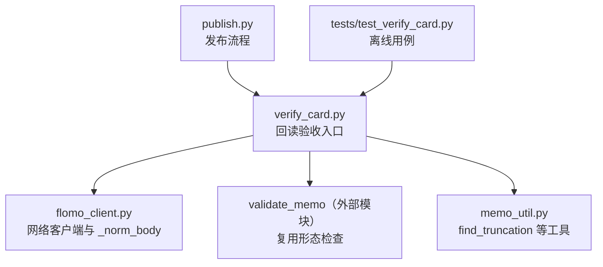
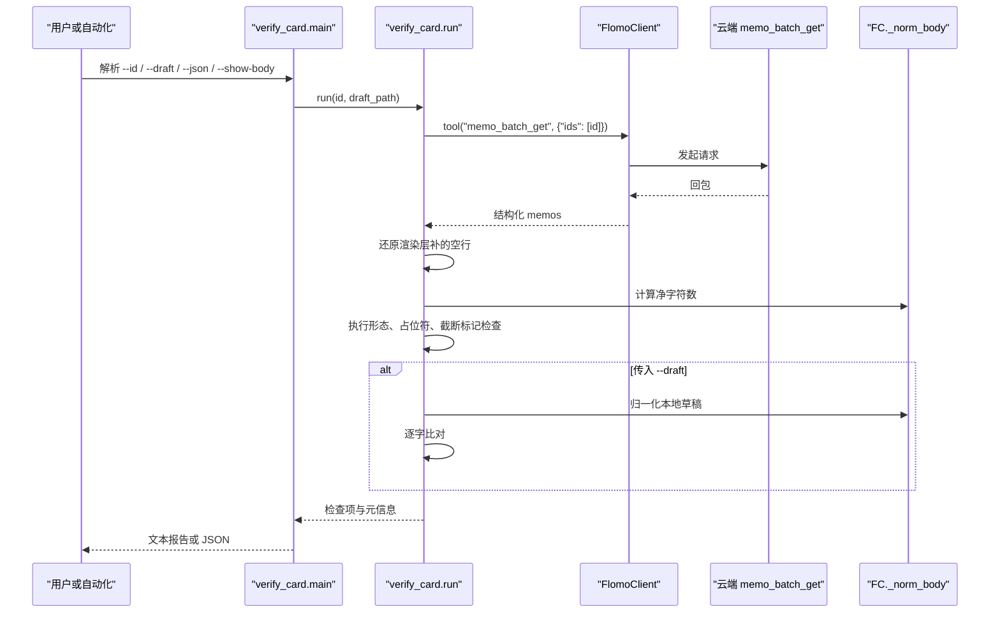
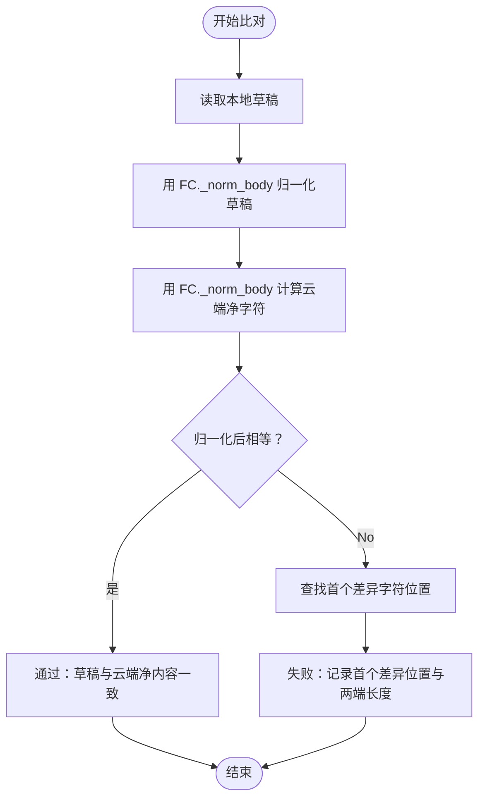
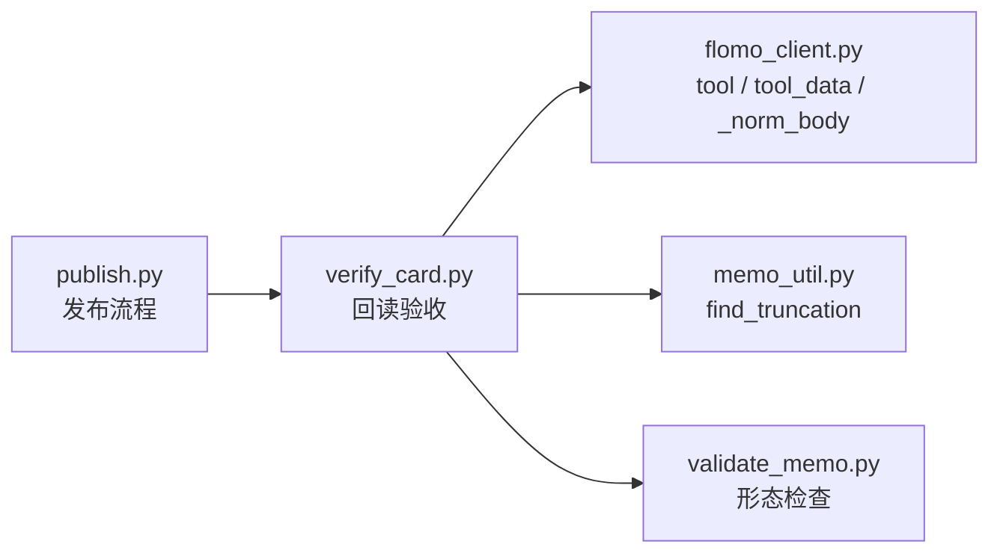

# 回读验收 verify_card.py

<cite>
**本文引用的文件**
- [scripts/verify_card.py](file://scripts/verify_card.py)
- [scripts/flomo_client.py](file://scripts/flomo_client.py)
- [scripts/memo_util.py](file://scripts/memo_util.py)
- [scripts/publish.py](file://scripts/publish.py)
- [tests/test_verify_card.py](file://tests/test_verify_card.py)
</cite>

## 目录
1. [引言](#引言)
2. [项目结构定位](#项目结构定位)
3. [核心职责与边界](#核心职责与边界)
4. [命令行参数与用法](#命令行参数与用法)
5. [回读流程](#回读流程)
6. [机械比对规则](#机械比对规则)
7. [差异报告与输出格式](#差异报告与输出格式)
8. [退出码与自动化约定](#退出码与自动化约定)
9. [与 flomo_client、memo_util、publish 的关系](#与-flomoclient-memo_util-publish-的关系)
10. [发布后单独运行示例](#发布后单独运行示例)
11. [不一致排查路径](#不一致排查路径)
12. [性能与可靠性建议](#性能与可靠性建议)
13. [结论](#结论)

## 引言
`scripts/verify_card.py` 是写云后的单卡回读验收脚本。它的目标不是替代人工通读，而是把 H11 中可机械判定的部分固定下来：回读是否完整、标签段和概念名位置是否正确、形态是否与本地校验同源、是否存在抽取丢失正文的占位符、是否存在检索截断占位符，以及云端回读与本地草稿在统一归一化口径下的逐字一致性。

该脚本显式列出两条它无法自动判断的项目——首尾是否为同一事件、是否串入其他卡片内容——避免让“全部通过”的机器结果误导为“四条都查过了”。

## 项目结构定位


**图示来源**
- [scripts/verify_card.py:45-50](file://scripts/verify_card.py#L45-L50)
- [scripts/verify_card.py:107-118](file://scripts/verify_card.py#L107-L118)
- [scripts/memo_util.py:338-347](file://scripts/memo_util.py#L338-L347)
- [scripts/publish.py:484-495](file://scripts/publish.py#L484-L495)

**章节来源**
- [scripts/verify_card.py:1-50](file://scripts/verify_card.py#L1-L50)
- [scripts/verify_card.py:45-50](file://scripts/verify_card.py#L45-L50)

## 核心职责与边界
| 类别 | 是否由本脚本判定 | 说明 |
|---|---:|---|
| 回读未被截断 | 是 | 读取 `content_truncated`；若为真则直接失败 |
| 首行是完整标签段 | 是 | 以 `#` 开头且包含 `/` |
| 第二行是概念名 | 是 | 非空、不以 `#` 开头、不落入“要点/结构/标签”等结构标签 |
| 形态一致 | 是 | 复用 `validate_memo.check()`，保持写前与写后同源判据 |
| 无公式占位符残留 | 是 | 匹配形如 `〈M12〉`、`〖M7〗` 的已知抽取失败形态 |
| 无截断占位符 | 是 | 调用 `memo_util.find_truncation`，检测正文中段已被截断的痕迹 |
| 实测字数与草稿净字符数一致 | 有条件 | 仅在传入 `--draft` 时执行；否则只报告数字 |
| 云端与草稿逐字比对 | 有条件 | 仅在传入 `--draft` 时执行；按 `FC._norm_body` 同口径比较 |
| 首尾是否为同一事件 | 否 | 必须人读 |
| 是否串入他卡内容 | 否 | 必须人读，并与近邻卡比对 |

**章节来源**
- [scripts/verify_card.py:120-180](file://scripts/verify_card.py#L120-L180)
- [scripts/verify_card.py:180-210](file://scripts/verify_card.py#L180-L210)
- [scripts/verify_card.py:1-40](file://scripts/verify_card.py#L1-L40)

## 命令行参数与用法
| 参数 | 必需 | 默认值 | 作用 |
|---|---:|---:|---|
| `--id` | 是 | 无 | 指定要回读的卡片 id |
| `--draft` | 否 | 无 | 提供本地草稿路径，追加云端与草稿的逐字比对 |
| `--json` | 否 | 假 | 输出结构化 JSON，供自动化消费 |
| `--show-body` | 否 | 假 | 打印云端全文，用于核对两条“须人读”项；不与 `--json` 同时生效 |

关键行为：
- 未传 `--draft` 时，脚本只报告云端返回的字数、净字符数等信息，不会假装已与草稿对账。
- `--json` 输出不包含原始正文；正文被提前从 `info` 中移除，避免自动化消费方误以为已覆盖语义项。
- `--show-body` 会在“须人读”提示之后打印云端全文，并明确标注人读落点就在此处。

**章节来源**
- [scripts/verify_card.py:215-297](file://scripts/verify_card.py#L215-L297)
- [tests/test_verify_card.py:260-320](file://tests/test_verify_card.py#L260-L320)

## 回读流程


**图示来源**
- [scripts/verify_card.py:100-118](file://scripts/verify_card.py#L100-L118)
- [scripts/verify_card.py:120-210](file://scripts/verify_card.py#L120-L210)
- [scripts/verify_card.py:215-297](file://scripts/verify_card.py#L215-L297)
- [scripts/flomo_client.py:387-400](file://scripts/flomo_client.py#L387-L400)

### 回读数据源
脚本通过 `FlomoClient.tool("memo_batch_get", {"ids": [memo_id]})` 拉取单卡全文，并由 `flomo_client.tool_data` 解析回包。解析失败会抛出异常，而不是静默返回空列表，以避免把“协议变化”误诊为“云端没有这张卡”。

**章节来源**
- [scripts/verify_card.py:100-118](file://scripts/verify_card.py#L100-L118)
- [scripts/flomo_client.py:270-297](file://scripts/flomo_client.py#L270-L297)

## 机械比对规则
### 1. 回读完整性
- 读取 `content_truncated`。
- 若为真，整条检查失败，因为截断时字数和结构判断都不可信。
- 处置提示要求改用 `memo_batch_get` 重新拉取全文。

### 2. 结构形态
- 首行应为完整标签段：以 `#` 开头且包含 `/`。
- 第二行应为概念名：非空、不以 `#` 开头、不落入“要点/结构/标签”。
- 云端存储可能在标签段后插入一个空行，导致概念名落到第三行。脚本会做有限还原：仅当首行是标签段、第二行空、第三行非空时才删除该空行。
- 结构还原不等于对账还原；字符对账走 `FC._norm_body`，避免把平台差异算进内容。

### 3. 形态检查
- 复用 `validate_memo.check()`。
- 检查前清空 `ERR` 与 `WARN` 列表，保证单次调用结果干净。
- 喂给校验器的是已还原渲染空行的正文，防止每张合规卡都报出“第二行不应为空”。

### 4. 占位符与截断
- 公式占位符：匹配 `〈M12〉`、`〖M7〗` 等已知抽取失败形态，命中即失败。
- 截断占位符：调用 `memo_util.find_truncation`，检测正文中段来自检索回包的截断痕迹。该项与 `content_truncated` 不同源：前者表示正文内部已有缺失标记，后者表示本次回包被截断。

### 5. 字符数与净字符
- 云端原样字符数可能大于草稿净字符数，原因包括：
  - 渲染层补空行
  - 全角标点与行内代码之间插入空格
  - 存储层对 Markdown 元字符加反斜杠转义
  - 草稿文件末尾换行被修掉
- 净字符使用 `FC._norm_body(raw)`，口径与写路径 `readback_check` 同源。
- 脚本还会分解四类差异：Markdown 转义数量、丢掉的空行数量、去除的行内空白数量、渲染层补行情况。

### 6. 与本地草稿逐字比对
- 仅当传入 `--draft` 时执行。
- 草稿与云端正文都先经 `FC._norm_body` 归一化。
- 归一化后按字符逐字比较；首个差异位置、两边长度都会写入详情。
- 不宽容行界与非转义字符差异；空行、行内空白、转义已在归一化阶段消除，不参与比对。



**图示来源**
- [scripts/verify_card.py:201-213](file://scripts/verify_card.py#L201-L213)
- [scripts/flomo_client.py:387-400](file://scripts/flomo_client.py#L387-L400)

**章节来源**
- [scripts/verify_card.py:120-213](file://scripts/verify_card.py#L120-L213)
- [tests/test_verify_card.py:210-260](file://tests/test_verify_card.py#L210-L260)

## 差异报告与输出格式
### 文本模式
文本模式下，脚本输出：
- 卡片 id、标签、云端字数、净字符数、非空行数。
- 若云端原样字符数与净字符数不同，补充空行、行内空白、转义数量的分解。
- 若传了 `--draft`，说明已完成本地草稿逐字比对。
- 若检测到渲染层补空行，提示该行为属于平台层。
- 首行、次行、末行摘要。
- `[机器判定]` 列出的所有检查项，失败项附带详情。
- `[提示（WARN）]` 显示 `validate_memo` 的警告（最多 5 条）。
- `[须人读——脚本判不了，别当成已查过]` 列出两条必须由人确认的项目。
- 可选 `[云端全文]`，仅在 `--show-body` 时打印。

### JSON 模式
JSON 模式适合自动化消费，字段包括：
- `ok`：是否所有机械检查项通过。
- `info`：卡片元信息与统计，不含原始正文。
- `checks`：每项检查的名称、通过状态与详情。
- `human_judgment`：两条机器无法覆盖的人读项。

注意：即使 `--json` 与 `--show-body` 同时传入，脚本仍会输出可解析的 JSON，但不会打印全文，并在标准错误给出提示。

**章节来源**
- [scripts/verify_card.py:215-297](file://scripts/verify_card.py#L215-L297)
- [tests/test_verify_card.py:260-320](file://tests/test_verify_card.py#L260-L320)

## 退出码与自动化约定
| 场景 | 退出码 | 说明 |
|---|---:|---|
| 所有机械检查项通过 | 0 | 可用于自动化门禁 |
| 存在失败的机械检查项 | 1 | 例如截断、结构错误、占位符残留、草稿比对失败 |
| 回读失败 | 1 | 异常被捕获并转为错误输出 + 非零退出码，不会静默通过 |
| `--json` 模式 | 0 或 1 | 由 `ok` 决定，便于程序判断 |

此外，`main` 外层还通过 `cli_util.cli_entry` 包装 `FlomoError`，使凭据缺失、握手失败等底层错误也能收敛成一行错误和退出码。

**章节来源**
- [scripts/verify_card.py:215-297](file://scripts/verify_card.py#L215-L297)
- [tests/test_verify_card.py:201-260](file://tests/test_verify_card.py#L201-L260)

## 与 flomo_client、memo_util、publish 的关系
### 与 flomo_client
- 网络调用：`client.tool("memo_batch_get", {"ids": [memo_id]})`。
- 回包解析：`flomo_client.tool_data`。
- 字符归一化：`FC._norm_body`，用于净字符计数和草稿比对。
- Token 构造：`_default_client` 解包 `load_token()` 返回的 `(token, source)` 元组后再传给 `FlomoClient`。

### 与 memo_util
- 截断检测：`memo_util.find_truncation` 用于识别正文中可能来自检索回包的截断占位符。
- 签名与关键词等其他能力集中在 `memo_util`，供 `flomo_client`、`validate_memo`、`sop_gate` 共用，避免各自实现口径漂移。

### 与 publish
- `publish.py` 在发布流程中也依赖回读对账逻辑，并通过 `flomo_client.tool_data_or_none` 解析云端回包。
- 两者共享 `_norm_body` 作为字符归一化口径，确保“写路径”和“回读路径”不各写一套。
- `publish.py` 会把回读结果与目标卡预检结合，形成更完整的发布质量门。



**图示来源**
- [scripts/verify_card.py:45-50](file://scripts/verify_card.py#L45-L50)
- [scripts/verify_card.py:107-118](file://scripts/verify_card.py#L107-L118)
- [scripts/publish.py:484-495](file://scripts/publish.py#L484-L495)
- [scripts/flomo_client.py:387-400](file://scripts/flomo_client.py#L387-L400)

**章节来源**
- [scripts/verify_card.py:45-50](file://scripts/verify_card.py#L45-L50)
- [scripts/verify_card.py:107-118](file://scripts/verify_card.py#L107-L118)
- [scripts/memo_util.py:1-20](file://scripts/memo_util.py#L1-L20)
- [scripts/publish.py:484-495](file://scripts/publish.py#L484-L495)
- [scripts/flomo_client.py:387-400](file://scripts/flomo_client.py#L387-L400)

## 发布后单独运行示例
假设某张卡片已通过 `publish.py` 发布到云端，id 为 `MjYxMzk1MDg0`，本地草稿位于 `_tmp/memo_body_37.txt`。

### 基础回读
```bash
python scripts/verify_card.py --id MjYxMzk1MDg0
```
用途：查看云端回读是否完整、结构是否合法、是否有占位符残留，以及净字符数等基本信息。

### 带草稿比对
```bash
python scripts/verify_card.py --id MjYxMzk1MDg0 --draft _tmp/memo_body_37.txt
```
用途：将云端回读与本地草稿按 `FC._norm_body` 同口径进行逐字比对；若不一致，报告首个差异位置和两端长度。

### 查看云端全文
```bash
python scripts/verify_card.py --id MjYxMzk1MDg0 --show-body
```
用途：打印云端全文，供人工核对“首尾是否同一事件”和“是否串入他卡内容”两条机器无法判断的项目。

### 自动化消费
```bash
python scripts/verify_card.py --id MjYxMzk1MDg0 --json
```
用途：输出 JSON，包含 `ok`、`info`、`checks`、`human_judgment`，适合流水线集成。

### 发布后推荐顺序
1. 运行 `publish.py` 完成发布。
2. 从发布日志或回包中取出最终 `id`。
3. 运行 `verify_card.py --id <id>` 做基础回读。
4. 如有对应草稿，加上 `--draft` 做逐字比对。
5. 若需要人工核对语义项，加上 `--show-body`。
6. 在自动化环境中使用 `--json` 并检查退出码。

**章节来源**
- [scripts/verify_card.py:1-40](file://scripts/verify_card.py#L1-L40)
- [scripts/verify_card.py:215-297](file://scripts/verify_card.py#L215-L297)
- [tests/test_verify_card.py:260-320](file://tests/test_verify_card.py#L260-L320)

## 不一致排查路径
### 1. 回读失败
现象：
- 脚本报错“回读失败”，退出码为 1。
- 常见原因包括凭据缺失、网络握手失败、回包无法解析、云端未返回卡片。

排查步骤：
- 确认 token 有效，`load_token()` 能返回字符串形式的 token。
- 确认 `memo_batch_get` 接口可用。
- 确认云端确实存在该 id。
- 不要立即重建一张同名卡；先区分“协议解析失败”和“卡不存在”。

相关实现要点：
- `_default_client` 解包 `(token, source)`，避免直接把元组传给 `FlomoClient`。
- `fetch` 使用 `tool_data` 解析回包，解析失败抛异常。
- 空 `memos` 列表会报“未返回卡片”。

**章节来源**
- [scripts/verify_card.py:91-118](file://scripts/verify_card.py#L91-L118)
- [tests/test_verify_card.py:201-260](file://tests/test_verify_card.py#L201-L260)

### 2. 云端正文被改写
现象：
- `--draft` 下逐字比对失败。
- 净字符数与草稿不一致。
- 差异可能表现为 Markdown 转义、空行、行内空白或真实内容变化。

排查步骤：
- 先用 `--show-body` 看云端实际正文。
- 对照“云端原样字符数 = 净字符 + 空行 + 行内空白 + 转义”的分解。
- 确认草稿是否被后续编辑修改。
- 确认是否触发了平台层的 Markdown 转义或渲染层补空行。

**章节来源**
- [scripts/verify_card.py:160-213](file://scripts/verify_card.py#L160-L213)
- [scripts/flomo_client.py:387-400](file://scripts/flomo_client.py#L387-L400)

### 3. 本地编码差异
现象：
- 读取草稿时报错，或与云端比对失败。
- 某些环境可能出现换行符、编码不一致问题。

处理原则：
- 脚本以 UTF-8 读取草稿。
- 云端正文在内部统一转换为 `\n`，避免 `\r\n` 混入比对。
- 若本地草稿不是 UTF-8，应先转换再交给 `--draft`。

**章节来源**
- [scripts/verify_card.py:201-213](file://scripts/verify_card.py#L201-L213)

### 4. 云端截断
现象：
- `content_truncated` 为真。
- 正文中出现检索截断占位符。
- 字数、结构和逐字比对都可能不可信。

处理原则：
- 不能信任被截断的正文。
- 应重新使用 `memo_batch_get` 拉取全文。
- 如果正文中包含截断占位符，说明内容中段已经永久缺失，需重写。

**章节来源**
- [scripts/verify_card.py:120-180](file://scripts/verify_card.py#L120-L180)
- [scripts/memo_util.py:338-347](file://scripts/memo_util.py#L338-L347)

## 性能与可靠性建议
### 大批量回读的分批策略
虽然 `verify_card.py` 本身一次只处理一张卡，但批量场景（如发布后对所有卡片做验收）应遵循以下原则：
- 每次调用只传入一个 `--id`，避免一次性拼出过长 id 列表。
- 服务端 `memo_batch_get` 有单次上限（仓库中其他脚本采用 10 条限制），因此批量任务应按批次拆分。
- 建议使用队列或分片方式驱动多个 `verify_card` 进程，避免单个进程因一张卡失败而中断整个批次。

参考实现中的批量限制：
- 其他脚本明确使用 `BATCH_LIMIT = 10` 控制 `memo_batch_get` 单次 id 数量。

**章节来源**
- [scripts/dedup.py:37-40](file://scripts/dedup.py#L37-L40)
- [scripts/dedup.py:112-115](file://scripts/dedup.py#L112-L115)
- [scripts/scan_truncated.py:42-46](file://scripts/scan_truncated.py#L42-L46)
- [scripts/scan_truncated.py:98-100](file://scripts/scan_truncated.py#L98-L100)

### 失败重试与人工复核标记
- 网络类失败应重试，但应避免无限重试；建议设置最大重试次数与指数退避。
- 对“云端正文被改写”的差异，不应自动修复，而应标记为待人工复核。
- 对“正文含截断占位符”的情况，应视为内容缺失，不能靠重试恢复。
- 建议在自动化报告中保留三类标记：
  - 网络失败：可重试。
  - 云端改写：需人工确认是否允许变更。
  - 内容截断：需重写正文。
- `verify_card.py` 的 JSON 输出适合接入这类标记系统：`ok` 表达机械项结果，`human_judgment` 提醒仍需人工覆盖的两项。

**章节来源**
- [scripts/verify_card.py:120-180](file://scripts/verify_card.py#L120-L180)
- [scripts/verify_card.py:215-297](file://scripts/verify_card.py#L215-L297)
- [tests/test_verify_card.py:201-260](file://tests/test_verify_card.py#L201-L260)

## 结论
`verify_card.py` 的核心价值是把原本散落在每轮临时代码中的机械检查固定下来，并确保写前校验与写后回读同源。它不负责证明“内容语义正确”，而是负责暴露“云端正文与本地草稿不一致、结构异常、抽取失败、截断风险”等可观测问题。

最佳实践是：
- 发布后单独运行 `verify_card.py`。
- 始终配合 `--draft` 做逐字比对。
- 用 `--show-body` 核对两条机器无法判断的人读项。
- 在自动化中基于 `--json` 和退出码决策。
- 对失败项分类：网络问题重试，云端改写人工复核，截断问题重写正文。
- 对大批量卡片分批调用，避免把单卡失败扩散为整体失败。