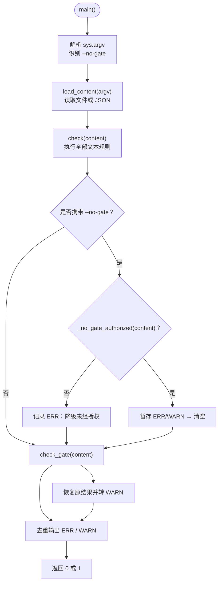
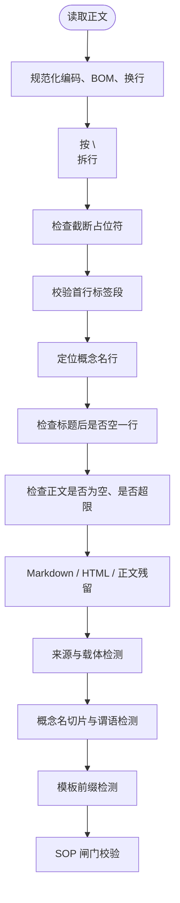
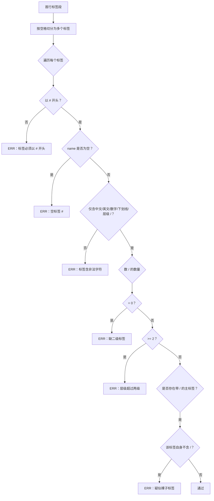
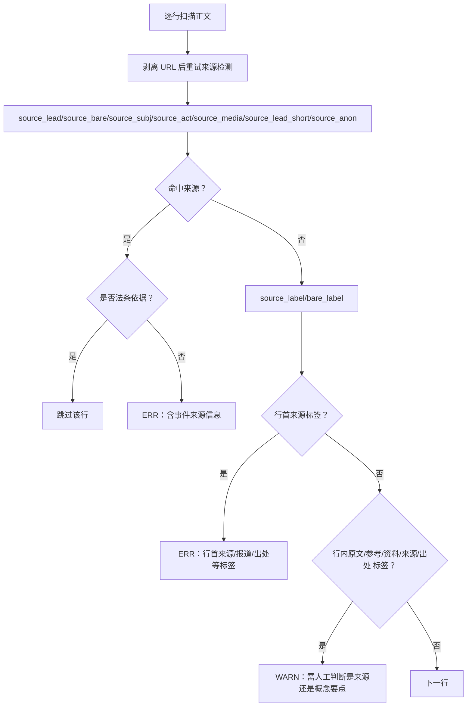
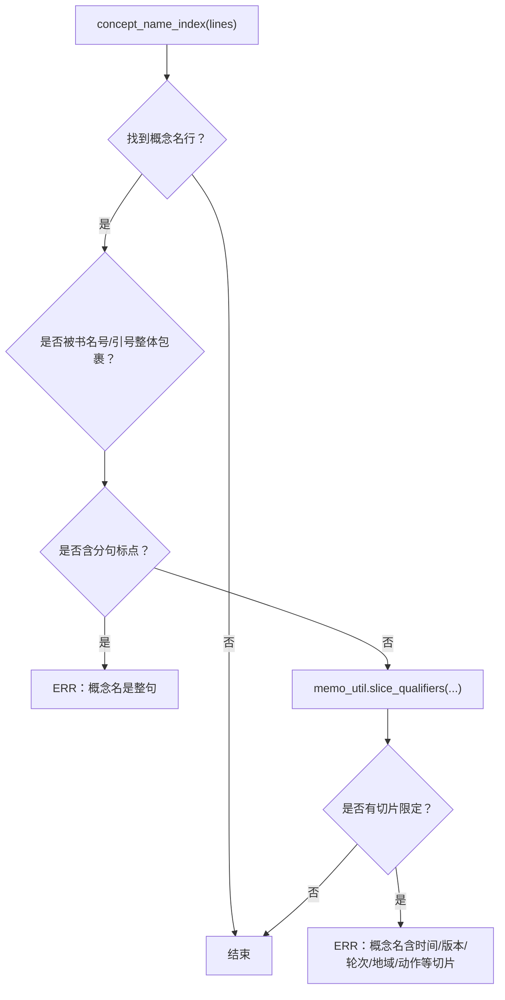
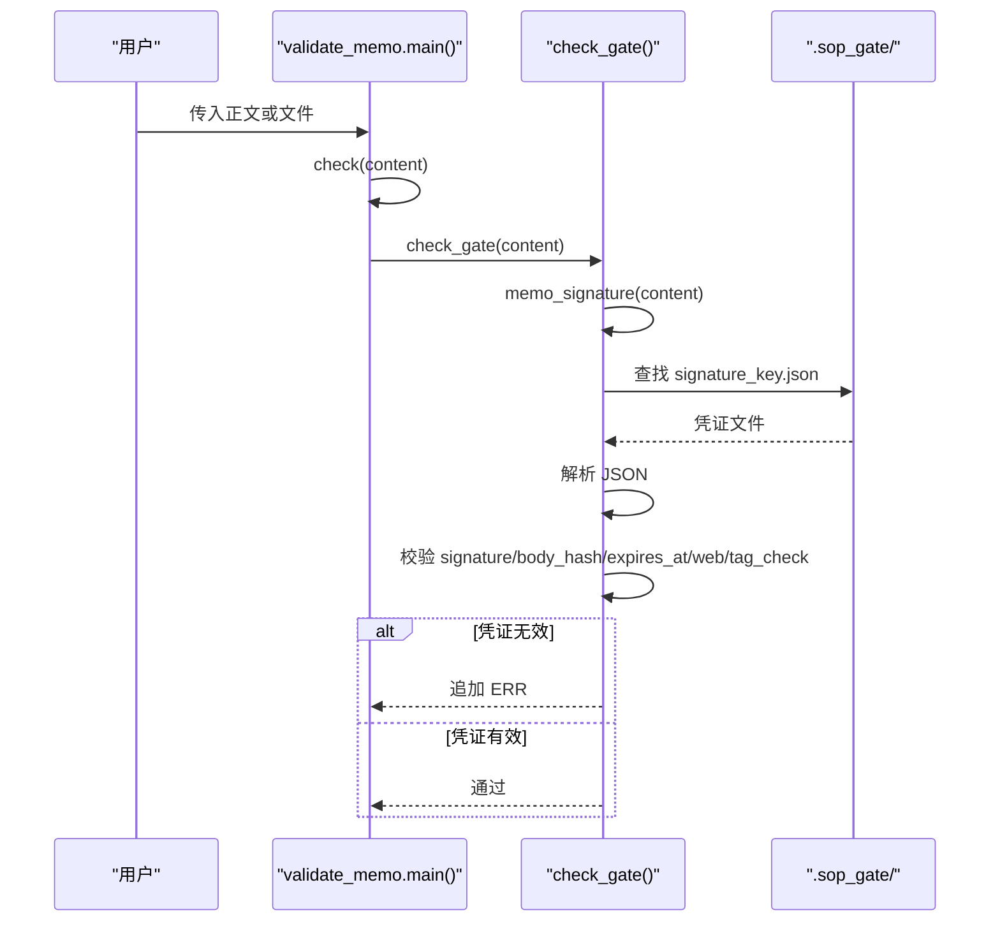
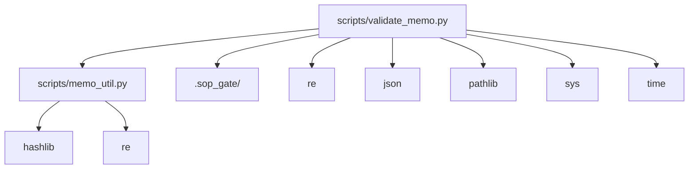

# 文本质检 validate_memo.py

<cite>
**本文引用的文件**   
- [scripts/validate_memo.py](file://scripts/validate_memo.py)
- [scripts/memo_util.py](file://scripts/memo_util.py)
- [tests/test_validate_memo.py](file://tests/test_validate_memo.py)
</cite>

## 目录
1. [简介](#简介)
2. [项目结构与入口](#项目结构与入口)
3. [输入与输出约定](#输入与输出约定)
4. [合法 memo 形态](#合法-memo-形态)
5. [标签体系规则](#标签体系规则)
6. [正文格式与字数约束](#正文格式与字数约束)
7. [Markdown、HTML 与正文残留检测](#markdownhtml-与正文残留检测)
8. [来源与载体字段校验](#来源与载体字段校验)
9. [概念名切片限定与谓语检测](#概念名切片限定与谓语检测)
10. [模板前缀回显检测](#模板前缀回显检测)
11. [SOP 流程闸门凭证校验](#sop-流程闸门凭证校验)
12. [诊断消息分类与退出码](#诊断消息分类与退出码)
13. [合规与违规示例](#合规与违规示例)
14. [依赖关系分析](#依赖关系分析)
15. [调试定位指南](#调试定位指南)
16. [质检失败后的 SOP 修正步骤](#质检失败后的-sop-修正步骤)
17. [结论](#结论)

## 简介
`scripts/validate_memo.py` 是 memo 写入前的静态自检脚本，负责在把卡片写入 flomo 云之前检查：
- 是否满足“一行标签段 + 概念名行 + 空行 + 正文”的形态；
- 标签是否严格为两级 `#顶层/二级`；
- 正文是否混入 Markdown、HTML、表格、邮箱、URL、占位符、旧格式状态行、载体元信息或事件来源信息；
- 概念名是否仍是对象本身，而不是某个时间、版本、阶段、地域或事件动作的切片；
- 是否漏跑 SOP 流程（验证、标签树核对、查重、复盘）；
- 是否错误使用 `--no-gate` 绕过闸门。

它的核心目标是：**不让结构异常、来源泄露、模板指令回显、闸门缺失等错误被静默写进云端**。

**章节来源**
- [scripts/validate_memo.py:1-28](file://scripts/validate_memo.py#L1-L28)

## 项目结构与入口
脚本以 Python 模块形式运行，支持以下入口方式：

| 调用方式 | 作用 |
|---|---|
| `python scripts/validate_memo.py memo.txt` | 校验纯文本卡片文件 |
| `python scripts/validate_memo.py --file memo.txt` | 同上，别名 |
| `python scripts/validate_memo.py --file create.json` | 从 JSON 文件中抽取 `content` 后校验 |
| `python scripts/validate_memo.py --content "..."` | 直接校验命令行传入的正文 |
| `python scripts/validate_memo.py --create create.json` | 同 `--file`，兼容历史参数名 |
| `python scripts/validate_memo.py --no-gate ...` | 降级闸门为警告，但须配套授权凭证 |

内部入口函数如下：



**图表来源**
- [scripts/validate_memo.py:940-1097](file://scripts/validate_memo.py#L940-L1097)

**章节来源**
- [scripts/validate_memo.py:940-1097](file://scripts/validate_memo.py#L940-L1097)

## 输入与输出约定
### 输入健壮性
- 文件统一以 `utf-8-sig` 编码读取，自动去除 BOM；
- `\r\n` 和 `\r` 归一化为 `\n`，避免行尾污染判定；
- JSON 输入兼容两种形态：
  - flomo 客户端请求体 `{ "content": "..." }`；
  - JSON-RPC 信封 `params.arguments.content` 或顶层 `arguments.content`；
- 若 JSON 中没有可识别的 `content`，则退回到原始文本。

### 输出约定
- 标准输出打印每条诊断；
- 诊断分两类：
  - `ERR :` 必须修复的错误；
  - `WARN:` 不阻塞写云的人工提示；
- 最后打印合计条数；
- 退出码：
  - `0`：无 ERR（可通过）；
  - `1`：存在 ERR；
  - `2`：参数/用法错误。

**章节来源**
- [scripts/validate_memo.py:940-1097](file://scripts/validate_memo.py#L940-L1097)

## 合法 memo 形态
一个合法的 memo 正文应满足：

1. **首行**：标签段，至少以一个 `#` 开头；
2. **第二行**：概念名称，简明概括卡片主题的名词或概念；
3. **第三行**：空行；
4. **第四行起**：正文；
5. **整体字符数**：不超过 20000 字。

注意：flomo 云端回读时可能在标签段后插入空行，因此“第二行为空、第三行为概念名”也需兼容；但“标题后缺空行”仍判错。



**图表来源**
- [scripts/validate_memo.py:201-430](file://scripts/validate_memo.py#L201-L430)
- [scripts/validate_memo.py:430-620](file://scripts/validate_memo.py#L430-L620)
- [scripts/validate_memo.py:829-1097](file://scripts/validate_memo.py#L829-L1097)

**章节来源**
- [scripts/validate_memo.py:201-430](file://scripts/validate_memo.py#L201-L430)

## 标签体系规则
标签段位于首行，由空格分隔的若干标签组成。脚本对每个标签执行以下判定：

| 规则 | 判定逻辑 | 诊断级别 |
|---|---|---|
| 必须以 `#` 开头 | 子串不以 `#` 开头即报错 | ERR |
| 不允许空标签 | `#` 后面为空 | ERR |
| 只允许中文、英文、数字、下划线、层级 `/` | 出现其他字符时报非法字符 | ERR |
| 必须恰好两级 | 零个 `/` 报缺二级；两个及以上 `/` 报三级及以上 | ERR |
| 有主标签时二级不能裸写 | 带 `/` 的主标签存在时，裸二级标签疑似建错顶层 | ERR |

合法标签形如 `#数学/泛函方程`、`#科技/安全`；非法包括 `#数学`、`#科技/安全/邮件认证`、`#科技*安全`。



**图表来源**
- [scripts/validate_memo.py:228-276](file://scripts/validate_memo.py#L228-L276)

**章节来源**
- [scripts/validate_memo.py:228-276](file://scripts/validate_memo.py#L228-L276)

## 正文格式与字数约束
### 概念名行与空行
- 标签段后第二行应为概念名；
- 若第二行为空，说明可能是云端回读插入了空行，脚本会发 `WARN` 提醒；
- 若标题后没有空行直接接正文，则判 `ERR`，因为 flomo 会把标题与正文首段合并；
- 第二行到第三行之间若出现以 `#` 开头的行，也会判 `ERR`，因为这会破坏卡片签名。

### 正文为空
正文为空时同时报两条：正文为空，以及缺少概念名称行。

### 字数上限
- 最大 20000 字符，包含标签段；
- 超限通常意味着该拆卡或多事件混装。

### 截断占位符
若正文中出现检索回包产生的省略标记，说明内容已缺失，必须重新取全文重写，不能继续写云。

**章节来源**
- [scripts/validate_memo.py:201-326](file://scripts/validate_memo.py#L201-L326)

## Markdown、HTML 与正文残留检测
本库的卡片一律要求**纯文本**，即使 flomo 官方清单能渲染某些语法，也不代表可以写进 memo。

### 禁止的强调与代码语法
| 形态 | 判定逻辑 | 级别 |
|---|---|---|
| 加粗 `**文字**` | 任何成对加粗 | ERR |
| 删除线 `~~...~~` | 删除线语法 | ERR |
| 单星号斜体 `*文字*` | 排除数学记号后仍匹配 | ERR |
| 粗斜体 `***文字***` | 三重星号 | ERR |
| 行内代码反引号 `` `code` `` | 任意反引号 | ERR |
| 图片语法 `` | Markdown 图片 | ERR |
| 代码块 ``` | 多行代码块 | ERR |

### 允许的 URL 处理
- URL 行整行跳过来源检测；
- URL 本身另有 Markdown 链接提示；
- 裸邮箱地址会被云端自动链接化，导致草稿与回读不一致，故发 `WARN` 建议改写；
- 行内 URL 会在来源检测前剥掉，防止 URL fragment 中的 `#` 被误判为脏标签。

### HTML 标签
- 只有 `<mark>`、`<u>` 在 flomo 官方受支持清单中，但本库同样禁止；
- `_is_supported_tag` 当前始终返回 `False`，即所有 inline HTML 标签均不被允许；
- 单字母尖括号如 `<R`、`<T` 不会误伤，脚本会通过“闭标签存在性 + 自闭合白名单 + CJK 判断”来放行数学记号。

### 表格检测
旧实现用“竖线数量 ≥ 2”误判绝对值、集合势、条件概率等数学符号。新实现只认三种真表格形态：
- 分隔行；
- 被竖线包裹的行；
- 空格包围的竖线成组。

未达硬阈值的表格形态发 `WARN`。

### 正文内意外 `#tag`
正文中出现 `#xxx` 会被 flomo 当标签处理，造成脏标签；含 `http` 的行整行跳过。

**章节来源**
- [scripts/validate_memo.py:326-430](file://scripts/validate_memo.py#L326-L430)

## 来源与载体字段校验
这部分是本次文档重点之一。memo 正文不得出现“这张卡来自哪里”的信息，也不得署事件自身的报道方、通报方或发布方。

### 卡片载体元信息检测
检测四类载体词：

| 类别 | 含义 | 判定结果 |
|---|---|---|
| 强载体词 | PPT、UP 主、B站、第 N 页、如图、见截图/讲义/课件/字幕 等 | ERR |
| 材料名 | 截图、讲义、课件、板书、字幕、批注、课程笔记 等 | 出处语境下 ERR；否则 WARN |
| 取材标注词 | 公众号、视频号、哔哩哔哩、抖音、录播、讲座、推文 等 | 括号注释中 ERR |
| 歧义词 | 视频、音频、回放、演讲、发布会、访谈、直播 等 | 括号注释中 WARN |

“出处语境”包括：
- 行内出现引导词：据、摘自、引自、转自、节选、来自、如图、所示、中可见、中显示、详见；
- 材料名落在括号注释中，且括号不是多项并列清单。

### 事件来源信息检测
对应 SKILL H15/H16，事件自身的报道方、通报方、发布方一律不得写入正文，无论出现在哪一行。

检测模式包括：
1. 来源引导式：据/根据/援引/源自/转自/转载自/引自 + 来源主体 + 消息/报道/通报/披露/介绍/称；
2. 发布/通报动作式：X 网站/纪委监委/… 发布、通报称、发文称、消息来源：；
3. 行首标签式：来源/报道/通报/发布/消息/出处/作者/参考/资料 + 冒号；
4. 媒体描述词 + 名称 + 报道动词；
5. 短修饰 + 报道/消息：如“据公开军事报道”；
6. 匿名出处引导语：史载、据载、史书载、史籍载；
7. 机构名作主语：新华社报道称、路透社报道等。

法规依据（如《中国共产党纪律处分条例》）豁免，不构成来源泄露。



**图表来源**
- [scripts/validate_memo.py:430-828](file://scripts/validate_memo.py#L430-L828)

**章节来源**
- [scripts/validate_memo.py:430-828](file://scripts/validate_memo.py#L430-L828)

## 概念名切片限定与谓语检测
概念名必须标识对象本身，不能标识对象的某个切片。例如：
- “2024 年财报”是时间切片；
- “GPT-4 Turbo 版”是版本切片；
- “第二轮测试”是轮次切片；
- “中文版”是地域语种切片；
- “某公司发布”是事件动作切片。

脚本委托 `memo_util.slice_qualifiers` 识别这些结构，并额外检查概念名是否写成整句。

### 概念名整句检测
如果概念名中包含逗号、句号、分号、问号、叹号，就很可能不是名词短语，而是定义句或陈述句。书名号、引号整体包裹的内容视为作品名，不触发整句检测。

### 切片检测
切片类型包括：
- 年份、季度、相对时间词、时间形态词；
- 语义化版本号、版本后缀、阶段号；
- 代次/轮次/批次；
- 地域/语种版本；
- 谓语动作。



**图表来源**
- [scripts/validate_memo.py:829-895](file://scripts/validate_memo.py#L829-L895)
- [scripts/memo_util.py:1-120](file://scripts/memo_util.py#L1-L120)

**章节来源**
- [scripts/validate_memo.py:829-895](file://scripts/validate_memo.py#L829-L895)
- [scripts/memo_util.py:1-120](file://scripts/memo_util.py#L1-L120)

## 模板前缀回显检测
SKILL 的条目名（如“结论先行”）不应原样写进卡片正文。脚本检测：
- 正文中出现“结论先行”；
- 正文行首出现“一句话核心结论：”或“一句话结论：”。

这类情况属于“模板指令词回显”，必须删除前缀，让结论直接作为正文首段第一句。

**章节来源**
- [scripts/validate_memo.py:895-940](file://scripts/validate_memo.py#L895-L940)

## SOP 流程闸门凭证校验
SOP 闸门凭证保存在 `.sop_gate/<signature_key>.json`，由 `scripts/sop_gate.py` 生成。`validate_memo.py` 负责在写云前核验凭证是否有效。

### 凭证校验项
| 校验项 | 说明 | 失败处理 |
|---|---|---|
| 签名存在 | 首行标签段 + 第二行概念名 | 取不到签名直接报 ERR |
| 凭证文件存在 | 文件名基于签名键 | 缺失报 ERR |
| 凭证是合法 JSON | 允许 utf-8-sig | 非法报 ERR |
| signature 一致 | tagline 与 concept 必须匹配 | 不符报 ERR |
| body_hash 一致 | 防闸门后改正文 | 不一致或缺失报 ERR |
| expires_at 有效 | 整数时间戳且未过期 | 缺失、非整数、过期均报 ERR |
| web.searched 或 web.web_skipped | 第 ② 步网络搜索必须执行 | 未执行报 ERR |
| tag_check 存在 | 第 ④ 步标签树核对留痕 | 缺失报 ERR |

### --no-gate 降级机制
`--no-gate` 不是普通开关，必须由 `sop_gate.py --allow-no-gate <理由>` 先在凭证中留下授权标记才生效。否则：
- 常规场景报 ERR；
- 授权场景将闸门 ERR 转为 `WARN`，但仍保留原始文本检查结果。



**图表来源**
- [scripts/validate_memo.py:906-1010](file://scripts/validate_memo.py#L906-L1010)
- [scripts/memo_util.py:1-80](file://scripts/memo_util.py#L1-L80)

**章节来源**
- [scripts/validate_memo.py:906-1010](file://scripts/validate_memo.py#L906-L1010)

## 诊断消息分类与退出码
### 诊断消息
- `ERR :`：必须修复的错误，常见于标签层级、正文为空、Markdown/HTML、来源泄露、闸门凭证缺失、概念名整句或切片等；
- `WARN:`：不阻塞写云的人工提示，常见于表格、裸邮箱、摘要依赖、材料指示词、载体词无出处语境、行内来源标签歧义等。

### 退出码
| 退出码 | 含义 | 典型原因 |
|---|---|---|
| 0 | 通过 | 无 ERR |
| 1 | 存在 ERR | 标签、正文、来源、闸门等任一必须修复问题 |
| 2 | 参数/用法错误 | 缺少输入路径、JSON 解析失败、文件不存在 |

**章节来源**
- [scripts/validate_memo.py:940-1097](file://scripts/validate_memo.py#L940-L1097)

## 合规与违规示例
以下示例用于帮助理解规则边界，实际修改请以诊断消息为准。

### 合法 memo 示例
```text
#数学/泛函方程
某概念

要点：
- 定理给出全纯情形的解；
- 曲率判据在第 3 节证明。
```

这个样例满足：
- 首行是两级标签；
- 第二行是名词性概念名；
- 第三行空行；
- 正文无 Markdown、HTML、来源、载体、切片、模板前缀；
- 字数未超限。

### 非法 memo 示例与修正方向

| 违规类型 | 示例特征 | 诊断级别 | 修正方向 |
|---|---|---|---|
| 标签缺二级 | `#数学` | ERR | 补二级，如 `#数学/泛函方程` |
| 标签超两级 | `#科技/安全/邮件认证` | ERR | 合并为两级 |
| 标签含非法字符 | `#科技*安全` | ERR | 移除 `*` |
| 标题后缺空行 | 概念名后直接写正文 | ERR | 加空行 |
| 正文含加粗 | `**结论**` | ERR | 改为纯文本 |
| 正文含斜体 | `*术语*` | ERR | 改为纯文本 |
| 正文含反引号 | `` `cmd` `` | ERR | 去掉反引号 |
| 正文含 HTML 标签 | `<b>甲</b>` | ERR | 删除标签 |
| 正文含表格 | `| a | b |` | WARN | 改用列表 |
| 正文含裸邮箱 | `a@b.c` | WARN | 改写为非链接形式 |
| 正文含意外 `#tag` | `issue #8435` | ERR | 改写为文字或符号 |
| 载体信息 | “B 站数学直播截图，UP 主…” | ERR | 删除载体元信息 |
| 事件来源 | “据新华社报道称…” | ERR | 删除来源表述 |
| 概念名整句 | “X 是研究…的分支，核心是…” | ERR | 改成名词短语 |
| 概念名切片 | “2024 年财报” | ERR | 去掉时间切片 |
| 模板前缀回显 | “结论先行：” | ERR | 删除指令前缀 |
| 闸门凭证缺失 | 未跑 `sop_gate.py` | ERR | 先跑闸门再写云 |

**章节来源**
- [tests/test_validate_memo.py:1-188](file://tests/test_validate_memo.py#L1-L188)

## 依赖关系分析
`validate_memo.py` 对外部系统的依赖较少，主要依赖集中在两个本地模块和一个目录：



### 与 memo_util 的关系
`memo_util.py` 提供三个关键能力：
1. `memo_signature(content)`：取前两个非空行作为卡片签名；
2. `signature_key(sig)`：生成稳定的短键，用于凭证文件名；
3. `body_hash(content)`：正文指纹，防闸门后改正文；
4. `slice_qualifiers(concept)`：识别概念名中的切片限定。

这是幂等查重、闸门凭证、写前校验三处的共同实现，避免口径漂移。

### 与 sop_gate 的关系
`sop_gate.py` 负责生成 `.sop_gate/<sig_key>.json`；`validate_memo.py` 只负责读取和校验。两者通过同一份签名口径和正文指纹耦合，因此：
- 凭证不可跨卡复用；
- 闸门后修改正文会导致 body_hash 不匹配；
- 旧凭证缺少 `tag_check`、`expires_at`、`web` 等字段时会被判为过旧。

**图表来源**
- [scripts/validate_memo.py:18-28](file://scripts/validate_memo.py#L18-L28)
- [scripts/memo_util.py:1-80](file://scripts/memo_util.py#L1-L80)

**章节来源**
- [scripts/validate_memo.py:18-28](file://scripts/validate_memo.py#L18-L28)
- [scripts/memo_util.py:1-120](file://scripts/memo_util.py#L1-L120)

## 调试定位指南
当质检失败时，可按以下步骤快速定位具体违规项：

1. **先看退出码**
   - `2`：检查是否传了正确路径或 `--file`/`--content`；
   - `1`：继续看 ERR；
   - `0`：可能只是 WARN，仍可写云但建议清理。

2. **按诊断顺序阅读 ERR**
   - 第一条通常是结构性问题（标签、概念名、空正文、截断）；
   - 结构修复后再看后续规则，因为结构异常可能引发连锁误判。

3. **定位行号**
   - 多数诊断消息带“第 X 行”，可直接跳到对应行；
   - 概念名相关诊断依赖 `concept_name_index`，优先确认第二行或第三行是否为概念名。

4. **区分来源类与载体类**
   - 载体信息（截图、讲义、UP 主、页码）走 5.6；
   - 事件来源（新华社、纪委监委、媒体报道）走 5.8；
   - 两者都报 ERR，但修正不同：前者删载体元信息，后者删来源表述。

5. **检查 .sop_gate 目录**
   - 若报“缺少 SOP 流程闸门凭证”，确认是否运行过 `scripts/sop_gate.py`；
   - 若报凭证过期或正文指纹不符，说明闸门后改过正文，需重跑；
   - 若使用 `--no-gate`，确认凭证中是否带 `no_gate_authorized`。

6. **对照回归用例**
   - `tests/test_validate_memo.py` 覆盖了大量真实误报和漏检边界，适合比对相似场景。

**章节来源**
- [scripts/validate_memo.py:201-1097](file://scripts/validate_memo.py#L201-L1097)
- [tests/test_validate_memo.py:1-188](file://tests/test_validate_memo.py#L1-L188)

## 质检失败后的 SOP 修正步骤
| 失败类型 | 应回到 SOP 哪一步 | 操作 |
|---|---|---|
| 标签不规范 | 标签构建阶段 | 调整为严格两级 `#顶层/二级` |
| 概念名是整句或切片 | 概念命名阶段 | 改为稳定对象名词短语 |
| 正文含 Markdown/HTML | 正文撰写阶段 | 删除强调、代码、HTML、表格 |
| 正文含来源或载体信息 | 正文撰写阶段 | 删除“据新华社”“B 站截图”“第 3 页”等 |
| 模板前缀回显 | 正文撰写阶段 | 删除“结论先行”等 SKILL 指令前缀 |
| 预印本摘要依赖提示 | SKILL 流程第 1 步 | 回查是否漏抓正文而非摘要页 |
| 材料指示词提示 | 正文撰写阶段 | 改为直接陈述，不写“本文”“作者指出” |
| 闸门凭证缺失 | 第 ② 验证、第 ④ 标签树核对、第 ⑤ 查重、第 ⑧ 复盘 | 执行 `scripts/sop_gate.py` |
| 闸门凭证过期或正文指纹不符 | 闸门后修改正文 | 重跑 `scripts/sop_gate.py` |
| 使用 `--no-gate` 未经授权 | 闸门流程 | 不要自行绕过；如需批量处理历史卡，由 `sop_gate.py --allow-no-gate` 生成授权凭证 |

**章节来源**
- [scripts/validate_memo.py:895-1097](file://scripts/validate_memo.py#L895-L1097)

## 结论
`validate_memo.py` 的核心价值不是简单拼凑正则，而是把 SKILL 中关于 memo 形态、标签、正文、来源、载体、闸门的要求收敛为一条可执行的写前防线。它特别强调：
- 标签必须是严格两级；
- 正文必须是纯文本；
- 来源和载体信息不得进入概念卡正文；
- 概念名必须标识对象本身；
- 闸门凭证必须真实、新鲜、与当前卡片一致；
- `--no-gate` 不是普通开关，必须有授权凭证。

对于写卡人而言，最实用的做法是：**先修 ERR，再看 WARN；来源类错误优先删除来源表述；闸门错误必须先跑 `sop_gate.py`，而不是手动绕过。**