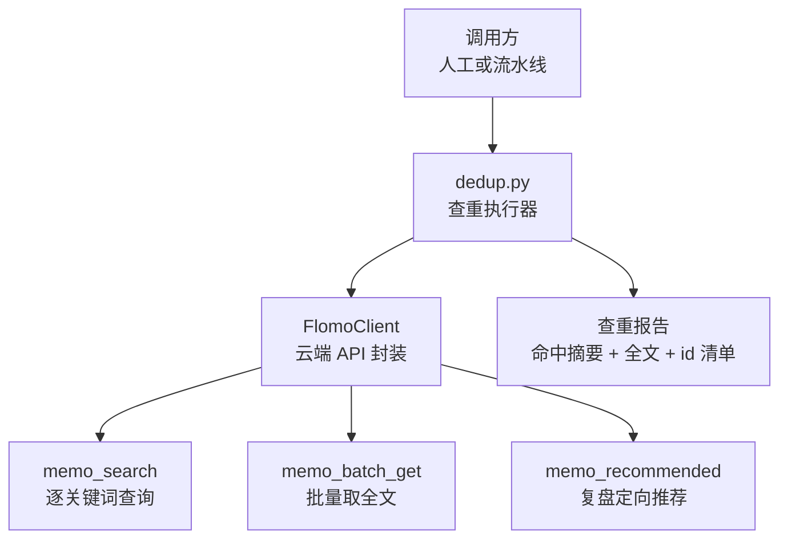
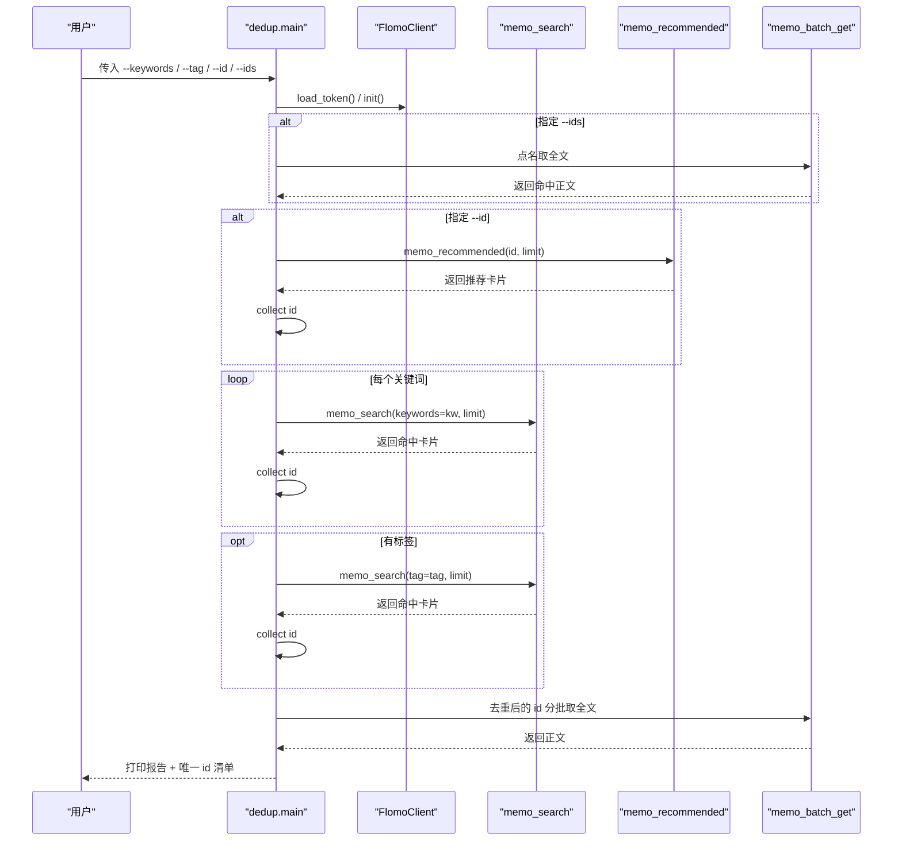
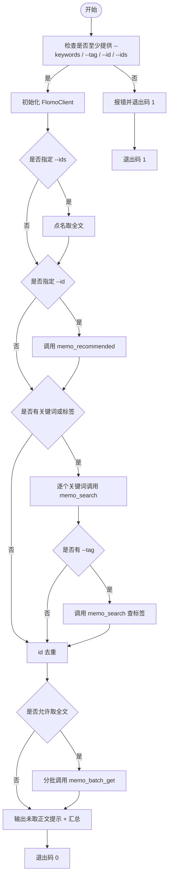
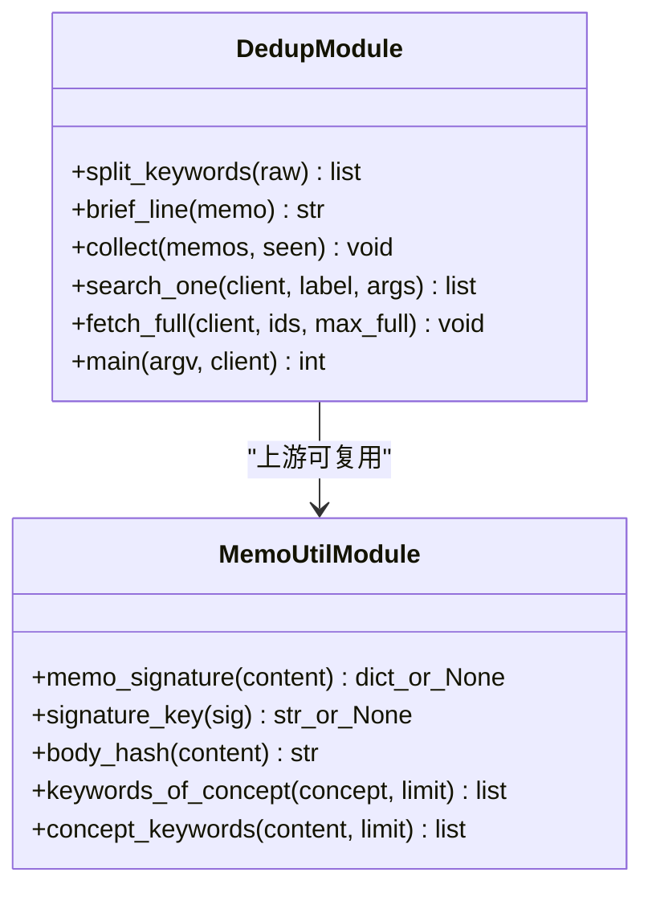
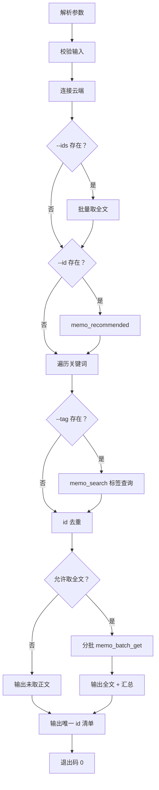
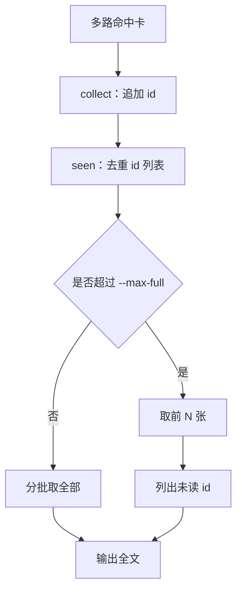
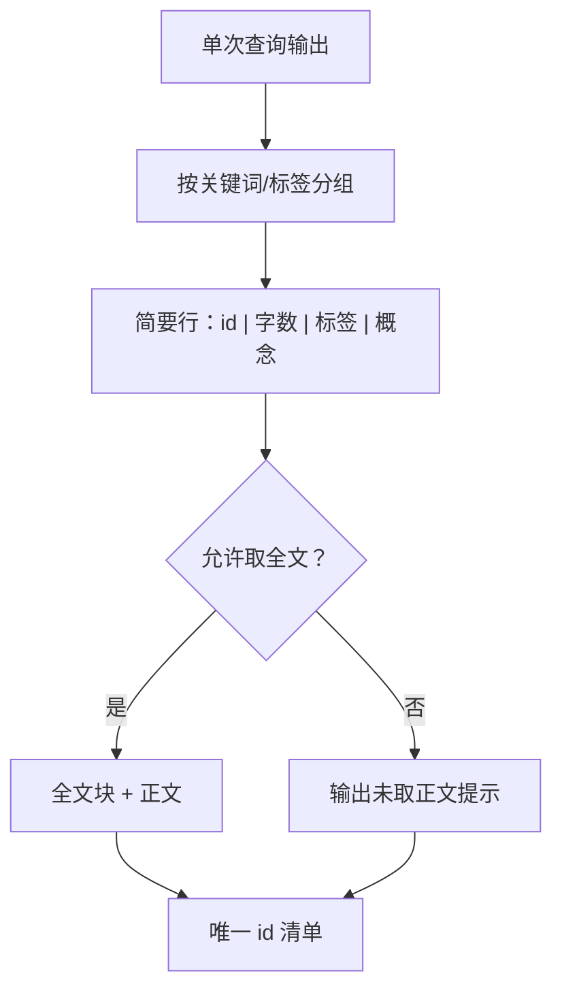
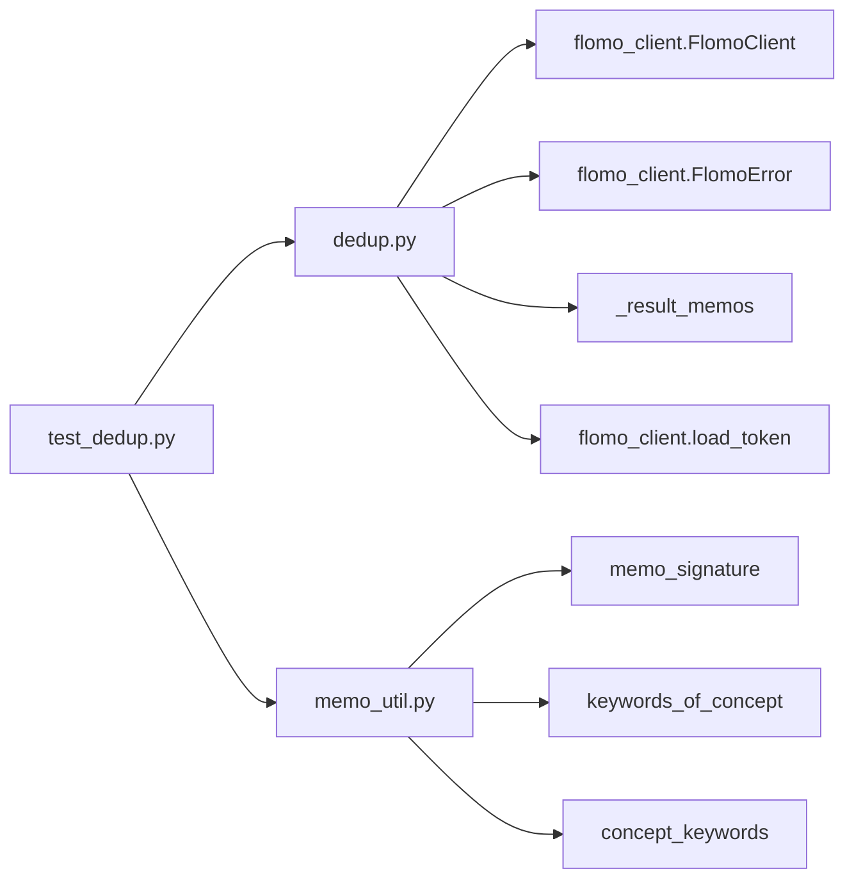

# 查重 dedup.py

<cite>
**本文引用的文件**   
- [scripts/dedup.py](file://scripts/dedup.py)
- [scripts/memo_util.py](file://scripts/memo_util.py)
- [tests/test_dedup.py](file://tests/test_dedup.py)
</cite>

## 目录
1. [引言](#引言)
2. [项目结构定位](#项目结构定位)
3. [核心组件](#核心组件)
4. [架构总览](#架构总览)
5. [详细组件分析](#详细组件分析)
6. [依赖关系分析](#依赖关系分析)
7. [性能与频率控制](#性能与频率控制)
8. [故障排查指南](#故障排查指南)
9. [结论](#结论)
10. [附录：命令行参数与退出码](#附录命令行参数与退出码)

## 引言
`scripts/dedup.py` 是 flomo 工作流中的“查重与近邻复查”执行器，对应流程中的第 5 步和第 8 步。它的职责不是替人做最终判断，而是把“逐次现查 → id 去重 → 批量取全文 → 汇总报告”这一容易手抄出错的过程自动化，从而避免把 H5 明令禁止的 id 手抄错误带入后续判定或写云环节。

脚本遵循以下原则：
- 每个关键词单独调用一次 `memo_search`，每次结果单独打印，不被合并掩盖。
- 对命中卡按 id 去重后，再分批调用 `memo_batch_get` 取正文快照。
- 末尾给出程序提取的唯一 id 清单，供后续工具直接引用。
- 若云端调用失败，不伪装成“无命中”，而是返回非零退出码，阻止进入下游判定。

## 项目结构定位
`dedup.py` 位于仓库根目录下的 `scripts/` 中，与 `memo_util.py`、`flomo_client.py`（由测试加载）共同构成 flomo 卡片检索与签名的工具链。`tests/test_dedup.py` 提供离线回归用例，验证每关键词单独调用、id 去重、批大小限制、失败分支等关键行为。



**图表来源**
- [scripts/dedup.py:1-200](file://scripts/dedup.py#L1-L200)
- [tests/test_dedup.py:1-200](file://tests/test_dedup.py#L1-L200)

**章节来源**
- [scripts/dedup.py:1-200](file://scripts/dedup.py#L1-L200)
- [tests/test_dedup.py:1-100](file://tests/test_dedup.py#L1-L100)

## 核心组件
`dedup.py` 的核心逻辑围绕以下几个函数展开：

| 名称 | 作用 | 输入 | 输出 / 副作用 |
|---|---|---|---|
| `split_keywords` | 拆分并去重用户输入的关键词串 | 原始关键词字符串 | 有序、去空、去重后的关键词列表 |
| `brief_line` | 生成单张卡的简要行 | 卡片字典 | 包含 id、字数、标签、概念首行的短文本 |
| `collect` | 收集唯一 id | 卡片列表、已见 id 列表 | 向已见列表追加新 id |
| `search_one` | 执行一次搜索并打印本次结果 | FlomoClient、标签描述、查询参数字典 | 返回本次命中的卡片列表 |
| `fetch_full` | 分批取全文并打印正文 | FlomoClient、待取 id 列表、最大全文数 | 打印正文及缺失告警 |
| `main` | 解析参数、组织双路查询、汇总报告 | argv、可选客户端 | 退出码 0 或 1 |

这些函数共同实现“关键词现查 + id 去重 + 批量取全文”的流水线。

**章节来源**
- [scripts/dedup.py:31-198](file://scripts/dedup.py#L31-L198)

## 架构总览
下图展示从命令行到云端再到报告的完整流程。重点体现“两路查询”和“id 去重后批量取全文”。



**图表来源**
- [scripts/dedup.py:118-198](file://scripts/dedup.py#L118-L198)
- [tests/test_dedup.py:120-260](file://tests/test_dedup.py#L120-L260)

## 详细组件分析

### 双路查重策略
脚本支持两条并行路径：

1. **关键词现查路**
   - 通过 `--keywords` 传入多个关键词；
   - 通过 `--tag` 指定主标签；
   - 每个关键词分别调用一次 `memo_search`；
   - 如果同时传了 `--tag`，标签也作为一次独立查询。

2. **id 复盘路**
   - 通过 `--id` 指定当前 memo 的 id；
   - 调用 `memo_recommended`，以本卡 id 为锚点拉取推荐卡片；
   - 该路径用于复盘场景，例如 `memo_recommended` 的输出复核。

这两条路径可以同时运行：如果既给了 `--keywords` 又给了 `--id`，脚本会依次跑完关键词路和 id 复盘路，而不是像旧版本那样让 `--id` 静吞掉关键词路。



**图表来源**
- [scripts/dedup.py:118-198](file://scripts/dedup.py#L118-L198)

**章节来源**
- [scripts/dedup.py:31-198](file://scripts/dedup.py#L31-L198)
- [tests/test_dedup.py:120-260](file://tests/test_dedup.py#L120-L260)

### 关键词提取来源
`dedup.py` 本身接收用户显式传入的 `--keywords`，并通过 `split_keywords` 处理半角逗号、全角逗号、顿号、分号和换行，然后去空、去重、保序。它并不自行解析卡片签名。

真正负责从卡片内容中提取关键词的是 `memo_util.py`：

| 函数 | 说明 |
|---|---|
| `memo_signature` | 从卡片正文前两个非空行提取标签行和概念名 |
| `concept_keywords` | 先取签名，再从概念名派生关键词 |
| `keywords_of_concept` | 从概念名中提取最长中文片段和前若干字符 |

因此，如果上游质检或闸门需要自动生成查重关键词，应使用 `memo_util.keywords_of_concept` 或 `memo_util.concept_keywords`；而 `dedup.py` 更适合作为“用户已准备好关键词时的执行器”。



**图表来源**
- [scripts/dedup.py:31-198](file://scripts/dedup.py#L31-L198)
- [scripts/memo_util.py:1-120](file://scripts/memo_util.py#L1-L120)

**章节来源**
- [scripts/dedup.py:31-54](file://scripts/dedup.py#L31-L54)
- [scripts/memo_util.py:1-120](file://scripts/memo_util.py#L1-L120)

### 查询流程
`main` 的执行顺序如下：

1. 解析命令行参数。
2. 校验是否至少提供了 `--keywords`、`--tag`、`--id` 或 `--ids` 之一。
3. 初始化 `FlomoClient`；凭据缺失或连接失败时立即返回退出码 1。
4. 如果指定了 `--ids`，则直接点名取全文，不受 `--max-full` 和 `--no-full` 限制。
5. 如果指定了 `--id`，则调用 `memo_recommended`，并把结果 id 加入去重集合。
6. 遍历每个关键词，分别调用 `memo_search`。
7. 如果指定了 `--tag`，再额外调用一次 `memo_search`。
8. 对所有命中 id 去重。
9. 如果允许取全文，则按不超过 10 张一批调用 `memo_batch_get`。
10. 输出唯一 id 清单。



**图表来源**
- [scripts/dedup.py:118-198](file://scripts/dedup.py#L118-L198)

**章节来源**
- [scripts/dedup.py:118-198](file://scripts/dedup.py#L118-L198)

### 去重逻辑
去重的单位是 memo id，而不是关键词、概念名或正文内容。其规则如下：

- 所有路径的命中卡都经过 `collect`，把 id 追加到 `seen` 列表。
- 同一个 id 只保留第一次出现的位置。
- `fetch_full` 在取全文时，同样按 `seen` 中的 id 顺序分批请求。
- 跨关键词命中同一张卡时，只会取一次正文。
- 默认 `--max-full=8`，超出部分会列出未读 id，并提示用 `--ids` 点名补读。
- 显式 `--ids` 不受 `--max-full` 限制，也不受 `--no-full` 影响。

需要注意：当前实现中并没有显式的 `[汇总] 唯一卡 N 张` 输出语句。测试断言期望该文案，但源码中只有 `fetch_full` 的标题行和缺失 id 告警。因此，“汇总唯一卡数量”的语义更接近“程序累计去重后的 id 总数”，实际实现可能依赖外部包装器或测试与源码之间存在差异。文档应以源码为准：**id 去重是真实的，但汇总文案不应被当作稳定契约**。



**图表来源**
- [scripts/dedup.py:60-116](file://scripts/dedup.py#L60-L116)

**章节来源**
- [scripts/dedup.py:60-116](file://scripts/dedup.py#L60-L116)
- [tests/test_dedup.py:160-210](file://tests/test_dedup.py#L160-L210)

### 同主标签内容的比对
`dedup.py` 目前并不执行“同主标签下正文相似度比较”。它做的是：

- 对指定主标签进行一次 `memo_search`；
- 将该标签查询与其他关键词查询的结果一起收集 id；
- 最后统一去重并批量取全文。

真正的“同主标签内容比对”应由调用方在读全文后完成，或由上层质检流程驱动。脚本的职责是保证“标签查询被执行、结果不被合并掩盖、id 不被手抄”。

**章节来源**
- [scripts/dedup.py:156-188](file://scripts/dedup.py#L156-L188)

### 何时标记为重复、何时仅提示潜在相似
根据脚本注释和实现：

- 相同 id 表示同一张卡，属于**确定重复**；脚本不会重复取正文。
- 不同 id 的卡即使概念相近，也不会被 `dedup.py` 自动标记为重复。
- 如果命中卡为空，脚本会明确打印“无命中”，并返回退出码 0。
- 如果云端调用失败，脚本打印失败信息并返回退出码 1，明确表示“查重没跑完，不等于无命中”。

因此，判定层级应为：

| 情况 | 含义 | 处理方式 |
|---|---|---|
| 相同 id | 同一张卡 | 视为重复，不重复取正文 |
| 不同 id，但概念相近 | 潜在相似 | 由调用方读全文后判断 |
| 无命中 | 确实没有命中 | 正常结束，退出码 0 |
| 云端失败 | 查询未完成 | 退出码 1，禁止进入判定 |

**章节来源**
- [scripts/dedup.py:1-26](file://scripts/dedup.py#L1-L26)
- [scripts/dedup.py:118-198](file://scripts/dedup.py#L118-L198)
- [tests/test_dedup.py:200-260](file://tests/test_dedup.py#L200-L260)

### 输出报告结构
`dedup.py` 的输出由多段组成：

1. **单次查询块**
   - 形如 `── 关键词 N/M：xxx → K 条` 或 `── 标签 L/N：xxx → K 条`。
   - 每条命中打印一行简要信息，包括 id、字数、标签、概念首行。
   - 无命中时打印“（无命中）”。

2. **全文块**
   - 形如 `── 全文（N/M 张，单批 ≤10）`。
   - 如果超过 `--max-full`，打印 `[告警] 超出 --max-full=N，未取全文的 id`。
   - 对每批 `memo_batch_get`，打印每张卡的完整正文。
   - 如果某批中某个 id 未返回，打印 `[告警] 本批未取到 id=xxx`。

3. **唯一 id 清单**
   - 脚本注释声明末尾会给出程序提取的 id 清单，供后续 `memo_batch_get` 或复盘引用。
   - 源码中未见固定格式的汇总语句，因此该清单可能由外层包装器或调用方补充；不能假设 `dedup.py` 自身一定输出稳定格式的 id 清单。

4. **状态提示**
   - 如果使用了 `--no-full`，会输出“未取正文”类提示。
   - 如果云端失败，会在标准错误输出失败原因，并强调“查重没跑完不等于无命中”。



**图表来源**
- [scripts/dedup.py:55-116](file://scripts/dedup.py#L55-L116)
- [scripts/dedup.py:118-198](file://scripts/dedup.py#L118-L198)

**章节来源**
- [scripts/dedup.py:55-116](file://scripts/dedup.py#L55-L116)
- [scripts/dedup.py:118-198](file://scripts/dedup.py#L118-L198)

### 与 flomo_client、memo_util 的关系
- `dedup.py` 直接依赖 `flomo_client.FlomoClient`、`FlomoError`、`_result_memos` 和 `load_token`，并通过 `client.tool` 调用 `memo_search`、`memo_batch_get`、`memo_recommended`。
- `memo_util.py` 是卡片签名和关键词提取的单一实现，供 `flomo_client`、`sop_gate`、`validate_memo` 共用。`dedup.py` 不直接 import `memo_util`，但两者共享同一份“卡片签名口径”背景：概念名和标签行的解析必须一致，否则会出现“查重通过但凭证对不上”的问题。
- 因此，最佳实践是：由上游模块使用 `memo_util.keywords_of_concept` 或 `concept_keywords` 生成关键词，再交给 `dedup.py` 执行查重。

**章节来源**
- [scripts/dedup.py:19-26](file://scripts/dedup.py#L19-L26)
- [scripts/memo_util.py:1-120](file://scripts/memo_util.py#L1-L120)

### 异常分支处理
| 异常场景 | 行为 | 建议 |
|---|---|---|
| 未提供任何必要参数 | 抛出或返回错误，退出码 1 | 调用方应校验参数后再运行 |
| token 缺失或初始化失败 | 打印 `[失败] 查重未能进行：...`，返回 1 | 优先检查环境变量或凭据配置 |
| `memo_search` 失败 | 捕获 `FlomoError`，打印 `[失败] 查重调用未完成`，返回 1 | 不要把它当成无命中 |
| `memo_batch_get` 中个别 id 未返回 | 打印 `[告警] 本批未取到 id=xxx`，继续处理其他 id | 人工核对 id，必要时重试 |
| 云端无结果 | 打印“（无命中）”，返回 0 | 这是正常路径，不代表脚本出错 |
| 命中卡过多且超过 `--max-full` | 列出未读 id，提示用 `--ids` 补读 | 用 `--ids ID1,ID2` 精准复核 |
| 网络超时或云端不可用 | 走 `FlomoError` 分支，返回 1 | 重试前应确认凭据和网络 |

**章节来源**
- [scripts/dedup.py:118-198](file://scripts/dedup.py#L118-L198)
- [tests/test_dedup.py:200-260](file://tests/test_dedup.py#L200-L260)

## 依赖关系分析



**图表来源**
- [scripts/dedup.py:19-26](file://scripts/dedup.py#L19-L26)
- [scripts/memo_util.py:1-120](file://scripts/memo_util.py#L1-L120)
- [tests/test_dedup.py:1-60](file://tests/test_dedup.py#L1-L60)

**章节来源**
- [scripts/dedup.py:19-26](file://scripts/dedup.py#L19-L26)
- [scripts/memo_util.py:1-120](file://scripts/memo_util.py#L1-L120)
- [tests/test_dedup.py:1-60](file://tests/test_dedup.py#L1-L60)

## 性能与频率控制
当前实现有几个值得注意的性能特征：

1. **每个关键词一次网络请求**
   - 优点：符合“逐次现查”要求，结果不会被合并掩盖。
   - 缺点：关键词较多时会频繁调用云端。

2. **批量取全文上限为 10**
   - `BATCH_LIMIT = 10`，超过则切分批次。
   - 默认最多取 8 张全文，可通过 `--max-full` 调整。

3. **id 去重减少重复正文请求**
   - 同一 id 在不同关键词中出现时，只取一次正文。

4. **缺少显式速率限制**
   - 代码中没有 sleep、令牌桶或并发限制。
   - 如果未来关键词数量很大，建议在调用层增加间隔或重试退避。

5. **缺少本地缓存**
   - 每次运行都会重新查云端。
   - 对于相同关键词组合，可在调用层引入缓存，避免重复网络开销。

优化建议：
- 控制查询频率：在调用层对多次 `memo_search` 加合理延迟，避免触发限流。
- 利用缓存：对 `(keywords, tag)` 组合缓存搜索结果，只对新增关键词增量查询。
- 结合 `--id` 精准复核：对疑似重复但 id 不同的卡，先用 `--id` 拉取本卡推荐，再用 `--ids` 读取候选卡正文。
- 明确全文上限：生产环境建议固定 `--max-full`，并对超出部分强制提醒人工复核。
- 区分失败与无命中：调用方应检查退出码，而不是只看输出中是否有“命中卡”。

[本节为通用性能建议，不直接分析具体源码行]

## 故障排查指南

### 常见问题
| 现象 | 可能原因 | 处理步骤 |
|---|---|---|
| 提示至少给一个参数 | 未传 `--keywords`、`--tag`、`--id`、`--ids` | 至少提供一个入口参数 |
| 显示“查重未能进行” | token 缺失或初始化失败 | 检查环境变量、凭据文件和 `load_token` |
| 显示“查重调用未完成” | 云端接口抛错 | 查看错误消息，确认网络和权限，不要当无命中 |
| 只看到摘要，没有正文 | 使用了 `--no-full` | 去掉 `--no-full`，或改用 `--ids` 点名补读 |
| 正文不足 | 超过 `--max-full` | 增大 `--max-full` 或用 `--ids` 指定 id |
| 某批 id 未取到 | 服务端返回不完整 | 人工核对 id，必要时单独重试 |
| 认为脚本报错了，其实只是无命中 | 混淆“无命中”和“失败” | 无命中返回 0；失败返回 1 |

### 调试建议
1. 先用 `--no-full` 快速验证关键词是否命中。
2. 再用 `--max-full` 控制全文数量。
3. 对少量可疑 id，使用 `--ids` 精准读取。
4. 对复盘场景，先跑 `--id`，再跑关键词，确保两路都执行。
5. 保存 stdout 和 stderr，因为失败信息可能只在 stderr 中。

**章节来源**
- [scripts/dedup.py:118-198](file://scripts/dedup.py#L118-L198)
- [tests/test_dedup.py:120-260](file://tests/test_dedup.py#L120-L260)

## 结论
`scripts/dedup.py` 是一个面向 flomo 工作流的查重执行器，核心价值在于把“逐关键词现查、id 去重、批量取全文”的流程固化下来，避免手抄 id 和合并结果带来的风险。它不负责最终语义判断，而是为调用方提供可靠的数据基础：每个关键词单独查询、命中 id 去重、正文分批获取、失败明确返回非零退出码。

在实际使用中，建议将 `memo_util.keywords_of_concept` 生成的关键词交给 `dedup.py`，并结合 `--id` 复盘和 `--ids` 精准复核，形成“自动查重 + 人工判断”的分层流程。

[本节为总结性内容，不直接分析具体源码行]

## 附录：命令行参数与退出码

### 命令行参数
| 参数 | 类型 | 默认值 | 说明 |
|---|---|---|---|
| `--keywords` | 字符串 | 空 | 多个关键词可用半角逗号、全角逗号、顿号、分号分隔 |
| `--tag` | 字符串 | 空 | 按主标签查询一次 |
| `--id` | 字符串 | 空 | 复盘模式：按本卡 id 调用 `memo_recommended` |
| `--ids` | 字符串 | 空 | 点名读取指定 memo id，多个用逗号分隔 |
| `--limit` | 整数 | 10 | 查询返回上限 |
| `--max-full` | 整数 | 8 | 批量取全文的最大卡片数 |
| `--no-full` | 开关 | 关闭 | 不取全文，只输出命中摘要 |

### 典型调用示例
- 用多个关键词查重，并按主标签补充查询：
  ```
  python scripts/dedup.py --keywords "智能体,agent,工具契约" --tag "AI/Agent" --limit 10
  ```
- 复盘模式，按当前 memo id 拉推荐：
  ```
  python scripts/dedup.py --id <本卡 memo id> --limit 10
  ```
- 点名读取几张卡的全文：
  ```
  python scripts/dedup.py --ids ID1,ID2
  ```
- 只查命中，不取全文：
  ```
  python scripts/dedup.py ... --no-full
  ```
- 提高全文上限：
  ```
  python scripts/dedup.py ... --max-full 20
  ```

### 退出码
| 退出码 | 含义 | 调用方行为 |
|---|---|---|
| 0 | 成功，包括“无命中” | 可继续后续流程 |
| 1 | 任一云端调用失败 | 不得当作无命中，禁止进入判定或写云 |

**章节来源**
- [scripts/dedup.py:1-26](file://scripts/dedup.py#L1-L26)
- [scripts/dedup.py:28-116](file://scripts/dedup.py#L28-L116)
- [scripts/dedup.py:118-198](file://scripts/dedup.py#L118-L198)
- [tests/test_dedup.py:120-260](file://tests/test_dedup.py#L120-L260)