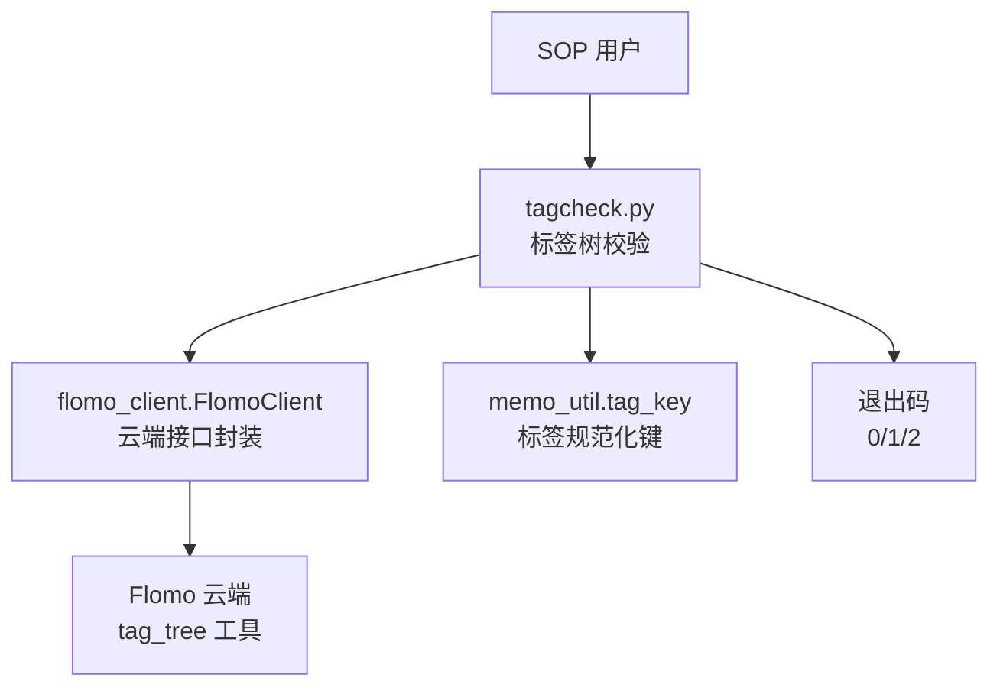
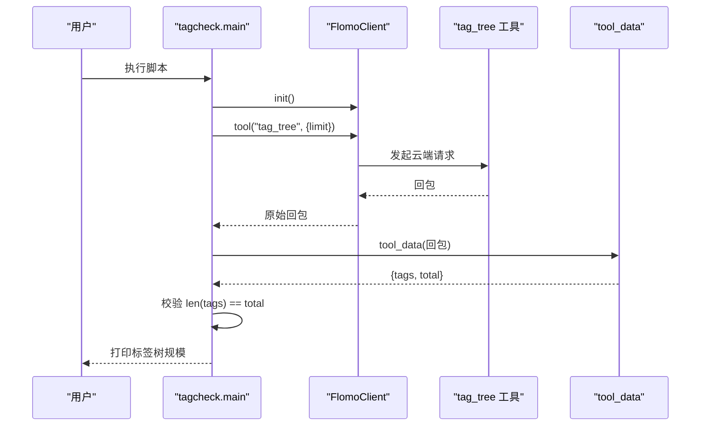
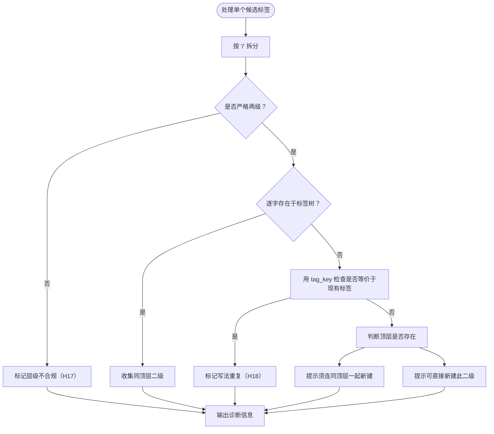
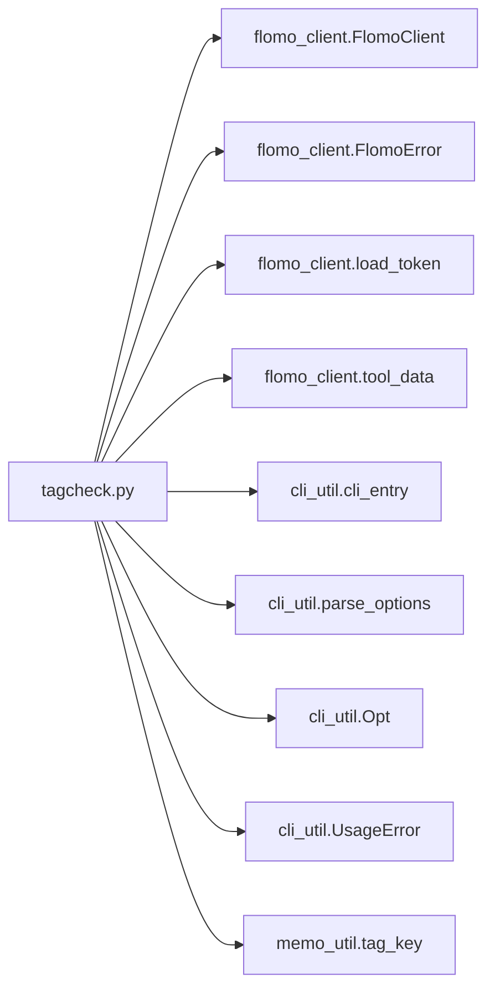
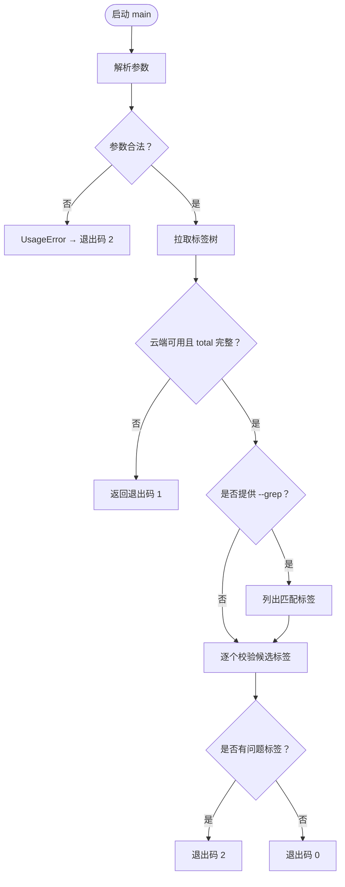

# 标签树校验 tagcheck.py

<cite>
**本文引用的文件**   
- [scripts/tagcheck.py](file://scripts/tagcheck.py)
- [tests/test_tagcheck.py](file://tests/test_tagcheck.py)
- [scripts/flomo_client.py](file://scripts/flomo_client.py)
- [scripts/memo_util.py](file://scripts/memo_util.py)
</cite>

## 目录
1. [简介](#简介)
2. [项目结构与定位](#项目结构与定位)
3. [命令行参数与退出码](#命令行参数与退出码)
4. [标签树拉取与解析](#标签树拉取与解析)
5. [三类校验规则](#三类校验规则)
6. [诊断输出与凭证字段](#诊断输出与凭证字段)
7. [典型调用示例](#典型调用示例)
8. [依赖关系分析](#依赖关系分析)
9. [异常与边界行为](#异常与边界行为)
10. [调试建议](#调试建议)
11. [结论](#结论)

## 简介
`scripts/tagcheck.py` 是 SOP 中“定标签”流程的第 4 步工具，用于在创建或复用标签前，对候选标签进行现采核对。它的核心目标是防止 H17（非严格两级）和 H18（近义簇分裂）问题：通过云端拉取最新 `tag_tree`，判断候选标签是否已存在、是否严格两级、同一顶层下已有哪些二级，以及是否与现有标签只差空白、全半角斜杠或大小写。

该脚本只读不写：不会创建标签、也不会修改现有标签；所有决策都基于从云端获取的当前标签树。

## 项目结构与定位
- 入口脚本位于 `scripts/tagcheck.py`，由 `cli_entry` 包装，最终通过 `sys.exit` 返回统一退出码。
- 测试位于 `tests/test_tagcheck.py`，提供离线夹具 `FakeClient`，覆盖存在性、层级、截断、正则匹配、写法重复、参数错误等场景。
- 与外部系统交互通过 `flomo_client.FlomoClient` 完成，认证通过 `load_token` 从 `.mcp.json` 或环境变量读取。
- 标签规范化键通过 `memo_util.tag_key` 实现，确保与 SOP 写前闸门使用同一判据。



**图表来源**
- [scripts/tagcheck.py:1-201](file://scripts/tagcheck.py#L1-L201)
- [scripts/flomo_client.py:74-160](file://scripts/flomo_client.py#L74-L160)
- [scripts/memo_util.py:295-315](file://scripts/memo_util.py#L295-L315)

**章节来源**
- [scripts/tagcheck.py:1-201](file://scripts/tagcheck.py#L1-L201)
- [tests/test_tagcheck.py:1-248](file://tests/test_tagcheck.py#L1-L248)

## 命令行参数与退出码

### 参数表

| 参数 | 类型 | 默认值 | 说明 |
|---|---|---:|---|
| `--tags` | 字符串 | 空字符串 | 用逗号分隔多个候选标签；支持中文逗号、顿号，会自动去除开头的 `#` |
| `--grep` | 正则表达式 | 无 | 仅列出匹配的现有标签，不做存在性判定；空字符串会被拒绝 |
| `--limit` | 整数 | `2000` | 请求标签树时的最大条数，必须为正整数 |

### 行为要点
- `--tags` 与 `--grep` 至少提供一个；若两者都未提供，会抛出用法错误。
- `--grep` 为空字符串时，因为空正则理论上会命中全部标签，所以被明确拒绝。
- 重复给出 `--tags` 时，后一个覆盖前一个，但会通过 `cli_entry` 渲染为“只能给一次”的一行提示。
- `--limit` 为非正整数或非整数时，同样走 `cli_entry` 的错误路径，不会打印完整 traceback。

### 退出码

| 退出码 | 含义 | 何时使用 |
|---:|---|---|
| `0` | 全部候选标签存在且严格两级，无写法重复 | 可直接写入首行标签段 |
| `1` | 标签树被截断或调用失败，结论不可信 | 云端数据不完整、网络或认证失败 |
| `2` | 有标签缺失、层级不合规、写法重复，或命令行参数错误 | 需要按诊断信息调整后再运行 |

**章节来源**
- [scripts/tagcheck.py:38-47](file://scripts/tagcheck.py#L38-L47)
- [scripts/tagcheck.py:117-165](file://scripts/tagcheck.py#L117-L165)
- [tests/test_tagcheck.py:201-248](file://tests/test_tagcheck.py#L201-L248)

## 标签树拉取与解析

### 拉取流程
1. 若无传入客户端，则调用 `load_token()` 读取认证凭据，构造 `FlomoClient` 并初始化。
2. 调用 `client.tool("tag_tree", {"limit": limit})` 获取云端回包。
3. 通过 `tool_data(...)` 提取结构化数据，要求包含 `tags` 和 `total`。
4. 若缺少 `total`，视为协议变更导致无法判断是否截断，直接抛错。
5. 若 `len(tags)` 不等于 `total`，认为标签树被截断，抛错并提示调大 `--limit`。
6. 成功时返回 `(tags, total)`，并在终端打印 `[标签树] N 个（limit=...，条数与 total 相符）`。

### 回包形态兼容
`tool_data` 同时支持两种结构：
- 标准结构：`structuredContent.tags` 与 `structuredContent.total`
- 宽松结构：`content[].text` 中的 JSON 文本

当云端只返回宽松结构时，`tagcheck.py` 不再报“缺 total 字段”，而是正常解析并继续校验。



**图表来源**
- [scripts/tagcheck.py:117-152](file://scripts/tagcheck.py#L117-L152)
- [scripts/flomo_client.py:270-290](file://scripts/flomo_client.py#L270-L290)

**章节来源**
- [scripts/tagcheck.py:49-93](file://scripts/tagcheck.py#L49-L93)
- [scripts/tagcheck.py:117-152](file://scripts/tagcheck.py#L117-L152)
- [scripts/flomo_client.py:270-290](file://scripts/flomo_client.py#L270-L290)

## 三类校验规则

### 一、存在性校验
对每个候选标签，先在 `tags` 集合中做逐字匹配。若存在，则标记为已存在；否则进入父级与兄弟二级提示逻辑。

注意：存在性必须逐字比较，不能套用 `tag_key` 归一化键，否则会把不同写法误判为“已存在”。

### 二、严格两级校验（H17）
候选标签必须满足：
- 恰好包含一个 `/`
- 分为顶层和二级两部分
- 两部分去除空白后均不为空

三级及以上、单层、空层都不合规。

### 三、兄弟二级校验
对候选标签所属的顶层，扫描标签树中同顶层且仍为两级的标签，排除候选自身，得到“同顶层二级列表”。  
该列表用于帮助判断：
- 如果候选不存在，但该顶层已有其他二级，通常应复用该顶层，而不是新建同名顶层。
- 如果该顶层没有任何二级，则可能需要连同顶层一起新建。

### 四、写法重复校验（H18）
这是防止近义簇分裂的关键规则。若候选标签与某个现有标签经 `tag_key` 归一后相同，则认为它们指向同一个簇，只是写法不同：
- 空白差异，例如 `AI / Agent`
- 全角斜杠差异，例如 `AI／Agent`
- 大小写差异，例如 `ai/agent`

此时不继续判断层级或是否存在，而是直接指出应与哪个现有标签保持一致，避免“照原样写入即分裂”。



**图表来源**
- [scripts/tagcheck.py:95-116](file://scripts/tagcheck.py#L95-L116)
- [scripts/tagcheck.py:167-200](file://scripts/tagcheck.py#L167-L200)
- [scripts/memo_util.py:295-315](file://scripts/memo_util.py#L295-L315)

**章节来源**
- [scripts/tagcheck.py:95-116](file://scripts/tagcheck.py#L95-L116)
- [scripts/tagcheck.py:167-200](file://scripts/tagcheck.py#L167-L200)
- [scripts/memo_util.py:295-315](file://scripts/memo_util.py#L295-L315)

## 诊断输出与凭证字段

### 终端输出格式
- 标签树规模：`[标签树] N 个（limit=...，条数与 total 相符）`
- 正则匹配清单：`[匹配] 正则「...」命中 N 个`，最多列出固定数量的匹配项
- 单个标签结果：
  - 写法重复：以 `✗` 开头，指出与哪个现有标签只差空白/全半角/大小写
  - 层级不合规：以 `✗` 开头，提示须严格两级（H17）
  - 已存在：以 `✓` 开头，并显示同顶层二级数量
  - 不存在：以 `✗` 开头，提示该顶层是否存在
- 兄弟二级列表：缩进一行，最多显示固定数量的二级，其余以省略形式提示

### 内部诊断结构
`inspect_tag` 返回的诊断字典包含以下字段：

| 字段 | 类型 | 含义 |
|---|---|---|
| `tag` | 字符串 | 原始候选标签 |
| `depth_ok` | 布尔值 | 是否满足严格两级 |
| `exists` | 布尔值 | 是否在标签树中逐字存在 |
| `top` | 字符串 | 顶层名称 |
| `top_exists` | 布尔值 | 是否可认为顶层存在 |
| `siblings` | 字符串列表 | 同顶层且仍为两级的其他标签 |
| `dup_of` | 字符串 | 若写法重复，则指出现有标签；否则为空 |

### 关键设计约束
- 兄弟二级只显示叶子形态的两级标签，不会把顶层本身当作二级列出。
- 顶层存在性采用键比而非纯逐字比：若顶层大小写不同，只要归一键匹配，就认为顶层存在，避免把已有顶层误判为“须连同顶层一起新建”。
- 兄弟二级列表默认最多展示固定数量，超出部分用省略提示，避免一次性刷屏。

**章节来源**
- [scripts/tagcheck.py:95-116](file://scripts/tagcheck.py#L95-L116)
- [scripts/tagcheck.py:167-200](file://scripts/tagcheck.py#L167-L200)

## 典型调用示例

### 示例一：先拉取最新标签树，再校验两个候选标签
```bash
python scripts/tagcheck.py --tags "AI/Agent,科技/测试"
```
预期行为：
- 从云端拉取 `tag_tree`
- 打印标签树总条数
- 判断 `AI/Agent` 和 `科技/测试` 是否存在
- 若存在，输出同顶层二级数量
- 全部合格时退出码为 `0`

### 示例二：带 `#` 前缀和全角逗号
```bash
python scripts/tagcheck.py --tags "#AI/Agent，科技/测试"
```
脚本会：
- 去掉 `#`
- 将中文逗号、顿号统一为英文逗号
- 去重并去空白

### 示例三：先搜索现有标签
```bash
python scripts/tagcheck.py --grep "多语言|本地化"
```
预期行为：
- 列出最多固定数量的匹配标签
- 若没有命中，提示不要根据“搜不到”就新建近义簇
- 退出码为 `0`，因为“只搜索”本身不是失败

### 示例四：结合搜索与候选标签
```bash
python scripts/tagcheck.py --grep "AI" --tags "AI/不存在"
```
预期行为：
- 先输出 `[匹配] ...` 段落
- 再输出 `AI/不存在` 的存在性诊断
- 退出码仍按候选标签判定，可能为 `2`

### 示例五：配合 `--limit` 应对大规模标签树
```bash
python scripts/tagcheck.py --tags "#AI/Agent" --limit 2000
```
若返回“标签树被截断”，应按提示增大 `--limit` 重新拉取。

**章节来源**
- [scripts/tagcheck.py:11-17](file://scripts/tagcheck.py#L11-L17)
- [scripts/tagcheck.py:38-47](file://scripts/tagcheck.py#L38-L47)
- [tests/test_tagcheck.py:108-155](file://tests/test_tagcheck.py#L108-L155)

## 依赖关系分析

### 模块依赖图


**图表来源**
- [scripts/tagcheck.py:33-36](file://scripts/tagcheck.py#L33-L36)
- [scripts/tagcheck.py:201](file://scripts/tagcheck.py#L201)

### 与 `flomo_client` 的关系
- `FlomoClient` 负责 HTTP/SSE 请求、会话管理、代理转发和 SSE 响应解析。
- `load_token` 优先读取项目 `.mcp.json` 中的 Bearer token，其次读取 `FLOMO_TOKEN` 环境变量；都取不到时抛出 `FlomoError`。
- `tool_data` 是标签树解析的统一出口：能解析结构化数据则返回，否则抛出 `FlomoError`，强调“读不到不等于 0 条”。
- 云端连接失败时，底层可能抛出 `CloudUnreachable`，属于 `FlomoError` 子类，表示出网通道不可用。

### 与 `memo_util` 的关系
- `tag_key` 是 H18 的核心判据：折叠空白与全角空格、把全角斜杠替换为半角斜杠、统一小写。
- 文档明确指出：`tag_key` 只用于识别“同一簇被写成两种”，不应用于存在性判断。
- `tagcheck.py` 与 SOP 写前闸门共用同一函数，避免一处拦截、另一处放行。

**章节来源**
- [scripts/tagcheck.py:33-36](file://scripts/tagcheck.py#L33-L36)
- [scripts/flomo_client.py:74-160](file://scripts/flomo_client.py#L74-L160)
- [scripts/flomo_client.py:270-290](file://scripts/flomo_client.py#L270-L290)
- [scripts/memo_util.py:295-315](file://scripts/memo_util.py#L295-L315)

## 异常与边界行为

### 云端不可用
当认证凭据缺失、网络通道不可达、HTTP 错误或 SSE 解析失败时：
- `load_token` 抛出 `FlomoError`
- `FlomoClient._post` 可能抛出 `FlomoError` 或 `CloudUnreachable`
- `main` 捕获 `FlomoError` 与 `RuntimeError`，向标准错误输出 `[失败] 标签树未取到：...`，并返回退出码 `1`

这意味着“云端不可用”属于“结论不可信”，不应被解释为“标签树为空”。

### 标签格式异常
- 三层及以上：判定为层级不合规（H17），退出码 `2`
- 单层或空层：同上
- 全角斜杠：先走写法重复检测；若与现有标签等价，报 H18 写法重复，而不是一味报层级不合规

### 父级缺失
标签树通常只返回叶子形态 `顶层/二级`，顶层本身不会单独成条。因此：
- 若候选二级不存在，但该顶层下有其他二级，仍认为顶层存在，建议直接新建此二级
- 若该顶层下没有任何二级，才提示“须连同顶层一起新建”
- 顶层存在性使用 `tag_key` 归一键比较，避免大小写差异导致误判

### 标签树截断
若返回的 `tags` 数量小于 `total`：
- 抛出 `RuntimeError`，消息中包含返回数量和 `total`
- 终端输出 `[失败] 标签树未取到：...`，退出码为 `1`
- 测试明确要求：宽容只接受回包形态变化，不接受“数据不全”

### 参数错误
- 未提供 `--tags` 或 `--grep`
- `--grep` 为空字符串
- `--limit` 非正整数
- 重复 `--tags`
- 未知选项或缺少参数值

这些情况均由 `cli_entry` 渲染为一行提示，并以退出码 `2` 结束，不暴露完整 traceback。



**图表来源**
- [scripts/tagcheck.py:117-200](file://scripts/tagcheck.py#L117-L200)
- [tests/test_tagcheck.py:156-248](file://tests/test_tagcheck.py#L156-L248)

**章节来源**
- [scripts/tagcheck.py:49-93](file://scripts/tagcheck.py#L49-L93)
- [scripts/tagcheck.py:117-200](file://scripts/tagcheck.py#L117-L200)
- [tests/test_tagcheck.py:108-248](file://tests/test_tagcheck.py#L108-L248)

## 调试建议

### 对比本地期望标签与云端实际树
1. 先用 `--grep` 搜索可能存在的候选词，确认云端是否已有近似标签。
   ```bash
   python scripts/tagcheck.py --grep "候选关键词"
   ```
2. 若搜索结果较多，缩小正则范围，避免一次列出过多结果。
3. 再用 `--tags` 精确校验目标标签：
   ```bash
   python scripts/tagcheck.py --tags "期望/标签"
   ```
4. 若提示“该顶层存在，可直接新建此二级”，说明顶层已在云端，只需确认二级名是否唯一。
5. 若提示“该顶层也不存在，须连同顶层一起新建”，应先确认是否确实需要新顶层，而不是复制已有顶层的大小写变体。

### 修复不规范标签
- 层级不合规：改为严格两级，例如从 `A/B/C` 拆分为合适的顶层与二级组合。
- 写法重复：按照诊断信息中的“与现有『...』只差空白/全半角/大小写”修改为树中已有写法。
- 全角斜杠：把全角斜杠改为半角斜杠，并与现有标签保持统一大小写和空白风格。
- 顶层大小写不一致：保持与现有顶层一致，不要凭直觉新建同名但大小写不同的顶层。

### 区分三类问题
| 现象 | 可能原因 | 处理方式 |
|---|---|---|
| 退出码 `1` | 云端不可用或标签树截断 | 检查网络、代理、token、`--limit` |
| 退出码 `2` + “层级不合规” | 不是严格两级 | 调整为两层 |
| 退出码 `2` + “写法重复” | 与现有标签等价但写法不同 | 改为现有标签写法 |
| 退出码 `2` + “不存在” | 候选标签不在标签树中 | 根据顶层存在性决定复用或新建 |
| 退出码 `0` | 全部符合规范 | 可直接写入 SOP 首行标签段 |

### 与 SOP 闸门的关系
- `tagcheck.py` 是“定标签前”的辅助校验，面向人类阅读的诊断更友好。
- `memo_util.tag_key` 是 SOP 写前闸门的同一判据，保证自动化侧不会放行已被人工视为“写法重复”的标签。
- 两者都应优先使用云端真实树，而不是本地缓存或记忆中的旧标签。

**章节来源**
- [scripts/tagcheck.py:11-17](file://scripts/tagcheck.py#L11-L17)
- [scripts/tagcheck.py:95-116](file://scripts/tagcheck.py#L95-L116)
- [scripts/tagcheck.py:167-200](file://scripts/tagcheck.py#L167-L200)
- [scripts/memo_util.py:295-315](file://scripts/memo_util.py#L295-L315)
- [tests/test_tagcheck.py:108-248](file://tests/test_tagcheck.py#L108-L248)

## 结论
`scripts/tagcheck.py` 把 SOP 中原本靠人工查看 `tag_tree` 的步骤标准化为可重复、可退出的命令行校验。它通过云端现采标签树，依次执行存在性校验、严格两级校验、兄弟二级校验和写法重复校验，并用清晰的诊断信息引导用户选择复用或新建标签。

其核心价值在于：
- 防止 H17：强制严格两级标签结构
- 防止 H18：通过 `memo_util.tag_key` 识别并拦截近义簇分裂
- 降低人工成本：兄弟二级列表帮助判断是否需要新建
- 提高可靠性：截断、云端不可用、参数错误都有明确退出码和提示信息

在实际使用中，推荐先通过 `--grep` 确认云端现状，再用 `--tags` 精确校验；若遇到截断或云端不可用，优先修复网络和凭据，而不是跳过校验。