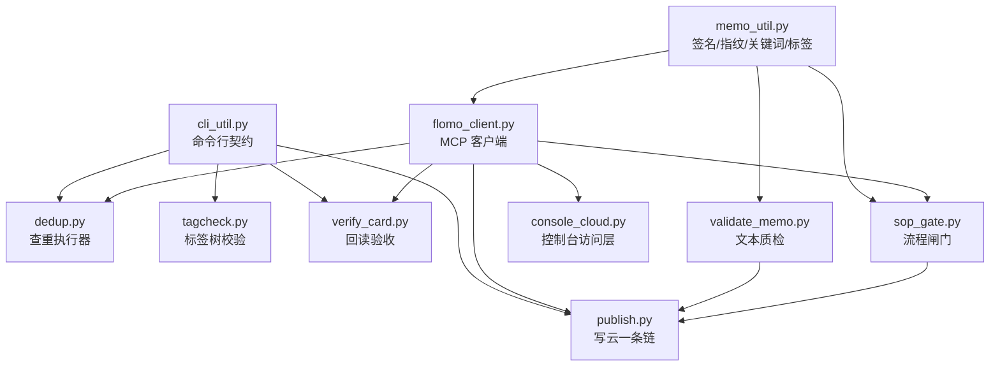
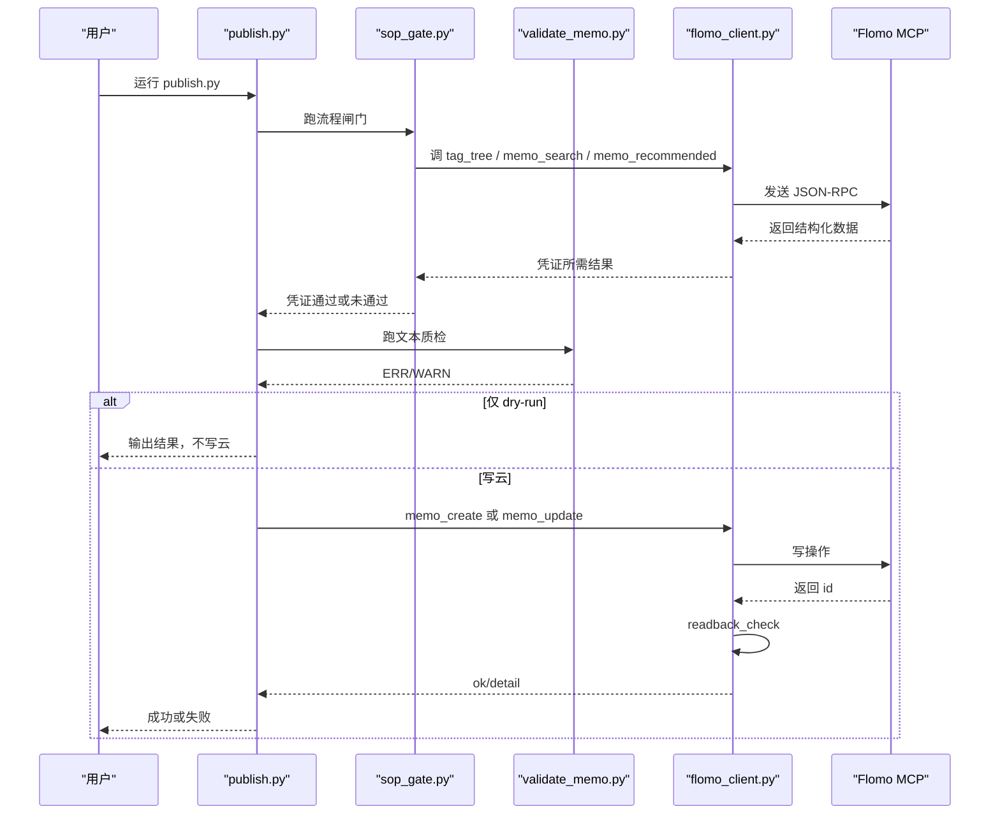
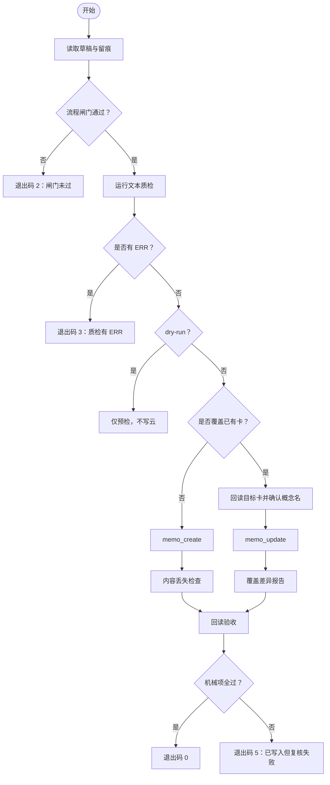
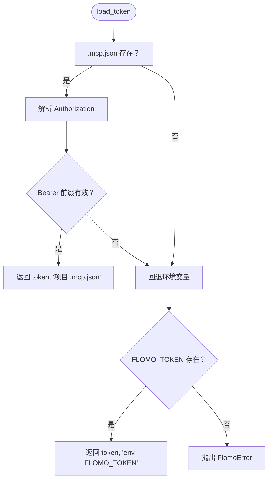
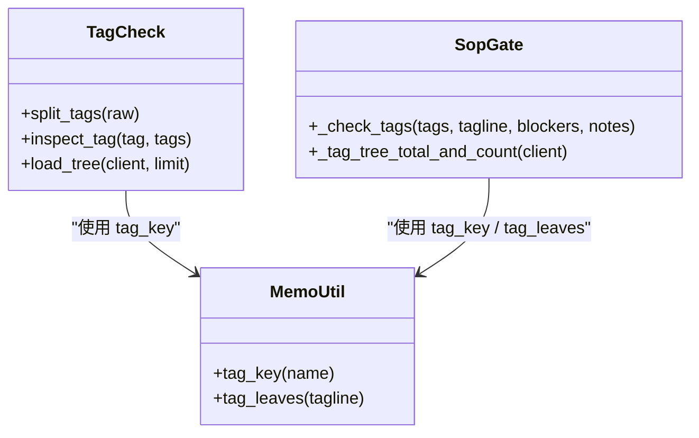
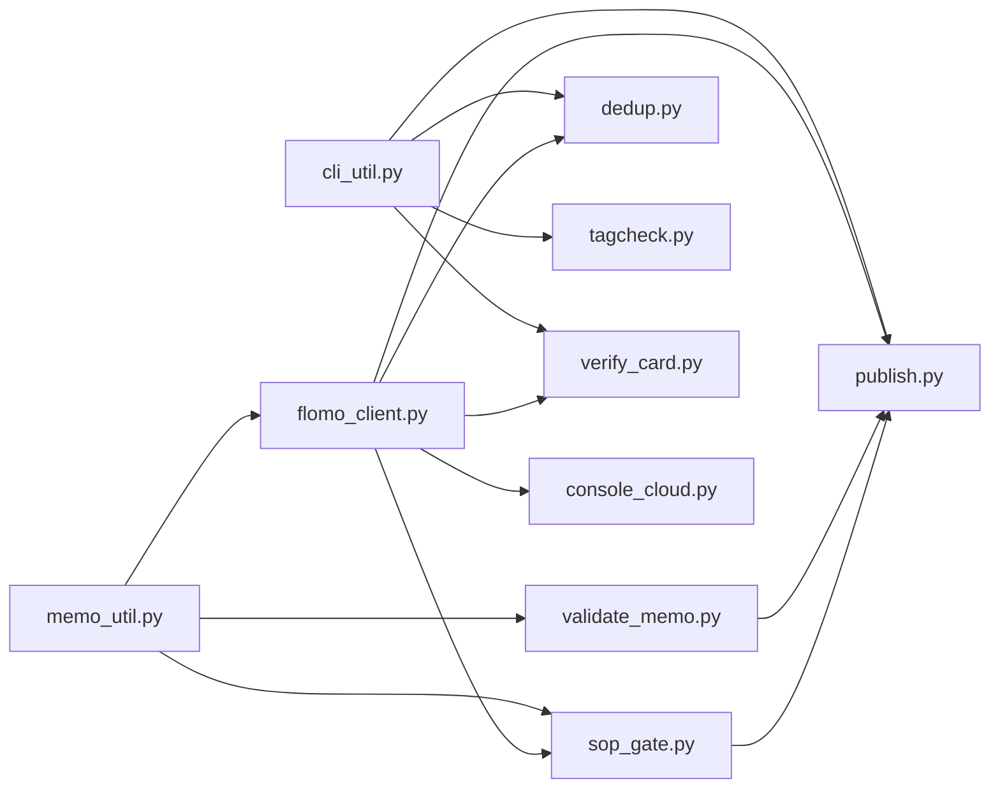

# 核心模块详解

<cite>
**本文引用的文件**   
- [cli_util.py](file://scripts/cli_util.py)
- [memo_util.py](file://scripts/memo_util.py)
- [flomo_client.py](file://scripts/flomo_client.py)
- [console_cloud.py](file://scripts/console_cloud.py)
- [sop_gate.py](file://scripts/sop_gate.py)
- [publish.py](file://scripts/publish.py)
- [validate_memo.py](file://scripts/validate_memo.py)
- [dedup.py](file://scripts/dedup.py)
- [tagcheck.py](file://scripts/tagcheck.py)
- [verify_card.py](file://scripts/verify_card.py)
</cite>

## 目录

1. [引言](#引言)
2. [项目结构](#项目结构)
3. [核心组件](#核心组件)
4. [架构总览](#架构总览)
5. [详细组件分析](#详细组件分析)
6. [依赖关系分析](#依赖关系分析)
7. [性能与可靠性特征](#性能与可靠性特征)
8. [故障排查指南](#故障排查指南)
9. [结论](#结论)

## 引言

本仓库围绕 Flomo MCP 工作流，把“查标签、查重、写云、验收”拆成一组可组合的脚本。核心目标是：**把原本靠人记性的步骤变成可重复、可审计、可回滚的流水线**。

这些模块按职责分层：

| 层级 | 模块 | 一句话职责 |
|---|---|---|
| 命令行契约叶子层 | `cli_util.py` | 选项声明、解析、类型转换、统一退出码出口 |
| 卡片语义工具层 | `memo_util.py` | 签名、指纹、关键词、标签拆分、截断标记、切片限定等唯一实现 |
| MCP 通道层 | `flomo_client.py` | token 读取、握手、SSE 解析、工具调用、写后回读 |
| 控制台访问层 | `console_cloud.py` | 云端只读能力封装、白名单、写入前闸门桥接、前端数据结构化 |
| 流程闸门 | `sop_gate.py` | 网络验证、标签核对、查重两路、复盘锚点、凭证落盘 |
| 写云一条链 | `publish.py` | 闸门 → 质检 → 建卡或覆盖更新 → 内容丢失检查 → 机器项复核 |
| 文本质检 | `validate_memo.py` | 首行标签、概念名、正文格式、Markdown/HTML 残留、字数上限、截断占位符 |
| 查重执行器 | `dedup.py` | 逐关键词检索、去重、分批取全文、汇总 id 清单 |
| 标签树校验 | `tagcheck.py` | 现采标签树，判断是否存在、是否两级、同顶层兄弟有哪些 |
| 回读验收 | `verify_card.py` | 写后回读全文，做 H11 可机械判定部分 |

## 项目结构



**图表来源**  
- [cli_util.py:1-166](file://scripts/cli_util.py#L1-L166)  
- [memo_util.py:1-347](file://scripts/memo_util.py#L1-L347)  
- [flomo_client.py:1-681](file://scripts/flomo_client.py#L1-L681)  
- [console_cloud.py:1-946](file://scripts/console_cloud.py#L1-L946)  
- [sop_gate.py:1-594](file://scripts/sop_gate.py#L1-L594)  
- [publish.py:1-1038](file://scripts/publish.py#L1-L1038)  
- [validate_memo.py:1-1097](file://scripts/validate_memo.py#L1-L1097)  
- [dedup.py:1-220](file://scripts/dedup.py#L1-L220)  
- [tagcheck.py:1-201](file://scripts/tagcheck.py#L1-L201)  
- [verify_card.py:1-297](file://scripts/verify_card.py#L1-L297)

**章节来源**  
- [cli_util.py:1-166](file://scripts/cli_util.py#L1-L166)  
- [memo_util.py:1-347](file://scripts/memo_util.py#L1-L347)

## 核心组件

本节先给出每个模块的公共接口、关键函数签名、参数与返回值约定，以及它与其他模块的依赖方向。

### `cli_util.py`：命令行契约叶子层

该模块是依赖图里的叶子：**不 import 任何项目内模块，不碰网络**。它只提供三件事：

1. `UsageError`：命令行参数本身写错时抛出的异常。
2. `Opt` + `parse_options`：声明式选项解析，统一处理缺值、重复、未知参数。
3. `cli_entry`：统一入口，把预期失败转成一行提示和固定退出码。

| 符号 | 类型 | 参数 | 返回值 / 行为 | 说明 |
|---|---|---|---|---|
| `UsageError` | 异常类 | 无 | 抛出中文错误消息 | 继承自 `Exception`，不是 `FlomoError` 子类，避免用法错被当成云端失败 |
| `int_arg(raw, flag, *, low=None, high=None)` | 函数 | `raw`: 原始字符串；`flag`: 选项名；`low/high`: 数值范围 | 整数 | 非数字或越界抛 `UsageError` |
| `float_arg(raw, flag, *, low=None, high=None)` | 函数 | 同上 | 浮点数 | 用于超时等浮点参数 |
| `Opt(name, dest, kind="str", *, low=None, high=None, default=None, hint="")` | 类 | `name`: 选项名；`dest`: 目标字段名；`kind`: str/int/float/flag；`hint`: 重复提示 | 选项声明对象 | `__slots__` 限制属性，禁止未知 kind |
| `parse_options(argv, spec, *, positional_ok=False)` | 函数 | `argv`: 命令行列表；`spec`: Opt 列表；`positional_ok`: 是否允许位置参数 | `(values, positionals)` | values 是字段字典；用法错抛 `UsageError` |
| `cli_entry(main, *, errors, code=1, prefix="[失败]", usage_code=2)` | 函数 | `main`: 零参入口函数；`errors`: 需捕获的非用法异常元组 | 返回 main 返回值或退出码 | UsageError 用 `usage_code`，其他 errors 用 `code` |

典型调用示例（以 `dedup.py` 为例）：

```python
from cli_util import Opt, parse_options, cli_entry, UsageError

_OPTS = [
    Opt("--keywords", "keywords_raw", default="",
        hint="；多个关键词请用逗号在一次里给全"),
    Opt("--limit", "limit", "int", low=1, default=10),
]

def main():
    args, _ = parse_options(sys.argv[1:], _OPTS)
    # ...
    return 0

if __name__ == "__main__":
    sys.exit(cli_entry(main, errors=(FlomoError,), prefix="[失败] 查重未能进行：", usage_code=1))
```

异常分支说明：

| 输入情况 | 行为 | 建议 |
|---|---|---|
| `--limit abc` | 抛 `UsageError` | 用户应修正参数类型 |
| `--tags A --tags B` | 抛 `UsageError`，提示重复 | 合并为一次传入 |
| `--unknown` | 抛 `UsageError` | 检查选项名 |
| `memo.txt` 裸词且 `positional_ok=False` | 抛 `UsageError` | 改为 `--file memo.txt` 或允许位置参数 |
| 云端失败但 `errors` 未声明 | 由 Python 默认 traceback 暴露 | 在 `cli_entry` 中显式声明 `errors` |

调试建议：

- 先用 `print(args)` 确认 `parse_options` 返回的字段名是否与代码一致。
- 如果退出码总是 2，优先看是否是 `UsageError`；如果是 1，再看 `errors` 是否漏了某个异常类型。
- 不要自己 catch `UsageError` 再 print；让 `cli_entry` 统一输出 `[失败]` 前缀。

**章节来源**  
- [cli_util.py:1-166](file://scripts/cli_util.py#L1-L166)

### `memo_util.py`：签名、指纹、关键词、标签拆分唯一实现

该模块是卡片语义层的“单一事实源”。它不关心 HTTP、不关心 CLI，只处理“一段正文如何被理解成签名、关键词、标签、切片限定”。

| 符号 | 类型 | 参数 | 返回值 | 说明 |
|---|---|---|---|---|
| `memo_signature(content)` | 函数 | `content`: 字符串 | `{"tagline","concept"}` 或 `None` | 取前两个非空行；首行须以 `#` 开头，第二行非空且不以 `#` 开头 |
| `signature_key(sig)` | 函数 | `sig`: 签名字典或 `None` | 16 字符 hex 或 `None` | 用于 `.sop_gate/<签名>.json` 文件名 |
| `body_hash(content)` | 函数 | 任意值 | 32 字符 hex | 防“跑完闸门后改正文”，非字符串会加 `<non-str:...>` 前缀 |
| `keywords_of_concept(concept, limit=2)` | 函数 | `concept`: 概念名字符串；`limit`: 关键词数量 | 去重保序的短关键词列表 | 最长连续中文段 ≥4 字 + 去标点前 8 字符 |
| `concept_keywords(content, limit=2)` | 函数 | `content`: 卡片正文；`limit`: 同上 | 列表 | 先取签名，再委托 `keywords_of_concept` |
| `slice_qualifiers(name)` | 函数 | `name`: 概念名 | 标签元组列表 | 返回命中切片限定或谓语动作的项 |
| `concept_head(name)` | 函数 | `name`: 概念名 | 字符串 | 遇冒号/破折号/句号截断标题部分 |
| `tag_key(name)` | 函数 | `name`: 标签名 | 标准化字符串 | 折叠空白、全角斜杠归一、小写；用于“同一簇不同写法”比对 |
| `tag_leaves(tagline)` | 函数 | `tagline`: 首行标签段 | `(顶层,二级)` 列表 | 严格两级，二级末尾句读标点剔除，成对括号保留 |
| `find_truncation(text)` | 函数 | `text`: 正文 | 匹配到的截断标记列表 | 检测 `[此处省略N字]` 类占位符 |

典型调用示例：

```python
from memo_util import memo_signature, signature_key, keywords_of_concept, tag_leaves, find_truncation

sig = memo_signature(card_content)
if sig is None:
    raise ValueError("不是合法卡片签名")

gate_file = f".sop_gate/{signature_key(sig)}.json"
kws = keywords_of_concept(card_content, limit=2)
leaves = tag_leaves(first_line)
truncations = find_truncation(stored_content)
```

复杂度与数据流：

- `memo_signature`：按行扫描，时间 O(n)，n 为行数。
- `signature_key`：SHA-256 哈希，时间 O(长度)。
- `keywords_of_concept`：正则查找中文段、去标点截取，时间近似 O(概念名长度)。
- `tag_leaves`：正则匹配 `#顶层/二级`，时间 O(标签行长度)。
- `find_truncation`：正则查找，时间 O(正文长度)。

异常分支说明：

- `memo_signature(None)`、空字符串、非字符串：返回 `None`，不抛异常。
- `keyword_of_concept("")`：返回 `[]`。
- `tag_key("")`：返回空字符串。
- `find_truncation(None)`：返回空列表。

调试建议：

- 如果签名取不到，优先打印 `memo_signature(content)`，而不是直接打印整张卡。
- 如果标签拆分结果异常，打印 `tag_leaves("#AI/Agent")` 与 `tag_key("#AI/Agent")` 对照。
- 如果写后回读失败但正文看起来一样，重点看 `find_truncation` 和 `_norm_body` 口径是否同源。

**章节来源**  
- [memo_util.py:1-347](file://scripts/memo_util.py#L1-L347)

### `flomo_client.py`：MCP 握手、协议发现、写后回读

该模块是云端通道层。它负责：

- 从 `.mcp.json` 或环境变量加载 token。
- 建立 MCP 会话并发送 JSON-RPC 请求。
- 解析 SSE 流中匹配本次请求 id 的响应。
- 提供 `tool()`、`tools_list()`、`readback_check()`、`brief_text()` 等复用接口。

| 符号 | 类型 | 参数 | 返回值 | 说明 |
|---|---|---|---|---|
| `FlomoError` | 异常类 | 无 | 抛出 `RuntimeError` 子类 | 凭据缺失、HTTP 错误、JSON-RPC 协议错误都走这里 |
| `CloudUnreachable(FlomoError)` | 异常类 | `message`, `request_sent: bool` | 抛出 | 区分“连接被拒/DNS 失败”和“可能已发出请求” |
| `load_token()` | 函数 | 无 | `(token, source)` | 优先级：`.mcp.json` > `FLOMO_TOKEN` |
| `FlomoClient(token, timeout=30.0)` | 类 | token、超时秒数 | 客户端实例 | 内部维护 `Mcp-Session-Id` |
| `client.init()` | 方法 | 无 | 无 | 发送 `initialize`，随后发 `notifications/initialized` |
| `client.tool(name, arguments=None)` | 方法 | 工具名、参数字典 | 原始 result | 写工具不幂等，不会自动重试 |
| `client.tools_list()` | 方法 | 无 | 工具清单 | 协议发现，不走工具白名单 |
| `tool_data(result)` | 函数 | MCP result | 结构化 dict | 取不到抛 `FlomoError` |
| `tool_data_or_none(result)` | 函数 | MCP result | dict 或 `None` | 写后回读专用，不抛错 |
| `brief_text(name, payload)` | 函数 | 工具名、result | 压缩文本或 `None` | 列表型结果只给 id/字数/标签/前两行 |
| `_result_memos(result)` | 函数 | result | memos 列表 | 取不到结构化数据则抛错 |
| `readback_check(client, memo_id, written)` | 函数 | 客户端、id、写入正文 | `(ok, detail)` | 按 id 回读并逐字比对 |
| `_norm_body(text)` | 函数 | 正文 | 归一化后字符串 | 去掉平台渲染差异，用于写后对账 |

典型调用示例：

```python
from flomo_client import load_token, FlomoClient, tool_data, readback_check

token, src = load_token()
client = FlomoClient(token)
client.init()

res = client.tool("memo_search", {"keywords": "政策", "limit": 10})
memos = tool_data(res).get("memos") or []

ok, detail = readback_check(client, created_id, draft_content)
if not ok:
    raise RuntimeError(f"回读不一致：{detail}")
```

异常分支说明：

| 场景 | 异常 | 含义 |
|---|---|---|
| 没有 `.mcp.json` 且没有 `FLOMO_TOKEN` | `FlomoError` | 凭据缺失 |
| DNS 失败、连接拒绝 | `CloudUnreachable(request_sent=False)` | 可换代理重试 |
| 超时、连接中断 | `CloudUnreachable(request_sent=True)` | 不可重试，可能已写出 |
| HTTP 4xx/5xx | `FlomoError` | 服务端拒绝 |
| JSON-RPC error | `FlomoError` | MCP 协议错误 |
| SSE 中找不到匹配 id 的 result | `_parse_sse` 返回 `None` | 通知类响应正常，但调用方应判断是否为空 |

调试建议：

- 如果握手成功但后续调用失败，检查 `Mcp-Session-Id` 是否持续使用。
- 如果写操作不确定是否发出，查看 `CloudUnreachable.request_sent`。
- 如果 `tool_data` 抛错，说明 MCP 回包形态变化或工具级错误，不要把它当“0 条结果”。
- 写后回读失败时，不要立刻重试写请求；先看 `detail` 中的首个差异位置。

**章节来源**  
- [flomo_client.py:1-681](file://scripts/flomo_client.py#L1-L681)

### `console_cloud.py`：云端访问层与白名单

该模块是控制台与 MCP 之间的边界。它把 MCP 的只读能力全部接出，并为写操作加上格式与流程闸门。

| 符号 | 类型 | 参数 | 返回值 | 说明 |
|---|---|---|---|---|
| `READONLY_TOOLS` | frozenset | 无 | 工具名集合 | 恰好等于各只读方法实际调用的工具 |
| `WRITE_TOOLS` | frozenset | 无 | 工具名集合 | 恰好等于 `memo_create`、`memo_update`、`tag_rename` |
| `cloud_status()` | 函数 | 无 | `{"available","reason","source","max_limit"}` | 只报布尔与理由，永不返回 token |
| `CloudReader` | 类 | 可选 factory | 连接管理器 | 懒建立连接，线程安全 |
| `reader.call(name, arguments, write=False)` | 方法 | 工具名、参数、是否写 | MCP result | 白名单外抛 `CloudError` |
| `reader.list_memos(...)` | 方法 | 关键词、标签、日期、来源、has_tag、limit | 精简 memos 列表 | 单次上限 50 |
| `reader.memo_detail(memo_id)` | 方法 | memo id | 单卡全文 | 未取到抛 `CloudError` |
| `reader.memo_batch(ids)` | 方法 | id 列表 | 批量全文 | 单次上限 10 |
| `reader.recommended(memo_id, limit, no_same_tag)` | 方法 | 推荐参数 | 相关笔记 |
| `reader.tag_tree(prefix, depth, limit)` | 方法 | 标签前缀、深度、limit | 标签树 |
| `reader.tag_names(query)` | 方法 | 搜索词 | 标签名列表 |
| `reader.memory_doc()` | 方法 | 无 | 记忆文档 |
| `reader.user_profile()` | 方法 | 无 | 用户画像 |
| `reader.format_guide()` | 方法 | 无 | 格式规范 |
| `reader.tag_guide()` | 方法 | 无 | 标签规范 |
| `reader.tool_catalog()` | 方法 | 无 | 工具清单 |
| `split_card(content)` | 函数 | 卡片正文 | `(tags, title, body)` | 拆分首部标签段、概念名、正文 |
| `slim_memo(m)` | 函数 | 原始 memo | 前端字段 | 不含全文 |
| `full_memo(m)` | 函数 | 原始 memo | 含全文 |

白名单纪律：

- 读路径只放行 `READONLY_TOOLS`。
- 写路径必须显式 `write=True`。
- 不在两个集合中的工具一律拒绝。

典型调用示例：

```python
from console_cloud import CloudReader

reader = CloudReader()
status = reader.cloud_status()
if not status["available"]:
    print(status["reason"])
else:
    result = reader.list_memos(keywords="标签树", limit=20)
    for m in result["memos"]:
        print(m["title"], m["word_count"])
```

异常分支说明：

| 场景 | 异常 | 说明 |
|---|---|---|
| token 缺失 | `CloudError` | 由 `load_token` 转为 `CloudError` |
| 调用白名单外工具 | `CloudError` | 明确区分写工具与白名单外工具 |
| 网络/协议异常 | `CloudError` | 连接重置后下次重试 |
| 未取到 memo | `CloudError` | 不是“0 条”，而是确实没读到 |

调试建议：

- 如果 HTTP 服务报错，先在控制台侧抓 `CloudError`，不要让它穿透成通用异常。
- 如果写操作返回“未取到 id”，不要假装成功；`_extract_id` 返回空串时应如实报告。
- 如果标签改名回执矛盾，看 `_rename_verdict` 的 `matched_memos` / `updated_memos`。

**章节来源**  
- [console_cloud.py:1-946](file://scripts/console_cloud.py#L1-L946)

### `sop_gate.py`：流程闸门凭证

该模块把“网络验证、标签核对、查重两路、复盘三路”收敛为一次代跑，并通过 `.sop_gate/<signature>.json` 凭证强制留痕。

| 符号 | 类型 | 参数 | 返回值 | 说明 |
|---|---|---|---|---|
| `GATE_TTL` | 常量 | 无 | 秒数 | 凭证有效期 6 小时 |
| `_check_web(verify_path, body, blockers, notes)` | 函数 | 验证记录路径、正文、阻塞列表、备注 | 验证结果或 `None` | 第 ② 步 |
| `_check_tags(tags, tagline, blockers, notes)` | 函数 | 云端标签、首行标签段、阻塞列表、备注 | 标签检查记录 | 第 ④ 步 |
| `_check_dedup(client, sig, blockers, notes, tree=None)` | 函数 | 客户端、签名、阻塞列表、备注、可选标签树 | 查重结果 | 第 ⑤ 步 |
| `_check_review(client, sig, blockers, notes, anchor_id=None)` | 函数 | 客户端、签名、阻塞列表、备注、锚点 id | 复盘结果或 `None` | 第 ⑧ 步 |
| `assemble_gate(content, sig, web, dedup, review, *, sig_key=None, expires_delta=GATE_TTL, now=None)` | 函数 | 正文、签名、web/dedup/review 结果 | 凭证字典 | 纯函数，便于用例断言 |

凭证关键字段：

| 字段 | 含义 |
|---|---|
| `signature` | 卡片签名 |
| `sig_key` | 稳定短键 |
| `body_hash` | 正文指纹 |
| `generated_at` | 生成时间 |
| `expires_at` | 过期时间 |
| `web` | 网络验证结果 |
| `tag_check` | 标签存在性核对 |
| `dedup` | 查重两路结果 |
| `review` | 复盘三路结果 |

典型调用示例：

```python
from sop_gate import assemble_gate
from memo_util import memo_signature, body_hash

sig = memo_signature(draft_content)
gate = assemble_gate(
    content=draft_content,
    sig=sig,
    web={"searched": True, "term_count": 3, "landed": [...]},
    dedup={"keyword_hits": {...}, "tag_neighbors": [...]},
    review={"anchor": "xxx", "recommended": [...]},
)
```

异常分支说明：

- 未提供 `--verify` 且未 `--skip-web`：阻塞。
- 验证记录 JSON 非法或 `searched` 不是布尔 `true`：阻塞。
- 术语结论未在正文落点：阻塞。
- 标签与现有标签只差空白/全半角/大小写：阻塞。
- 复盘无法取锚：阻塞。
- 凭证过期：`validate_memo.check_gate` 会拒绝。

调试建议：

- 如果闸门说“查重命中文档为空”，先确认 `keywords_of_concept` 是否能派生关键词。
- 如果复盘说“无法取锚”，检查是否传了 `--anchor-id`，或概念名/标签是否正确。
- 如果凭证不出但日志显示“术语都有落点”，检查 `_landed_record` 的 `landed` 字段是否被正确设置。

**章节来源**  
- [sop_gate.py:1-594](file://scripts/sop_gate.py#L1-L594)

### `publish.py`：写云一条链

该模块把“闸门 → 质检 → 建卡/更新 → 内容丢失检查 → 回读验收”固化为一次命令。它是整个 SOP 中最关键的编排者。

| 符号 | 类型 | 参数 | 返回值 | 说明 |
|---|---|---|---|---|
| `_exec(cmd, timeout=600)` | 函数 | 子命令、超时 | `(returncode, stdout, stderr)` | 可被用例替换以离线测试 |
| `diff_report(before, after)` | 函数 | 改前云端原文、本轮草稿 | 差异统计 | 纯函数，不落盘 |
| `lost_readings(before, after)` | 函数 | 前后正文 | 丢失读数列表 | 写前检查 |
| `misaligned_deletions(before, after)` | 函数 | 前后正文 | `(前一个字符, 删除片段)` 列表 | 检测删在词中间 |
| `content_loss_report(before, after)` | 函数 | 前后正文 | `{"lost_readings","fragments"}` | 内容丢失报告 |

主要 CLI 选项：

| 选项 | 目标字段 | 含义 |
|---|---|---|
| `--draft` | `draft` | 本地草稿路径 |
| `--batch` | `batch` | 批次清单路径 |
| `--verify` | `verify` | 流程留痕路径 |
| `--update-id` | `update_id` | 覆盖既有卡 |
| `--allow-rename` | `allow_rename` | 允许覆盖时连概念名一起改 |
| `--allow-content-loss` | `allow_content_loss` | 允许有意重写导致的读数丢失 |
| `--dry-run` | `dry_run` | 只跑到质检 |
| `--skip-web` | `skip_web` | 透传闸门 |
| `--no-verify-card` | `no_verify_card` | 跳过机器项复核 |

退出码：

| 码 | 含义 |
|---|---|
| 0 | 写入成功且机器项复核全过 |
| 1 | 前置检查不通过 |
| 2 | 闸门未过 |
| 3 | 文本质检有 ERR |
| 4 | 写入失败（不重发） |
| 5 | 已写入但机器项复核失败 |
| 6 | 目标卡确认不通过 |
| 7 | 草稿比原卡少了读数或删在词中间 |

典型调用示例：

```bash
python scripts/publish.py --draft _tmp/memo_body_68.txt --verify _tmp/verify_68.json
python scripts/publish.py --draft _tmp/memo_body_68.txt --verify _tmp/verify_68.json --update-id MjYxODU0MzI5
python scripts/publish.py --batch _tmp/batch.txt --dry-run
```

异常分支说明：

- 更新时概念名与草稿不符：退出码 6，除非加 `--allow-rename`。
- 写前快照与草稿出现内容丢失：退出码 7，除非加 `--allow-content-loss`。
- 写成功后回读不一致：退出码 5，不重发，须人工核对。
- 批量预检阶段失败：一张都不写。
- 批量写入第 k 张失败：前 k−1 张已写，应注释掉已成功的行继续余下。

调试建议：

- 先看 `[失败]` 前缀对应的退出码，不要只看最后一行。
- 更新场景务必先确认目标卡概念名；抄错 id 会把 A 卡盖到 B 卡上。
- 批量任务失败后，用 `[批次汇总]` 与 `[批次] 已写 id` 决定从哪里续跑。

**章节来源**  
- [publish.py:1-1038](file://scripts/publish.py#L1-L1038)

### `validate_memo.py`：文本质检

该模块是写云前的静态自检。它检查卡片格式、正文质量、Markdown/HTML 残留、字数上限、截断占位符等。

| 符号 | 类型 | 参数 | 返回值 | 说明 |
|---|---|---|---|---|
| `MAX_MEMO_CHARS` | 常量 | 无 | 20000 | 卡片正文含标签段字数上限 |
| `ERR` / `WARN` | 模块级列表 | 无 | 累积错误与警告 | 每次调用前应由调用方清空 |
| `concept_name_index(lines)` | 函数 | 行列表 | 行号或 `None` | 标签段后首个非空行 |
| `check(content)` | 函数 | 正文 | 填充 `ERR` / `WARN` | 主检查入口 |
| `check_gate(sig, body_hash, gate_dir)` | 函数 | 签名、正文指纹、闸门目录 | 闸门检查结果 | 由 `console_cloud.py` 调用 |

检查类别：

| 编号 | 检查项 | 级别 |
|---|---|---|
| 0 | 正文含截断占位符 | ERR |
| 1 | 首行标签段、标签字符、层级 | ERR |
| 2 | 概念名行、空行分隔 | ERR/WARN |
| 3 | 正文空、字数上限 | ERR |
| 4 | Markdown/HTML 残留 | ERR/WARN |
| 4.5 | 正文意外 `#tag` | ERR |
| 5 | 占位符/TODO/lorem | ERR |
| 5.5 | 旧格式状态行 | WARN |
| 5.6 | 载体元信息混入正文 | ERR |
| 5.8 | 切片限定、谓语动作 | ERR |

典型调用示例：

```python
import validate_memo as vm

vm.ERR.clear()
vm.WARN.clear()
vm.check(draft_content)

if vm.ERR:
    print("不能写云：", vm.ERR[:5])
elif vm.WARN:
    print("可通过但有提示：", vm.WARN[:5])
```

异常分支说明：

- 空正文：ERR。
- 首行不是标签段：ERR。
- 标签不是两级：ERR。
- 正文含 `**`、`~~`、反引号、未支持 HTML：ERR。
- 正文含截断占位符：ERR。
- 概念名写成句子或带切片限定：ERR。

调试建议：

- 如果线上与本地结论不一致，先确认 CRLF/CR/BOM 是否归一化。
- 如果“第二行应为概念名”误报，确认是否用了云端回读正文而非本地草稿。
- 如果 Markdown 残留判据漂移，优先对比 `validate_memo.py` 的正则，而不是手写一份新规则。

**章节来源**  
- [validate_memo.py:1-1097](file://scripts/validate_memo.py#L1-L1097)

### `dedup.py`：查重

该模块执行流程第 5 步和第 8 步所需的查重现查：对每个关键词单独调用 `memo_search`，再按需分批取全文。

| 符号 | 类型 | 参数 | 返回值 | 说明 |
|---|---|---|---|---|
| `BATCH_LIMIT` | 常量 | 无 | 10 | 服务端 `memo_batch_get` 单次上限 |
| `split_keywords(raw)` | 函数 | 原始关键词字符串 | 去重保序列表 | 支持半角/全角逗号、顿号、分号、换行 |
| `search_one(client, label, args)` | 函数 | 客户端、标签、参数 | 命中 memo 列表 | 每次调用结果单独打印 |
| `fetch_full(client, ids, max_full)` | 函数 | 客户端、id 列表、全文上限 | 无 | 分批取全文 |
| `main(argv, client=None)` | 函数 | 命令行参数、可选注入客户端 | 退出码 | 0=成功，1=调用失败 |

典型调用示例：

```python
from dedup import main
import sys

sys.argv = ["dedup.py", "--keywords", "智能体,agent", "--tag", "AI/Agent", "--limit", "10"]
exit_code = main()
```

异常分支说明：

| 场景 | 行为 |
|---|---|
| 未给任一参数 | 抛 `UsageError` |
| 某次云端调用失败 | 打印 `[失败] 查重调用未完成`，返回 1 |
| 全文未取到 | 打印 `[失败] 全文未取到`，返回 1 |
| 无命中 | 仍算成功，明确打印“无命中” |

调试建议：

- 如果“命中 N 条”但后续没看到正文，检查 `--no-full` 或 `--max-full`。
- 如果 id 列表很长，用 `--ids ID1,ID2` 点名读取，不受 `--max-full` 限制。
- 不要拿“无命中”当“查重完成”的证据；若云端调用失败，退出码是 1。

**章节来源**  
- [dedup.py:1-220](file://scripts/dedup.py#L1-L220)

### `tagcheck.py`：标签树校验

该模块执行流程第 4 步：现采标签树，核验拟用标签是否存在、是否严格两级、同顶层兄弟有哪些。

| 符号 | 类型 | 参数 | 返回值 | 说明 |
|---|---|---|---|---|
| `DEFAULT_LIMIT` | 常量 | 无 | 2000 | 默认标签树 limit |
| `split_tags(raw)` | 函数 | 原始标签字符串 | 去重保序列表 | 自动去除 `#` |
| `load_tree(client, limit)` | 函数 | 客户端、limit | `(tags, total)` | 条数与 total 不符抛错 |
| `inspect_tag(tag, tags)` | 函数 | 待查标签、完整标签列表 | 检查信息字典 | 包含存在性、层级、兄弟、写法重复 |
| `main(argv, client=None)` | 函数 | 命令行参数、可选注入客户端 | 退出码 | 0=可用，1=树不可信，2=需调整 |

典型调用示例：

```python
from tagcheck import main
import sys

sys.argv = ["tagcheck.py", "--tags", "AI/Agent,科技/测试", "--limit", "2000"]
exit_code = main()
```

异常分支说明：

| 场景 | 行为 |
|---|---|
| `--grep` 为空 | 抛 `UsageError` |
| 未给 `--tags` 或 `--grep` | 抛 `UsageError` |
| `--grep` 正则无效 | 返回 2 |
| 标签树被截断 | 返回 1 |
| 标签与现有标签只差空白/全半角/大小写 | 返回 2，提示写错 |
| 标签不是两级 | 返回 2 |
| 标签不存在 | 返回 2，提示新建还是连顶层新建 |

调试建议：

- 如果输出说“顶层也不存在”，先确认 `tag_key(top)` 是否与树里大小写一致。
- 如果“同顶层兄弟”很多，缩小 `--grep` 范围再看。
- 不要根据“搜不到”就新建近义簇；先看 `dup_of` 是否只是写法不同。

**章节来源**  
- [tagcheck.py:1-201](file://scripts/tagcheck.py#L1-L201)

### `verify_card.py`：回读验收

该模块执行 H11 中可机械判定的部分：回读全文、检查截断、检查结构、复用 `validate_memo.check`、可选地与本地草稿逐字比对。

| 符号 | 类型 | 参数 | 返回值 | 说明 |
|---|---|---|---|---|
| `HUMAN_JUDGMENT` | 常量 | 无 | 元组列表 | “首尾是否同一事件”“是否串入他卡内容” |
| `fetch(memo_id, client=None)` | 函数 | id、可选客户端 | 卡片对象 | 未返回卡片抛 `RuntimeError` |
| `run(memo_id, client=None, draft_path=None)` | 函数 | id、客户端、草稿路径 | `(checks, info)` | 检查项与元信息 |
| `main(argv=None)` | 函数 | 可选 argv | 退出码 | 0=机械项全过，1=失败 |

典型调用示例：

```bash
python scripts/verify_card.py --id MjYxMzk1MDg0
python scripts/verify_card.py --id MjYxMzk1MDg0 --draft _tmp/memo_body_37.txt
python scripts/verify_card.py --id MjYxMzk1MDg0 --show-body
python scripts/verify_card.py --id MjYxMzk1MDg0 --json
```

异常分支说明：

| 场景 | 行为 |
|---|---|
| 回读未返回卡片 | 返回 1 |
| 正文被截断 | FAIL |
| 首行不是完整标签段 | FAIL |
| 第二行不是概念名 | FAIL |
| 形态检查有 ERR | FAIL |
| 正文含抽取占位符 | FAIL |
| 正文含截断占位符 | FAIL |
| 与本地草稿不一致 | FAIL |

调试建议：

- 如果数字相等但仍有差异，必须用 `--draft` 做同写路径口径比对。
- 如果只想自动化消费结果，用 `--json`；不要用 `--show-body`，它会打印全文。
- 如果“机械项全过”但仍不放心，注意脚本明确列出两条必须由人读的盲区。

**章节来源**  
- [verify_card.py:1-297](file://scripts/verify_card.py#L1-L297)

## 架构总览



**图表来源**  
- [publish.py:1-1038](file://scripts/publish.py#L1-L1038)  
- [sop_gate.py:1-594](file://scripts/sop_gate.py#L1-L594)  
- [validate_memo.py:1-1097](file://scripts/validate_memo.py#L1-L1097)  
- [flomo_client.py:1-681](file://scripts/flomo_client.py#L1-L681)

## 详细组件分析

### 写云一条链的数据流



**图表来源**  
- [publish.py:1-1038](file://scripts/publish.py#L1-L1038)

**章节来源**  
- [publish.py:1-1038](file://scripts/publish.py#L1-L1038)

### 令牌与网络异常分支



**图表来源**  
- [flomo_client.py:1-681](file://scripts/flomo_client.py#L1-L681)

**章节来源**  
- [flomo_client.py:1-681](file://scripts/flomo_client.py#L1-L681)

### 标签比对键的一致性



**图表来源**  
- [tagcheck.py:1-201](file://scripts/tagcheck.py#L1-L201)  
- [sop_gate.py:1-594](file://scripts/sop_gate.py#L1-L594)  
- [memo_util.py:1-347](file://scripts/memo_util.py#L1-L347)

**章节来源**  
- [tagcheck.py:1-201](file://scripts/tagcheck.py#L1-L201)  
- [sop_gate.py:1-594](file://scripts/sop_gate.py#L1-L594)  
- [memo_util.py:1-347](file://scripts/memo_util.py#L1-L347)

## 依赖关系分析



**图表来源**  
- [memo_util.py:1-347](file://scripts/memo_util.py#L1-L347)  
- [flomo_client.py:1-681](file://scripts/flomo_client.py#L1-L681)  
- [console_cloud.py:1-946](file://scripts/console_cloud.py#L1-L946)  
- [sop_gate.py:1-594](file://scripts/sop_gate.py#L1-L594)  
- [validate_memo.py:1-1097](file://scripts/validate_memo.py#L1-L1097)  
- [dedup.py:1-220](file://scripts/dedup.py#L1-L220)  
- [tagcheck.py:1-201](file://scripts/tagcheck.py#L1-L201)  
- [publish.py:1-1038](file://scripts/publish.py#L1-L1038)  
- [verify_card.py:1-297](file://scripts/verify_card.py#L1-L297)

耦合与内聚分析：

- `memo_util.py` 内聚最高：只处理卡片语义，不依赖 CLI 或网络。
- `cli_util.py` 内聚最高：只处理命令行契约，不依赖任何项目模块。
- `flomo_client.py` 是枢纽：既依赖 `memo_util`，又被多个上层脚本依赖。
- `publish.py` 耦合最复杂：协调闸门、质检、写云、快照、差异、复核。
- `console_cloud.py` 作为控制台边界，所有异常最终收敛为 `CloudError`。

潜在循环依赖：

- 当前依赖方向单向，没有循环 import。
- 需要特别注意 `flomo_client.py` 与 `memo_util.py` 的依赖方向：后者不应反向 import 前者，否则会把“纯工具”拖进网络语义。

**章节来源**  
- [flomo_client.py:1-681](file://scripts/flomo_client.py#L1-L681)  
- [publish.py:1-1038](file://scripts/publish.py#L1-L1038)  
- [console_cloud.py:1-946](file://scripts/console_cloud.py#L1-L946)

## 性能与可靠性特征

| 模块 | 主要性能关注点 | 可靠性设计 |
|---|---|---|
| `cli_util.py` | 几乎无 I/O，性能可忽略 | 统一用法错与退出码，减少人类判断成本 |
| `memo_util.py` | 正则扫描正文，O(n) | 签名、指纹、关键词、标签拆分唯一实现，防止口径漂移 |
| `flomo_client.py` | HTTP/SSE 延迟主导 | 会话复用、写操作不幂等、写后回读逐字比对 |
| `console_cloud.py` | 前端展示层，缓存连接 | 白名单、连接锁、CloudError 边界 |
| `sop_gate.py` | 多次云端检索 | 凭证 TTL、human_judgment 标注盲区 |
| `publish.py` | 子进程、diff、云端读写 | 幂等保护、内容丢失检查、差异报告 |
| `validate_memo.py` | 多轮正则扫描 | ERR 与 WARN 分级，截断占位符优先拦截 |
| `dedup.py` | 逐关键词检索 | 分批取全文，id 去重，失败不等于无命中 |
| `tagcheck.py` | 标签树拉取 | total 一致性校验，写法重复拦截 |
| `verify_card.py` | 单卡全文回读 | 同写路径口径，明确标注人读盲区 |

可靠性关键点：

1. **写操作不幂等**：`memo_create` 重发会造重复卡，因此失败即停。
2. **写后必须回读**：拿到 id 不等于正文落库正确。
3. **签名唯一实现**：闸门、查重、质检共用同一份签名逻辑。
4. **标签比对键唯一实现**：`tagcheck.py` 与 `sop_gate.py` 都用 `memo_util.tag_key`。
5. **工具回包唯一解析**：`flomo_client._extract_data` 是结构化数据解析的唯一入口。
6. **控制台异常唯一边界**：`console_cloud.CloudReader.call` 把所有异常转成 `CloudError`。

**章节来源**  
- [flomo_client.py:1-681](file://scripts/flomo_client.py#L1-L681)  
- [publish.py:1-1038](file://scripts/publish.py#L1-L1038)  
- [memo_util.py:1-347](file://scripts/memo_util.py#L1-L347)  
- [console_cloud.py:1-946](file://scripts/console_cloud.py#L1-L946)

## 故障排查指南

### 常见问题与定位顺序

| 现象 | 可能原因 | 优先检查 | 修复建议 |
|---|---|---|---|
| 命令行报“未知参数” | 选项名拼错或缺值 | `parse_options` 输出 | 修正选项名或补值 |
| 参数写错却报云端失败 | 未声明 `errors` | `cli_entry(errors=...)` | 加入对应异常类型 |
| 没有 token | `.mcp.json` 缺失或格式不对 | `load_token` | 补全 `Authorization` 或设置 `FLOMO_TOKEN` |
| 握手成功但工具调用失败 | 会话失效或协议变 | `FlomoClient._post` | 重建连接，检查回包形态 |
| 写操作成功但回读失败 | 平台转义、邮箱链接化、正文不一致 | `readback_check` | 人工核对差异位置，不重发 |
| 查重“无命中”但怀疑漏查 | 关键词派生失败或云端错误 | `keywords_of_concept`、`_result_memos` | 打印概念名与关键词 |
| 标签树返回条数少于 total | 需要增大 limit | `tagcheck.load_tree` | 调大 `--limit` |
| 标签提示“顶层也不存在” | 大小写不同 | `tag_key` | 改用树中写法 |
| 闸门不出凭证 | 术语未落正文或复盘取锚失败 | `_check_term_landed`、`_check_review` | 补充正文落点或传 `--anchor-id` |
| publish 退出码 4 | 写操作失败 | 云端 HTTP/JSON-RPC 错误 | 人工核实后再决定 |
| publish 退出码 5 | 已写入但回读不一致 | `readback_check` | 不重发，核对 id 与正文 |
| publish 退出码 7 | 内容丢失或删在词中间 | `content_loss_report` | 检查正则起点、允许有意重写 |
| verify 数字相等但仍有差异 | 平台渲染差异参与比较 | `_norm_body` | 必须用 `--draft` 同口径比对 |

### 调试建议清单

1. **先复现最小命令**：不要从批量任务开始 debug，先跑单卡。
2. **打印中间态**：签名、关键词、标签拆分、凭证字段、回读结果。
3. **区分三类失败**：用法错（2）、云端失败（1）、业务错误（具体退出码）。
4. **不信任 id**：始终用 `readback_check` 或 `verify_card.py` 验正文。
5. **不信任“0 条”**：`_result_memos` 在回包形态变化时会抛错，而不是静默返回空列表。
6. **不信任“无命中”**：`dedup.py` 中云端失败返回 1，不等于成功。
7. **不信任凭证“看起来很齐”**：`human_judgment` 是故意留下的盲区清单。
8. **控制台侧永远抓 `CloudError`**：不要让 `SystemExit` 或通用异常穿透 HTTP 服务。

**章节来源**  
- [cli_util.py:1-166](file://scripts/cli_util.py#L1-L166)  
- [flomo_client.py:1-681](file://scripts/flomo_client.py#L1-L681)  
- [dedup.py:1-220](file://scripts/dedup.py#L1-L220)  
- [tagcheck.py:1-201](file://scripts/tagcheck.py#L1-L201)  
- [sop_gate.py:1-594](file://scripts/sop_gate.py#L1-L594)  
- [publish.py:1-1038](file://scripts/publish.py#L1-L1038)  
- [verify_card.py:1-297](file://scripts/verify_card.py#L1-L297)

## 结论

这组核心模块共同构成了一条从“本地草稿”到“云端卡片”的可审计流水线：

- `cli_util.py` 保证命令行契约稳定，让“打错参数”和“云端失败”不再混淆。
- `memo_util.py` 保证卡片语义口径唯一，避免闸门、查重、质检各自漂移。
- `flomo_client.py` 集中处理 MCP 握手、SSE 解析、写后回读，成为所有云端调用的统一通道。
- `console_cloud.py` 作为控制台边界，用白名单和 `CloudError` 封住权限与异常。
- `sop_gate.py` 把“自觉检查”变成“必须留痕”的凭证。
- `validate_memo.py` 守住卡片格式与正文质量。
- `publish.py` 把整条链固化为一次命令，并用退出码表达不同阶段的失败。
- `dedup.py`、`tagcheck.py`、`verify_card.py` 分别承担查重、标签树校验、写后验收三个关键安全阀。

维护这些模块时，最重要的纪律是：**不要复制判据**。签名、指纹、关键词、标签键、回读归一化、工具回包解析，都应该回到唯一实现处修改，而不是在每个脚本里各写一份。否则最危险的错误就是“两边都通过，但查的是两张不同的卡”。