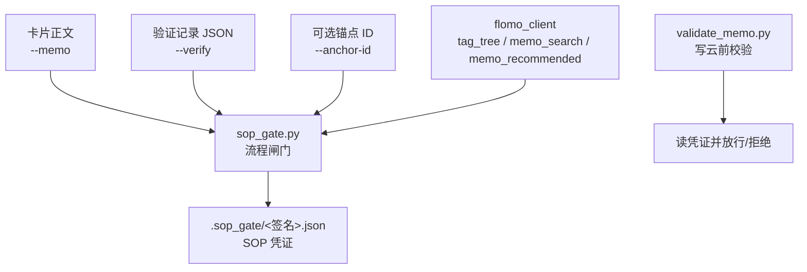
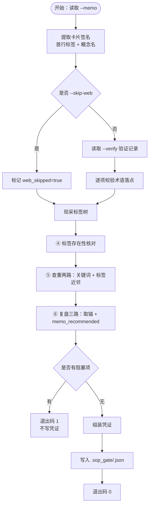
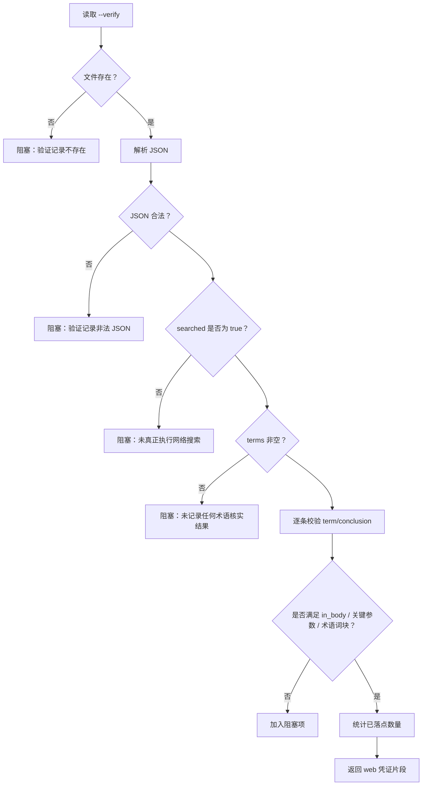
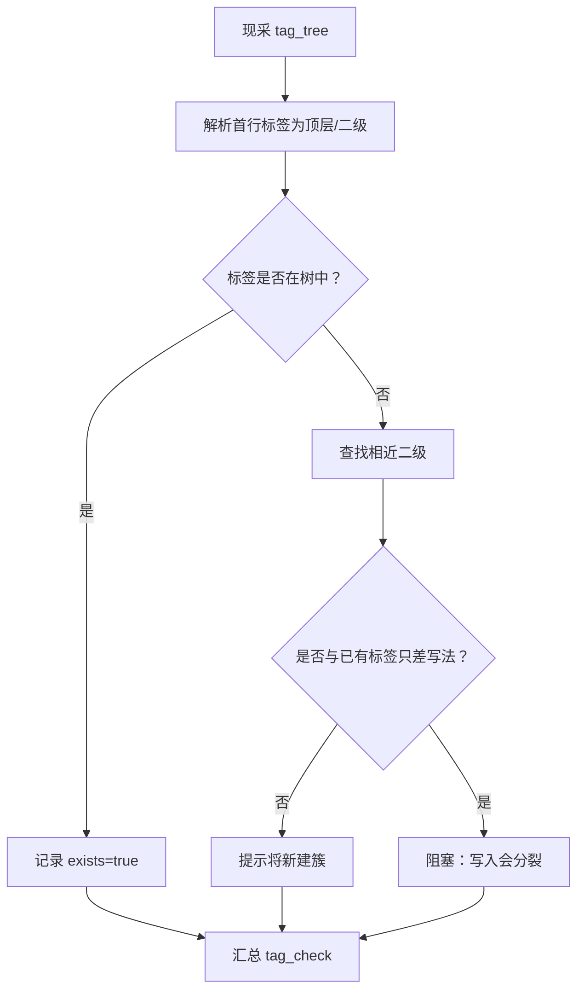
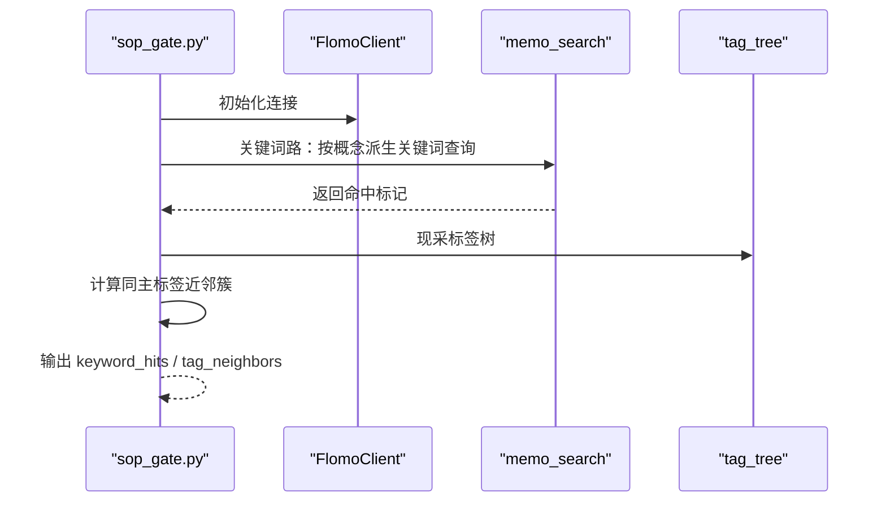
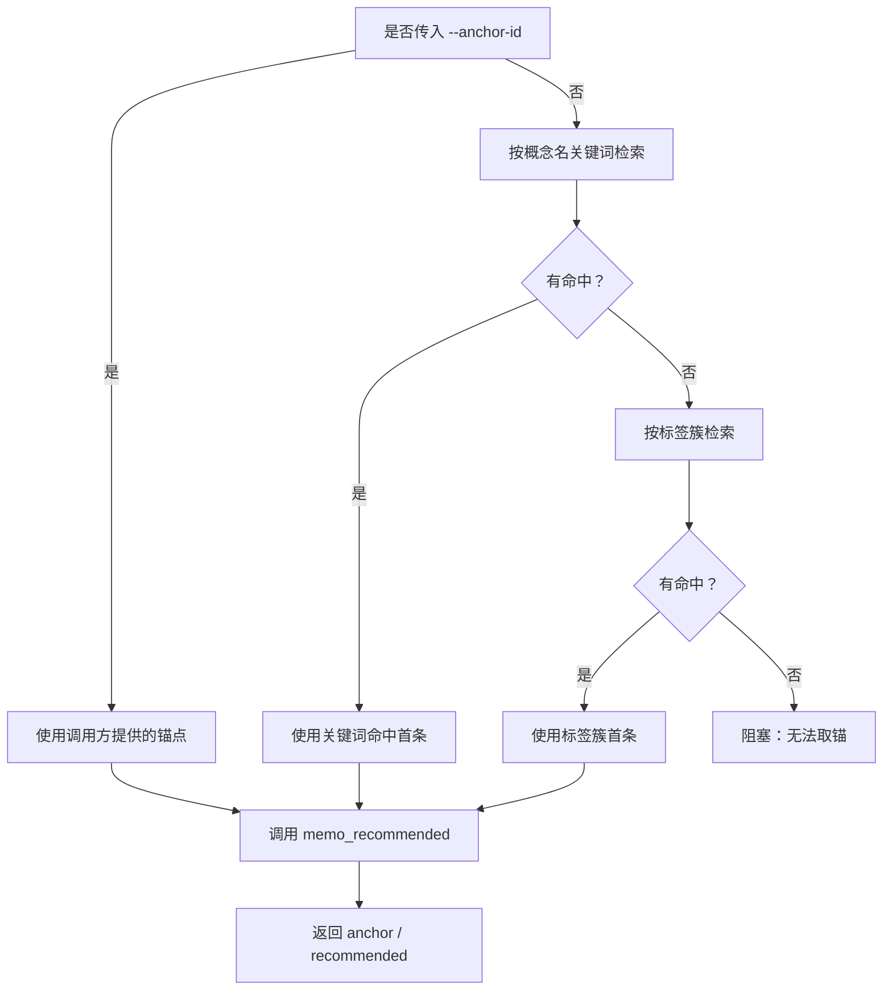
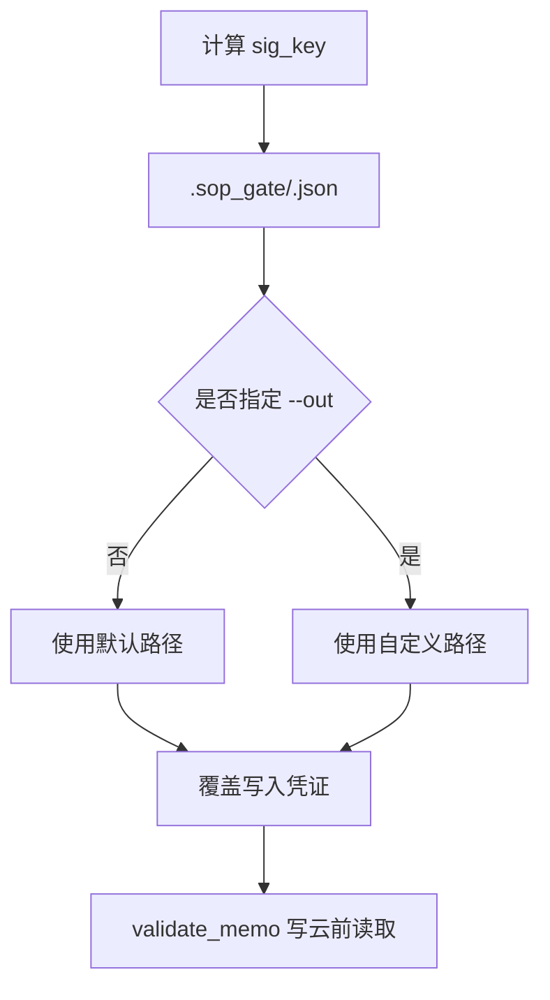
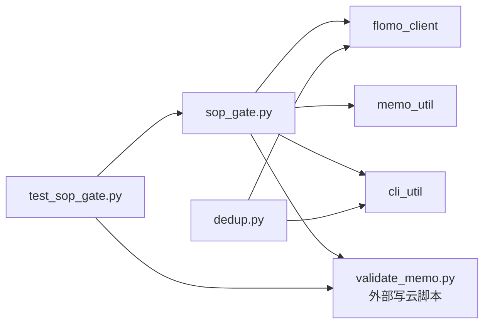

# 流程闸门 sop_gate.py

<cite>
**本文引用的文件**   
- [sop_gate.py](file://scripts/sop_gate.py)
- [dedup.py](file://scripts/dedup.py)
- [test_sop_gate.py](file://tests/test_sop_gate.py)
</cite>

## 目录
1. [引言](#引言)
2. [项目结构与角色分工](#项目结构与角色分工)
3. [闸门机制总览](#闸门机制总览)
4. [凭证对象结构](#凭证对象结构)
5. [各步骤校验逻辑](#各步骤校验逻辑)
6. [凭证落盘路径与幂等性](#凭证落盘路径与幂等性)
7. [典型调用示例](#典型调用示例)
8. [异常行为与修复方式](#异常行为与修复方式)
9. [调试建议](#调试建议)
10. [依赖关系分析](#依赖关系分析)
11. [结论](#结论)

## 引言
`sop_gate.py` 是 SOP 流程闸门脚本，把“靠自觉”的检查型步骤变成“必须留痕”。它负责代跑第②步网络验证、第④步标签核对、第⑤步查重两路、第⑧步复盘三路，并把通过结果写为 `.sop_gate/<签名>.json` 凭证。后续的 `validate_memo.py`（不在本仓库源码中）在写云前会读取该凭证：如果凭证缺失、正文指纹不匹配或已过期，就拒绝写云，从而在物理上阻止跳过步骤。

闸门不是替人做语义判断：它只保证“这些检查真的执行了”，并把机器判不了的项如实写进凭证的盲区清单，供审计者看到边界。

## 项目结构与角色分工
| 角色 | 职责 | 关键实现位置 |
|---|---|---|
| 闸门脚本 `sop_gate.py` | 读取卡片正文、调用 flomo 工具、执行四类检查、生成并写入凭证 | [sop_gate.py:1-594](file://scripts/sop_gate.py#L1-L594) |
| 查重执行器 `dedup.py` | 按关键词逐次现查、分批取全文、输出 id 清单；闸门复用其“两路都跑了”的理念 | [dedup.py:1-220](file://scripts/dedup.py#L1-L220) |
| 闸门测试 `test_sop_gate.py` | 离线回归凭证生成、凭证校验、签名提取、正文指纹、过期、降级授权等 | [test_sop_gate.py:1-758](file://tests/test_sop_gate.py#L1-L758) |



**图表来源**   
- [sop_gate.py:505-594](file://scripts/sop_gate.py#L505-L594)
- [test_sop_gate.py:60-140](file://tests/test_sop_gate.py#L60-L140)

**章节来源**   
- [sop_gate.py:1-120](file://scripts/sop_gate.py#L1-L120)
- [dedup.py:1-40](file://scripts/dedup.py#L1-L40)
- [test_sop_gate.py:1-30](file://tests/test_sop_gate.py#L1-L30)

## 闸门机制总览
闸门的核心思想是：**每个检查型步骤都必须产出可被后续阶段消费的凭证字段，publish 只消费凭证，不信任口头声明。**



**图表来源**   
- [sop_gate.py:505-594](file://scripts/sop_gate.py#L505-L594)
- [sop_gate.py:201-504](file://scripts/sop_gate.py#L201-L504)

**章节来源**   
- [sop_gate.py:1-120](file://scripts/sop_gate.py#L1-L120)
- [sop_gate.py:505-594](file://scripts/sop_gate.py#L505-L594)

## 凭证对象结构
凭证是一个 JSON 对象，核心字段如下：

| 字段 | 类型 | 含义 | 写云侧用途 |
|---|---:|---|---|
| `signature` | 对象 | 卡片签名，包含 `tagline` 和 `concept` | 确认凭证属于哪张卡 |
| `sig_key` | 字符串 | 基于签名的短哈希，用作文件名后缀 | 定位 `.sop_gate/<sig_key>.json` |
| `body_hash` | 字符串 | 当前正文内容的摘要 | 防“先跑闸门后改正文” |
| `generated_at` | 整数 | 凭证生成时间戳 | 计算是否过期 |
| `expires_at` | 整数 | 凭证过期时间戳 | 默认有效期 6 小时 |
| `web` | 对象 | 第②步验证结果 | 检查是否搜索过或显式跳过 |
| `tag_check` | 对象 | 第④步标签核对结果 | 证明标签树已现采、每标签状态已记录 |
| `dedup` | 对象 | 第⑤步查重结果 | 证明两路都跑了且候选已留痕 |
| `review` | 对象 | 第⑧步复盘结果 | 证明推荐路径已取到 |
| `human_judgment` | 数组 | 机器判不了的人工判定项 | 审计用，不参与放行 |
| `no_gate_authorized` | 布尔值，可选 | 是否允许降级闸门 | 配合 `--allow-no-gate` |
| `no_gate_reason` | 字符串，可选 | 降级理由 | 审计留痕 |

凭证生成由 `assemble_gate` 完成；`GATE_TTL` 默认为 6 小时，同一张卡在有效期内可反复用于自检，超期需重跑。

**章节来源**   
- [sop_gate.py:485-510](file://scripts/sop_gate.py#L485-L510)
- [sop_gate.py:120-140](file://scripts/sop_gate.py#L120-L140)
- [test_sop_gate.py:60-120](file://tests/test_sop_gate.py#L60-L120)

## 各步骤校验逻辑

### 第②步：代跑标签核对前的网络验证
闸门并不直接调搜索接口去替你搜，而是读取调用方在第②步生成的验证记录 JSON，然后做两层校验：

1. **搜索是否执行**：`searched` 必须是严格布尔 `true`，不能是 `"false"`、`"no"` 或数字 `0`。
2. **结论是否落进正文**：对每条记录的 `term` 和 `conclusion` 进行归一化比对。

正文落点优先级：
- 若条目提供 `in_body`，则每段必须是正文真实子串，且不能等于或包含于术语本身；否则阻塞。
- 若结论能提取到关键参数（数字加单位，如“430 公里”“160 kW”“31,200 欧元”，或“五星”等评级），至少一项须出现在正文。
- 若结论没有关键参数，则从术语本身提取 ASCII 或中文词块，至少一个须出现。
- 确实不该写进正文的条目，可用 `not_in_body` 显式豁免，但会留下审计痕迹。

比较前两侧统一去掉空白与千分位逗号并转小写，避免“160 kW”和“160kW”这种写法差异造成误判。



**图表来源**   
- [sop_gate.py:360-440](file://scripts/sop_gate.py#L360-L440)
- [sop_gate.py:201-280](file://scripts/sop_gate.py#L201-L280)

**章节来源**   
- [sop_gate.py:120-220](file://scripts/sop_gate.py#L120-L220)
- [sop_gate.py:201-280](file://scripts/sop_gate.py#L201-L280)
- [sop_gate.py:360-440](file://scripts/sop_gate.py#L360-L440)

### 第④步：标签核对
闸门现采云端标签树，对卡片首行标签中的每一对“顶层/二级”做存在性检查：

- 若与现有标签只差空白、全半角斜杠、大小写 → **阻塞**。因为云端会把它们当成两个簇，写入即分裂。
- 若不存在 → **提示**“本卡将新建此二级”，并列出同顶层最接近的现有二级。新建二级是合法动作，机器不做语义归属判断。
- 若首行不是合法两级标签，或标签树未取到 → 报告无法核对，并说明查重标签路同样受影响。



**图表来源**   
- [sop_gate.py:280-360](file://scripts/sop_gate.py#L280-L360)

**章节来源**   
- [sop_gate.py:280-360](file://scripts/sop_gate.py#L280-L360)
- [sop_gate.py:420-450](file://scripts/sop_gate.py#L420-L450)

### 第⑤步：查重两路
闸门自动从概念名派生关键词，并执行两条查重路径：

1. **关键词路**：对每个关键词调用 `memo_search`，最多取 20 条命中，记录 id 和内容前 60 字符。
2. **标签近邻路**：从标签树中找出与当前主标签相同的路径，或以其开头的子路径，作为同主标签下的近邻簇。

关键点：
- “0 个簇”有两种含义：一种是簇存在但没有卡，另一种是该标签根本不在树中，意味着这一路实际没扫到同类卡。闸门会在备注中区分。
- 闸门只证明“两路都跑了、候选被读到”，不代替人工判断“是否同一事件”。



**图表来源**   
- [sop_gate.py:440-504](file://scripts/sop_gate.py#L440-L504)

**章节来源**   
- [sop_gate.py:440-504](file://scripts/sop_gate.py#L440-L504)
- [dedup.py:1-60](file://scripts/dedup.py#L1-L60)

### 第⑧步：复盘三路
复盘需要一张已有卡作锚点，调用 `memo_recommended` 获取相关推荐。锚点选取顺序：

1. 调用方显式传入 `--anchor-id`。
2. 用概念名派生关键词检索，取命中首条。
3. 关键词无命中时，退到本卡标签簇检索，取首条。
4. 以上都失败 → 阻塞，并在错误信息中指出出路。

闸门明确拒绝用“最近更新的卡”兜底，因为那样可能让无关卡成为锚点，使凭证撒谎。



**图表来源**   
- [sop_gate.py:504-504](file://scripts/sop_gate.py#L504-L504)

**章节来源**   
- [sop_gate.py:504-504](file://scripts/sop_gate.py#L504-L504)

## 凭证落盘路径与幂等性

### 默认落盘路径
- 凭证默认写入项目根目录下的 `.sop_gate/<sig_key>.json`。
- `sig_key` 来自 `signature_key(sig)`，由签名中的 `tagline` 和 `concept` 生成，因此不同卡片不会互相覆盖。
- 可通过 `--out` 指定自定义凭证路径。

### 幂等性
- 闸门本身不主动清理旧凭证；同名文件会被直接覆盖。
- 同一张卡在凭证有效期内可反复运行闸门，生成新凭证覆盖旧凭证。
- 由于 `body_hash` 绑定正文内容，修改正文后即使签名不变，旧凭证也会被写云侧拒绝。
- 如果希望重新跑闸门，可以删除对应 `.sop_gate/<sig_key>.json`，再执行一次闸门。



**图表来源**   
- [sop_gate.py:560-594](file://scripts/sop_gate.py#L560-L594)

**章节来源**   
- [sop_gate.py:560-594](file://scripts/sop_gate.py#L560-L594)

## 典型调用示例

### 场景一：术语卡，先执行第②步和第⑤步，再跑闸门
1. 手动完成第②步网络搜索，生成验证记录 JSON，保存到某路径。
2. 执行查重，得到关键词命中和标签近邻结果。
3. 运行闸门：

```bash
python scripts/sop_gate.py \
  --memo 卡片正文.txt \
  --verify 验证记录.json
```

闸门会：
- 校验验证记录中术语是否真正落进正文。
- 现采标签树并核对标签。
- 执行查重两路。
- 执行复盘三路。
- 全部通过后写入 `.sop_gate/<sig_key>.json`。

### 场景二：非术语卡，显式跳过网络验证
```bash
python scripts/sop_gate.py \
  --memo 卡片正文.txt \
  --skip-web
```

凭证中会记录 `web_skipped=true`，便于审计知道这一步是被有意跳过的。

### 场景三：更新已有卡，指定复盘锚点
```bash
python scripts/sop_gate.py \
  --memo 卡片正文.txt \
  --verify 验证记录.json \
  --anchor-id 某张已有卡的ID
```

这会让第⑧步直接用指定 ID 拉推荐，适合更新场景。

### 场景四：自定义凭证输出位置
```bash
python scripts/sop_gate.py \
  --memo 卡片正文.txt \
  --verify 验证记录.json \
  --out ./my_gate.json
```

### 场景五：批量处理历史卡，降级闸门
```bash
python scripts/sop_gate.py \
  --memo 卡片正文.txt \
  --verify 验证记录.json \
  --allow-no-gate "批量处理历史卡：补跑流程"
```

这会在凭证中加入 `no_gate_authorized` 和 `no_gate_reason`，只有 `validate_memo.py` 看到该标记时才接受 `--no-gate` 降级。

**章节来源**   
- [sop_gate.py:505-594](file://scripts/sop_gate.py#L505-L594)
- [test_sop_gate.py:120-200](file://tests/test_sop_gate.py#L120-L200)

## 异常行为与修复方式

| 问题 | 闸门行为 | 修复方式 |
|---|---|---|
| 凭证缺失 | 写云侧报错，提示缺少 SOP 流程闸门凭证 | 先运行 `sop_gate.py` 生成凭证 |
| 正文指纹不匹配 | 写云侧报错，提示正文指纹不一致 | 修改正文后重新运行闸门；不要复用旧凭证 |
| 凭证过期 | 写云侧报错，提示凭证已过期 | 重新运行闸门，凭证有效期默认 6 小时 |
| 签名不符 | 写云侧报错，提示签名与当前卡片不符 | 删除旧凭证后重新生成，确保文件名和凭证内签名一致 |
| 验证未执行 | 闸门阻塞，要求提供 `--verify` 或使用 `--skip-web` | 补充验证记录 JSON，或确认卡片是非术语卡并使用 `--skip-web` |
| 验证记录 `searched` 不是布尔 `true` | 闸门阻塞 | 修正验证记录 JSON，使 `searched` 为严格布尔真值 |
| 验证术语未在正文落点 | 闸门阻塞，列出未落点术语 | 把搜索结果融入正文，或用 `not_in_body` 显式豁免并写明理由 |
| 标签与现有标签只差写法 | 闸门阻塞 | 改为与云端一致的标签写法 |
| 标签不在树中 | 闸门提示将新建簇，不直接阻塞 | 确认是否应新建二级；若属错字则修正 |
| 查重 API 失败 | 闸门退出码非 0，不出凭证 | 检查 token、网络、关键词和标签；不要据此认为“无命中” |
| 复盘无法取锚 | 闸门阻塞 | 传入 `--anchor-id`，或修正首行标签，使标签簇能搜到卡 |
| 重复凭证 | 新凭证覆盖旧凭证 | 正常幂等行为；如需回滚可保留多份副本或重新生成 |

**章节来源**   
- [sop_gate.py:201-594](file://scripts/sop_gate.py#L201-L594)
- [test_sop_gate.py:60-200](file://tests/test_sop_gate.py#L60-L200)

## 调试建议

### 如何查看某步骤是否真正执行过
1. 打开对应 `.sop_gate/<sig_key>.json` 凭证。
2. 检查 `web`：
   - 若为 `{"web_skipped": true}`，说明是通过 `--skip-web` 显式跳过。
   - 若存在 `searched` 和 `term_count`，说明第②步已读取验证记录。
   - 若 `landed` 中有术语未标记落地，说明术语搜索结果没有写进正文。
3. 检查 `tag_check`：
   - `checked` 表示实际检查了多少标签。
   - `tags` 中每项记录 `exists`、`top_exists`、`near`、`dup_of` 等，可看出标签是否已存在、是否新建、是否与现有标签只差写法。
4. 检查 `dedup`：
   - `keyword_hits` 显示每个关键词命中的 id 和内容头。
   - `tag_neighbors` 显示标签近邻簇。
5. 检查 `review`：
   - `anchor` 和 `anchor_source` 显示复盘锚点及来源。
   - `recommended` 显示推荐卡 id 列表。
6. 检查 `human_judgment`：
   - 这里列出的都是机器判不了、必须人工判断的事项。
   - 有盲区不等于闸门失败，但审计时应重点关注。

### 如何确认某步骤是否真的联网执行
- 看闸门标准输出中的备注行，例如“标签树·现采 X 个”“查重·关键词 Y 命中 Z 条”“复盘·memo_recommended（锚=...）返回 ... 条”。
- 如果某步根本没执行，这些备注不会出现；如果执行失败，通常会打印 `[阻塞]` 或 `[失败]` 消息。
- 对于查重，`dedup.py` 也遵循“每次调用单独打印结果”的原则，避免把多次搜索合并掩盖。

### 如何清理旧凭证重新跑闸门
1. 找到凭证文件：`.sop_gate/<sig_key>.json`。
2. 删除该文件或整个 `.sop_gate` 目录。
3. 重新执行 `python scripts/sop_gate.py --memo <正文> --verify <验证记录>`。
4. 如果只是想替换正文指纹，不需要删目录，直接重新运行闸门即可覆盖同名凭证。
5. 如果使用 `--out` 自定义路径，请同时删除或移动旧输出文件。

### 如何排查“凭证齐全但正文仍被拒绝”
- 检查 `body_hash` 是否与当前正文一致。
- 检查 `signature.tagline` 和 `signature.concept` 是否与当前卡片一致。
- 检查 `expires_at` 是否小于当前时间。
- 检查是否误用了另一张卡的凭证文件名或凭证内容。

**章节来源**   
- [sop_gate.py:120-140](file://scripts/sop_gate.py#L120-L140)
- [sop_gate.py:485-594](file://scripts/sop_gate.py#L485-L594)
- [dedup.py:1-60](file://scripts/dedup.py#L1-L60)
- [test_sop_gate.py:60-200](file://tests/test_sop_gate.py#L60-L200)

## 依赖关系分析



**图表来源**   
- [sop_gate.py:100-120](file://scripts/sop_gate.py#L100-L120)
- [dedup.py:20-40](file://scripts/dedup.py#L20-L40)
- [test_sop_gate.py:30-60](file://tests/test_sop_gate.py#L30-L60)

**章节来源**   
- [sop_gate.py:100-120](file://scripts/sop_gate.py#L100-L120)
- [dedup.py:20-40](file://scripts/dedup.py#L20-L40)
- [test_sop_gate.py:30-60](file://tests/test_sop_gate.py#L30-L60)

## 结论
`sop_gate.py` 通过“代跑 + 出凭证”的方式，把原本依赖执行者自觉的第②步、第④步、第⑤步和第⑧步变成了可审计、可校验、可阻断的物理流程。它的核心约束不是替人做语义判断，而是确保：

- 网络验证记录存在且术语结论落进了正文。
- 标签树已现采，每个标签的存在性已核对。
- 查重两路都已执行，候选已留痕。
- 复盘锚点已取到，推荐结果已拉取。
- 凭证带正文指纹、签名、有效期和人类判断盲区。
- 写云侧只认凭证，不认口头承诺。

当凭证缺失、正文指纹不匹配或凭证过期时，闸门机制会阻止写云；当步骤真正执行后，凭证可作为后续阶段的唯一可信输入。这样，“漏做”不再只是管理问题，而是物理上不可能。