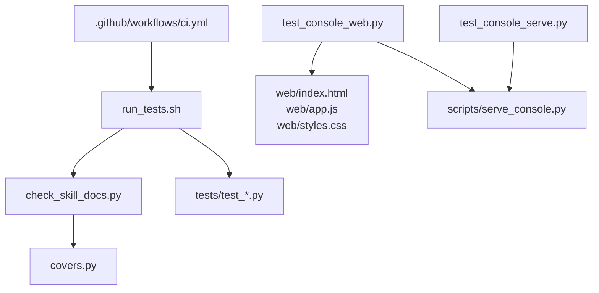
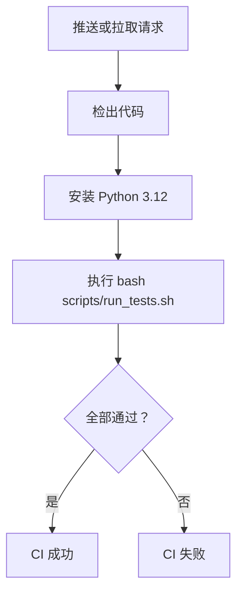
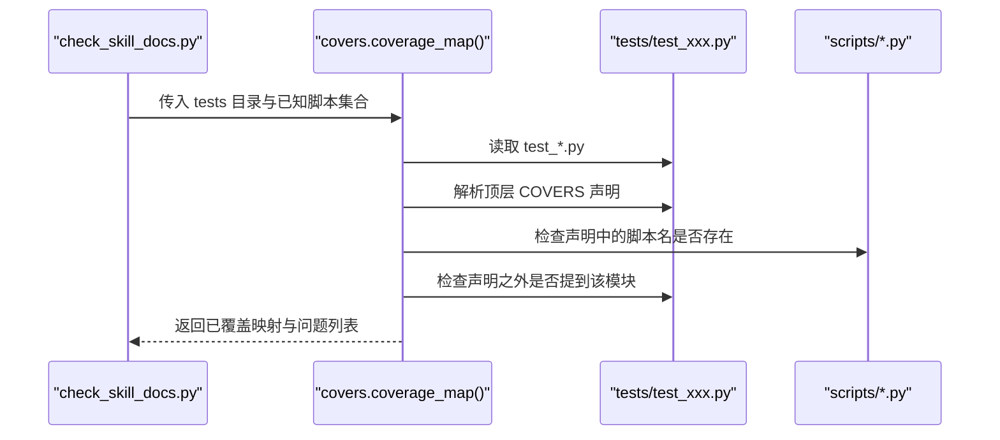
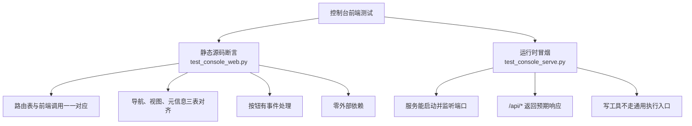
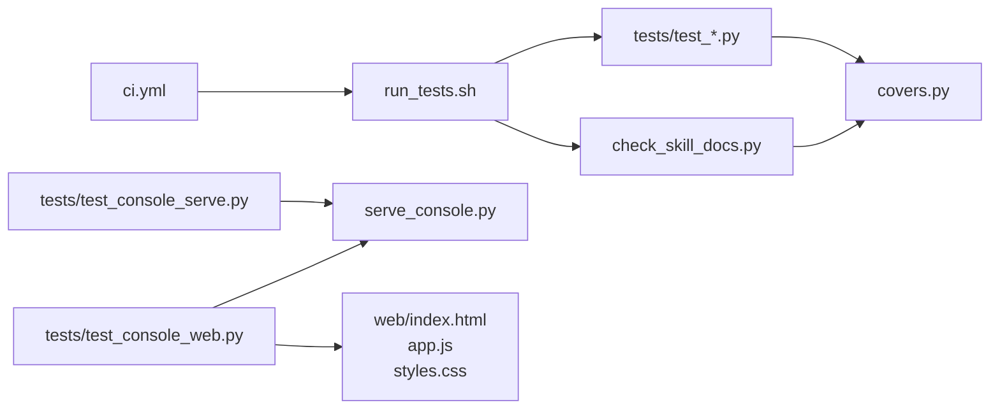
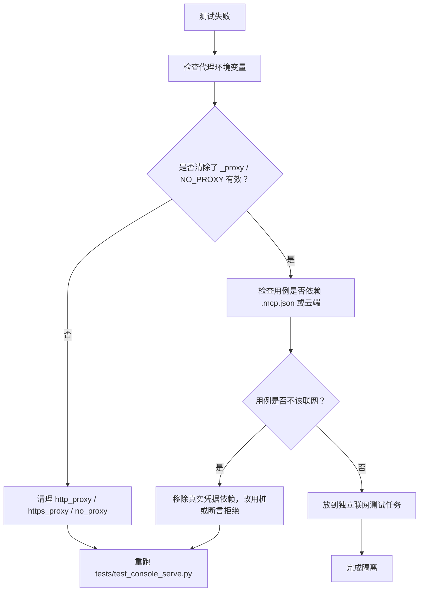

# 测试与质量保障

<cite>
**本文引用的文件**
- [README.md](file://README.md)
- [scripts/run_tests.sh](file://scripts/run_tests.sh)
- [scripts/covers.py](file://scripts/covers.py)
- [scripts/check_skill_docs.py](file://scripts/check_skill_docs.py)
- [.github/workflows/ci.yml](file://.github/workflows/ci.yml)
- [tests/test_covers.py](file://tests/test_covers.py)
- [tests/test_console_web.py](file://tests/test_console_web.py)
- [tests/test_console_serve.py](file://tests/test_console_serve.py)
</cite>

## 目录
1. [引言](#引言)
2. [项目结构](#项目结构)
3. [核心组件](#核心组件)
4. [架构总览](#架构总览)
5. [详细组件分析](#详细组件分析)
6. [依赖关系分析](#依赖关系分析)
7. [性能与执行特征](#性能与执行特征)
8. [排查指南](#排查指南)
9. [结论](#结论)

## 引言
本指南面向 flomo-note 的测试与质量保障体系，目标是让读者理解并可靠地运行这套“全离线回归 + 文档自检”的校验链。仓库不依赖云端凭据运行测试：用例全部在本地解析源码、模拟请求或启动服务，因此 CI 不需要配置任何 secret。

测试策略由四层组成：
- 全离线回归用例：`tests/test_*.py`，每个文件声明它验证的脚本。
- COVERS 声明：模块级 `COVERS = (脚本名, ...)`，是“用例覆盖哪个脚本”的唯一事实来源。
- covers.py 覆盖率校验：解析所有用例的 COVER 声明，判断是否遗漏、悬空或只声明不测。
- check_skill_docs.py SKILL 文档自检：检查日期、叙事、交叉引用、命令行选项、脚本-用例覆盖等结构性纪律。

CI 流水线仅执行 `scripts/run_tests.sh`，从而保证本地与线上判据一致。

**章节来源**
- [README.md:1-200](file://README.md#L1-L200)

## 项目结构
flomo-note 把“交付脚本”和“验证脚本”分目录存放：
- `scripts/`：写卡流程、控制台后端、文档自检、覆盖率解析等工具。
- `tests/`：命名必须为 `test_*.py` 的回归用例。
- `.github/workflows/ci.yml`：每次推送 master 或 PR 时执行同一套测试命令。
- `web/`：控制台前端静态资源，被 `serve_console.py` 提供。



**图表来源**
- [.github/workflows/ci.yml:1-30](file://.github/workflows/ci.yml#L1-L30)
- [scripts/run_tests.sh:1-95](file://scripts/run_tests.sh#L1-L95)
- [scripts/covers.py:1-118](file://scripts/covers.py#L1-L118)
- [tests/test_console_web.py:1-200](file://tests/test_console_web.py#L1-L200)
- [tests/test_console_serve.py:1-200](file://tests/test_console_serve.py#L1-L200)

**章节来源**
- [README.md:1-200](file://README.md#L1-L200)
- [.github/workflows/ci.yml:1-30](file://.github/workflows/ci.yml#L1-L30)

## 核心组件
### run_tests.sh：统一入口
`run_tests.sh` 是所有测试的编排器。它的职责不是实现业务逻辑，而是保证“本地怎么跑，CI 也怎么跑”。

关键行为如下：
1. 定位仓库根目录，进入该目录执行。
2. 检测 Python 解释器：优先使用环境变量 `PYTHON_BIN`，否则依次尝试 `python3`、`python`。找不到则直接失败。
3. 探测临时目录：大量用例用 `tempfile` 创建临时目录；如果外部 `TMPDIR` 不可写，脚本会改用仓库内 `_tmp/.tmp` 并显式提示这是环境问题。
4. 校验 `tests/` 下是否存在 `test_*.py`：如果一个都没有，直接报错，避免“glob 静默匹配成字面量路径但一条用例也没跑”。
5. 串行执行：先跑 `check_skill_docs.py`，再逐个跑 `tests/test_*.py`。
6. 汇总统计：记录总数、失败数，并以非 0 退出码反映整体结果。

这意味着：
- 新增用例必须命名为 `test_xxx.py`，否则不会被收集。
- 新增脚本如果没有对应 `COVERS` 声明，会在文档自检阶段失败。
- 临时目录权限问题会被提前暴露，而不是等到某个用例报 `PermissionError` 才让人困惑。

**章节来源**
- [scripts/run_tests.sh:1-95](file://scripts/run_tests.sh#L1-L95)

### covers.py：脚本-用例覆盖关系的唯一解析
`covers.py` 回答的问题是：“这个脚本有没有回归用例？”它不依赖网络、云端或第三方库，只依赖标准库 AST。

它提供两个核心能力：
- `declared_covers(path)`：从单个用例文件里解析顶层 `COVERS = (...)`，返回脚本名元组、解析问题列表、以及声明所在行号区间。
- `coverage_map(tests_dir, known=None)`：扫描整个 `tests/`，聚合所有 `test_*.py` 的声明，返回“脚本名 → 用例文件名列表”，同时收集问题。

重要规则：
- “没有声明”和“声明为空元组”严格区分：前者是漏写，后者表示用例有意不针对具体脚本。
- `COVERS` 只能包含字符串字面量；动态变量、拼接表达式、非字符串元素都会被判为解析问题。
- 声明之外文件中没提到该模块名，会被判定为“只声明不测”的假覆盖。
- 提到方式可以很宽松：`import alpha`、`from beta import thing`、拼出 `"gamma.py"` 都算提到。这样加载方式变化不会造成大面积误报。

控制台数据层和闸门共用这一份解析，避免“闸门说有覆盖、页面说没有”的矛盾结论。

**章节来源**
- [scripts/covers.py:1-118](file://scripts/covers.py#L1-L118)
- [tests/test_covers.py:1-128](file://tests/test_covers.py#L1-L128)

### check_skill_docs.py：技能文档与结构自检
`check_skill_docs.py` 是“内容纪律 + 跨文件结构检查”的守门人。它不只是看语法，还要确认仓库内部约定没有被破坏。

主要检查项包括：
- 禁止具体日期和历史事件叙事，要求抽象陈述。
- README 中必须列出 `scripts/` 下的脚本。
- `tests/` 下的用例必须以 `test_` 开头，否则 `run_tests.sh` 不会执行。
- 内部交叉引用（H 编号、附录小节、流程步骤、脚本名）不能悬空。
- 文档里写的命令行选项必须真实存在于对应脚本。
- 每个 `scripts/*.py` 都必须出现在某个用例的 `COVERS` 中；每个用例也必须写出 `COVERS`（可空）。

注意：它不是覆盖率工具。它只检查“有没有声明覆盖”，不评估断言写得够不够；断言质量仍需人工阅读。

**章节来源**
- [scripts/check_skill_docs.py:1-200](file://scripts/check_skill_docs.py#L1-L200)
- [README.md:1-200](file://README.md#L1-L200)

### CI 流水线：只跑同一套测试
`.github/workflows/ci.yml` 的目标非常明确：防止“改完脚本忘了跑用例”。它只在 Ubuntu 上准备 Python 3.12，然后执行 `bash scripts/run_tests.sh`。

关键点：
- 触发条件：push 到 master，以及所有 pull_request。
- 不配置 secrets：因为测试全部离线。
- 如果未来有人给用例引入真实凭据依赖，CI 会失败；这被视为需要修复的问题，而不是靠加 secret 掩盖。



**图表来源**
- [.github/workflows/ci.yml:1-30](file://.github/workflows/ci.yml#L1-L30)
- [scripts/run_tests.sh:1-95](file://scripts/run_tests.sh#L1-L95)

**章节来源**
- [.github/workflows/ci.yml:1-30](file://.github/workflows/ci.yml#L1-L30)

## 详细组件分析

### 全离线回归用例与 COVERS 绑定机制
仓库不依赖“用例文件名和脚本同名”来推断覆盖关系。README 明确指出存在反例：
- `serve_console.py` 的用例叫 `test_console_serve.py`。
- `console_cloud.py` 的主要回归在 `test_console_web.py`。
- `memo_util` 的口径用例在 `test_memo_util.py`。

因此，绑定关系完全由模块级 `COVERS` 声明决定。

典型模式：
```text
COVERS = ("serve_console", "console_cloud")
```
这表示当前测试文件验证的是这两个脚本的行为。

校验过程：
1. `check_skill_docs.py` 调用 `covers.coverage_map()`。
2. `coverage_map()` 遍历所有 `test_*.py`。
3. 对每个用例解析 `COVERS`。
4. 检查声明中的脚本名是否在 `scripts/` 中存在。
5. 检查声明之外的源码是否真的提到该模块。
6. 只有同时满足以上条件的声明才会计入“已覆盖”。



**图表来源**
- [scripts/check_skill_docs.py:1-200](file://scripts/check_skill_docs.py#L1-L200)
- [scripts/covers.py:1-118](file://scripts/covers.py#L1-L118)

**章节来源**
- [README.md:1-200](file://README.md#L1-L200)
- [scripts/covers.py:1-118](file://scripts/covers.py#L1-L118)
- [scripts/check_skill_docs.py:1-200](file://scripts/check_skill_docs.py#L1-L200)

### 如何运行测试
#### 运行全部测试
```bash
bash scripts/run_tests.sh
```
这会：
- 先运行 `scripts/check_skill_docs.py`。
- 再按 glob 顺序运行所有 `tests/test_*.py`。
- 任一失败即返回非 0。

#### 指定 Python 解释器
```bash
PYTHON_BIN=/usr/bin/python3 bash scripts/run_tests.sh
```

#### 运行单个测试文件
由于 `run_tests.sh` 只负责批量编排，单个用例仍可直接用 Python 运行：
```bash
python scripts/check_skill_docs.py
python tests/test_covers.py
python tests/test_console_web.py
python tests/test_console_serve.py
```

注意：
- 如果只想快速定位某个脚本对应的用例，不要猜文件名，应查看该用例文件的 `COVERS` 声明。
- 如果测试依赖临时目录写入失败，应先检查 `TMPDIR`、`TEMP`、`TMP` 指向的可写路径。

**章节来源**
- [scripts/run_tests.sh:1-95](file://scripts/run_tests.sh#L1-L95)
- [tests/test_covers.py:1-128](file://tests/test_covers.py#L1-L128)
- [tests/test_console_web.py:1-200](file://tests/test_console_web.py#L1-L200)
- [tests/test_console_serve.py:1-200](file://tests/test_console_serve.py#L1-L200)

### Playwright 与控制台前端渲染验证
在当前仓库快照中，未检索到 Playwright 相关依赖或导入。控制台前端的测试分为两层：

1. **源码对齐断言**：`tests/test_console_web.py` 通过正则解析 HTML、CSS、JS 和服务端路由，验证导航、视图、接口、按钮事件、零外部依赖、截断上限等结构约束。
2. **运行时冒烟**：`tests/test_console_serve.py` 真启动 `serve_console.py`，用随机端口直连 HTTP，验证静态资源、API、路径逃逸、安全边界和端口占用处理。

这两层合在一起，已经覆盖了“前端渲染是否正确”的核心风险：
- 如果前端请求了已被删除的路由，静态断言会失败。
- 如果服务根本起不来，运行时测试会失败。
- 如果按钮渲染了但没有事件处理，正则断言会失败。
- 如果服务端把写工具暴露到通用执行入口，HTTP 状态码会暴露安全问题。

Playwright 属于浏览器自动化框架，适合做端到端 UI 截图和交互测试；而当前仓库选择更轻量、更确定性的源码解析 + 进程级 HTTP 冒烟。若未来要加入 Playwright，建议：
- 仅在确需浏览器渲染语义时才引入。
- 单独放在 e2e 或 ui 测试目录，不要混入纯离线单元测试。
- 明确哪些断言是“视觉正确性”，哪些是“协议与安全边界”。



**图表来源**
- [tests/test_console_web.py:1-200](file://tests/test_console_web.py#L1-L200)
- [tests/test_console_serve.py:1-200](file://tests/test_console_serve.py#L1-L200)

**章节来源**
- [tests/test_console_web.py:1-200](file://tests/test_console_web.py#L1-L200)
- [tests/test_console_serve.py:1-200](file://tests/test_console_serve.py#L1-L200)

## 依赖关系分析
测试体系的依赖关系并不复杂，但非常关键：一旦某处口径不一致，就会形成“看起来通过，实际漏检”的隐蔽问题。



**图表来源**
- [.github/workflows/ci.yml:1-30](file://.github/workflows/ci.yml#L1-L30)
- [scripts/run_tests.sh:1-95](file://scripts/run_tests.sh#L1-L95)
- [scripts/check_skill_docs.py:1-200](file://scripts/check_skill_docs.py#L1-L200)
- [scripts/covers.py:1-118](file://scripts/covers.py#L1-L118)
- [tests/test_console_web.py:1-200](file://tests/test_console_web.py#L1-L200)
- [tests/test_console_serve.py:1-200](file://tests/test_console_serve.py#L1-L200)

耦合点说明：
- `check_skill_docs.py` 依赖 `covers.py` 作为唯一解析实现。
- `test_console_web.py` 同时依赖前端静态资源和 `serve_console.py` 的路由定义。
- `test_console_serve.py` 依赖操作系统进程、socket、HTTP 客户端，但不依赖代理或云端。
- CI 只依赖 `run_tests.sh`，因此只要 shell 入口不变，GitHub Actions 上的行为就稳定。

**章节来源**
- [scripts/covers.py:1-118](file://scripts/covers.py#L1-L118)
- [tests/test_console_web.py:1-200](file://tests/test_console_web.py#L1-L200)
- [tests/test_console_serve.py:1-200](file://tests/test_console_serve.py#L1-L200)

## 性能与执行特征
- 测试总体开销很低：主要是 AST 解析、正则匹配、少量子进程启动。
- `run_tests.sh` 串行执行，有利于定位第一个失败位置，也避免并发临时目录竞争。
- 控制台运行时测试会启动真实服务，因此比纯静态断言慢，但换来的是“真正发过 HTTP 请求”的保证。
- CI 环境固定为 Ubuntu + Python 3.12，减少“本地绿、CI 红”的解释成本。

优化建议：
- 不要把需要联网的用例放进主测试集；如需联网，应拆到独立任务。
- 控制台运行时测试应限制超时，避免 CI 长时间挂起。
- 如果测试数量增长明显，可考虑按类型分组输出，但不应改变默认“全部串行”的安全假设。

[本节为通用指导，不直接分析具体代码片段]

## 排查指南

### 常见断言失败
#### 用例没有被执行
现象：
- 新增 `xxx.py`，但 `run_tests.sh` 没有运行它。
- `check_skill_docs.py` 报用例命名错误。

原因：
- 文件名不是 `test_*.py`。
- `run_tests.sh` 只收集 `tests/test_*.py`。

处理：
- 将用例重命名为 `test_xxx.py`。
- 在模块顶部添加 `COVERS = ("目标脚本名",)`。

#### COVER 声明无效
现象：
- `check_skill_docs.py` 报缺少 `COVERS`。
- `covers.py` 报声明不是字面量。

原因：
- 忘记写 `COVERS`。
- 写成 `COVERS = NAMES` 之类动态值。
- 元组里混入非字符串。

处理：
- 改为 `COVERS = ("脚本名",)`。
- 如果确实不针对具体脚本，写 `COVERS = ()`。

#### 只声明不测
现象：
- 报告声称覆盖某个脚本，但声明之外的文件里没有提到它。

原因：
- 复制了旧声明。
- 改了被测模块名但没更新 `COVERS`。
- 用了动态加载且模块名不在源码文本中出现。

处理：
- 确保源码中至少出现一次模块名，例如 `import xxx`、`from xxx import yyy`，或拼出 `"xxx.py"`。
- 如果是动态加载，也要在测试源码中留下可读标识。

#### 控制台静态断言失败
现象：
- 导航项、视图函数、路由表、按钮事件、外部资源、截断上限等断言失败。

原因：
- 前端加了功能但没在服务端路由表里注册。
- 改了路由名但前端仍调旧路径。
- 模板渲染按钮但没有绑定事件。
- 引入了远程 CSS/JS。

处理：
- 同步修改 `web/index.html`、`web/app.js` 和 `scripts/serve_console.py`。
- 重新运行 `python tests/test_console_web.py`。

#### 控制台运行时测试失败
现象：
- 服务无法启动。
- 端口未监听。
- 未知路径不是 404。
- 通用执行入口允许写工具。
- 响应体泄露 token。

原因：
- `serve_console.py` 启动参数或端口冲突。
- HTTP 路由未正确处理 POST。
- 安全白名单或参数校验缺失。
- 响应构造中携带了鉴权头。

处理：
- 先用 `python tests/test_console_serve.py` 复现。
- 检查服务日志、端口占用、代理环境变量。
- 确认 `/api/cloud/tool` 只放行读工具白名单。

### 网络隔离问题
仓库设计明确要求回归用例离线运行。`test_console_serve.py` 还会清理 `_proxy` 环境变量，并通过 `NO_PROXY=*` 阻止系统代理影响本机请求。

常见问题：
- 本地设置了 `http_proxy` / `https_proxy`，导致 localhost 请求走代理。
- CI 意外读到 `.mcp.json` 或其他凭据，使测试变成“可能联网”。
- 开发者误以为测试会访问 flomo 云端。

处理：
- 运行测试前清理代理环境变量，或确保 `NO_PROXY` 生效。
- 不要给用例添加真实 token 依赖；如果需要云交互，应放在独立任务。
- 如果移走 `.mcp.json` 后用例变红，优先怀疑用例引入了真实网络或凭据。



**图表来源**
- [tests/test_console_serve.py:1-200](file://tests/test_console_serve.py#L1-L200)
- [scripts/run_tests.sh:1-95](file://scripts/run_tests.sh#L1-L95)

**章节来源**
- [tests/test_console_serve.py:1-200](file://tests/test_console_serve.py#L1-L200)
- [scripts/run_tests.sh:1-95](file://scripts/run_tests.sh#L1-L95)

## 结论
flomo-note 的测试与质量保障体系以“最小依赖、最大确定性”为原则：
- 用例全部离线，CI 无需 secret。
- 脚本-用例绑定由 `COVERS` 声明决定，不以文件名猜测。
- `covers.py` 是覆盖解析的唯一事实源。
- `check_skill_docs.py` 保护文档与结构纪律。
- `run_tests.sh` 是本地与 CI 的共同入口。
- 控制台前端通过静态断言与运行时冒烟共同保证渲染、路由与安全边界正确。

日常维护时，请始终遵循这条顺序：
1. 改脚本。
2. 写或更新 `tests/test_*.py`。
3. 在模块顶部写明 `COVERS`。
4. 运行 `bash scripts/run_tests.sh`。
5. 如果涉及控制台前端，额外运行 `test_console_web.py` 和 `test_console_serve.py`。
6. 确认 CI 通过，而不是只看本地输出。