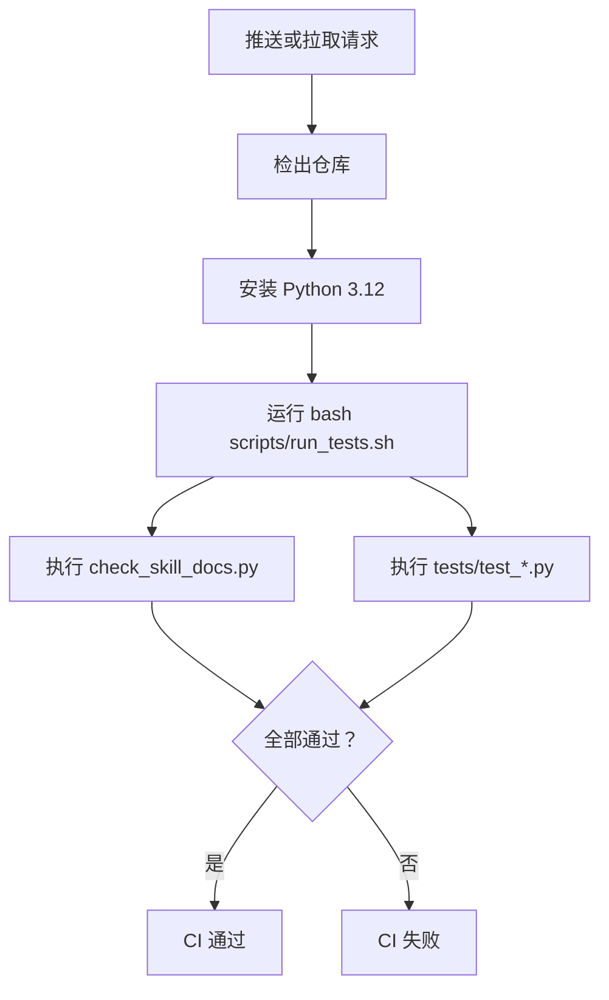

# 部署与环境

<cite>
**本文引用的文件**
- [README.md](file://README.md)
- [ENVIRONMENT.md](file://ENVIRONMENT.md)
- [AGENTS.md](file://AGENTS.md)
- [.github/workflows/ci.yml](file://.github/workflows/ci.yml)
- [scripts/run_tests.sh](file://scripts/run_tests.sh)
</cite>

## 目录
1. [简介](#简介)
2. [前置要求](#前置要求)
3. [从零开始的环境搭建清单](#从零开始的环境搭建清单)
4. [平台差异与路径约定](#平台差异与路径约定)
5. [令牌与网络通道配置](#令牌与网络通道配置)
6. [技能注册与联接命令](#技能注册与联接命令)
7. [首次运行：控制台与写卡](#首次运行控制台与写卡)
8. [CI 流水线行为](#ci-流水线行为)
9. [常见问题排查](#常见问题排查)
10. [结论](#结论)

## 简介
flomo-note 是一个 AI 辅助的云端卡片笔记技能，目标是把网页、文章和想法整理成 flomo 云端卡片。它不在本地落盘笔记正文，只保留技能文档、工具脚本、控制台前端与 MCP 配置；实际卡片存在于用户的 flomo 账号中。

本项目通过 Python 脚本实现抓取、验证、提炼、标签检查、查重、写作、流程闸门、质检、写云与回读验收，并通过 `.mcp.json` 中的 Bearer Token 连接 `https://flomoapp.com/mcp`。

**章节来源**
- [README.md:1-40](file://README.md#L1-L40)

## 前置要求
| 项目 | 要求 | 说明 |
|---|---|---|
| Python | ≥ 3.10 | 仓库徽章以 3.10+ 为准；本环境实测过更高版本（Windows 托管版 3.14.6） |
| 虚拟环境 | 推荐 | 建议用 venv / conda / uv 等隔离依赖，避免污染系统 Python |
| Git | 需要 | 用于克隆仓库、推送与隧道相关操作 |
| `.mcp.json` | 必需 | 提供 `mcpServers.flomo.headers.Authorization`，值为 `Bearer fmcp_xxxxx` |
| Playwright Chromium | 可选 | 仅控制台页面渲染/无头浏览器场景需要 |
| HTTP(S) 出网 | 视网络环境而定 | 默认走环境变量代理，失败时按通道策略回退 |

关键事实：
- 令牌优先从项目根 `.mcp.json` 读取；仅在文件不存在时后备到 `FLOMO_TOKEN` 环境变量。
- 两处都没有 token 时，所有脚本会以非 0 退出并提示未找到 flomo token。
- 控制台默认监听 `127.0.0.1:8787`，端口占用时会直接拒绝启动。

**章节来源**
- [README.md:10-14](file://README.md#L10-L14)
- [README.md:22-40](file://README.md#L22-L40)
- [ENVIRONMENT.md:26-42](file://ENVIRONMENT.md#L26-L42)
- [ENVIRONMENT.md:44-63](file://ENVIRONMENT.md#L44-L63)
- [ENVIRONMENT.md:200-215](file://ENVIRONMENT.md#L200-L215)

## 从零开始的环境搭建清单
以下清单面向第一次在本机安装 flomo-note 的用户。若你已在某套环境中完成部分步骤，可跳过对应项。

1. **安装 Python ≥ 3.10**
   - Windows：建议使用 Python 官方安装器或 conda/miniconda，并确保命令行能调用 `python --version`。
   - Linux：使用发行包管理器或 pyenv/conda 安装 3.10+。
   - 如果系统有 `python3` 但版本过低，可用 `PYTHON_BIN=/path/to/python3` 显式指定解释器。

2. **创建虚拟环境**
   ```bash
   python -m venv .venv
   # Windows PowerShell
   .\.venv\Scripts\Activate.ps1
   # Git Bash / Linux
   source .venv/bin/activate
   ```

3. **克隆仓库**
   ```bash
   git clone https://github.com/shushuzn/flomo-note.git
   cd flomo-note
   ```

4. **安装依赖**
   - 如果项目包含依赖声明文件（例如 `requirements.txt`、`pyproject.toml`），按该文件安装。
   - 若当前只需运行离线测试，可先不装第三方库；若要跑控制台、Playwright 或真实写卡，再按需安装。

5. **创建 `.mcp.json`**
   - 在项目根目录创建 `.mcp.json`，内容包含 flomo MCP 端点与 Bearer Token。
   - 该文件已加入 `.gitignore`，不会入库。
   - 如果已有 `FLOMO_TOKEN` 环境变量，也可作为后备，但 `.mcp.json` 优先级更高。

6. **验证 token 是否生效**
   - 运行任意需要联网的脚本或控制台接口时，若出现“未找到 flomo token”，说明 `.mcp.json` 结构或 token 无效。

7. **可选：安装 Playwright Chromium**
   - 如果你要使用控制台页面的无头浏览器能力，请确保本机存在可用的 Python 与 Playwright Chromium。
   - 本机示例路径为 `C:/Users/35234/miniconda3/python.exe`，实际以你的安装位置为准。

8. **可选：注册技能到 dsh / OpenCode / Qoder Desktop**
   - 见下一节“技能注册与联接命令”。

9. **可选：启动控制台**
   ```bash
   python scripts/serve_console.py
   ```
   默认打开 http://127.0.0.1:8787。

**章节来源**
- [README.md:22-40](file://README.md#L22-L40)
- [README.md:225-243](file://README.md#L225-L243)
- [ENVIRONMENT.md:26-42](file://ENVIRONMENT.md#L26-L42)
- [ENVIRONMENT.md:200-215](file://ENVIRONMENT.md#L200-L215)

## 平台差异与路径约定
### Windows 与 Git Bash
- 当前仓库记录的本机工作目录为 `D:/OpenClaw/flomo-note`，Python 为 Windows 托管版。
- 在 Windows 上，PowerShell 控制台默认代码页可能是 GBK，打印中文或使用特殊字符时可能编码失败；此时应设置 `PYTHONUTF8=1` 或 `PYTHONIOENCODING=utf-8` 后再运行测试或脚本。
- 脚本对 `run_audit.sh`、`push_skill.sh` 做了平台自适应：自动探测 `$PYTHON_BIN` → `python3` → `python`；仅 Windows Git Bash 启用 Git 目录 PATH 修正与 `gh.exe` 凭据助手。
- 推荐用 `PYTHON_BIN=...` 显式指定解释器，避免不同 shell 下解析出不同 Python。

### 路径约定
| 场景 | 路径约定 |
|---|---|
| 沙箱 Linux | 中间文件写在 `/root/.codebuddy/artifact/<会话 id>/`，最终交付物写 `/workspace` |
| 本机 Windows | 中间文件写在项目根 `_tmp/`；清理逻辑会回收根目录的 `tmp_*` 与 `_tmp_*` |
| 临时请求 JSON | 可放 `/tmp/` 或 `_tmp/`，不要在当轮立刻删除 |
| 流程闸门凭证 | `.sop_gate/<sig_key>.json`，有效期 6 小时 |
| 阅读器导出 | `feeds.opml` 仅本机使用，与技能本体无关，已 gitignore |

注意：
- 本机 Windows 的 `_tmp/` 可能被上一轮清理移除，写卡前应先确保目录存在。
- 沙箱 `/etc/hosts` 改动重启后还原；如需持久化需同步写入 `~/.user_hosts`。

**章节来源**
- [ENVIRONMENT.md:6-24](file://ENVIRONMENT.md#L6-L24)
- [ENVIRONMENT.md:217-255](file://ENVIRONMENT.md#L217-L255)

## 令牌与网络通道配置
### Token 配置
- MCP 端点：`https://flomoapp.com/mcp`。
- 鉴权方式：Bearer Token。
- 优先级：
  1. `.mcp.json` 中的 `mcpServers.flomo.headers.Authorization`
  2. 环境变量 `FLOMO_TOKEN`
- 两处都缺失时，脚本统一报错并退出非 0。

### 代理与出网通道
- 沙箱会注入 HTTP 代理，且代理常返回 502，因此判断“网络不通”前先排除代理。
- 脚本默认先走环境代理，失败则转直连，并在 `[出网]` 行说明原代理为何失败。
- 写云与读取共用同一份通道判据：只有“连接被拒 / DNS 失败”才允许换出口；超时或中断一律判为“可能已写入”，因为重发 `memo_create` 会产生第二张卡。
- 本机服务也受代理影响：若 `HTTP_PROXY`/`HTTPS_PROXY` 指向本机代理端口，访问 `127.0.0.1:<端口>` 的请求会被代理接管，误以为服务起不来。测本机服务时应清掉代理环境变量或用直连方式。

### GitHub 域名与 DNS
- 沙箱 DNS 可能把 GitHub 相关域名解析到保留段假 IP，表现为 TLS 立即失败。
- 具体 IP 由 `scripts/git_tunnel.py` 维护，可通过 `python scripts/git_tunnel.py --print-hosts` 生成 hosts 片段。
- 推送优先级：GitHub Contents API > `git push` 直连 > 本地 CONNECT 隧道。

### SNI 关键字阻断
- 当 TCP 能建连但 TLS 握手立即重置时，先用无关 SNI 对照确认是否为 SNI 关键字阻断。
- 确认后使用 `python scripts/sni_fetch.py <url> <out_path>` 取件。

**章节来源**
- [ENVIRONMENT.md:44-140](file://ENVIRONMENT.md#L44-L140)

## 技能注册与联接命令
本项目支持三种技能注册方式：dsh（DeepSeek Harness）、OpenCode、Qoder Desktop。三者各自扫描自己的技能根，互不影响；`SKILL.md` 始终只在仓库根定义一次。

### dsh（DeepSeek Harness）
dsh 默认只扫描 `<projectRoot>/.dsh/skills/<name>/SKILL.md` 与 `<projectRoot>/.agents/skills/<name>/SKILL.md`，而本仓库的 `SKILL.md` 在仓库根，因此需要手动注册。

```powershell
New-Item -ItemType Directory -Force -Path .dsh\\skills
New-Item -ItemType Junction -Path .dsh\\skills\\flomo-note -Target $PWD
```

- 联接目标是仓库根本身。
- `.dsh/` 已 gitignore，联接是指针不是副本。
- 提供者带目录监视，无需重启即可看到新技能。
- 验证：`.dsh\skills\flomo-note\SKILL.md` 存在，且新会话的技能目录出现 `flomo-note`。

### OpenCode
OpenCode 的全局技能根是 `~/.config/opencode/skills`，本机为 `C:\Users\35234\.config\opencode\skills`；它也兼容 `~/.claude/skills` 与 `~/.agents/skills`。

```powershell
New-Item -ItemType Directory -Force -Path "$env:USERPROFILE\\.config\\opencode\\skills"
New-Item -ItemType Junction -Path "$env:USERPROFILE\\.config\\opencode\\skills\\flomo-note" -Target $PWD
```

- 放在全局目录便于跨项目复用。
- 技能清单按路径现采，不需要重启进程。
- 复制形态的安装位 `~/.workbuddy/skills/flomo-note/` 是复制而非联接，会静默分叉；同步请使用 `scripts/sync_skill.sh`。

### Qoder Desktop
Qoder 扫描 `<用户数据目录>\skills\<name>\SKILL.md`。本机当前在用数据目录为 `C:\Users\35234\.qoder\`，旧版数据目录为 `C:\Users\35234\.qoder-cn\`。

```powershell
New-Item -ItemType Junction -Path "C:\\Users\\35234\\.qoder\\skills\\flomo-note" -Target "D:\\OpenClaw\\flomo-note"
```

- 使用 PowerShell 的 `New-Item`，不要用 `cmd /c mklink /J`，因为在 Git Bash 中转调 cmd 时引号会被吞。
- 技能清单现采，建好联接即出现。
- 验证：目标 SKILL.md 存在，且 `cmp` 与仓库版一致；`git status` 不受影响。

**章节来源**
- [ENVIRONMENT.md:232-255](file://ENVIRONMENT.md#L232-L255)
- [ENVIRONMENT.md:200-215](file://ENVIRONMENT.md#L200-L215)

## 首次运行：控制台与写卡
### 首次运行控制台
```bash
python scripts/serve_console.py
```
可选参数：
- `--open`：启动后自动打开浏览器。
- `--port 9000`：指定监听端口。

控制台提供云端笔记、标签、参考与能力四个视图，并可执行云端只读工具、新建/编辑卡片、重命名标签等。

注意事项：
- 服务在启动时刻加载脚本模块，改脚本后必须重启进程。
- 端口已被占用时会直接报错退出。
- 绑定回环不等于只有本机能用，因此服务内置 Host/Origin 校验，防止 DNS 重绑定与跨站写。

### 首次写卡端到端流程
写卡由 AI 助手按 SOP 驱动，核心步骤如下：

1. **抓取**：`fetch_article.py` 取页并抽正文，标题与字数一并落 `_tmp/`。
2. **验证**：专业术语、机构、产品、模型简称须现查，结果留痕 `verify.json`。
3. **提炼**：过滤营销话术，保留事实、数据与因果链。
4. **定标签**：`tagcheck.py` 现采标签树，严格两级 `#顶层/二级`。
5. **查重**：`dedup.py` 逐关键词检索，同主标签逐条比对。
6. **写作**：按卡片格式生成草稿。
7. **自检并写云**：`publish.py --draft <草稿> --verify <留痕>` 一条链完成闸门、质检、建卡或覆盖、写后复核。
8. **复盘**：`dedup.py --id <本卡 id>` 定向复查近邻；`verify_card.py --show-body` 打印全文人读自查。
9. **更新云端**：改既有卡同样走写云链路，加 `--update-id <id>`。

CLI 入口示例：
```bash
python scripts/publish.py --draft <草稿路径> --verify <验证留痕路径>
python scripts/dedup.py --id <卡片 id>
python scripts/verify_card.py --show-body
```

**章节来源**
- [README.md:42-82](file://README.md#L42-L82)
- [README.md:225-243](file://README.md#L225-L243)

## CI 流水线行为
CI 的唯一目的是防止“改完脚本忘了跑用例”。每次推送到 `master` 或创建 pull request 时，GitHub Actions 都会执行 `bash scripts/run_tests.sh`。

关键特征：
- CI 使用 Ubuntu 容器与 Python 3.12。
- 不配置任何 secrets，因为回归用例全部离线、不读 token。
- 如果未来有人给用例加上真实凭据依赖，CI 会直接失败，而不是被 secret 掩盖。
- 测试脚本会并行执行 `scripts/check_skill_docs.py` 与 `tests/test_*.py`，任一失败即整体非 0。



**图表来源**
- [.github/workflows/ci.yml:1-30](file://.github/workflows/ci.yml#L1-L30)
- [scripts/run_tests.sh:1-95](file://scripts/run_tests.sh#L1-L95)

**章节来源**
- [.github/workflows/ci.yml:1-30](file://.github/workflows/ci.yml#L1-L30)
- [scripts/run_tests.sh:1-95](file://scripts/run_tests.sh#L1-L95)

## 常见问题排查
### Python 版本不匹配
**现象**
- 脚本因版本语法或依赖问题无法运行。
- `run_tests.sh` 找不到 `python3` 或 `python`。

**排查**
1. 运行 `python --version` 确认 ≥ 3.10。
2. 如系统有多个 Python，使用 `PYTHON_BIN=/path/to/python3 bash scripts/run_tests.sh` 显式指定。
3. 在 Windows PowerShell 中遇到中文或特殊字符打印失败时，先执行：
   ```powershell
   $env:PYTHONUTF8=1
   ```
   或使用 `PYTHONIOENCODING=utf-8`。

**章节来源**
- [ENVIRONMENT.md:6-24](file://ENVIRONMENT.md#L6-L24)
- [scripts/run_tests.sh:25-39](file://scripts/run_tests.sh#L25-L39)

### Token 无效或未找到
**现象**
- 所有脚本输出“未找到 flomo token”并退出非 0。
- 控制台或 MCP 调用失败。

**排查**
1. 检查项目根是否存在 `.mcp.json`。
2. 确认其包含 `mcpServers.flomo.headers.Authorization`，值形如 `Bearer fmcp_xxxxx`。
3. 若 `.mcp.json` 缺失，检查 `FLOMO_TOKEN` 环境变量是否设置。
4. 注意：token 可能过期，`.mcp.json` 才是权威来源，环境变量仅作后备。

**章节来源**
- [README.md:22-40](file://README.md#L22-L40)
- [ENVIRONMENT.md:44-63](file://ENVIRONMENT.md#L44-L63)

### DNS 解析失败
**现象**
- GitHub 相关域名解析到 `198.18.0.x` 等非真实地址。
- TLS 握手立即失败。

**排查**
1. 使用 `python scripts/git_tunnel.py --print-hosts` 生成 hosts 片段。
2. 将结果写入 `/etc/hosts`。
3. 注意 `/etc/hosts` 重启后还原；如需持久化，同步写入 `~/.user_hosts`。
4. 不要硬编码某个 IP，候选 IP 会漂移，应以 `git_tunnel.py` 的 `ROUTES` 为准。

**章节来源**
- [ENVIRONMENT.md:142-170](file://ENVIRONMENT.md#L142-L170)

### CONNECT 代理不可用
**现象**
- `git push` 或 HTTPS 操作报连接被拒、超时。
- 本机服务看起来起不来，实际请求被代理接管返回 502。

**排查**
1. 先用不带代理的方式测试网络：
   ```bash
   env -u http_proxy -u https_proxy git -c http.proxy="" -c https.proxy="" ls-remote origin
   ```
2. 通的情况下，沿用相同方式执行后续命令。
3. 如果需要本地 CONNECT 隧道，先启动：
   ```bash
   python scripts/git_tunnel.py &
   ```
   再通过 `git -c http.proxy=http://127.0.0.1:18123 push` 推送。
4. 测本机控制台时，清掉 `HTTP_PROXY`/`HTTPS_PROXY`，或使用 `curl --noproxy '*'`，或在脚本中直连 `http.client`。
5. 不要把代理端口写死在文档或命令里，代理端口每次会话可能重新分配。

**章节来源**
- [ENVIRONMENT.md:65-140](file://ENVIRONMENT.md#L65-L140)
- [ENVIRONMENT.md:172-198](file://ENVIRONMENT.md#L172-L198)

### 端口被占用
**现象**
- 控制台启动时报端口已被占用。
- 改完代码重启后页面仍显示旧行为。

**排查**
1. 确认是否残留上一轮控制台进程。
2. Windows 下可用 `netstat -ano | grep 8787` 或等价命令查看 PID。
3. 结束旧进程后再重启 `python scripts/serve_console.py`。
4. 如需更换端口，使用 `--port`。

**章节来源**
- [README.md:225-243](file://README.md#L225-L243)
- [ENVIRONMENT.md:200-215](file://ENVIRONMENT.md#L200-L215)

### Windows 沙箱权限不足
**现象**
- 文件工具能读写，但 shell 通道一进工作区就失败，报 `SetNamedSecurityInfoW failed (Win32 5)`。

**排查**
1. 使用 dsh 的 `diagnose-windows-sandbox-acl` 技能运行诊断修复命令。
2. 报告位于 `D:\OpenClaw\flomo-note-acl-out\`，含备份与回滚脚本。
3. 修复后重跑原先被挡的操作。

**章节来源**
- [ENVIRONMENT.md:236-247](file://ENVIRONMENT.md#L236-L247)

## 结论
部署 flomo-note 的关键在于三点：
1. 使用 Python ≥ 3.10，并尽量隔离虚拟环境。
2. 正确准备 `.mcp.json` 中的 Bearer Token，这是所有云端操作的入口。
3. 根据所在平台选择正确的技能注册方式，并理解 Windows PowerShell、Git Bash、代理与 DNS 的差异。

一旦环境就绪，你可以先启动控制台体验云端卡片浏览与只读工具，再让 AI 助手按 SOP 执行写卡流程。CI 会持续保证回归用例与文档纪律不被遗忘，而本地环境的变化则集中在 `ENVIRONMENT.md` 中维护，避免规范与事实混在一起。