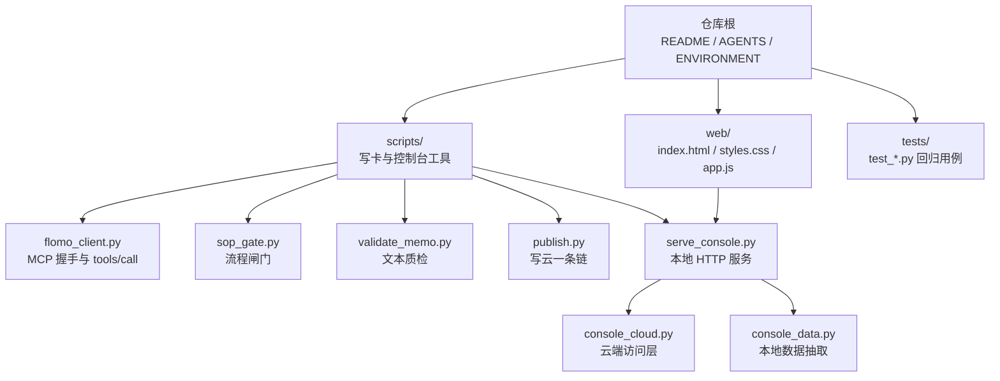
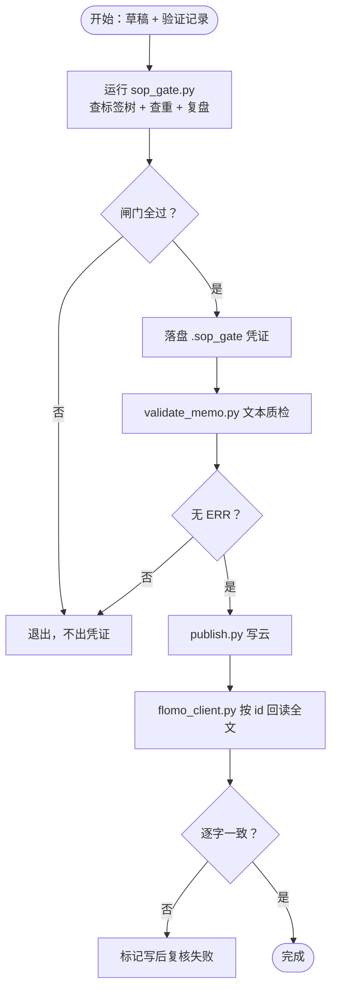
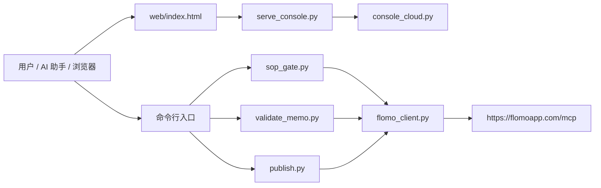
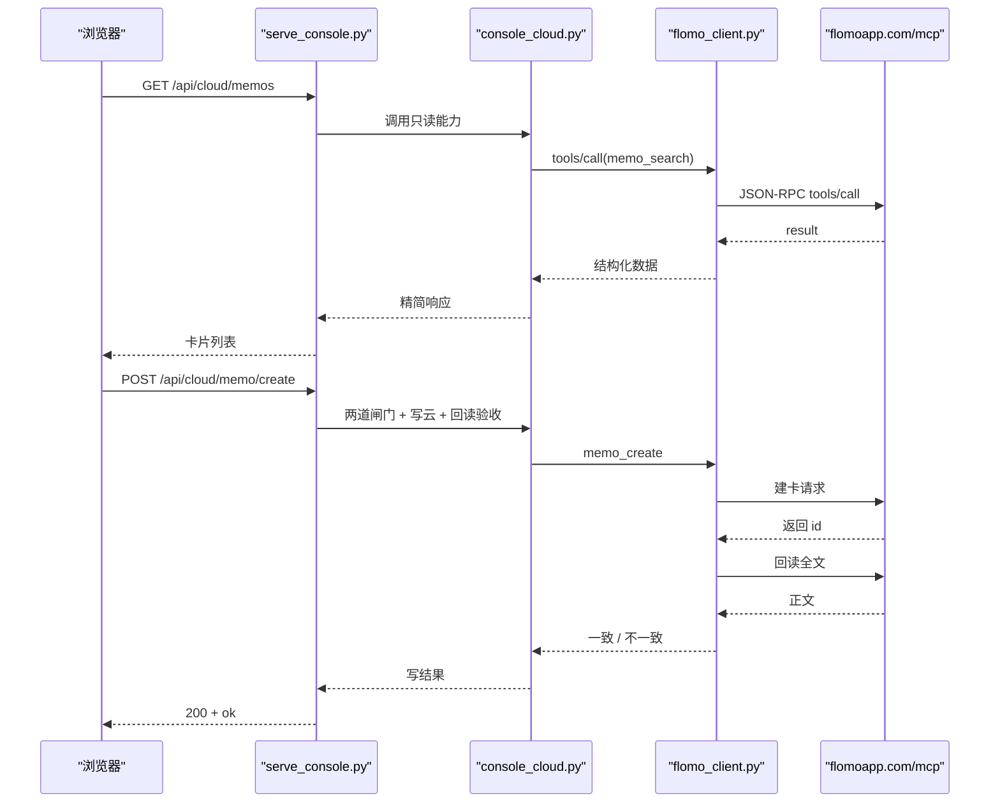
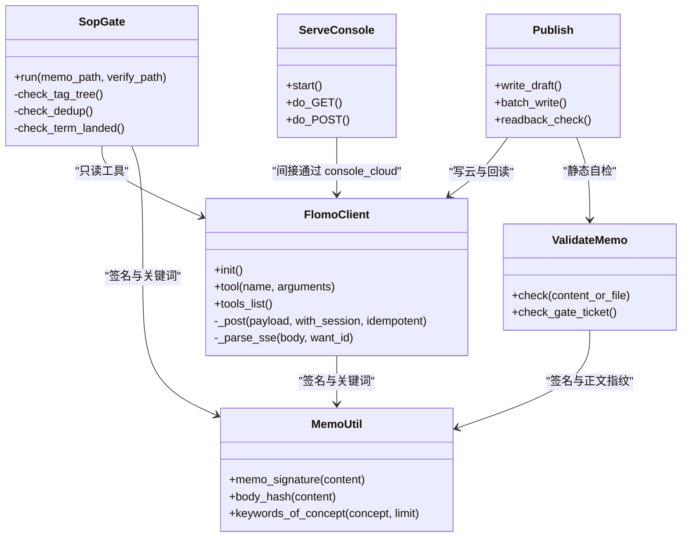

# 项目概览

<cite>
**本文引用的文件**   
- [README.md](file://README.md)
- [AGENTS.md](file://AGENTS.md)
- [ENVIRONMENT.md](file://ENVIRONMENT.md)
- [scripts/flomo_client.py](file://scripts/flomo_client.py)
- [scripts/sop_gate.py](file://scripts/sop_gate.py)
- [scripts/validate_memo.py](file://scripts/validate_memo.py)
- [scripts/publish.py](file://scripts/publish.py)
- [scripts/memo_util.py](file://scripts/memo_util.py)
- [scripts/serve_console.py](file://scripts/serve_console.py)
- [web/index.html](file://web/index.html)
</cite>

## 目录
1. [引言](#引言)
2. [项目结构](#项目结构)
3. [核心概念](#核心概念)
4. [快速开始：环境准备到首次写卡](#快速开始环境准备到首次写卡)
5. [系统架构与分层](#系统架构与分层)
6. [关键组件分析](#关键组件分析)
7. [依赖关系图](#依赖关系图)
8. [性能与安全特性](#性能与安全特性)
9. [常见问题排查](#常见问题排查)
10. [结论](#结论)

## 引言
flomo-note 是一个 AI 辅助的云端卡片笔记技能，目标是把网页、文章和想法整理成一条条 flomo memo，直接写入用户的 flomo 云端账号。它不依赖第三方面板，而是通过 MCP 协议直连 `https://flomoapp.com/mcp`；同时提供本地 HTTP 控制台，用于搜索、编辑、标签管理与参考文档浏览。

项目的核心设计是三条机械防线：**流程闸门 + 文本质检 + 写后回读**。任何一张卡要进入云端，都必须先通过“必须留痕”的流程闸门，再通过格式、标签、来源、载体等静态检查，最后由客户端在成功写入后按 id 回读全文逐字比对，确认云端存的就是这张卡。

面向初学者，可以把 flomo-note 理解为一个“带质检流水线的小工厂”：你输入网页或想法，流水线把它标准化为一张云卡片；工厂里每个环节都有机器检查，而不是全靠人自觉。对经验丰富的开发者，仓库采用“命令层 → 工具层 → 通道层 → 云端 MCP”的分层结构，把命令行参数、卡片语义、云端握手与 SSE 解析拆到不同模块，降低耦合。

## 项目结构
仓库采用“顶层规则 + scripts 工具 + tests 回归 + web 前端”的组织方式。顶级文件负责说明“这是什么、怎么跑、凭据在哪”，脚本负责执行写卡与控制台逻辑，前端只消费服务提供的 JSON，测试全部离线且不读 token。

**图表来源**
- [README.md:1-200](file://README.md#L1-L200)
- [AGENTS.md:1-58](file://AGENTS.md#L1-L58)
- [scripts/serve_console.py:1-80](file://scripts/serve_console.py#L1-L80)

**章节来源**
- [README.md:1-200](file://README.md#L1-L200)
- [AGENTS.md:1-58](file://AGENTS.md#L1-L58)

## 核心概念

### 卡片形态：一行标签段 + 概念名 + 正文
卡片不是自由段落，而是固定三段式结构：
1. **首行标签段**：以 `#` 开头，要求两级形式，例如 `#AI/RAG`，多个标签用空格分隔。
2. **第二行概念名**：简明概括卡片主题的名词或概念，不以 `#` 开头。
3. **空行后的正文**：正文首句直接写结论，不加“结论先行”之类引导语。

这个结构被 `memo_util.memo_signature` 统一提取为“标签行 + 概念名”，并作为幂等查重、闸门凭证键、写前校验的共同依据。也就是说，概念名不只是给人看的标题，也是程序判断“这是哪张卡”的关键字段。

### 云端不落盘
项目明确约定：卡片正文只存在于 flomo 云端账号，本地不以任何“本地文件”代存云端卡片。本地保留的是技能文档、环境备忘、脚本、控制台前端和 MCP 配置；中间产物如草稿、请求 JSON、验证记录也属于当轮工作区，由收尾清理。

这意味着：
- 你不能把 flomo 云端内容当成普通 Git 仓库来备份。
- 本地 `_tmp/`、`.sop_gate/` 等目录是过程文件，不是最终知识库。
- 如果云端账号丢失，需要重新从来源抓取、走 SOP 重建，不能靠“翻本地历史”。

### 凭证化 SOP
SOP 九步中的“验证、查重、复盘”原来是靠执行者自觉。现在由 `sop_gate.py` 把这些步骤变成“必须留痕”的闸门：脚本自己调 flomo 只读工具查标签树、查重候选、复盘相关笔记，并把结果写成 `.sop_gate/<签名>.json` 凭证。`validate_memo.py` 在写云前检查凭证是否存在、是否覆盖本卡签名、是否在有效期内。

这样，“漏做”不再是口头承诺，而是物理上无法跳过：没跑闸门就没有凭证，写云流程会判失败。

### 凭证化 SOP 的执行流程

**图表来源**
- [scripts/sop_gate.py:1-120](file://scripts/sop_gate.py#L1-L120)
- [scripts/validate_memo.py:1-60](file://scripts/validate_memo.py#L1-L60)
- [scripts/publish.py:1-60](file://scripts/publish.py#L1-L60)
- [scripts/flomo_client.py:1-60](file://scripts/flomo_client.py#L1-L60)

## 快速开始：环境准备到首次写卡

### 环境准备
1. 克隆仓库并进入目录。
2. 准备 Python ≥ 3.10。仓库当前在 Windows 托管版上实测到更高版本，但最低要求仍按 README 标注的 3.10。
3. 创建项目根目录下的 `.mcp.json`，填入 flomo MCP 的 Bearer token。token 解析优先级为：
   - `.mcp.json` 中的 `mcpServers.flomo.headers.Authorization`（首选）。
   - 环境变量 `FLOMO_TOKEN`（仅当 `.mcp.json` 不存在时后备）。
4. 两处都没有 token 时，所有脚本都会以非 0 退出并提示未找到 flomo token。

### 首次写卡
最简路径是让 AI 助手按 9 步 SOP 执行；如果你只想理解主线，可以把它压缩为以下几步：

1. **抓取**：取网页正文，必要时补全文。
2. **验证**：专业术语、机构、产品、模型简称必须现查，并把搜索结果落到验证记录中。
3. **提炼**：去掉营销话术，保留事实、数据与因果链。
4. **定标签**：现采标签树，使用严格两级 `#顶层/二级` 标签。
5. **查重**：关键词逐次查询 + 同主标签邻居比对，两路并行。
6. **写作**：按“标签段 + 概念名 + 正文”的卡片格式写出草稿。
7. **自检并写云**：一次调用 `publish.py`，内部依次跑闸门、质检、建卡或更新、写后回读。
8. **复盘**：对既有卡可定向复查近邻，并用 `verify_card.py --show-body` 打印全文自查。
9. **更新云端**：改既有卡同样走这条链，加 `--update-id <id>`；标签改名走 `tag_rename`。

如果你更习惯图形界面，也可以启动本地控制台，在“云端笔记”视图中新建卡片，页面会调用服务端的闸门与写云接口。

**章节来源**
- [README.md:1-120](file://README.md#L1-L120)
- [ENVIRONMENT.md:1-80](file://ENVIRONMENT.md#L1-L80)

## 系统架构与分层

### 分层总览
flomo-note 的控制面分为四层：

| 层次 | 主要职责 | 关键文件 |
|---|---|---|
| 用户交互层 | 命令行、浏览器控制台 | `scripts/serve_console.py`、`web/index.html` |
| 流程编排层 | 闸门、质检、写云、批次处理 | `sop_gate.py`、`validate_memo.py`、`publish.py` |
| 卡片语义层 | 签名、指纹、概念关键词、切片限定 | `memo_util.py` |
| 云端通道层 | MCP 握手、tools/call、SSE 解析、写后回读 | `flomo_client.py` |

**图表来源**
- [scripts/flomo_client.py:1-120](file://scripts/flomo_client.py#L1-L120)
- [scripts/sop_gate.py:1-60](file://scripts/sop_gate.py#L1-L60)
- [scripts/validate_memo.py:1-60](file://scripts/validate_memo.py#L1-L60)
- [scripts/publish.py:1-60](file://scripts/publish.py#L1-L60)
- [scripts/serve_console.py:1-80](file://scripts/serve_console.py#L1-L80)
- [web/index.html:1-80](file://web/index.html#L1-L80)

### 控制台交互流程
控制台不是简单“复制粘贴 MCP 工具”，而是把云端能力接出来，并在写路径上加闸门和回读验收。

**图表来源**
- [scripts/serve_console.py:1-120](file://scripts/serve_console.py#L1-L120)
- [scripts/flomo_client.py:1-120](file://scripts/flomo_client.py#L1-L120)

## 关键组件分析

### MCP 客户端：`flomo_client.py`
这是连接 flomo 云端 MCP 的唯一封装，承担以下职责：
- 加载 token：优先读 `.mcp.json`，再退到 `FLOMO_TOKEN`。
- 建立会话：发送 `initialize`，保存 `Mcp-Session-Id`。
- 调用工具：构造 JSON-RPC `tools/call`，并通过 `net_util` 统一出网。
- 解析 SSE：按请求 id 匹配 result，遇到 error 抛错。
- 写后回读：对 `memo_create`、`memo_update` 等写操作自动按 id 回读全文。

关键点包括：
- 写工具集合 `WRITE_TOOLS` 标记为非幂等，通道失败时不允许换出口重发，避免重复建卡。
- `FlomoError` 是 `RuntimeError` 子类，不会穿透 HTTP 服务的异常处理；`SystemExit` 被明确禁止。
- 令牌缺失、握手失败、HTTP 错误、JSON-RPC 协议错误都归一为 `FlomoError`。
- 读取工具可因网络问题换出口重试，写工具则遵循“可能已发出就不重发”的原则。

**章节来源**
- [scripts/flomo_client.py:1-200](file://scripts/flomo_client.py#L1-L200)

### 流程闸门：`sop_gate.py`
`sop_gate.py` 的核心价值是把“靠自觉的检查”变成“必须留痕的凭证”。它负责：
- 现采标签树，校验标签是否存在、是否为严格两级。
- 根据概念名派生关键词，触发查重查询。
- 校验验证记录中的术语是否真正落进正文。
- 把可机判项与只能人工判项分开记录。
- 输出有效期 6 小时的凭证文件。

其中“结论必须落进正文”是一条新增阻塞条件：光有搜索留痕不够，还必须证明搜到的信息确实写进了卡片。

**章节来源**
- [scripts/sop_gate.py:1-200](file://scripts/sop_gate.py#L1-L200)

### 文本质检：`validate_memo.py`
这是写云前的静态检查器，检查维度包括：
- 卡片结构：标签段、概念名、正文位置。
- 标签规则：必须是两级 `#顶层/二级`。
- 模板前缀：正文首句不能出现“结论先行”之类的指令词。
- 不受支持的 Markdown/HTML：flomo 只渲染加粗、高亮、下划线、有序和无序列表。
- 字数上限：单卡正文含标签段不超过 20000 字符。
- 来源与邮箱检测：URL 必须真实可核，裸邮箱会被云端自动链接化。
- 闸门凭证校验：可选降级模式需凭证显式授权。

它还定义了概念名定位函数，兼容本地草稿第 2 行与云端回读第 3 行的差异，避免同一张卡在“来源检测”和“切片限定检测”中拿到不同概念名。

**章节来源**
- [scripts/validate_memo.py:1-200](file://scripts/validate_memo.py#L1-L200)

### 写云编排：`publish.py`
`publish.py` 把闸门、质检、建卡/更新、写后复核串成一条命令。它强调三个纪律：
1. 闸门不过，一个字节不发云端。
2. 质检存在 ERR，不发。
3. `memo_create` 只发一次，失败即停，绝不重发。

对于更新既有卡，它会先回读目标卡，比对概念名；概念名不符就阻塞，除非显式允许改名。同时它生成“改前快照”，写后对比草稿与云端原文，列出删除与新增行，帮助用户识别无意删改。

批量模式支持“预检全过才写”：先把 N 张卡全部跑过闸门、质检和覆盖对象身份检查，任何一张不过则一张都不写。

**章节来源**
- [scripts/publish.py:1-200](file://scripts/publish.py#L1-L200)

### 卡片语义库：`memo_util.py`
这是整个仓库影响面最大的公共库之一，提供：
- `memo_signature`：从正文提取标签行和概念名。
- `signature_key`：给签名生成稳定短键。
- `body_hash`：正文整体指纹，防止“先跑闸门、后改正文”。
- `keywords_of_concept`：从概念名派生检索关键词。
- 概念名切片限定识别：年份、季度、相对时间、版本、阶段、地域语种、谓语动作等。

切片限定判据的目标是防止概念名标识“某个切片”而不是“对象本身”，例如“2023-2024 年的 RAG 落地”应拆成对象级概念，而不是把时间切片混进概念名。

**章节来源**
- [scripts/memo_util.py:1-200](file://scripts/memo_util.py#L1-L200)

### 控制台服务：`serve_console.py`
`serve_console.py` 是一个零第三方依赖的本地 HTTP 服务，默认监听 `127.0.0.1:8787`。它暴露四类视图：
- 云端笔记：搜索、今日回顾、全文抽屉、新建与编辑。
- 标签：实时标签树、标签名搜索、标签重命名。
- 参考：记忆文档、用户画像、格式规范、标签规范。
- 能力：云端 MCP 工具清单与参数规格。

安全方面，它强制来源校验：
- Host 宿主名必须在白名单内，拦截 DNS 重绑定。
- 带 Origin 时必须同源，拦截浏览器跨站写。
- 非回环绑定需要 `--allow-lan` 显式解锁。
- 端口占用会直接报错，避免新旧实例同时接客。

**章节来源**
- [scripts/serve_console.py:1-200](file://scripts/serve_console.py#L1-L200)

### 前端：`web/index.html`
前端是纯静态资源，通过导航按钮切换“云端笔记、标签、参考、能力”四个视图。编辑器包含标签段、概念名、正文输入框，以及“校验、跑闸门、写入”三个动作按钮。页脚文案明确表达读写策略：“读：随时现采；写：过闸门 + 回读验收”。

**章节来源**
- [web/index.html:1-150](file://web/index.html#L1-L150)

## 依赖关系图

**图表来源**
- [scripts/flomo_client.py:1-200](file://scripts/flomo_client.py#L1-L200)
- [scripts/sop_gate.py:1-200](file://scripts/sop_gate.py#L1-L200)
- [scripts/validate_memo.py:1-200](file://scripts/validate_memo.py#L1-L200)
- [scripts/publish.py:1-200](file://scripts/publish.py#L1-L200)
- [scripts/memo_util.py:1-200](file://scripts/memo_util.py#L1-L200)
- [scripts/serve_console.py:1-200](file://scripts/serve_console.py#L1-L200)

## 性能与安全特性

### 性能特点
- 控制台后端无第三方依赖，基于 Python 标准库 `http.server`，适合本地开发和本地调试。
- MCP 客户端复用会话，避免每次请求都重新握手。
- 列表型工具支持 `--brief` 压缩，减少大体积 JSON 传输。
- 批量写云先预检再写入，避免部分成功导致状态分裂。
- 回读全文只在写成功后进行，读工具按需拉取。

### 安全特点
- token 不入库，优先从 `.mcp.json` 读取，环境变量仅作后备。
- 本地控制台默认绑定回环地址，并校验 Host 与 Origin。
- 写路径不走通用工具执行入口，必须经过 `create_memo` / `update_memo` / `rename_tag` 等白名单。
- 写后必须回读全文逐字比对，不一致或非 0 退出。
- 非幂等写操作在网络不可达时区分“请求确定未发出”和“可能已发出”，后者禁止重发。

**章节来源**
- [scripts/serve_console.py:1-200](file://scripts/serve_console.py#L1-L200)
- [scripts/flomo_client.py:1-200](file://scripts/flomo_client.py#L1-L200)
- [ENVIRONMENT.md:80-160](file://ENVIRONMENT.md#L80-L160)

## 常见问题排查

| 现象 | 可能原因 | 处理建议 |
|---|---|---|
| 所有脚本报“未找到 flomo token” | `.mcp.json` 缺失或结构不对，且没有 `FLOMO_TOKEN` | 检查 token 来源优先级；确保 `mcpServers.flomo.headers.Authorization` 正确 |
| 控制台端口占用 | 上一轮进程仍在监听 8787 | 先结束旧进程，再重启服务；不要同时起两个实例 |
| 本机代理导致“服务起不来” | `HTTP_PROXY`/`HTTPS_PROXY` 指向本机代理，接管了 `127.0.0.1` 请求 | 清代理变量、用 `curl --noproxy '*'` 或脚本直连方式测试 |
| 写云成功但回读失败 | 云端正文被截断、内容不一致、或 id 对应另一张卡 | 查看写后复核输出，不要盲目重发写请求 |
| 控制台显示“请求不是本站地址” | Host 或 Origin 不符合来源校验 | 使用 `http://127.0.0.1:<端口>/` 打开，不要用攻击者域名重绑 |
| 标签写错形成分裂簇 | 两级标签只差空白、全半角斜杠或大小写 | 按 `tagcheck.py` 的标签树结果修正，不要手写近似名 |
| 正文被截断 | 云端检索回包被截断，不是完整正文 | 用 `memo_batch_get` 或 `verify_card.py --show-body` 获取完整正文 |

**章节来源**
- [scripts/flomo_client.py:1-200](file://scripts/flomo_client.py#L1-L200)
- [scripts/serve_console.py:1-200](file://scripts/serve_console.py#L1-L200)
- [ENVIRONMENT.md:1-160](file://ENVIRONMENT.md#L1-L160)

## 结论
flomo-note 的定位很清晰：它是一个围绕 flomo 云端 memo 的极简卡片笔记技能。它不追求本地文件系统里的“第二份笔记”，而是把本地当作 MCP 客户端、流程编排器和控制台前端；真正的知识资产留在云端账号中。

对初学者，最重要的是记住三件事：
1. 卡片格式是“一行标签段 + 概念名 + 正文”，不是自由长文。
2. 写卡要走流程闸门、文本质检和写后回读，不要手动拼接 API。
3. 凭证是“做了检查”的证据，不是装饰。

对开发者，最重要的架构约束是：
- 命令行契约下沉到叶子层，云端通道只负责 MCP 通信。
- 卡片语义集中在 `memo_util.py`，多处共用。
- 写操作必须幂等可审计，写后必须回读。
- 控制台只提供白名单内的能力，写路径不直通 MCP。

这套设计让 flomo-note 更像一条“可复测的流水线”，而不是散落的脚本集合。