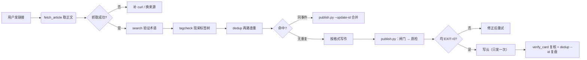

# flomo-note

> 极简云端卡片笔记技能 — 把网页、文章、想法整理成一条条 flomo memo，直接写入云端账号。

[](LICENSE)
[](https://www.python.org/downloads/)
[](https://github.com/shushuzn/flomo-note/actions/workflows/ci.yml)

---

## 项目是什么

flomo-note 是一个 AI 辅助的云端笔记技能，用于将看到的好内容高效沉淀为 **flomo 云端卡片**。

- **卡片形态** = 一行标签段 + 概念名称行 + 正文，一事一卡、标签聚合
- **本地不落盘**：笔记只存在于 flomo 云端账号，本地仅存放技能文档与工具脚本
- **流程机械化**：抓取 → 验证 → 提炼 → 定标签 → 查重 → 写作 → 自检并写云 → 复盘；其中验证/核对/查重/复盘由流程闸门脚本强制留痕，漏做无法通过自检

---

## 规则在哪（本文件不复述）

规则只有三份，分工明确：

| 文件 | 管什么 |
|------|--------|
| `AGENTS.md` | 项目总则：顶层目标与全局不可变约定（8 条） |
| `SKILL.md` | 执行细则**唯一源**：卡片格式（H14–H16）、标签（H17/H18）、概念名判据（H6b/H6d）与「材料不是概念时提取概念」（H6c）、流程与硬限 H1–H28 |
| `ENVIRONMENT.md` | 环境事实：平台、路径、token 来源、代理与推送通道、取件通道 |

本文件只讲「是什么、怎么跑、控制台怎么用」。**判据与硬限一律以 `SKILL.md` 编号为准**，
不要在这里补一份摘要——历史上这份摘要就分叉过：README 的旧版核心约定 6 条 vs `AGENTS.md` 8 条，
卡片格式段也缺概念名判据，按它写卡会被质检拦。

---

## 快速开始

### 环境准备

```bash
# 克隆仓库
git clone https://github.com/shushuzn/flomo-note.git
cd flomo-note

# 配置 MCP token（本地文件，已 gitignore 不入库）
# 结构见 scripts/flomo_client.py 的 load_token()：mcpServers.flomo.headers.Authorization
cat > .mcp.json <<'JSON'
{"mcpServers":{"flomo":{"url":"https://flomoapp.com/mcp",
  "headers":{"Authorization":"Bearer fmcp_xxxxx"}}}}
JSON
```

> token 解析优先级：`.mcp.json` 优先，环境变量 `FLOMO_TOKEN` 仅作后备。**两处都没有时，所有脚本命令都会以非 0 退出并打印「未找到 flomo token」**——看到该提示即说明下面所有示例都还没到执行阶段。

### 执行写卡

发送链接给 AI 助手，助手按 9 步 SOP 执行：

1. **抓取** — `fetch_article.py` 取页并抽正文（webfetch 为主，SPA 补 curl）；抓回即读回全文
2. **验证** — 专业术语/机构/产品/模型简称必须 `search` 现查（阻塞；结果留痕 `verify.json`）
3. **提炼** — 滤营销话术，留事实/数据/因果链
4. **定标签** — `tagcheck.py` 现采标签树，核存在性与严格两级 `#顶层/二级`（阻塞）
5. **查重** — `dedup.py` 关键词逐次现查 + 同主标签逐条比对，两路并查（阻塞）
6. **写作** — 按卡片格式写作
7. **自检并写云** — `publish.py --draft <草稿> --verify <留痕>` 一条链跑完闸门 → 质检 → 写云（只发一次）→ 写后复核；改既有卡加 `--update-id`（阻塞）
8. **复盘** — `dedup.py --id <本卡 id>` 定向复查近邻，`verify_card.py --show-body` 打全文做人读自查
9. **更新云端** — 改既有卡同样走这条链的 `--update-id <id>`（写前确认概念名、写后给覆盖差异）；标签改名用 `tag_rename`

---

## 项目结构

```
flomo-note/
├── SKILL.md / AGENTS.md / ENVIRONMENT.md   # 细则 / 总则 / 环境事实（三份各有唯一职责）
├── scripts/     # 工具：写卡流程、文档自检、控制台后端 —— 逐个职责见下表
├── tests/       # 回归用例 test_*.py，与 scripts/ 一一配套，全离线
├── web/         # 项目控制台前端静态资源（index.html / styles.css / app.js）
├── .github/workflows/ci.yml   # 每次推送/PR 跑同一条 run_tests.sh（不配 secrets）
├── .gitignore                 # 忽略凭据、本机私有导出与现采缓存
└── README.md
```

> **树只说位置，职责只在下表**。此前树里给每个文件挂注释、表格里再写一遍职责，同一件事有两处描述——改一处忘另一处就会出现「树里说 A、表里说 B」，而没有任何检查会发现。现在文件清单的唯一事实源是下表。

> **工具在 `scripts/`，用例在 `tests/`**：判据是「它是不是交付物」——用例不进任何写卡流程，只用来验证流程脚本。混在一层里会让 `scripts/` 看不出哪些是入口，改脚本时也容易误以为用例也能直接跑进流程。

### 文档（唯一事实源）

| 文件 | 职责 |
|------|------|
| `SKILL.md` | 执行细则：卡片格式、标签规则、SOP 流程、硬限清单（H1–Hn）。**唯一细则源**，其他文档只引编号 |
| `AGENTS.md` | 项目总则：顶层目标与全局约定，不复制 SKILL 细节 |
| `ENVIRONMENT.md` | 环境事实：平台、路径、token 来源、代理与推送通道 |

### 写卡流程（按执行顺序）

| 文件 | 职责 |
|------|------|
| `memo_util.py` | 卡片签名 / 正文指纹 / 检索关键词 / 标签拆分的唯一实现（多处共用，改动影响面最大） |
| `flomo_client.py` | flomo MCP 调用唯一入口：握手、协议发现、写后回读验收；`cli_entry()` 是各命令行脚本统一的失败出口（`FlomoError` → 一行说明 + 退出码）；`int_arg`/`float_arg` 是命令行数字参数的唯一解析（越界与非数字抛 `UsageError`） |
| `fetch_article.py` | 取页并抽正文落 `_tmp/`：站内专用选择器优先、通用兜底，附带标题与字数 |
| `tagcheck.py` | 标签树现采 + 存在性 / 严格两级 / 同顶层兄弟二级 / 只差空白·全半角·大小写的近义名（判据同写前闸门，树被截断即非 0 退出） |
| `dedup.py` | 查重执行器：每个关键词单独调一次、id 去重后分批取全文；`--id` 走复盘路、`--ids` 点名读全文 |
| `sop_gate.py` | 流程闸门：代跑标签核对 / 查重两路 / 复盘三路，校验验证留痕，全过后落带正文指纹的凭证 |
| `validate_memo.py` | 文本质检（格式、标签、来源、载体、字数）+ 闸门凭证校验 |
| `publish.py` | 写云一条链：闸门 → 质检 → 建卡（只发一次）/ 覆盖（写前比对概念名 + 落改前快照）→ 机器项复核 → 覆盖差异 |
| `verify_card.py` | 写云后回读全文，做 H11 里可机械判的那部分（形态、占位符、净字符数），并列出脚本判不了的两项；`--draft <草稿>` 按写路径同口径逐字比对，`--show-body` 打印全文供人读 |
| `cleanup.py` | 收尾强制清理残留（文件与目录），跨进程共用一份基准时刻 |

### 控制台脚本

| 文件 | 职责 |
|------|------|
| `serve_console.py` + `web/` | 本地服务 + Claude 风格前端（云端笔记 / 标签 / 参考 / 能力）；请求须带本机 `Host`、带 `Origin` 时须同站（防 DNS 重绑定与跨站写） |
| `console_cloud.py` | 云端访问层：读 / 写两套白名单、全部已接能力、通用只读执行、字段精简、写路径的两道闸门与回读验收 |
| `console_data.py` | 读仓库：解析技能文档与脚本清单（工具在 `scripts/`、用例在 `tests/`，配套关系跨目录核），产出统计字段 |

### 文档与治理

| 文件 | 职责 |
|------|------|
| `check_skill_docs.py` | 内容纪律自检（日期 / 叙事）+ 四项跨文件结构检查（README 清单、用例命名、交叉引用、命令行选项） |
| `run_tests.sh` | 跑 `tests/` 下全部用例与上述自检；CI 与本地共用这一条命令 |
| `run_audit.sh` / `audit_skill.sh` | 技能文档结构审计（`run_audit.sh` 包好环境，勿手搓后者） |
| `scan_qualified_concepts.py` / `scan_concept_duplication.py` | 存量取证：统计概念名里的切片限定、找「同一对象被切成多张卡」的实例（只读，不写云） |
| `push_skill.sh` | 文档改动强制推送（提交 + 推送 + 远端 HEAD 回读核对） |

### 取件与通道

| 文件 | 职责 |
|------|------|
| `git_tunnel.py` | GitHub 本地透传通道（候选 IP / 选路 / 回落） |
| `sni_fetch.py` | SNI 被阻断时的取件通道 |
| `extract_arxiv_html.py` | arXiv HTML 正文抽取（公式按 MathML 还原） |

### 回归用例

| 文件 | 职责 |
|------|------|
| `tests/test_*.py` | 与 `scripts/` 下脚本一一配套，全离线。**必须叫 `test_*.py`**——`run_tests.sh` 按这个 glob 收集，名字不符就不会被跑，且不报任何错 |

> 回归用例全部离线、不读 token（实测：移走 `.mcp.json` 后仍全过），因此 CI 不需要任何 secret；一旦有人给用例加上真实凭据依赖，流水线会直接红，而不是被 secret 掩盖。**有多少套不在这里写死**——`tests/test_*.py` 即清单，数量以 `bash scripts/run_tests.sh` 的输出为准。

---

## 项目控制台

控制台把云端 MCP 的**能力接出来**——不只列出来，而是**在页面上直接可用**。分四个视图：

| 视图 | 内容 |
|------|------|
| **云端笔记** | 搜索卡片：关键词 · 标签 · 起止日期 · 来源 · 是否含标签 · 条数；今日回顾；点开读全文（抽屉内带**相关笔记**，可勾选「不含同标签」）；多选取全文；**新建与编辑**（过闸门后写云，写完回读验收） |
| **标签** | 云端实时标签树（可按前缀 / 深度 / 条数收窄） + 标签名搜索 + **标签重命名**（二次确认） |
| **参考** | 云端四份文本：记忆文档、用户画像、笔记格式规范、标签使用规范 |
| **能力** | **工具台**：云端 `tools/list` 现取全部工具，按云端声明的参数规格当场生成表单，**读工具填参数点「执行」就地出结果**（卡片列表可点开读全文 / 标签串 / 文本 / 原始 JSON 按形态渲染）；写工具不在此直通，只给「去专属入口」的指路按钮 |

```bash
python scripts/serve_console.py            # 启动，默认 http://127.0.0.1:8787
python scripts/serve_console.py --open     # 启动后自动开浏览器
python scripts/serve_console.py --port 9000
```

> 服务在启动那一刻加载脚本模块，**改了脚本要重启进程才生效**。端口已被占用时启动会
> 直接报错退出：两个实例同时监听同一端口会让页面内容时新时旧，极难排查。

页面按需拉 `/api/*`：

| 接口 | 内容 |
|------|------|
| `/api/cloud/memos` | 卡片列表：`keywords` / `tag` / `start_date` / `end_date` / `source` / `has_tag` / `limit`（无参即最近） |
| `/api/cloud/memo` | 按 `id` 取单卡全文（列表里的正文可能被云端截断） |
| `/api/cloud/memos/batch` | 按 `ids` 批量取全文（逗号分隔，单次上限 10 条） |
| `/api/cloud/review` | 今日回顾 |
| `/api/cloud/related` | 相关笔记：`id`、`limit`、`no_same_tag` |
| `/api/cloud/tagtree` | 云端实时标签树：`prefix` / `depth` / `limit` |
| `/api/cloud/tags` | 按关键词搜标签名 |
| `/api/cloud/reference` | 记忆文档 / 用户画像 / 格式规范 / 标签规范四份文本 |
| `/api/cloud/tools` | 云端工具清单 + 接入状态 + 参数规格（供界面生成表单） |
| `/api/overview` | 统计字段与云端可用性 |

写与「带参数执行」走 `POST`：

| 接口 | 内容 |
|------|------|
| `POST /api/cloud/tool` | **通用只读执行**：`{name, arguments}` → 跑任一读工具并回结果（形态已归类）。写工具在此被显式拒绝 |
| `POST /api/cloud/validate` | 格式自检（委托 `validate_memo`），只报不改 |
| `POST /api/cloud/gate` | 现跑流程闸门 `sop_gate.py` 出凭证 |
| `POST /api/cloud/memo/create` | 新建卡片：两道闸门 → 写云 → 回读验收 |
| `POST /api/cloud/memo/update` | 更新卡片：先回读原文 → 两道闸门 → 写云 → 回读验收 |
| `POST /api/cloud/tag/rename` | 批量重命名标签（`max_memos` 显式声明规模）。**HTTP 200 只表示请求被处理**：写没写成看响应里的 `ok` 与 `status`（`done` / `partial` / `needs_scale` / `no_match` / `unknown`），只有 `done` 是匹配到的都改完了 |

`POST` 上只有两类用途：**改动云端的写接口**，与 **`/api/cloud/tool` 这个带参数跑读工具的入口**。
没有「执行命令」「跑脚本」的位置。

`tag` 参数须给**完整标签路径**（如 `AI/RAG`）：云端不接受裸顶层名（传 `AI` 查不到）。
`memo_search` 单次返回受云端上限约束（上限值由接口给出），到顶时界面会提示改用关键词、
标签或日期继续筛。日期须为 `YYYY-MM-DD` 且真实存在——云端对不合法日期不报错，
只返回 0 条，界面因此在本地先拦一道，避免这种静默空结果。

云端访问全部收敛在 `console_cloud.py`，三条边界：

- **两套白名单**：读只放行 `READONLY_TOOLS`、写只放行 `WRITE_TOOLS`，两个集合**分别恰等于**
  各方法实际调用的工具（回归用例按源码扫描 + `write=True` 标记锁定，不留无人使用的权限空位）；
  读路径上写工具一律拒（不带 `write=True` 放不出写请求），白名单外的任何工具名一并拒；
- **不落盘**（H26）：卡片正文只在进程内存与 HTTP 响应之间传递，不写缓存、不写访问日志；
  唯一例外是流程闸门要求的当轮草稿（`memo_body*.txt`），由收尾清理按近轮窗口回收；
- **token 不出进程**：凭证只在建连时使用，响应里只有「可用 / 不可用」这一事实。

**写不是直通**：写卡须走格式闸门与流程闸门（见 `SKILL.md`），控制台把这两道闸门做成
**可操作的步骤**而不是绕开它——`POST /api/cloud/validate` 报待修项，`POST /api/cloud/gate`
现跑 `sop_gate.py` 出凭证，写入后一律按 id **回读全文验收**（H1 / H2 / H11），更新前还要
先回读原文（H22）。任一闸门不过即 ERR 阻断，**一个字节都不会发到云端**。回读取不到全文时
既不报成功也不报失败，标成「已下发、未验收」并说明「不要重发」——报失败会引来重发，
而重发就是多一张重复卡。写工具因此不走
能力页的通用执行入口，只在「云端笔记」（新建 / 编辑）与「标签」（重命名）两个过闸门的
专属入口发生。

标签树**只在云端、本地不留快照**：控制台不缓存标签树，每次现采云端，
避免「界面显示的标签与云端实际不一致」这类漂移。

---

## 卡片格式（骨架示意）

```markdown
#标签/二级
概念名称

直接写结论句，不带任何模板前缀。

要点：
- 要点一（依据）
- 要点二
```

结构只有三层：首行标签段 → 第二行概念名 → 空一行 → 正文。**判据不在本文件复述，一律查 `SKILL.md` 编号**：
格式骨架 H14、无来源无状态 H15、无载体信息 H16、标签严格两级 H17/H18、
概念名须为名词短语（不含切片、不含谓语）H6b/H6d、材料不是概念时如何提取 H6c。
写前自检 `scripts/validate_memo.py` 会把这些判据逐条机械拦截，EXIT=0 才许写云。

> 本节历史上复写过一份规则摘要，已与 SKILL 分叉（缺 H6b/H6c/H6d 的概念名判据，
> 按旧摘要写卡会产出不合规签名，而签名是幂等查重与闸门凭证的共同依据）。
> 因此这里只留骨架示意，判据回到唯一源。

---

## 脚本工具

**写卡不要照下面这些底层命令手拼**：闸门、质检、写云、复核由 `publish.py` 一条链串起来，
手拼会绕过写前确认与「只发一次」的约束（见 `SKILL.md` 第 7 步）。本段列的是底层通道与
单点检查的用法，供排查与特殊场景使用。

### flomo_client.py

```bash
# 列出标签树（须拿全量）
python scripts/flomo_client.py tag_tree --file tag_tree_args.json   # {"limit":2000}

# 搜索 memo（参数为 JSON，形如 {"keywords":"...","limit":10}）
python scripts/flomo_client.py memo_search --file search.json

# 新建 memo（参数 {"content":"...","format":"markdown"}）
python scripts/flomo_client.py memo_create --file create.json

# 更新 memo（覆盖式，参数 {"id":"...","content":"..."}）
python scripts/flomo_client.py memo_update --file update.json

# 读全文（参数 {"ids":["..."]}）
python scripts/flomo_client.py memo_batch_get --file read.json
```

> 参数一律以 JSON 传入（`--file <路径>` 或内联 JSON 字符串），避免中文引号被转全角。

### sop_gate.py（流程闸门）

```bash
# 术语卡：须先备好 verify.json（第 2 步网络搜索留痕）
python scripts/sop_gate.py --memo memo_body.txt --verify verify.json
# 更新场景可加 --anchor-id <本卡 id> 作推荐锚点
# 确认非术语卡：用 --skip-web 替代 --verify（凭证中留痕 web_skipped）
```

闸门会核对首行标签是否真的存在于云端标签树、代跑查重两路与复盘三路，全过后在 `.sop_gate/` 落一份带**正文指纹**的凭证。标签只差空白/全半角/大小写即视为写错（那会让同一簇分裂成两个），直接阻塞；确属新建二级的只提示不阻塞。退出码非 0 即未过，禁写云。

### validate_memo.py

```bash
# 从文件读取并自检
python scripts/validate_memo.py memo_body.txt

# 从命令行参数读取 / 从 JSON 读取 content
python scripts/validate_memo.py --content "#标签/细分\n\n概念名\n\n正文..."
python scripts/validate_memo.py --create create.json

# 特殊场景降级（闸门问题转 WARN，常规写卡禁用）
python scripts/validate_memo.py --no-gate memo_body.txt
```

**自检通过标准**：EXIT=0（0 ERR）。闸门凭证缺失 / 签名不符 / 正文指纹不符 / 已过期 / 验证未执行 / 标签核对缺失，任一情形判 ERR 阻断写云。

---

## 工作流示例



---

## 安全须知

- `.mcp.json` 含个人 Bearer token，已加入 `.gitignore`，**不会入库**
- 云端无删除 API（`memo_delete` 不存在），删除卡片只能在 flomo App 手动完成
- 清空卡片 = `memo_update(content=' ')`，属常规写云动作、免确认执行；会连带置空该卡标签，只挂在它上面的独占标签会从标签树消失——引用标签簇名前须现采 `tag_tree`

---

## License

MIT License — 见 [LICENSE](LICENSE) 文件。

此前徽章曾指向一个不存在的文件（属错误陈述），现 `LICENSE` 已补齐，徽章与文件一致。
